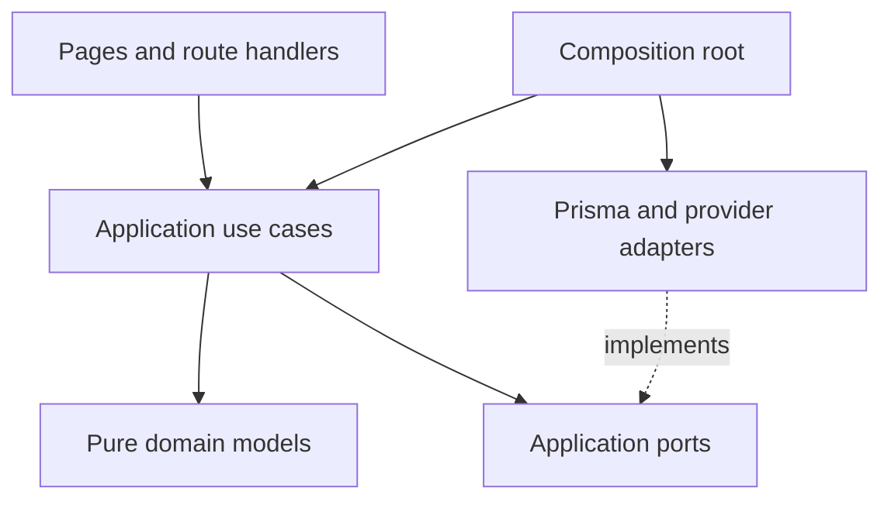
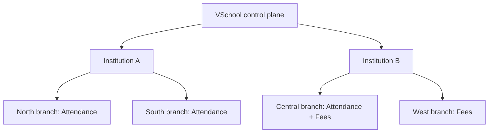

# VSchool Product and Architecture Bible

Version 4.4 · Configurable multi-institution platform baseline · 3 October 2026

Status: comprehensive product blueprint with Phase 1 implementation contracts. The repository implements the local foundation, shared UI primitives, public synthetic branding/configuration previews and pure entitlement reference rules. IAM-01 adds local operator bootstrap, real administrator authentication and current school authorization; editable tenant administration and school business modules remain planned until module evidence says otherwise. There is no active 24-hour run, no inherited completion claim and no production deployment.

## 1. Product purpose

VSchool helps a school maintain dependable daily operations, beginning with attendance. The first release connects administrator setup, teacher/student onboarding, class assignment, session attendance and administrative review. A school should be able to explain every attendance number and recover safely from failed requests.

The contractual tenant is an institution, represented by Organization. An institution operates multiple school branches, represented by School. Campus is an optional physical site within a branch, not another tenant or a synonym for branch. UI uses Institution and Branch; existing planned contracts retain organizationId/schoolId. Every branch has its own academic configuration, timezone, membership, operational data and enabled modules. Phase 1 must support multiple institutions and multiple branches with an explicit authorized context switcher. The attendance pilot may begin with one branch, but tenant isolation is never deferred. Tests include at least two institutions and two branches of one institution.

## 2. Delivery phases and boundaries

These are product releases. Preserve, scope, design, implement, validate and release are execution stages repeated within a release, not competing phase numbers.

| Phase | Outcome | Modules / boundaries | Exit condition |
|---|---|---|---|
| 1 — Attendance pilot | Admin and teacher can complete a school attendance day | Platform, tenancy/entitlements, branding/design system, access, academics, people, students, imports, attendance, reporting | Complete synthetic and school-approved pilot journeys; permissions, retries, corrections and restore verified |
| 2 — Family access and engagement | Verified guardians see only linked children; schools communicate reliably | Guardians, communication, parent portal, offline-assisted attendance and basic product analytics | Relationship revocation, reliable delivery and offline reconciliation pass |
| 3 — Student lifecycle and academic operations | Admissions through student lifecycle; richer academic planning | Admissions, student lifecycle, documents, promotions/transfers, recurring timetable, homework/lesson planning | Each selected module has its own design, tasks and acceptance gate |
| 4 — Assessment | Controlled marks, approvals and report publication | Assessments and results | Published results pin approved revisions; corrections preserve history |
| 5 — Finance | Accountable fees and payments | Fee plans, invoices, concessions, payments, allocations, receipts, refunds, reconciliation | Exact money, immutable financial history and duplicate callback handling verified |
| 6 — School operations | Operational modules selected by school need | Transport, HR, library, facilities, inventory and health | Scope and sensitive-data access defined separately for each module |
| 7 — AI assistance | Permission-aware explanations and assistance | Principal/teacher/parent AI capabilities | Grounded retrieval, evaluations, provenance and privacy gates before use |

The fresh baseline deliberately narrows the first release to admin/teacher operations. Parent access and notification delivery belong to Phase 2. Full admissions is explicitly Phase 3. The later roadmap is a commitment to design modules before implementing them, not a claim that their detailed schemas are complete. The earlier numbering is not used by this repository.

### Phase 1 user journey

1. Operator provisions an institution, branches, approved module entitlements and institution administrator. Authorized administrators select a branch, see its identity and manage only the resources their explicit grants allow.
2. Administrator configures timezone, school year, calendar, grades, sections and subjects.
3. Administrator creates teacher/student profiles or previews and confirms the student roster CSV.
4. Administrator enrolls students, creates course offerings and assigns eligible teachers for effective dates.
5. Administrator schedules class sessions; an assigned teacher opens today's roster, reviews statuses and submits.
6. Administrator sees pending versus submitted sessions, drills into records, corrects with a reason and exports a scoped report.

A subject can have several sessions on the same date. Attendance belongs to one class session, never a competing editable daily register. Day/month views are derived. No automatic presence or absence is recorded by opening a page.

### Explicit Phase 1 exclusions

Guardian accounts/views, automatic absence messages, billing, examination results, full admissions, native mobile apps, durable offline queues, timetable optimization, AI and custom role editing. Institution/branch administration, module configuration and branding are Phase 1 foundations, not optional later work. No disabled future-module navigation. Manual enrollment history, manual dated sessions and the internal outbox contract remain first-release requirements.

## 3. The four connected sources of truth

| Source | Authority | Update trigger |
|---|---|---|
| This Bible | Shared product scope, phase boundaries, invariants, architecture and global decisions | Approved scope/rule change or new module design |
| `docs/modules/<module>/DESIGN.md` | Module ADRs, entities, values, contracts, database structure, sequences, screens and tests | Before a task becomes ready; update when design changes |
| `docs/modules/<module>/TASKS.md` | Ordered task instructions, dependencies, acceptance and demo scripts | Task split, scope change or new planned work |
| `docs/modules/<module>/CURRENT_STATE.md` | Actual per-task implementation/review status, evidence and next step | Every implementation checkpoint, test run, demo and human review |

`docs/EXECUTION_INDEX.md` is a navigation/dependency index, not another status store. The root CURRENT_STATE.md is a pointer. `pnpm next-task` reads module state and dependencies; it does not run an agent or change state. Designs and task plans cannot prove implementation. Evidence records cannot silently change product rules.

### Evolution policy

Append a module summary and links to this Bible when designing a new module. Update an existing rule in place when it changes, add a dated changelog entry, and preserve the superseded ADR in its owning DESIGN.md. Do not merely append contradictory instructions. Stable task and ADR IDs are never reused. A schema/API breaking change includes migration, compatibility and recovery notes in the same change. Completed historical task evidence remains tied to its tested commit.

Before adding a module: name phase, actors, outcome and non-goals; define aggregates/values/invariants; design tables/keys/read joins/transactions; specify screen and API behavior including errors; write tests and demoable tasks; create CURRENT_STATE.md as NOT_STARTED. Only then implement.

## 4. Hexagonal architecture

Use a modular monolith in Next.js/TypeScript, with PostgreSQL as the authoritative transactional store and Prisma in infrastructure adapters. Root folders are `app`, `components`, `backend`, `shared`, `lib`, `prisma`, `test`, `scripts` and `docs`. Portable backend modules live under backend/modules; framework-free factories live under backend/composition; Next-specific environment/server adapters live under lib/server. Do not introduce microservices to satisfy module boundaries.

Domain code imports no framework, ORM, environment or network code. Application depends on domain and ports; adapters depend inward. Composition under `backend/composition` instantiates concrete adapters. Other modules use published `contracts` facades; they cannot write foreign tables. Explicit read models may join across owners with authorization and scoped joins. ORM objects never become browser DTOs.

| Module | Owns | First-release public contracts |
|---|---|---|
| platform | Runtime readiness; transaction/audit/outbox/receipt plumbing | Readiness, unit of work, clock/IDs, event envelopes |
| access | Organization, School, Campus; accounts, bindings and school membership | ResolveActor, RequireCapability, scope guard, provision/suspend/grant |
| academics | Years, immutable calendar revisions, grades/sections/subjects; teacher profile and offering assignment | Setup commands, dated class context, eligibility |
| people | Organization-local Person and school Employee | CreatePerson, CreateEmployee, authorized minimal identity facts |
| students | School Student; yearly Enrollment and placement history | Register, enroll, future-dated transfer, roster eligibility |
| imports | Versioned preview, job, rows and external-key mappings | PreviewRoster, ConfirmImport, ProcessImportRow, Progress |
| attendance | Session aggregate, frozen roster, records and corrections | Schedule/Open/Submit/Correct/Cancel, teacher history |
| reporting | Authorized read models and export execution | Completeness, session/student report, scoped CSV export |

Physical audit/outbox/receipt tables are shared technical storage. Every business command supplies its owner module, explicit event type, safe payload and audit policy. The platform module cannot interpret or mutate business state on its own.

## 5. Domain conventions and invariants

An entity has identity and lifecycle. A value object validates a concept and compares by value. An aggregate owns a consistency boundary. Rehydration raises no new event. Application services authorize and coordinate named transactions; domain methods enforce business transitions.

| Value | Contract |
|---|---|
| SchoolScope | Immutable organizationId and schoolId (institution and branch), derived from verified membership |
| IDs | UUID at system boundaries; branded TypeScript strings in the core |
| LocalDate / DateRange | Valid YYYY-MM-DD; school-local civil date; ranges `[from,to)` with from < to |
| Instant | UTC instant in storage/API; school zone only for presentation and session date derivation |
| Code / Name | Unicode NFC, outer trim; explicit length bounds; codes case-sensitive and scoped |
| ExpectedVersion | Positive integer; updates compare-and-swap under lock |
| IdempotencyKey | 16–100 safe ASCII characters; one unchanged intent; not a random key on every retry |
| AttendanceStatus | PRESENT, ABSENT, LATE, EXCUSED; not-marked is a draft/UI state |
| AttendanceRate | (PRESENT + LATE) / (PRESENT + LATE + ABSENT); EXCUSED excluded; zero denominator unavailable |

School-owned records carry organizationId and schoolId. Composite foreign keys prevent cross-school references even inside one organization. A nullable campus is school-wide scope, not authorization to another campus. No tenant identifier from the request is trusted as authority.

One Person per deliberately established identity in an organization; matching names/emails do not merge people. Student and Employee are school profiles. One Student per school/Person, with unique school admission number. One Enrollment per student/year, owning nonoverlapping placement intervals. Teacher profiles belong to Academics and reference eligible Employees.

School years and calendar revisions pin civil date policy. Session creation records date, start/end instants, offering and calendar revision. Before opening, roster is calculated from effective enrollment/placement. Opening freezes it. A placement change affecting an already open/submitted session conflicts in Phase 1; it cannot rewrite history. Backdated repair is deferred to an explicit later workflow.

## 6. Authorization and identity

Phase 1 fixed branch roles: SCHOOL_ADMIN and TEACHER. Separate institution role INSTITUTION_ADMIN controls explicit institution configuration and branch grants; platform operator is a restricted control-plane principal. Neither institution nor platform role automatically permits reading pupil/fee/health records. Cross-branch operational access requires explicit branch grants. See §14–16 for control-plane permissions and module enforcement. A user may hold both roles, but teaching still requires an eligible employee/teacher profile and dated assignment. Admin does not gain attendance.mark by default. Teacher does not gain correction or school report access.

| Capability | Admin | Teacher | Resource boundary |
|---|:---:|:---:|---|
| school.manage | yes | no | Selected school, campuses and academic year/calendar |
| user.manage | yes | no | School memberships, fixed grants, verified staff binding |
| class.manage | yes | no | Grades/sections/subjects/offerings/assignments/sessions |
| class.read | yes | yes | Admin school; teacher assigned classes |
| student.manage | yes | no | Profiles/enrollment/imports |
| student.read | yes | yes | Teacher receives only assigned roster's minimal fields |
| attendance.mark | no | yes | Current dated assignment for exact session |
| attendance.read_class | yes | yes | Admin school; current teacher assignment for requested session date |
| attendance.read_school | yes | no | School overview and audit |
| attendance.correct | yes | no | Submitted session; mandatory reason |
| attendance.export | yes | no | Bounded current-school report |
| self.read | yes | yes | Own safe account/session data |

Resolve actor on every protected query/action: authenticate, account status/token version, active school membership, capability, scoped resource and relationship. Never rely only on layouts or hidden buttons. Queries expose safe not-found for foreign resource IDs. Writes repeat authorization after acquiring guards. Suspended accounts/memberships and ended assignments take effect on the next protected request.

NextAuth credentials adapter is the selected authentication direction for the access module; it is not installed or implemented in the starter. IAM-01 pins and verifies its compatible dependency before implementation. Use bcryptjs with measured cost, rate limits, generic login errors, HTTP-only secure cookies in deployed environments, CSRF/origin validation and explicit session revocation. Staff enrollment is operator-assisted with verified identity and one-time activation; no public registration, default shared password or emailing passwords. The module defines this procedure and the production gate.

## 7. Database and transaction contract

Physical tables use the VS convention: `vs_<module>_<singular_entity>` with lowercase snake_case columns, explicitly mapped from PascalCase domain models and camelCase properties through Prisma. [Database design](DATABASE_DESIGN.md) defines names, schema ownership, constraints, joins and migration rules; module DESIGN.md files define column schemas and workflow-specific writes. This supersedes the earlier physical PascalCase convention. `_prisma_migrations` remains Prisma-owned and is exempt. UUID business IDs, PostgreSQL DATE for civil dates, TIMESTAMPTZ(3) for instants, integer version, JSONB only for versioned snapshots/envelopes; relational IDs remain constrained columns. Explicit indexes serve scoped foreign keys and queries. All module tables in DESIGN.md are proposed until migrated; currently only `vs_platform_setup_check` (logical SetupCheck) is migrated.

`SchoolCommand` transaction: account rows (sorted IDs) FOR UPDATE → Organization guard FOR SHARE → School guard FOR UPDATE → current actor authorization → receipt lookup → owned roots/references → domain decision → persistence + audit + outbox + receipt → commit. This conservative serialization is intentional at initial pilot scale; unrelated branches can execute concurrently under shared Organization guards. Account-wide disable/recovery takes account locks first, then all affected Organization guards and School guards in sorted ID order. No code may take School then account locks. Ordinary protected reads recheck current actor; snapshot read results are allowed, but mutations linearize under guards. Account creation uses its normalized-email unique constraint; conflict rolls back and requires explicit binding.

Cross-module changes enlist owner facades in the same transaction via abstract ports. DB transaction objects stay inside infrastructure. Transactions perform no external HTTP, email or AI requests. Timeouts become retryable errors; a bounded serialization/deadlock retry reuses the same command key. Audit or outbox failure rolls back business state.

Receipt key: organization, school, actor, command and idempotencyKey. Store SHA-256 of canonical versioned input and safe success response. Reauthorize before replay. Same key+hash returns committed result; different hash gives 409 IDEMPOTENCY_CONFLICT. Expected versions included in hash. A unique receipt index backs concurrency. Receipt retention for the pilot is the full pilot duration; later deletion requires an explicit retry-window ADR.

Audit records are append-only with actor, owner, resource, before/after safe diff, reason and requestId. Outbox delivery is at-least-once; future consumers deduplicate by event ID and reauthorize sensitive deliveries. Phase 1 emits durable internal facts but has no external notification dispatcher. An outbox pending count is not a failed attendance submission.

## 8. UI and transport contract

Use the VSchool shared design system: readable typography, visible institution/branch context, responsive forms/tables, keyboard focus, semantic labels and status text that does not rely on color. Tokens in globals.css and palettes in backend/modules/branding/domain/theme.ts are the shared baseline. Components under components/ui are mandatory defaults. School branding uses validated token overrides and safe public assets, never arbitrary CSS/HTML/scripts. See §17 and the design-system module for full contracts. Main attendance controls target 44px touch areas and screens fit 360px width without clipped actions.

Every screen specifies loading, empty, validation, conflict, permission, service-error and success states. Do not render secret fields into the client. Server rendering may call authorized queries directly; HTTP routes call the same use cases. Mutations use POST/PATCH, same-origin verification and runtime schema validation; never state-changing GET.

Command DTO envelope: `{payload, expectedVersion?}` plus `Idempotency-Key` header. Actor, timestamp and scope are server-derived. Responses: 200 replay/update, 201 creation, 400 malformed, 401 unauthenticated, 403 capability denial, 404 foreign/missing resource, 409 stale version/business conflict, 422 invalid fields, 429 rate/size limit where appropriate, 503 temporary dependency failure. Error body `{code,message,fieldErrors?,requestId,retryable}` never contains SQL, credentials or raw stack traces. Do not promise an automatic retry for validation/permission failures.

Read pagination defaults 50, maximum 100; bounded date filters and scoped opaque keyset cursors. Cursor encodes last sort key plus filter hash and rejects incompatible scope/filter reuse. Sensitive pages/responses use no-store. Cache keys include institution, branch, actor/permission version, module configuration version and query arguments; never cache a protected DTO under a raw entity ID alone. Public brand caching is a separate, sanitized and versioned contract. No organization-wide Person browsing.

## 9. CSV, network and future contracts

Phase 1 roster import is STUDENT_ROSTER_V1: UTF-8 comma CSV, optional BOM, strict headers and valid quoted fields. Identifiers remain strings. Required columns: external_student_id, student_first_name, admission_number, grade, section. Optional: student_last_name, roll_number. Job context supplies school, academicYear, campus, sourceNamespace and validFrom. Parent fields are deliberately deferred to Phase 2; unknown headers fail with a template explanation. This fresh template is not automatically compatible with other versions.

Pilot limit: 2 MiB, 1,000 data rows and 4 KiB per cell. Preview makes no domain writes and shows creates/no-change/conflicts/errors. Phase 1 is create-only plus exact no-change re-import; updates and transfers require explicit manual commands. Confirm binds immutable file hash, schema, target context, preview revision and referenced versions. One row transaction commits Person, Student, Enrollment/Placement, external mapping, row receipt, audit and outbox. Job is partially successful, never falsely all-or-nothing. Resumable process is explicitly invoked in bounded batches; no dependency on an always-running background worker. See imports DESIGN for claims, leases, matching and recovery.

Online-first: attendance draft lives in component memory only. Display Not submitted until the server acknowledges. On timeout, keep the same key and payload, offer Check status/retry; confirm current state before a new intent. On 409, fetch the authorized current roster/revision and require review. On 401/403 clear protected draft data. Refresh/navigation may lose a draft; warn before leaving. No localStorage/IndexedDB pupil cache or silent offline submission in Phase 1.

Phase 2 analytics: versioned allowlisted events `{eventId,type,occurredAt,schoolScope,anonymousSessionId,outcome,durationBucket}`; no pupil names, contacts, free-text notes or CSV content. Analytics failure never blocks a save; audit remains transactional. Decide consent/retention before deployment. Phase 7 AI: permission-filter retrieval first, source references and as-of time, deterministic calculations, no model access to unrestricted tables, no autonomous record changes, explicit model/provider/retention review and evaluation set before activation.

## 10. Testing and release evidence

Vitest provides unit tests and JUnit XML reports; this TypeScript project does not use Java JUnit runtime. Functional tests use real PostgreSQL 16 with actual migrations/constraints and isolated fixtures, never an HBase substitute. HBase is outside the selected stack. Playwright covers browser journeys on desktop and mobile, including denied access and failure recovery. Use adapters/fakes at external boundaries; do not mock away database invariants in functional tests.

Each task needs relevant unit, application/adapter, real-DB and E2E evidence; exact command, exit code, source commit (or documented dirty fingerprint), environment and limitations. `pnpm check` alone is not functional/E2E/build verification. Cross-school access, duplicate submits, stale versions, revoked roles, transactional rollback, nullable uniqueness, import replay and time boundaries are release gates where applicable. Tests follow business risks, not one test per getter.

After every verified task, start the server, check health/build identity, provide URL, synthetic account instructions privately where needed, and a 3–5 step manual script. Human status is PENDING until actual feedback for that build. A failed review prioritizes repair. The agent may continue independent ready tasks while feedback is pending if the user has authorized continuation; never continue after an explicit pause. An agent process or subscription is not an unattended scheduler.

Phase 1 release is blocked until real operator provisioning/recovery, TLS/secrets, rate controls, DB backup/restore rehearsal, school-approved data retention, authorization tests and the complete attendance journey are verified. Starter is local-development-only and contains no production deployment configuration.

## 11. Global architectural decisions

| ADR | Decision | Rationale / consequence / verification |
|---|---|---|
| CORE-001 | Modular monolith, hexagonal core | Fast integrated transactions; import-boundary check plus review |
| CORE-002 | PostgreSQL + Prisma adapters | Real constrained relational workflows; DB functional tests required |
| CORE-003 | Organization / school / campus | School security boundary; composite scoped FKs and negative tests |
| CORE-004 | Session attendance, derived summaries | Multiple class occurrences and pending are explicit; denominator tests |
| CORE-005 | Account → Organization → School guard protocol | Simple race control at pilot scale; concurrency tests; optimize only with measurements |
| CORE-006 | Transactional receipt/audit/outbox | Retry safety and accountability; rollback and replay tests |
| CORE-007 | Progressive specification | One Bible plus three module documents; doc integrity check; no invented completion |
| CORE-008 | New isolated local workspace/database | Existing project untouched; no automatic migration/reuse of old data |
| CORE-009 | Numbered product phases start at 1 | Admin/teacher pilot includes multi-institution/branch and configuration foundations; parents/notifications are Phase 2 |
| CORE-010 | pnpm 11.25.0 verified starter toolchain | Pins the package manager used to install/verify this archive; application framework/ORM versions retained; future upgrade is explicit |

These baseline decisions are accepted for this fresh starter direction; owner review of product assumptions is recorded in module state. Module-specific choices are in DESIGN.md and supersede only the decisions they explicitly name.

## 12. Module index

- [Tenancy and module entitlements](modules/tenancy/DESIGN.md) · [Tasks](modules/tenancy/TASKS.md) · [State](modules/tenancy/CURRENT_STATE.md)
- [Branding](modules/branding/DESIGN.md) · [Tasks](modules/branding/TASKS.md) · [State](modules/branding/CURRENT_STATE.md)
- [Design system](modules/design-system/DESIGN.md) · [Tasks](modules/design-system/TASKS.md) · [State](modules/design-system/CURRENT_STATE.md)
- [Platform](modules/platform/DESIGN.md) · [Tasks](modules/platform/TASKS.md) · [State](modules/platform/CURRENT_STATE.md)
- [Access](modules/access/DESIGN.md) · [Tasks](modules/access/TASKS.md) · [State](modules/access/CURRENT_STATE.md)
- [Academics](modules/academics/DESIGN.md) · [Tasks](modules/academics/TASKS.md) · [State](modules/academics/CURRENT_STATE.md)
- [People](modules/people/DESIGN.md) · [Tasks](modules/people/TASKS.md) · [State](modules/people/CURRENT_STATE.md)
- [Students](modules/students/DESIGN.md) · [Tasks](modules/students/TASKS.md) · [State](modules/students/CURRENT_STATE.md)
- [Imports](modules/imports/DESIGN.md) · [Tasks](modules/imports/TASKS.md) · [State](modules/imports/CURRENT_STATE.md)
- [Attendance](modules/attendance/DESIGN.md) · [Tasks](modules/attendance/TASKS.md) · [State](modules/attendance/CURRENT_STATE.md)
- [Reporting](modules/reporting/DESIGN.md) · [Tasks](modules/reporting/TASKS.md) · [State](modules/reporting/CURRENT_STATE.md)

## 13. Change log

2026-10-03 / IAM-01: reconciled task table scope with first-use ownership; documented bootstrap duplicate-name guard, operator provenance, credential/lockout policy, pinned provider integration, current authorization and local runtime configuration in Access IAM-ADR-004/005. Real /sign-in is separate from branded previews until BRD-02.

2026-10-03 / BRD-01: aligned public-preview validator limits with branding LLD (3–80 slug, 160-character names, 254-character support email); malformed runtime inputs fail safely. Synthetic branch previews cover all approved palettes, wrap long public labels, clear/hide sample credentials and focus informational feedback. No authentication or publication scope is added.

2026-10-03 / DS-01: added explicit shared dialog boundary focus wrapping and clarified the shared local file-selection contract: CSV extension and 2 MiB limit with associated rejection/recovery feedback. Import content validation and server enforcement remain imports-module work.

2026-10-03 / FND-01 local reconciliation: aligned platform readiness liveness release with fresh-0.3.0 and clarified that explicitly labeled synthetic sign-in previews are permitted before real authentication. No product scope or schema change.

4.4 / 2026-10-03: physically separated portable backend, Next hosting adapters and browser-safe shared contracts. Added independent backend compilation, stronger dependency gates and the documented future NestJS extraction contract. No Nest runtime is installed.

4.3 / 2026-10-03: replaced the physical table namespace with the requested vs_ prefix; aligned the 47-table catalog, LLDs, Prisma mappings and naming checks. Previously shipped migrations remain unchanged; a new forward migration preserves setup data.

4.2 / 2026-10-03: adopted the previous Vora physical database convention, mapped every Phase 1 table and field schema, added the connected database catalog and naming gate, and renamed the readiness table through a data-preserving forward migration. UX and modular tenancy foundations from 4.1 are retained.

4.1 / 2026-10-03: strengthened institution/branch tenancy; independent module entitlements with dependency closure; branch switching and control-plane roles moved into Phase 1; comprehensive module contracts and quality targets; shared design system and safe brandable login; added tenancy, branding and design-system module packs. This revision supersedes the single-school-only Phase 1 UI restriction. School business features remain planned.

4.0 / 2026-10-03: Fresh Phase 1 attendance pilot baseline, explicit later phases, module documentation ownership, clean development starter, isolated databases and honest checkpoint policy. No task acceptance or implementation history is imported. Future edits append entries here and update affected current rules.

## 14. Multi-institution, multi-branch model

### Product language and ownership

| UI concept | Stored entity / key | Owns | Does not imply |
|---|---|---|---|
| Institution / client | Organization / organizationId | Contract, institution administrators, module licenses, shared verified Person identity, brand default | Unrestricted pupil access in all branches |
| Branch / school | School / schoolId | Membership, year/calendar, classes, student profile/enrollment, attendance, fee books and module activation | A separate login account for the same verified person |
| Campus / site | Campus / campusId | Optional site label and physical facilities within one branch | Independent tenant entitlement or a branch security boundary |
| Platform operator | Control-plane principal | Provisioning, contracted entitlements, audited support | Ordinary teacher/admin authority or unaudited impersonation |

An institution has one or many branches; every branch belongs to exactly one institution. Institution A can license Attendance only. Institution B can license Attendance and Fees and activate only Attendance in its North branch, both modules in its South branch. Institution C can run Fees without Attendance. A module unavailable in the deployed release cannot be enabled merely because it was purchased. Billing plans for VSchool subscriptions are platform commercial configuration, distinct from a school's pupil-fee Finance module.

UserAccount is a global authentication subject. Verified AccountPersonBinding is institution-local; memberships are branch-local. A staff member working in two institutions must have independently approved bindings/grants and chooses institution before branch. Switching context clears prior selected pupil, cached queries, unsent protected drafts and authorization-specific navigation. A deep link is reauthorized in its requested scope; it cannot silently widen the current scope.

Institution administration uses explicit `institution.manage`, `branch.manage`, `module.configure`, `branding.manage` grants. These do not grant `student.read` or financial access. Platform entitlement editors act through an authenticated operator surface/CLI with reason, audit and restrictive operator grants. Institution admins can activate licensed/released modules in their permitted branches; they cannot grant themselves commercial entitlement. Branch admins may receive explicit `branding.manage_branch` delegation; they do not modify institution branding or another branch.

### Isolation beyond SQL

Every school-owned write/read, export, scheduled job, object path, search index document, cache key, idempotency receipt, audit query and analytics aggregate carries scope. Untrusted host headers, URL slugs and request scope only select a candidate context; verified membership establishes authority. Composite constraints are required even when all IDs are UUIDs. Do not trust globally unique IDs as an authorization control.

Shared PostgreSQL is the first deployment model. Scope-qualified repositories and composite foreign keys are mandatory. Before multi-client production, add and test PostgreSQL row-level security as defense in depth on protected school tables using a restricted runtime role, FORCE RLS where appropriate and transaction-local scope. Use `set_config(..., true)` inside the same transaction/connection; never leave tenant state on a pooled connection. Migrations use a separately controlled owner role. RLS does not replace resource permissions. Public-brand reads use a deliberately sanitized view/port. TEN-03 defines this release gate.

Isolation may later move selected institutions to dedicated database/deployment stamps behind a TenantDirectory/DatabaseRouter port. This is a deployment choice, not a reason for client-specific code forks. Tenant routing becomes a trusted server configuration lookup; unknown mappings fail closed. No automatic migration to dedicated infrastructure is implemented now.

Institution-wide reporting is an explicit read use case over an authorized branch set, never an omitted branch filter. Counts reconcile by branch; pupils with multiple institutional profiles are labeled distinctly unless a reviewed institution-level identity metric is requested. Cross-branch student transfer creates the destination Student/Enrollment and links source history through a dedicated future workflow, rather than rewriting old branch foreign keys. Financial balances never move automatically with a student.

## 15. Module product model and entitlement lifecycle

### Four independent controls

1. **Release availability:** this deployed code version actually implements the module and required migrations.
2. **Institution entitlement:** the client's active contract allows it, including negotiated limits.
3. **Branch activation:** this branch elected to use it and passed prerequisites/onboarding.
4. **User/resource permission:** the current verified actor may perform this action on this record.

All four must allow the operation. Navigation uses the same effective capability projection, but hiding a menu never secures an endpoint. Feature flags are for controlled rollout, not commercial or user authorization. Pure reference policy exists in the starter; live enforcement and persistence are TEN-02/TEN-03 tasks.

| Selected capability | Included internal prerequisites | Explicitly independent of |
|---|---|---|
| Attendance | Student core, academic structure, staff/teacher core; access and platform always present | Fees, admissions, assessments, family portal |
| Fees | Student/billing party core, finance policy, access and platform | Attendance, full timetable, examinations |
| Assessments | Student, academic and staff core | Fees and attendance unless a published school rule explicitly combines evidence |
| Admissions | Person/applicant support and destination student core for conversion | Attendance or fee collection as a mandatory step |
| Family portal | Verified guardian links and student core | Attendance/Fees unless the respective panel is entitled and authorized |
| Communication | Verified recipient directory, preferences and delivery adapter | An attendance event as its only source |
| Timetable / learning | Academic and staff core; student core when assigning work | Finance |
| Transport / library / health | Student core and owner-specific permissions | Other operational modules |
| HR | Staff core | Student attendance module (staff attendance is separate policy) |
| Analytics / AI | Authorized adapters for each selected source module | Blanket access to disabled modules or foreign tenants |

Foundations are internal capabilities, not mandatory separate commercial purchases. A client selecting Attendance gets its required roster/setup screens. Student core registration and identity can operate without academic enrollment, allowing Fees-only operation. When academic_core is enabled, annual enrollment and placement workflows become available; do not make a fee invoice depend on an attendance roster. Foundation navigation appears only for required, available and authorized actions.

Module states: NOT_LICENSED, AVAILABLE_DISABLED, PROVISIONING, ACTIVE, READ_ONLY, SUSPENDED, RETIRED. Entitlement and activation are separate versioned roots. Initial starter reference logic covers active/suspended allow/deny and dependency closure; the full lifecycle is planned.

- Enable: preview dependency closure, limits and affected branches; require explicit confirmation; apply reviewed schema availability check; provision idempotently; publish ACTIVE only after success. Never show a working module while provisioning fails.
- Disable: preview upstream dependents, queued work and unresolved obligations. Refuse disabling a foundation still used by an active module. Do not erase records. Normal business commands stop; a separately authorized archive/export path follows the retention contract.
- Fees cannot be hard-disabled while payments/refunds/reconciliation remain unsettled. Transition to READ_ONLY with separately permitted settlement/reconciliation operations, audited and entitlement-policy governed, until safe closure. Generic UI switches cannot bypass this guard.
- Commercial suspension does not delete data or terminate in-flight money reconciliation. Access to retained exports and settlement is defined in the contract and implemented explicitly.
- Configuration updates require expectedVersion, reason and command receipt. Audit/outbox publish a configuration revision so caches/workers invalidate. Recheck module status at command commit, job batch and sensitive delivery boundaries. A queued job does not inherit permanent entitlement.
- An extension adds a manifest `{moduleId,version,dependencies,capabilities,ownedTables,events,queries,navigation,onboarding,releaseGate}`. Dependency graph must be acyclic. Schema migrations deploy centrally; client configuration cannot execute arbitrary SQL or download unreviewed plugin code.

### Supported customization ladder

Use configuration first: module selection, school year/calendar, numbering, approved role bundles, locale/timezone/currency, notification templates, brand tokens and versioned policies. Add constrained custom fields through typed schema definitions with validation and visibility; exclude passwords/payment secrets/medical unrestricted free text. More complex requirements use versioned extension ports/events with contract tests. Do not create a separate code branch per client or allow arbitrary client scripts in the portal. Bespoke workflow overrides require an ADR, migration/compatibility design and test matrix.

## 16. Branding, authentication entry and tenant discovery

Public sign-in identity includes institution name, branch display name, logo, approved palette, welcome message and verified support contact. Institution defaults may be overridden by an authorized branch profile. Published brand versions are immutable; preview and rollback select versions, not ad hoc production CSS. A brand publish must pass content, contrast, asset and accessibility checks.

Allowed changes: logo/monogram, three initial approved palettes plus validated future color tokens, welcome copy, approved illustration/photo asset, support contact, locale and school-specific help link. Fixed: credential semantics, labels, error handling, keyboard behavior, security warnings, focus indicators, required attribution policy and accessible contrast. No arbitrary HTML/JS/CSS, remote tracking pixel, external font loader or unverified redirect URL. Photographs require school approval and appropriate usage rights; no stock image that implies actual pupils.

Published assets use a private upload→type/size/dimension validation→scan/sanitize→approved public derivative workflow. Reject SVG uploads until a proven sanitizer/render-to-raster pipeline exists; initial production logos accept PNG/WebP with max 2 MiB, maximum 2048px each dimension, sensible aspect ratio and supplied accessible name. Brand storage keeps immutable asset IDs, not user-provided storage paths. CSP allowlists only approved assets. Starter monograms and code-drawn illustration use no uploads.

Canonical hosted entry is `/sign-in/<verified-brand-slug>` in the starter. Unknown slug is 404, not a fallback showing another institution's identity. Production custom domains require ownership verification, exact host allowlist, TLS and mapping to published branding. Forwarded host is trusted only from a configured proxy. Domain branding helps recognition but does not authorize tenant access. After authentication show only approved institution/branch contexts. Cross-domain sessions/SSO require an explicit cookie and CSRF design; never broaden cookie domain to every client domain.

The current login preview deliberately submits nothing and stores no credentials. Real sign-in is IAM-01 integrated with BRD-02; no dummy success redirect. Production errors remain generic for unknown/disabled accounts, and a branded screen never leaks whether a pupil/account belongs to the school. MFA/SSO, federation and self-service recovery are planned extensions with separate design and verification gates.

## 17. VSchool experience system

### Design direction

The visual direction is calm, warm and precise: soft off-white surfaces, deep forest primary, restrained green accents, clear typography, thin boundaries and generous whitespace. Indigo and Clay provide alternate school identities. Decorative serif typography is limited to welcome/marketing headings; operational screens use readable system sans-serif. Branding must not repaint semantic danger/warning/success meanings. No claim that a palette medically prevents eye strain; validate comfort with actual users over representative tasks and honor OS/user accessibility preferences.

Defaults: 4/8px spacing scale; 44px primary/touch controls; 12px cards/7px controls; visible labels; body 14–16px in workspaces; minimum 12px supplementary text; font zoom without clipped actions. Default row height around 56px; optional compact mode keeps interactive targets accessible. Text contrast target at least 4.5:1 for normal text and 3:1 for large text; focus/control boundaries 3:1 where required. WCAG 2.2 AA is a release target, not a certification of this starter. Contrast tests cover approved foreground/background pairs; full rendered-state, keyboard and assistive-tech audit remains a release gate.

### Shared components built before business screens

| Family | Starter implementations | Required behavior |
|---|---|---|
| Actions | Button, ButtonLink; primary/secondary/ghost/danger/loading/disabled | Clear verbs; one page primary action; no duplicate submit; visible focus |
| Forms | TextField, SelectField, TextArea, Checkbox, Switch, RadioGroup, native autocomplete, DateRange, FileUpload | Programmatic labels/help/errors; required semantics; invalid input recovery; no color-only error |
| Data | DataTable, pagination, sortable headers, local sample filtering, Avatar, Badge, StatCard | Semantic table/caption/header; keyboard sort; scoped server-query integration later; no fake live totals |
| Navigation | SiteHeader, Breadcrumbs, Tabs, Disclosure, Stepper | Real link/action distinction; arrow/Home/End tab behavior; selected state announced |
| Feedback | Alert, EmptyState, Skeleton, Progress, Toast, Tooltip | Loading/error/empty distinct; persistent errors; dismissible notices; reduced motion |
| Overlays | native Dialog, Drawer | Focus containment, Escape close, return focus; no unneeded modal chains |
| Composition | Card, PageHeader, Timeline, BrandSurface, branded login, configuration preview | Consistent tokens, typography and state hierarchy across modules |

Production large-data tables use server filtering/sorting/keyset pagination and selected-ID scope checks; the gallery's local table is explicitly for a small sample. Never fetch all pupils to power client-side filters. Add a CommandPalette/async Combobox, advanced scheduling grid, rich editor, charting and virtualized table only through a separately tested design-system task before their first module uses them. Their contracts are specified up front; the starter does not claim to implement every possible future specialized widget.

### Screen recipes

- **List:** branch context → title/count → primary create/import action → search/filters → table → pagination; saved views are user+branch scoped; selection states explain whether current page or explicit matching dataset is selected.
- **Detail:** identity/status summary → key fields → contextual tabs → timeline/audit; editing has a clear mode and save/cancel; back navigation preserves filters.
- **Form:** short grouped sections, helpful defaults, progressive disclosure, field-level validation plus focusable error summary; preserve safe input on error; destructive actions confirm consequence.
- **Teacher task:** Today → assigned class → roster → exception marking → review counts → explicit submit → acknowledged result. Large touch targets, keyboard shortcuts only with discoverable help, no automatic all-present save.
- **Admin overview:** actionable completeness first, then rates with denominator and as-of time; each number has a filtered drilldown; distinguish current data from stale/loading.
- **Fees:** outstanding/invoiced/paid/reconciled separated; money shows currency and fixed precision; irreversible operations display exact student/account/amount and confirmation; provider uncertainty is explicit.
- **Import wizard:** source/context → preview/errors → confirm → durable progress → reconciliation; no hidden create on upload; partial completion explained.
- **Institution switcher:** institution then branch; reveal only permitted contexts; clear unsaved protected drafts after explicit warning; live region announces context; URL/deep links reauthorize.
- **Login:** school identity, branch, focused form, consistent help, generic auth errors; no marketing carousel or decorative animation competing with credentials.

### UX acceptance gates

Keyboard-only completion, visible non-obscured focus, 200% zoom and 360px viewport checks, dark/high-contrast user preference strategy, reduced motion, screen-reader labels/status and helpful empty/error states. Native screen-reader testing on macOS VoiceOver and a Windows/NVDA pass are required before production; automated tests alone are insufficient. Dark mode is designed as a future token variant, not claimed implemented by the three brand palettes. No silent password/log data in analytics. Confirm loading placeholders do not replace accessible names. Test long names, localization expansion, RTL before enabling RTL languages, timezone/currency formatting, and interrupted requests.

## 18. Full product module blueprint

Every entry below defines the intended product boundary, key flows, model and quality gate. Detailed executable Phase 1 flows live in module DESIGN.md. Later modules require their physical schema/API/sequence/test design before implementation; the product blueprint is broad by intention but does not pretend unbuilt modules are implementation-ready.

### Student core and lifecycle

**Delivery:** Phase 1 core; richer lifecycle Phase 3.

**Flows:** Register → verify identity → enroll/place → transfer/promote → archive/alumni; contact/document changes reviewed.

**Domain model:** Person, Student, Enrollment, SectionPlacement; future StudentDocument and LifecycleCase.

**Non-negotiable rules:** Admission number stable per branch; dated enrollment never rewrites attendance/finance history; transfer across branch creates destination profile.

**Experience:** Student directory/detail/history with authorized minimal teacher view. Import and manual commands use identical invariants.

**Release evidence:** Identity integrity, duplicate races, placement boundaries, backdate impact, scoped export and restore.

### Attendance

**Delivery:** Phase 1.

**Flows:** Schedule occurrence → open/freeze roster → mark/review → submit → correct/cancel → reconcile/report.

**Domain model:** AttendanceSession, roster/record children, immutable revisions, calendar policy.

**Non-negotiable rules:** Session granularity; no inferred absence for pending; complete atomic submission; reasoned admin correction; retry receipt.

**Experience:** Teacher Today/roster/history and admin completeness/drilldown. Offline assistance is Phase 2 with reauthorization/conflict review.

**Release evidence:** 40-pupil task usability target, exact roster tests, role/tenant denial, duplicate/lost-response and local-midnight cases.

### Admissions and enrollment

**Delivery:** Phase 3.

**Flows:** Inquiry → application → document checklist → interview/assessment → decision → offer/waitlist → acceptance → student conversion.

**Domain model:** Applicant, Application, ApplicationCycle, Checklist, DecisionRevision, Offer; Enrollment belongs to Students.

**Non-negotiable rules:** Keep applicant separate from pupil; deduplicate only with reviewed identity; seat reservation/expiry atomic; admission fees optional integration, not hard dependency.

**Experience:** Applicant pipeline/list/detail, family application form, review panel, offer templates; reasons and approvals explicit.

**Release evidence:** Concurrent last-seat offers, one conversion per accepted application, consent/retention, document access and revoked reviewer.

### Academic structure and timetable

**Delivery:** Phase 1 structure; Phase 3 full planning.

**Flows:** Years/terms/calendar → grades/sections/subjects → offerings/staff allocation → recurring timetable → exception/substitution → session generation.

**Domain model:** AcademicYear, CalendarRevision, Section, Subject, Teacher, Offering, Assignment; future TimetableVersion and Substitution.

**Non-negotiable rules:** No overlapping teacher/room allocations unless policy allows; published timetable revisions pin session source; cancellations preserve history.

**Experience:** Setup dependency hints, accessible timetable/list alternative, conflict explanation, draft/publish comparison.

**Release evidence:** DST/time bounds, recurrence idempotency, clash concurrency, revision migration, teacher eligibility.

### Learning, homework and resources

**Delivery:** Phase 3.

**Flows:** Plan lesson → assign task/resources → submission → feedback → completion follow-up.

**Domain model:** LessonPlan, Assignment, SubmissionRevision, Feedback, ResourceReference.

**Non-negotiable rules:** Only enrolled/assigned users; due dates versioned, late policy explicit; scan attachments; never public pupil submissions.

**Experience:** Teacher planning, student task list, guardian permitted overview; accessible file/text alternatives.

**Release evidence:** Deadline/timezone, revision history, malware/private URLs, revoked enrollment and meaningful workload usability.

### Assessment and results

**Delivery:** Phase 4.

**Flows:** Assessment plan → marks/rubrics → moderation → approval → publication → correction/republication.

**Domain model:** AssessmentSchemeVersion, Assessment, MarkRevision, Approval, ResultPublicationManifest.

**Non-negotiable rules:** Exact rules/rounding; distinguish absent/exempt/not entered; published result pins approved revisions; draft edits cannot leak to families.

**Experience:** Gradebook with accessible table alternative, validation summary, approval diff, branded report card.

**Release evidence:** Two editors, concurrent approval/publish, missing scores, rubric boundaries, scoped publication and correction traceability.

### Fees and finance

**Delivery:** Phase 5; independent client packaging.

**Flows:** Fee plan → assign concessions → generate invoice → collect/payment callback → allocate → receipt → refund/reconcile.

**Domain model:** FeePlanVersion, Invoice/Line snapshots, Payment, Allocation, CreditNote, RefundReservation, Receipt, Settlement.

**Non-negotiable rules:** Exact minor-unit money/currency; immutable posted records; callbacks authenticated/deduplicated; UNKNOWN payment/refund outcomes reconciled before retry. Attendance optional.

**Experience:** Student ledger, aging, collection desk, gateway state, concession approvals, reconciliation worklist; clear debit/credit signs.

**Release evidence:** Double payment/callback races, overspend/refund reservation, allocation invariants, cutoff, missing settlement and no destructive disable with obligations.

### Guardians and family portal

**Delivery:** Phase 2.

**Flows:** Verified relationship approval → invite/bind → choose child → allowed attendance/fees/results → message/request.

**Domain model:** Guardian, dated StudentGuardianGrant with purpose, invitation/binding and preferences.

**Non-negotiable rules:** Email control does not prove child relationship; no pupil-directory search; each panel separately entitled/permitted; revocation takes effect on next request/delivery.

**Experience:** Child switcher, concise actionable home, translated notices, accessible calendars/payments; pending vs absent explicit.

**Release evidence:** Sibling/other-child denial, custody-purpose restrictions, revoked queued delivery, mixed-role and multi-school context.

### Communication and engagement

**Delivery:** Phase 2.

**Flows:** Draft/template → audience preview → consent/purpose check → approve/send → retry/status → acknowledge.

**Domain model:** TemplateVersion, MessageCampaign, RecipientSnapshot, DeliveryAttempt, Preference, ConversationGrant.

**Non-negotiable rules:** Outbox at least once with provider idempotency where possible; recheck relationship before sensitive send; suppress after revocation; bounded retries/dead letters.

**Experience:** Channel/cost/audience confirmation, delivery worklist, parent inbox, accessible notification text.

**Release evidence:** Duplicate delivery, unsubscribed recipient, revoked child link, partial provider failure, quiet hours and unsafe attachments.

### Transport

**Delivery:** Phase 6.

**Flows:** Routes/stops → vehicle/driver assignment → pupil subscription → trip manifest → boarding/handoff → incident.

**Domain model:** RouteVersion, Stop, Vehicle, DriverQualification, TransportAllocation, Trip, BoardingEvent.

**Non-negotiable rules:** Trip roster snapshot and authorized handoff; no unrestricted live child location; emergency changes audited; fee integration optional.

**Experience:** Transport operations board, route list/map alternative, minimal driver manifest and exception alerts.

**Release evidence:** Wrong-child boarding, route change during trip, location retention/access, disconnected device and emergency fallback.

### People operations and payroll

**Delivery:** Phase 6.

**Flows:** Staff lifecycle → contract/qualification → leave → staff attendance → payroll inputs → approval/export.

**Domain model:** Employee, EmploymentContractVersion, LeaveRequest, LeaveBalanceLedger, StaffAttendance, PayrollRun.

**Non-negotiable rules:** Staff attendance separate from pupil Attendance; jurisdiction-specific payroll rules versioned; approved pay immutable; sensitive salary permissions distinct.

**Experience:** Staff directory, leave calendar/list, approval inbox and restricted payroll review.

**Release evidence:** Concurrent leave debit, entitlement expiry, payroll corrections, restricted salary visibility and integration reconciliation.

### Library

**Delivery:** Phase 6.

**Flows:** Catalog/copy → borrower eligibility → checkout → reserve/renew → return/loss → reconciliation.

**Domain model:** CatalogItem, PhysicalCopy, Loan, Reservation, LoanPolicyVersion, FineCharge.

**Non-negotiable rules:** One active loan per copy; hold queue ordering; renewal exceptions explicit; fines optional Fees integration.

**Experience:** Fast scan/keyboard circulation, accessible catalog search, due/overdue views and inventory.

**Release evidence:** Concurrent checkout, barcode duplicates, lost/returned transitions, policy revisions and scoped borrower history.

### Inventory and facilities

**Delivery:** Phase 6.

**Flows:** Purchase/request → receive → asset/stock assign → issue/return → maintain → dispose.

**Domain model:** StockItem, StockMovement, Asset, CustodyAssignment, MaintenanceOrder, FacilityBooking.

**Non-negotiable rules:** Append-only stock ledger; no negative stock without explicit policy; custody history; room booking overlaps constrained.

**Experience:** Stock/asset lists, issue/return forms, maintenance worklist, booking grid with list alternative.

**Release evidence:** Concurrent issue, adjustment approvals, custody transfer, stock reconciliation and cross-branch moves.

### Student health and safeguarding

**Delivery:** Phase 6; separate sensitive-data gate.

**Flows:** Health consent → restricted record → authorized visit/incident → treatment/referral → parent contact → follow-up.

**Domain model:** HealthProfile, ConsentVersion, Visit, TreatmentRecord, Incident, RestrictedNoteGrant.

**Non-negotiable rules:** Need-to-know access, emergency break-glass with reason/alert, no ordinary teacher full-record access, validated retention. Medical interpretation is not a generic AI feature.

**Experience:** Minimal safety flags only where justified; restricted clinician workspace and accountable emergency flow.

**Release evidence:** Break-glass review, note isolation, export leakage, revoked consent and emergency service contingency.

### Documents and forms

**Delivery:** Introduced with first consuming module; extended Phase 3.

**Flows:** Template → capture/upload → scan/classify → review → version → share/expire/archive.

**Domain model:** FileAsset, ScanResult, DocumentVersion, FormSchemaVersion, FormResponse.

**Non-negotiable rules:** Signed URLs short-lived and scope-bound; download reauthorizes; sanitized previews; immutable approvals; configurable retention/legal hold.

**Experience:** Drag/drop plus keyboard picker, upload progress, retry/error, accessible form builder within supported field types.

**Release evidence:** Malicious content/path, wrong-tenant URL, scan failure, interrupted upload, expired link and form-schema changes.

### Analytics and institutional reporting

**Delivery:** Basic operational queries Phase 1; product analytics Phase 2.

**Flows:** Define metric → select authorized branches/date → aggregate → explain/drilldown → export/schedule.

**Domain model:** MetricDefinitionVersion, ReportDefinition, AuthorizedBranchSet, ExportJob; facts owned by modules.

**Non-negotiable rules:** As-of/denominator/units explicit; missing vs zero; entitlement-aware joins; no cross-client aggregate identifying pupils; audit separate from usage analytics.

**Experience:** Consistent filters and table alternatives to charts; low-data caveats; compare only compatible periods/policies.

**Release evidence:** Reconciliation to owner tables, branch-role changes, metric version shifts, small-group privacy and scheduled export revocation.

### AI assistance

**Delivery:** Phase 7.

**Flows:** Choose authorized task → retrieve permitted evidence → deterministic calculations → grounded draft/explanation → human review.

**Domain model:** AssistantSession, RetrievalGrant, EvidenceReference, EvaluationCase, ActionProposal.

**Non-negotiable rules:** No unrestricted SQL or autonomous record changes; module permission/entitlement on each retrieval; citations/as-of; uncertain answer abstains; provider retention reviewed.

**Experience:** Optional assistant drawer with sources, capability scope and explicit confirmation for proposed actions.

**Release evidence:** Prompt injection, cross-tenant/child data, stale evidence, fabricated math, sensitive note retrieval, provider outage and human approval bypass.

### Integrations and platform administration

**Delivery:** Foundations Phase 1; external connectors as required.

**Flows:** Provision tenant/branch → configure modules/brand → validate integration → sync/import → reconcile → support/offboard.

**Domain model:** TenantDirectory, Entitlement, Activation, BrandRevision, IntegrationCredentialRef, WebhookReceipt, SyncRun.

**Non-negotiable rules:** Secrets in secure store not JSON settings; verify webhooks/replay; least-privilege connectors; idempotent sync; audited support; full client export/offboarding policy.

**Experience:** Institution settings, branch switcher, module dependency preview, branding preview/publish, health/support console.

**Release evidence:** Forged domain/scope, revoked entitlement while job runs, duplicate webhook, backup/restore, noisy-neighbor quotas and migration rollback.

## 19. Cross-module contracts and extension discipline

Owner commands are the only write path. Read models may compose explicitly approved owner data. A field shown on a Student 360 screen is not permission to directly update Finance or Health tables. Events use `{eventId,type,schemaVersion,organizationId,schoolId,aggregateId,aggregateVersion,occurredAt,correlationId,payload}` with minimal necessary PII; consumers deduplicate by eventId+consumer and recheck current entitlement/access. Outbox publishing and local business commit remain atomic.

Examples: StudentRegistered enables a minimal billing party projection if Fees is active; disabling Attendance does not remove that student. AttendanceSubmitted can request a notification only if Communication and applicable family grants are active. AssessmentPublished exposes a family panel only when Assessments+Family are enabled and the guardian has the child's results purpose grant. Module migrations are code-release operations, not operations performed by clicking an untrusted commercial toggle.

Adding a new module requires catalog/dependency update, owning tables, no-cycle check, capabilities, lifecycle hooks, public DTOs, schema versioning, UI recipes, test fixtures, data retention/export/offboarding behavior, telemetry budget and a rollout flag separate from entitlement. A consumer unavailable when an event is emitted must have an explicit backfill/reconciliation plan before later activation; do not assume historical outbox rows are an eternal replay log.

## 20. Quality targets, operations and parity assessment

“World-class” is a product ambition measured by evidence, not a label the starter can certify. Evaluate each release against usability, integrity, access isolation, configurability, interoperability, operational recovery and supportability. Representative school staff must complete the journey with minimal training; measure task success, time, errors and recovery, not only screenshot appearance.

Initial engineering targets (to benchmark and approve): critical interactive screen usable within 2 seconds on an agreed school device/network; common scoped reads p95 under 500ms at the pilot load; attendance submission p95 under 1 second excluding client network; no silent lost write, duplicate financial effect or cross-tenant leak; 99.9% monthly service objective once a production operating team and deployment support it. Pilot load profile must include at least 5,000 pupil records per branch, 20 branches across multiple institutions and realistic concurrent teacher submissions. These are targets, not measured starter performance.

The conservative account/School lock protocol is a correctness-first Phase 1 design. Profile lock contention under that load. If it misses the agreed submit budget, introduce a reviewed narrower scope/version/roster guard protocol with concurrency tests; do not remove locks blindly. Tenant quotas/rate limits and per-tenant job concurrency protect other clients from a large import. Expose tenant-safe request IDs, redacted logs, error/latency/backlog metrics and alert ownership.

Backup targets before production: documented RPO/RTO approved with the client, starting proposal RPO ≤1 hour and RTO ≤4 hours, encrypted backups and offsite retention, regular restore into a new isolated target, branch/institution reconciliation. A shared-database tenant export must filter all owned tables and references; whole-instance restore is not a tenant-selective recovery plan. Define migration staging, backward-compatible releases, rollback/roll-forward, secret rotation, incident communications, support escalation and ownership. No deployment automation is included merely by writing these targets.

Privacy/retention policy is deployment-specific and must be validated for the jurisdiction and school. Collect minimum pupil/guardian data; separate audit from analytics; classify health, finance and safeguarding records; restrict exports; define consent and deletion/legal hold; do not claim regulatory compliance from this document. The legal/privacy review is a release task with school approval, not an invented universal retention schedule.

## 21. Traceability and future-module readiness

Phase 1 task sources remain the three module documents plus the Bible. TEN/BRD/DS additions are prerequisites to feature expansion; detailed flow designs include table writes, joins and sequences. Later module blueprint entries are NOT_STARTED / DESIGN_REQUIRED. Before a later phase begins, create its own DESIGN.md, TASKS.md and CURRENT_STATE.md, with named vertical slices and required domain/DB/E2E cases. Use stable prefixed IDs and link them to the module blueprint heading. Never let a module with no detailed physical/API design be selected automatically by the agent.

Minimum later task breakdown: (1) module prerequisites/settings and first real workflow; (2) daily operational workflow; (3) exception/correction/retry flow; (4) scoped report/export; (5) integration/migration/recovery and pilot acceptance. These are decomposition rules, not ready-to-code task IDs. The catalog's release evidence supplies the required risk cases. Dependencies must allow Attendance-only, Fees-only and combined installations; run those configuration matrices in every relevant release.

## 22. Research and design references

Primary sources consulted on 3 October 2026 inform the benchmark categories; VSchool decisions are our own specifications, not copied product implementation claims. No vendor marketing statement proves feature quality or completeness.

- Veracross platform: unified person records and connected school operations — https://www.veracross.com/
- Veracross tuition management: fee collection/financial workflow category — https://www.veracross.com/tuition-management/
- Faria admissions: connected admissions and academic ecosystem category — https://www.faria.org/solutions/admissions/
- W3C WCAG 2.2 contrast: https://www.w3.org/WAI/WCAG22/Understanding/contrast-minimum.html
- W3C ARIA Authoring Practices: https://www.w3.org/WAI/ARIA/apg/patterns/
- Microsoft multitenancy tradeoffs: https://learn.microsoft.com/en-us/azure/architecture/guide/multitenant/considerations/tenancy-models

References guide evaluation and standards; they do not authorize external client data transfer, prescribe Azure deployment, or imply independent WCAG certification.

## 23. Physical database naming and LLD completeness

`vs_` is the user-selected abbreviation of VSchool. It is a stable database namespace, not a tenant ID. Ownership appears in every business table name; tenant/branch identity remains in constrained columns. No client names or branch codes appear in table names. Renaming branding does not rename persistence. See [Database design](DATABASE_DESIGN.md) and [table registry](database/TABLE_REGISTRY.json).

Every implementation-ready module LLD must list physical table names, each column’s SQL type/nullability/default, primary/unique/check/foreign-key constraints, tenant scope, indexes tied to reads, aggregate responsibility, retention and migration/task status. It must explain joins, the exact transactional write set, failure/rollback behavior, and authorization before retrieval and at commit. Business schemas in later-phase blueprints remain candidates until the module design gate is completed; a roadmap entity is not an installed table. Shared foundation dependencies are provisioned for Attendance-only and Fees-only packages without activating unrelated business capabilities.

## 24. Future backend extraction

[Backend extraction contract](BACKEND_EXTRACTION.md) is mandatory for every module. CORE-012: Next.js owns UI/transport only; domain/application rules and repository adapters stay portable. Future Nest controllers/providers wrap the same use cases; no Nest decorators or Next APIs enter the core. Backend configuration is injected, shared browser DTOs are JSON-safe, and frontend gateway interfaces isolate later local-to-HTTP changes. Core rewrite effort should be minimal; authentication, network behavior, deployment and lifecycle still require verified adapters. Independent backend compile and boundary checks are part of pnpm check.

## 25. Repository identity

The project/package and extracted root folder are vyapti_vschool. VSchool remains the client-facing product name. Project renaming does not alter tenant IDs, vs_ table prefixes, or migration history. Development uses vyapti_vschool; tests use the isolated vyapti_vschool_test. Existing data is preserved through an explicit local database rename, not deletion/recreation.
