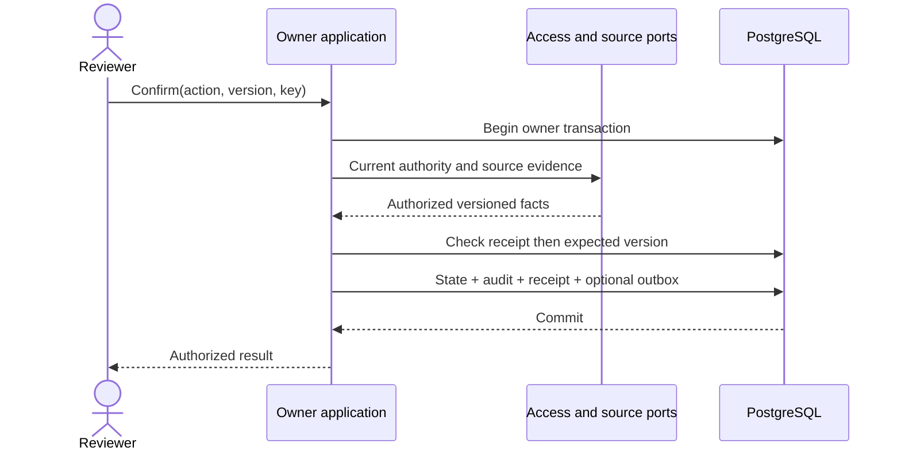
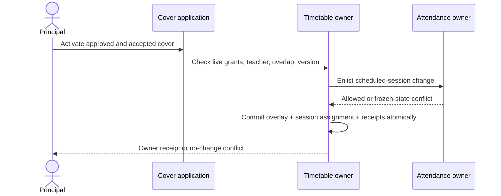

# Shared architecture and owner design contracts

## Preserve architecture
Next.js transport and composition → application use case → pure domain + ports → PostgreSQL/provider adapters. Domain imports no Next.js/Prisma/environment/HTTP. DTOs are serialized contracts, never Prisma entities. Existing backend/composition is the adapter binding point. Do not add DAO + Repository + Service layers that merely forward identical calls. Cross-module access is via published facades; permitted read-model joins are explicitly scoped and documented. No owner writes another owner's tables directly.

New module ownership below is a candidate where absent in the snapshot. Reuse a canonical existing owner discovered in live repository rather than creating duplicates. Documents remains Documents; Leadership is a composition/read workspace, not universal business authority.

## Scope and commands
Institution = organization_id; branch = school_id. IDs are server-validated UUIDs, never browser-supplied authority. Resolve actor from trusted Access context. Preserve account → Organization → School guard ordering and the repository's read/write lock distinctions. Reauthorize before protected reads, writes, dispatch, downloads and replay. Tenant SQL predicates and scoped composite constraints remain mandatory while TEN-03 is pending. Record table class and future RLS policy in registry; never call this database RLS enforcement.

The owner command hash includes versioned normalized payload, expectedVersion and relevant review digest. Existing scoped receipt uniqueness includes organization,school,actor,command,key. Reusing key+same hash returns prior receipt only after current authorization; changed hash conflicts. The server allocates monotonic aggregate version and commits state+safe audit+receipt/outbox in one owner transaction. External provider/network work occurs after commit. Bounded transient DB retry retains original key.

## Proposed interfaces (adapt names to real contracts)
```ts
type OwnerId = 'attendance' | 'coordination' | 'learning' |
  'communication' | 'assessments' | 'requests' | 'services';
type DecisionRef = Readonly<{
  owner: OwnerId; kind: string; resourceId: string; expectedVersion: number;
}>;
type CommandEnvelope<T> = Readonly<{
  commandKey: string; expectedVersion: number; payload: T;
}>;
type CommandOutcome<T> =
  | { kind: 'committed'; receiptId: string; replayed: boolean; result: T }
  | { kind: 'stale'; currentVersion: number }
  | { kind: 'unavailable' }
  | { kind: 'invalid'; issues: readonly { field: string; code: string }[] };
interface DecisionOwnerPort {
  listAssigned(ctx: AuthorizedContext, query: BoundedQuery): Promise<DecisionPage>;
  inspect(ctx: AuthorizedContext, ref: DecisionRef): Promise<DecisionView>;
  decide(ctx: AuthorizedContext, ref: DecisionRef,
    command: CommandEnvelope<OwnerDecision>): Promise<CommandOutcome<SafeReceipt>>;
  status(ctx: AuthorizedContext, key: string): Promise<AuthorizedCommandStatus>;
}
interface EvidencePort {
  verify(ctx: AuthorizedContext, source: TypedSourceRef,
    evidence: TypedEvidenceRef): Promise<VerifiedEvidence>;
}
interface AggregateProjectionPort {
  read(ctx: AuthorizedContext, query: AggregateQuery): Promise<VersionedAggregate>;
}
```
`AuthorizedContext`, view fields, enums and validation are defined in actual owner LLD before coding. These illustrative signatures are design seams, not drop-in compiled code. Clients cannot instantiate an authorized context. Type unions must be allowlisted at runtime too. Add optional requestInformation/recuse methods only for owners that support them; no generic dynamic SQL dispatch.

## Aggregate boundaries and candidate persistence
Names below are proposals except existing tables explicitly marked reuse. Migrations require comparison with TABLE_REGISTRY and actual Prisma schema. Do not add every proposed table upfront.

Common columns C for branch aggregates: id UUID PK; organization_id UUID NOT NULL; school_id UUID NOT NULL; version INTEGER NOT NULL DEFAULT1 CHECK(version>0); created_at TIMESTAMPTZ(3) NOT NULL; created_by UUID NOT NULL. Add UNIQUE(organization_id,school_id,id) and scoped branch FK to actual canonical School table. Mutable rows add updated_at. Actor/account FKs use real Access identifiers. Foreign resources use constrained scoped foreign keys where shared DB permits, or typed owner-verified refs with explicit deletion/integrity policy; JSON is not a substitute for relational IDs.

| Owner/table candidate | Additional columns and constraints | Responsibility / access path |
|---|---|---|
| Access `vs_access_delegation` | C; issuer_id, delegate_id UUID; starts_at, ends_at; revoked_at nullable; reason VARCHAR(1000); CHECK ends>starts and bounded duration | Delegation root; index org/school/delegate/end for live check |
| Access `vs_access_delegation_action` | scoped delegation_id UUID; capability VARCHAR(120); unique(delegation_id,capability) | Exact action allowlist; cascade prohibition preserves historical root |
| Coordination batch/item | REUSE existing proposed `vs_coordination_batch`, `vs_coordination_batch_item` LLD | Preserve1–50 bound, derived keys and resumable independent transactions |
| Owner information request | C; owner resource FK, requester_id, recipient_id, state enum, question VARCHAR(1000), answer nullable VARCHAR(2000), answered_at nullable | Implement under each source owner or an explicitly approved reusable Questions owner; one active question per source; never universal decision authority |
| Reporting `vs_reporting_brief` | C; state, period_start/end DATE, purpose VARCHAR(200), narrative VARCHAR(4000), final_revision_id nullable UUID | Versioned draft aggregate, authorized own/assigned list index |
| Reporting `vs_reporting_brief_revision` | scoped brief_id; revision INTEGER; definition JSONB versioned; source snapshot IDs via join table; immutable | Pin contents/provenance; unique brief/revision |
| Reporting `vs_reporting_brief_recipient` | scoped revision_id, account_id, purpose, revoked_at; unique revision/account/purpose | Portal share, recheck source authority at read |
| People `vs_people_availability_interval` | C; employee_id UUID; starts_at/ends_at; state AVAILABLE/UNAVAILABLE; origin type/ref; no private reason in public projection | CHECK end>start; employee/time range indexes and owner policy for overlapping authoritative intervals |
| Academics `vs_academics_cover_proposal` | C; occurrence ref; substitute_teacher_id; original_teacher_id; state; approved_by/at nullable; accepted_by/at nullable; active_from/to | One active cover per occurrence; overlap constraints and owner transaction with scheduled Attendance |
| Learning `vs_learning_recipient_policy_event` | C; assignment_id, recipient_id; event EXTEND/EXCUSE/REVERSE; effective_due_at nullable; reason protected; immutable sequence | Per-recipient policy history; owner projection latest policy, unique recipient/event-number |
| Attendance `vs_attendance_correction_request` | C; student_id, session_id, source_revision; proposed_status; requester_id; state; applied_revision nullable | Active uniqueness per exact mark/revision; source identity and revision bound |
| Assessments `vs_assessments_plan` | C; year_id; state; scale_revision_id; period; definition_version | Root owns plan/cohort; submitted/published versions pinned |
| Assessments `vs_assessments_mark_revision` | C; plan_id, student_id, subject_id; revision; score NUMERIC with configured precision nullable; outcome enum; author_id | Unique plan/student/subject/revision; score/outcome mutually valid; immutable revision |
| Assessments `vs_assessments_moderation` | C; source revision set/digest; reviewer_id; decision; reason; immutable | Exact reviewed content, independent reviewer enforced inside use case |
| Assessments `vs_assessments_report_publication` | C; approved report_revision_id; document_version_id; published_at; withdrawn_at; audience snapshot ref | Immutable artifact and live audience-purpose recheck |
| Requests `vs_requests_request` | C; category; requester_id; assigned_reviewer_id nullable; state; evidence_version; restricted_payload_ref | Category-specific lifecycle, no generic permissions from table access |
| Requests `vs_requests_participant` | scoped request/account/purpose; starts_at,revoked_at; unique active participant/purpose | Case visibility, not broad Leadership membership |
| Communication drafts/revisions/approvals | Reuse current owner tables; add only missing revision,digest,reviewer,decision fields/tables | Approval binds audience/content/attachments/channel; published version immutable |
| Communication `vs_communication_reminder` | C; publication_id/version; actor; intent key/hash; state | Batch root; no duplicated recipient body |
| Communication `vs_communication_reminder_recipient` | scoped reminder/account; channel; eligibility_version; state; provider_ref nullable; error_code nullable | Unique logical reminder/recipient/channel; delivery attempts separate append-only children |
| Events meeting/participant/action | Reuse event owner if lifecycle compatible; otherwise `vs_events_meeting`, `vs_events_meeting_participant`, `vs_events_meeting_action` | Meeting version pins time; response version resets on schedule change; action link owns no Coordination state |
| Support `vs_support_referral` | C; student_id; route_revision_id; restricted narrative; state; retention_policy_id | Restricted root; no broad search or audit narrative |
| Support `vs_support_procedure_revision` | C; branch procedure/version; configured contact refs; status; approved_by/at | Reviewed actual school procedure; stale/retired clearly unavailable |
| Services `vs_services_incident` | C; service_kind FACILITIES initially; facility_id; impact_start/end; state; safe_public_update; evidence_ref | Exact service owner, distinct private investigation notes if needed |
| Access preferences | Reuse own-account preference store, else `vs_access_preference` with account_id,key,value,version; unique(account,key) | Global own-account preference is NOT automatically branch scoped; allowlisted density/motion only |
| AI `vs_ai_leadership_draft` | C; provider/config revision; request state; permitted source manifest; protected draft payload; reviewer/time nullable | Evaluation/audit metadata separate from output; no mutation tool handle |

Finance needs its own full ledger/charge/payment/allocation/refund/reconciliation LLD before any migration. Do not improvise a two-table ledger from this Principal package. Documents already has a detailed six-table design; reuse it verbatim unless an approved D15 delta requires a change.

## Required joins and query contracts
- Attendance pattern: scoped Student → authorized enrollment/placement history → exact frozen roster membership → submitted session → latest effective mark revision at requested cutoff. No current-class join that rewrites historical placement. Missing session/submission counted separately.
- Learning report: frozen assignment recipient → effective per-recipient policy at asOf → immutable accepted submission → first published feedback. Constrain assignment/subject/class/branch before aggregate. Never join private drafts into reports.
- Cover: occurrence/pinned publication → dated overlay → eligible Teacher/Employee → current operational availability; conflict port evaluates other assignments. Attendance linkage must be trusted source link, not class/name matching.
- Inbox: fan out authorized query to registered owner facades; each returns safe refs/action hints. Detail/decision rereads owner. Pagination across heterogeneous sources requires documented stable merged cursor per owner or separate grouped pagination; do not fake a global total from first pages.
- Brief: brief revision → pinned Reporting snapshot IDs → owner definition/version and explicit recipients; live policy recheck for each section before whole download.
- Notice reminder: frozen audience ∩ current purpose grant − acknowledged when applicable − current dedup exclusion; no re-expansion through current class membership alone.
- History: safe owner events filtered by source purpose and branch, never unrestricted platform audit scan.

## Transaction patterns



Shared transaction enlistment uses abstract owner ports, not Prisma handles crossing into domain. If existing infrastructure cannot atomically enlist these owners, design an explicit saga with restricted pending authority before implementation; do not claim atomicity from two sequential commits.

## Migration and implementation-readiness gate
For every new table the owner DESIGN must state every column type/null/default, PK/FK/check/unique, tenant class, retention, index tied to query, conflict strategy, migration/backfill and deletion behavior. The above is a candidate model, not a claim of complete SQL for absent modules. Verify against current schema; preserve all existing migrations and data. Registries count migrated vs proposed separately. Gate substantive code on this local design delta, not a reread of all documents.

## Source ownership and precedence
Actual accepted user decision → live accepted ADR/owner contract → this package's approved D-ID delta → catalogue proposed defaults. When evidence is ambiguous, report exact conflicting sentences and continue independent tasks. Never let a general new recommendation override already implemented data/privacy promises without a migration and approval record.
