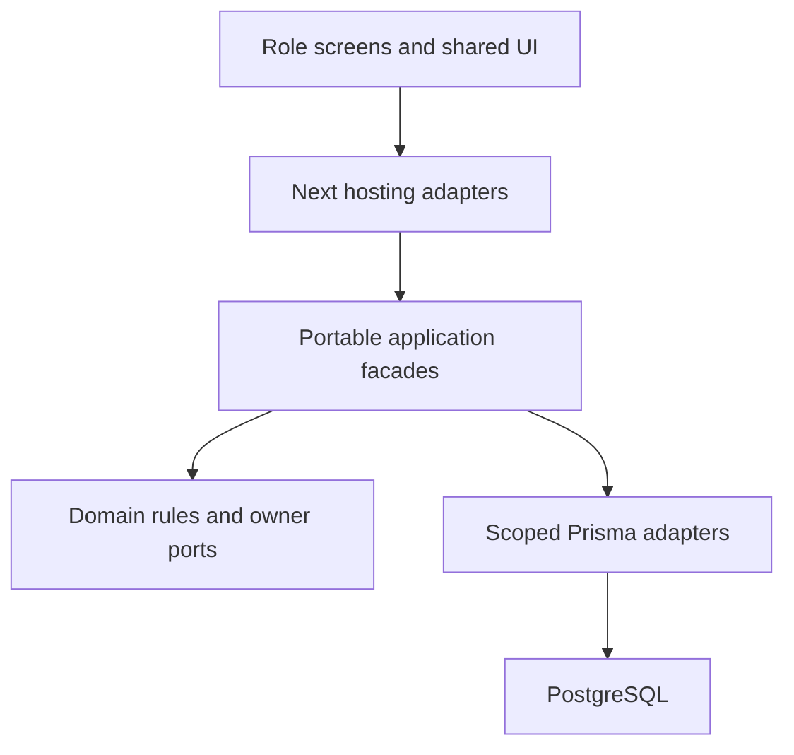

# Architecture: one owner, multiple workspaces

Pages, route handlers and server actions resolve transport identity, validate transport and call a named gateway. Application/guard code checks current authorization. Infrastructure performs scoped persistence. Cross-owner operations call the owner's published contracts; no foreign table writes. Future Nest controllers replace the host adapter, leaving domain/application and portable adapters reusable. No Nest dependencies or decorators now.

## Workspace versus owner
| Workspace | Reads/writes through owners |
|---|---|
| Operator | Access institution lifecycle; Tenancy licensing; Branding metadata; configuration audit. Separate verified operator authentication required. |
| Administrator | Access, People, Academics, Students, Imports, Attendance, Reporting; future Guardians and Communication. |
| Teacher | Verified person/teacher assignment through Access/Academics; scoped rosters through Students; session marking through Attendance. |
| Parent/guardian | Verified child relationship and per-purpose grants through Guardians; only published/authorized child projections from owners. |
| Student | Verified self-account binding and enrollment; own published owner projections. |
| Principal | Explicit read/review grants and owner-defined decisions; never an admin wildcard. |

## Aggregate ownership
Access owns global UserAccount, Organization/School lifecycle and scoped grants in the current code. People owns institution Person and branch employment. Academics owns teacher eligibility, years/calendars/sections/offerings/dated assignments. Students owns Student, dated Enrollment and SectionPlacement. Attendance owns session state, pinned roster, submitted records and correction history. Tenancy owns license and branch activation. Reporting reads owner-approved projections and owns export evidence. Preserve current ownership even if the physical name of Organization starts with access.

Value objects stay small and pure: identifier, civil date, local interval, expected version, normalized code, exact money (future), command key. Preserve existing functions where equivalents exist. Do not wrap every scalar in classes or add entities merely to imitate JPA.

## Concurrency and dependencies
Keep the repository's guard ordering and scoped foreign keys. Recheck mutable permission/module state at protected commands. Reads enforce live context without taking mutation locks unnecessarily. Command result loss is UNKNOWN, not failed: retain its intent key and resolve the existing receipt. A retry with changed input is a new intent only after the prior outcome is known. Optimistic version mismatch never overwrites a newer record.

RLS is an independent database defense. UI delivery does not enable it or claim it complete. Do not enable policies on owner connections as a superficial substitute for the TEN-03 role/context design. Before production, complete its documented enforcement, denial, pooling, load, provider and restore gates.
