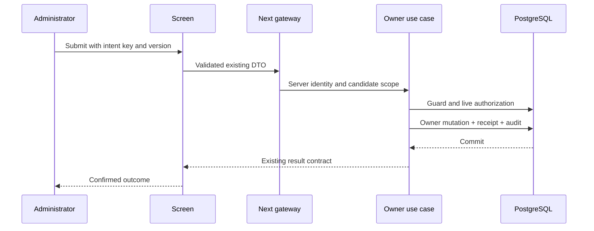

# Shared UI low-level design

## Exact implementation locations
| Existing location | Change |
|---|---|
| components/admin-portal-frame.tsx | Thin administrator wrapper around shared shell; retain existing home and server navigation inputs. |
| components/teacher-portal-frame.tsx | Thin teacher wrapper; preserve assignment-scoped server identity/navigation. |
| components/portal-navigation-group.tsx | Reuse icon paths and active-link behavior; extract shared icon export if useful, no new icon dependency required. |
| lib/server/admin-navigation.ts | Remains server authority for visible administrator destinations; retain route checks and fix permission-sensitive memoization if necessary. |
| components/ui/* | Reuse buttons, forms, dialog and semantic table. Add missing composition, not a second competing design system. |
| components/portal/* (new) | portal-shell.tsx, portal-sidebar.tsx, portal-profile.tsx, list-toolbar.tsx, filter-drawer.tsx, sort-drawer.tsx, command-feedback.tsx. |
| shared/contracts/portal.ts (new) | JSON-safe presentation data below. No database, environment or framework imports. |
| app/globals.css | Namespaced shell/sidebar rules and existing design tokens; avoid global body/table/button overrides that alter approved page recipes. |

```ts
export type PortalIdentity = Readonly<{
  displayName: string; roleLabel: string;
  institutionName: string; branchName: string;
}>;
export type PortalLink = Readonly<{
  id: string; label: string; href: string; icon: string;
}>;
export type PortalGroup = Readonly<{
  id: string; label: string; items: readonly PortalLink[];
}>;
export type PortalView = Readonly<{
  identity: PortalIdentity; groups: readonly PortalGroup[];
}>;
export type CommandFeedback =
 | { kind: 'idle' }
 | { kind: 'submitting'; commandKey: string }
 | { kind: 'confirmed'; commandKey: string; receiptId?: string }
 | { kind: 'unknown'; commandKey: string }
 | { kind: 'conflict'; message: string }
 | { kind: 'denied'; message: string }
 | { kind: 'invalid'; fields: Readonly<Record<string,string>> };
```

These proposed types adapt existing data; they do not replace Identity/AdminHome/business responses. Icons are an allowlisted union derived from the existing icon implementation before commit, not arbitrary HTML. Server-provided labels are plain escaped text. If verified display name is absent, show an honest account label; never read an unrelated Person by matching email. Keep a safe pending profile label until the authorized owner query provides it.

## Shell specification
Desktop: preserve reference content width and page body layout. Sidebar uses the approved dark forest appearance, consistent outline icons, active indication, labelled groups, scrollable navigation and identity footer with separate sign-out. Header preserves authorized institution/branch context. Sign-out remains the existing CSRF-aware auth action. Do not place it inside a clickable identity card.
Mobile: reuse the existing menu trigger, focus containment/return, Escape and close-on-navigation behavior. Menu content scrolls independently; identity/sign-out remain reachable. No horizontal document overflow at 390px. Touch targets >=44px when coarse pointer; desktop keeps reference density. A disabled module never becomes visible from local state or a design-review role switch.

## List toolbar behavior
ListToolbar is a controlled composition. Props: attribute options + selected attribute, draft text, applied search, onCommitSearch; filter count/onOpenFilters; sort summary/onOpenSort. Attribute defaults to the screen's specified field. Enter commits trimmed bounded text; clear commits empty text. No Search button. Selecting the attribute does not focus/highlight the text input. Input focus has an accessible focus indicator; keyboard focus is never hidden to imitate a screenshot. Toolbar fills the table width; search flexes and Filter/Sort sit adjacent with a consistent gap. Persist applied state in validated query parameters; browser Back restores it. Never serialize private credentials/notes to URLs.

FilterDrawer: local draft distinct from applied filters; borderless expandable attributes separated by dividers, multi-select stays open, selected options remain visible. Apply commits once and resets pagination. Cancel/Escape discards draft and restores opener focus. Empty filter selection means unrestricted within authorized scope. Footer only Apply and Cancel. Active filters can be cleared outside the drawer. SortDrawer: Sort by and Order by radio groups, both expanded initially and independently collapsible; Apply/Cancel same draft semantics. Stable sort always includes a unique tie-breaker on the server.

Table: real table semantics, caption and headers; action cell fit-content, right aligned. Named View/Manage action uses an icon plus accessible name; avoid Actions button under Actions header and unsolicited ellipsis. Row link is keyboard reachable. Clicking internal controls never also activates a whole-row handler. Sort/filter changes clear incompatible cursor.

## Form and command behavior
Retain server validation and existing DTOs. Align field labels and helper/error text; associate errors via aria-describedby. Wizard footer puts Back left, Continue right, Save draft as a separate tertiary action. Save draft enabled only when content exists and differs from last save; no success notification before server confirmation. Block duplicate pending submit. On denied/revoked response clear protected stale content. Unknown commit result shows Check status/Retry same request; never silently recreate the command.

## Sequence: existing school command


## Visual acceptance
Use exact approved HTML route/state as reference, not a static design-system gallery. Capture same viewport, route, data density and open drawers. Check sidebar, content title/action alignment, toolbar width, labels, field errors, table action width and modal footer. Compare the page body separately from navigation. Existing prototype review banners/fixture role switches are review tools and must not enter production UX. Document unavailable backend data rather than render fake dashboard counts.
