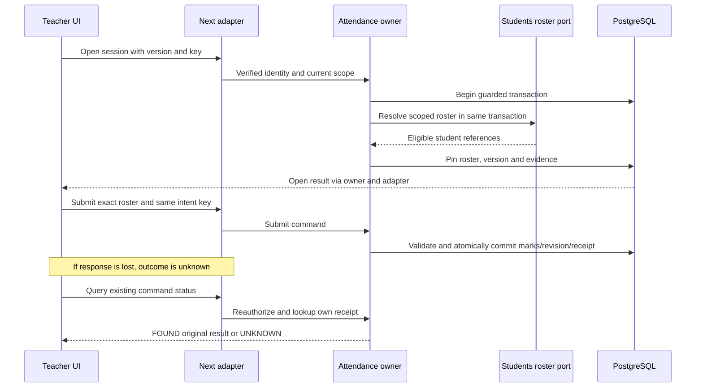

# Critical workflow LLDs — exact current integration

All examples are synthetic. They describe the inspected snapshot; EX-00 checks current repo drift. Do not overwrite newer compatible code. Dates use YYYY-MM-DD civil values; timestamps ISO instants; IDs strings. UI date interval endpoints are not automatically the DB endpoints.

## Student registration
**Entry:** administrator Students → Register. **Input port:** studentsGateway.create → StudentsFacade.create → StudentRepository.create. **Endpoint:** POST /api/v1/students. **Authorization:** live student.manage and active/released student_core in current school. **Body bound:** 8192 bytes in current student-http.ts. **Idempotency-Key header:** equals body key, 16–100 allowed characters at application validation. **Origin:** existing exact configured origin validation.

```json
{"firstName":"Aarav","lastName":"Mehta","admissionNumber":"DEMO-001","key":"demo_student_0001"}
```

Existing-person mode supplies existingPersonId, but does not replace verified identity policy. Present name fields follow actual validation; existing Person is not renamed implicitly.

Transaction algorithm:
1. Validate actor/IDs/name/admission/key in application.
2. Begin Serializable, timeout 15000 ms/maxWait 10000 ms as existing adapter; run current guard.
3. Compute owner canonical hash, lookup StudentRegistered receipt.
4. If matching receipt, re-read authorized referenced Student and return replayed=true; mismatched hash rejects.
5. Reject scoped duplicate admission number. Resolve existing Person through PersonIdentityPort.findById in organization or create through PersonIdentityPort.create with the same transaction.
6. Reject scoped duplicate person-student association. Insert Student ACTIVE/version1.
7. Advance School configurationVersion with expected value; zero affected rows is STALE_VERSION.
8. Append safe AuditEntry, OutboxEvent and CommandReceipt through the transaction-bound port. Commit.
9. HTTP 201 for new, 200 for replay; browser navigates to returned studentId, not a fixture route.

Error mapping observed: unauthenticated401, forbidden403, not-found404, validation/invalid-cursor422, unavailable/release-unavailable503, other owner conflicts409. Body contains code/message/requestId/retryable. Preserve endpoint-specific mappings; do not introduce a global envelope.

## Enrollment and transfer
POST /api/v1/enrollments receives studentId/yearId/sectionId/startsOn/lastDay/rollNumber?/key. Application converts inclusive lastDay to exclusive validTo by adding one civil day. DB writes Enrollment plus SectionPlacement in the same transaction. Open year, active student and matching active section must hold. Never add a second frontend timezone conversion.

```json
{"studentId":"11111111-1111-4111-8111-111111111111","yearId":"22222222-2222-4222-8222-222222222222","sectionId":"33333333-3333-4333-8333-333333333333","startsOn":"2026-10-09","lastDay":"2027-03-31","rollNumber":"12","key":"demo_enroll_00001"}
```

Transfer endpoint /api/v1/enrollments/[id]/transfer receives expectedVersion/toSectionId/effectiveDate/rollNumber?/reason/key. Reason 5–500 chars. Find the current placement using school-local today. Current contract requires effectiveDate >= today, strictly after prior start and before prior end, within the open year. Verify frozen-session impact through Attendance port. Close prior placement at effectiveDate, create new placement to former validTo, increment enrollment version and append evidence. Replay returns existing outcome. Do not update historical submitted rosters.

Read join: scoped Student → organization Person; scoped Enrollment by student/year; scoped SectionPlacement by enrollment with validFrom<=date<validTo; scoped Section → GradeLevel. For history return all dated placements in order, not only current. Registration search and existing-Person selection are separate contracts.

## Attendance open and submit
**Endpoints:** POST /api/v1/sessions/[id]/open and /submit. **Ports:** attendanceGateway → AttendanceFacade → SessionRepository. **Actor:** verified assigned teacher under current rule; admin attendance oversight does not automatically grant marking.

Open body: expectedVersion positive integer and UUID key. It freezes eligible Students-owned roster under the current scope/date transaction and returns sessionId/version/status OPEN/rosterRevision/roster/replayed. Do not generate rosterRevision in UI.

Submit request:
```json
{"expectedVersion":2,"rosterRevision":"aaaaaaaaaaaaaaaaaaaaaaaaaaaaaaaaaaaaaaaaaaaaaaaaaaaaaaaaaaaaaaaa","entries":[{"studentId":"11111111-1111-4111-8111-111111111111","status":"PRESENT"}],"key":"44444444-4444-4444-8444-444444444444"}
```

Use the real returned rosterRevision; repeated a's above only illustrate shape. Header key matches body. Current submit body limit 32768 bytes. 1–200 unique entries; statuses PRESENT/ABSENT/LATE/EXCUSED; LATE requires integer lateMinutes1–480, other statuses forbid that field. Exact permitted keys only. Every frozen roster pupil must be marked; no extra student is accepted.

Transaction checks current guard and dated teacher identity, replay, session OPEN/version/rosterRevision, exact roster coverage; persists records and SUBMIT revision, transitions session SUBMITTED, increments relevant revisions and appends tenant evidence. Rendering success precedes neither database commit nor confirmed replay. Disable ordinary editing after submission.



Recovery path: GET /api/v1/commands/[command]/key/[key], where command accepts attendance.submit or attendance.cancel in the current facade. FOUND returns existing result; UNKNOWN is not proof the command never committed. Retry the identical command key after safe status/retry handling. No new key after timeout. The route supports these two command types, not arbitrary student/branding status lookup.

Correction: POST /api/v1/sessions/[id]/corrections, expectedVersion/changes/reason/key. Reason5–500, changes1–200 unique roster members, current body limit65536. Append CORRECT revision with before/after, preserve original submission. Cancellation reason/version/permissions are state-dependent: cancellationPermissions() is authoritative, including submitted sessions. Do not hard-code “only scheduled can cancel” if current owner supports submitted cancellation.

## Teacher day and detail
GET /api/v1/teacher/sessions?date=YYYY-MM-DD. Snapshot restricts date to today or earlier within a relevant OPEN year; future timetable planning is separate scope. Actor account → verified AccountPersonBinding → Person → active eligible Teacher/Employee → dated offering assignment → non-cancelled session. A direct session URL rechecks this chain. Not seeing a session is not solved by widening branch grants.

Teacher history is not the admin school-wide Attendance history endpoint; current history query requires attendance.read_school. Preserve read-only returned session state for teachers and design a separately scoped history query if the approved future workflow needs one.

## Import confirmation and processing
Existing ImportsFacade validates preview and calls ImportsRepository.preview. Preview includes source bytes, schema STUDENT_ROSTER_V1, namespace, year/campus/date and idempotency key. Keep owner parser/size limits; generic JSON 8KiB limits do not establish the file-upload size contract.

Confirm pins jobId + expectedVersion + previewRevision + fileHash + skipInvalid + key; changed preview/file cannot reuse a prior confirmation silently. Process uses jobId + key. Status/rows/errorsCsv remain scoped and permissions rechecked. Existing implementation controls transaction/chunk semantics; do not promise whole-file atomicity or invent a background worker. Per-row import collaboration uses Students enlisted registration port in the same transaction as that row's result/source mapping. Retry cannot create a second student for a processed source key. Audit excludes raw rows/file bytes/hashes; source_hash belongs in owner ImportJob storage.

## Dashboard and reporting
Use Reporting owner totals, denominator, asOf, current scope and dates. No count based only on sessions.items length when nextCursor exists. Deliberately distinguish expected/submitted/pending/future/cancelled sessions from present/absent counts. Empty success and failed query are distinct. Export is an authorized server operation with ExportRun evidence and formula-safe CSV, not a client dump of a paginated table.
