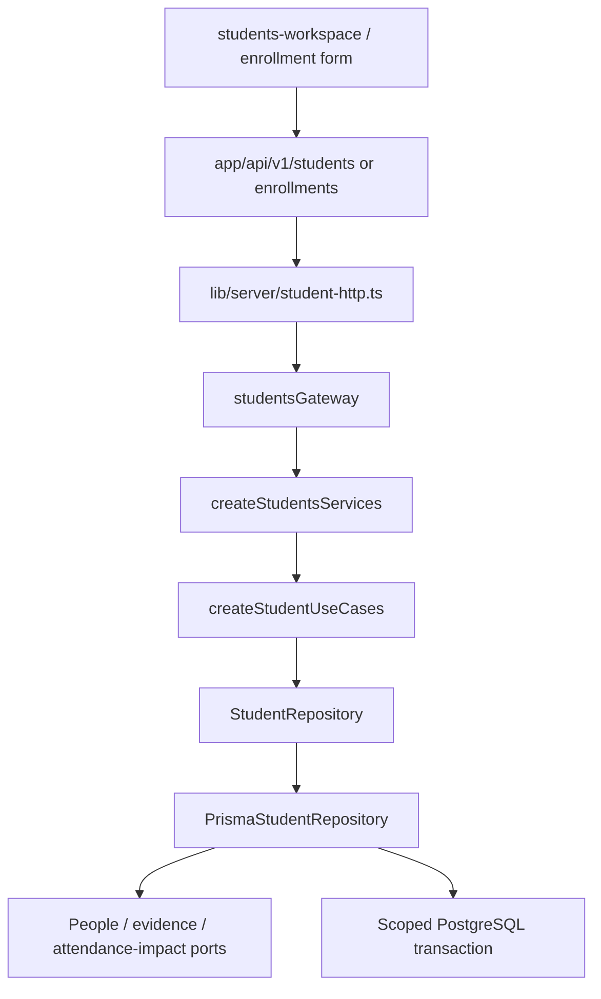

# Hexagonal architecture — binding implementation contract

## 1. Dependency direction and responsibilities

| Layer | Directory | Allowed responsibilities | Forbidden |
|---|---|---|---|
| Domain | backend/modules/<owner>/domain | State/invariant functions, value normalization, transitions and calculation | React/Next/Prisma, cookies, process.env, HTTP or DB calls |
| Application / input port | backend/modules/<owner>/application | Named commands/queries, validated input, collaboration through ports | Route objects, JSX, foreign owner writes |
| Owner public port | backend/modules/<owner>/contracts | Minimal cross-owner service interfaces and safe types | Exposing an unrestricted Prisma client or generic CRUD interface |
| Output adapter | backend/modules/<owner>/infrastructure | Implement repository ports, SQL/Prisma, guarded transaction, mapping and provider calls | Treating a client tenant/role field as authority |
| Composition root | backend/composition | Construct adapters, inject configuration and wire use cases | Reading environment implicitly; user-scoped mutable singleton state |
| Next host / BFF | lib/server | Read environment/session, choose scope, map HTTP error/status, invoke facades | Business rules, Prisma writes, permission based only on menu visibility |
| Delivery | app/api, pages, server actions | Parse route/transport, call hosting adapter, render/serialize | Copying repository logic or importing database into client bundle |
| Browser | components, shared/contracts | Display DTOs, interaction state, same-origin requests | Backend/Prisma imports, tokens in logs or fake production fixture state |

This is a modular monolith with ports and adapters. A generic Repository<T>.save(entity) or DAO per table is not a requirement. Existing repositories are atomic use-case persistence ports, not JPA entities. Do not split an aggregate into independent CRUD calls merely to create more classes.

## 2. Current transaction boundary — retain it

Observed Student and Attendance application factories validate input then invoke repository ports. Their repository adapters own a transaction including current authorization, replay lookup, business checks, writes and evidence. This is a deliberate existing boundary to preserve during screen adoption. The application must invoke the guarded port; a prior getHome check does not replace its checks.

Do not perform authorization in one independent transaction and mutation in another. Do not extract `guard()` into an HTTP-only middleware. Do not move DB-dependent invariant checks to a pure function that reads an old snapshot outside the write transaction.

New pure rules should live in domain and be invoked by the use case or guarded adapter as appropriate; transaction ownership must remain explicit. If later extracting a UnitOfWork abstraction, that is a separate tested refactor. No change to existing opaque transaction ports is necessary now.

## 3. Student wiring — exact observed symbols



- Input port: `createStudentUseCases(repository)` returns `StudentsFacade`; exact interface is under source-reference/backend/modules/students/application/students.ts.
- Output port: `StudentRepository` methods list/get/create/findExistingPeople/enrollmentOptions/enroll/transfer/archive. Exact parameters and DTO types are retained; do not replace them with an invented CreateStudentDTO.
- Cross-owner identity: `PersonIdentityPort.create/findById/findExactName(transaction, ...)`, implemented by People. Student registration calls this in the same transaction.
- Cross-owner roster impact: `AttendanceStudentImpactPort.hasFrozenSessions(transaction, {organizationId,schoolId,sectionIds,fromDate,toDate})`. Fail closed if unavailable; do not substitute a false result in production.
- Cross-owner import input port: `EnlistedStudentRegistrationPort.registerAndEnroll(transaction, actor, input)`. Import supplies an enlisted transaction; do not nest an independent student transaction that commits before the import row.
- Evidence: `CommandEvidenceWriter.append()` bound to the transaction. Implemented by PrismaCommandEvidence; writes platform audit + outbox + receipt atomically.
- Host scope: studentsGateway obtains accountGateway.getHome(identity).scope; repository still validates that live scope. The HTTP JSON body does not choose actor or grant.

## 4. Attendance wiring — exact observed symbols

- `createAttendanceUseCases(repo)` → `SessionRepository` → `PrismaSessionRepository`.
- `createAttendanceServices(config)` wires Students-owned `StudentAttendanceRosterPort`, release manifest, verified database context and transaction-bound `InstitutionEvidenceWriter`.
- `attendanceGateway` obtains current scope; `attendance-http.ts` maps named commands and owner errors.
- SessionRepository has schedule/open/submit/correct/cancel/commandStatus/history/schoolDay/teacherDay/detail plus authorizeAdmin. Follow exact signatures from source reference.
- Attendance evidence currently uses `PrismaInstitutionEvidence`: ConfigurationChange + TenantCommandReceipt + TenantOutbox. Do not query the platform CommandReceipt table to recover attendance submission.
- Runtime errors in provider/DB mapping are converted to owner-safe codes; unknown network result must preserve the command intent.

## 5. Composition constructor policy

Required target pattern for factories touched in this batch:

```ts
// Conceptual config shape; use the owner's existing ModuleId/ReleaseManifest types.
type ServiceConfiguration = Readonly<{
  databaseUrl: string;
  cursorSecret: string;
  releasedModules: readonly string[];
  now: () => Date;
}>;
```

Hosting reads environment and validates configuration once. Composition accepts it explicitly, constructs the Prisma adapter and wires ports. Keep actual current factory method names/return types compatible. Introduce owner-typed released module configuration instead of string[] in implementation. Secret is server-only; never put config in shared browser props.

The observed students composition reads `process.env.VSCHOOL_RELEASED_MODULES` and `process.env.NEXTAUTH_SECRET`; this conflicts with the extraction design. If still present, fix it in BE-01 by moving environment reads to lib/server/students.ts and passing explicit config. Audit the other factories for the same pattern; do not silently copy the violation to new services. Tests supply deterministic clock/manifest/secret. Avoid pool-per-request construction; preserve the current module-scoped factory lifetime and disconnect in tests. Pool topology overhaul is not part of cosmetic work.

## 6. Browser gateway policy

Keep current same-origin API calls. React components may import DTO types and pure display helpers, never factories or repositories. A page can call the server gateway for SSR; a client mutation calls the same-origin endpoint. A future Nest adapter replaces gateway transport, not domain/application contracts.

Do not introduce a second HTTP client library. Use the existing fetch/command helpers where present. An abstraction is justified when two consumers require it, not to create a framework. New retries: no automatic mutation retry with a new key, no retry on validation/forbidden, preserve UNKNOWN after ambiguous network outcome.

## 7. New owner modules

Use this exact module layout with a module-specific input facade and output ports. Define one command transaction owner. Owner contracts are imported across modules, not foreign infrastructure. A multi-owner atomic command must explicitly enlist its ports in the same transaction or document a durable saga; do not accidentally mix the two. Schedule, parent and finance modules are not authorized by current school-admin UI role. Design their missing identity, grant and schema contracts before marking their implementation ticket ready.
