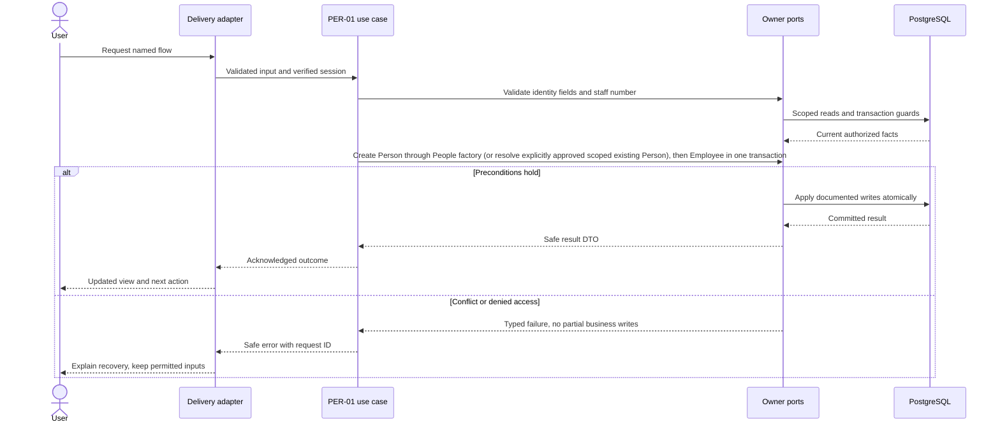
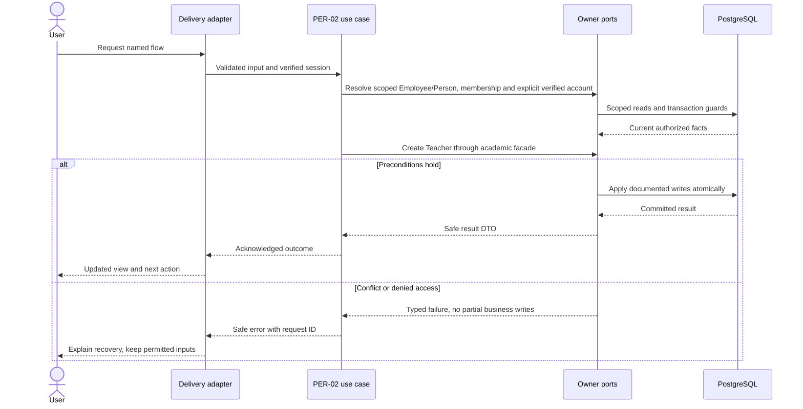

# People and staff identity — design

Phase 1 · Design revision 2 · 5 October 2026. PER-01 and PER-02 are implementation-verified; PER-02 human review remains pending for source `e72125d4545e48c4b5c69c4ba3c9a646f7eea5d1`. IAM-03 acceptance was recorded for the prerequisite source `e0f262a78d7e020919cd36be80d508c9032d1e07`. Teacher schema is installed. Review unresolved deployment choices in FND-02 before real-data use.

## Database naming and physical mapping

All physical objects follow [the VS database contract](../../DATABASE_DESIGN.md). Table names and columns below are physical SQL names; workflow prose uses logical domain names. `organizationId` maps to `organization_id`, `schoolId` to `school_id`, and `scope` expands to both columns. Models retain PascalCase through Prisma `@@map`; camelCase fields use `@map`. Planned schemas are implemented only through their named tasks and reviewed migrations.

## Ownership, aggregates and values

Person aggregate owns organization-local display identity. Employee is a school root with staff number, employment interval and status. Academics owns Teacher, not People. A Person can become both staff and guardian later without duplicating names. Values: HumanName (firstName 1–100, lastName 0–100), StaffNumber (1–40), EmailAddress, DateRange. Events: PersonRegistered.v1, PersonNameChanged.v1, EmployeeCreated/Ended.v1. Do not merge on name/contact similarity.

## Module decisions

PER-ADR-001: stable person identity and separate school profiles. Creating similarly named people is permitted, while suggested matches need explicit human resolution. Alternative uniqueness on contact email rejected because families share addresses.

PER-ADR-002: organization-wide person corrections are restricted operator maintenance in Phase 1; ordinary admins cannot mutate shared identity across schools. This narrows scope without weakening cross-school isolation.

## Physical data contract

PER-01 installs Person, Employee and the Access-owned AccountPersonBinding table; binding rows remain empty until PER-02. PER-02 installs the Academics-owned Teacher eligibility table. Later People tables remain planned. `scope` below means `(organizationId,schoolId)`. All business roots have version >=1. All scoped references require composite FK targets with matching unique keys, even when abbreviated in the table. Creation times use server clock; IDs server generated. Required unless nullable is stated. Enum labels are constrained enums/CHECKs, not unchecked strings. Do not silently implement a weaker constraint because Prisma syntax cannot express it; use reviewed migration SQL.

| Table | Fields and data stored | Meaning | Keys / constraints / query support |
|---|---|---|---|
| `vs_people_person` (Person) | id uuid PK; organization_id uuid; first_name varchar(100); last_name varchar(100) default empty; contact_email varchar(254) nullable; version int; created_at timestamptz(3) | Canonical name/contact; email contact is not verified login ownership. Minimal pilot PII, no health/document fields. | FK organization; UNIQUE(organization_id,id); index(organization_id,last_name,id); no email/name uniqueness |
| `vs_people_employee` (Employee) | id uuid PK; organization_id uuid; school_id uuid; person_id uuid; staff_number varchar(40); employed_from date; employed_to date nullable; status ACTIVE/ENDED; version int | School institutional profile; links rather than duplicates identity. | Scoped School FK; FK(organization_id,person_id); UNIQUE(scope,staff_number); UNIQUE(scope,person_id); UNIQUE(scope,id); CHECK end null or from<end |
| `vs_academics_teacher` (Teacher) | id uuid PK; organization_id uuid; school_id uuid; employee_id uuid; active boolean; version int | Academics-owned teacher eligibility, not an account or login. | Scoped FK(scope,employee_id)→Employee(scope,id); UNIQUE(scope,employee_id); UNIQUE(scope,id); index(scope,active,employee_id); Path A RLS metadata; TEN-03 enforcement gate |

## Read workflows and joins

Staff list: Employee filtered by selected school → Person on organization/id → optional Teacher on scope/employeeId → AccountPersonBinding on organization/personId → current SchoolMembership for that account. Return staff name/number/status and portal-access badge, never password/token. A Person is viewable only through an authorized same-school profile. Organization-wide contact/name edits must lock every school in which that Person has a profile in sorted order and require explicit organization identity-steward operator authority; Phase 1 admin UI only creates people and manages school Employee, so it cannot silently change another school's shared identity.

## Screen contract

/admin/teachers: search/paginate staff; PER-01 captures first/last name, optional contact email, staff number and employment start date, then shows employment and portal-access status. It always creates a new Person and never links an account or enables teaching. PER-02 adds only the separately reviewed verified-account and teacher-eligibility actions. Pending portal access and no assignments remain distinct states; ending employment shows affected assignments/sessions first.

All screens additionally follow Bible §8: loading, empty, validation, permission, stale/conflict, temporary failure and acknowledged success; semantic labels, focus and mobile layout. No future-module navigation.

## Application ports and transaction boundary

Each named flow below is an application use case. Inputs/outputs are plain DTOs; adapters implement owned repositories and public cross-module facades. Use SchoolCommand, ActorResolver, Clock, IdGenerator and transactional envelope writers from the shared contract. Do not pass Prisma.TransactionClient into application/domain code. Generic `save(any)` is not a replacement for named commands. Domain factories create new roots/events; rehydration restores without events.

Mutations use the account → Organization → School guard protocol in Bible §7. Every protected read and write reauthorizes current scope and resource permission. Read-only flows do not acquire write locks. Bootstrap/auth-only commands use their documented account/provisioning transaction. Scoped school uniqueness/range checks run after locks. Reauthorize before mutation receipt replay and commit; only a successful transaction stores a receipt. Aggregate version, audit, outbox and response commit together. Exact flow-specific reads and writes below refine this shared behavior.

## PER-01 — Create and inspect staff profiles

**Success response contract:** `{employeeId,version,staffNumber,person:{id,displayName},employment:{from,to,status},portalAccess:"UNLINKED"}`. List adds current permitted portal badge.

**Transport:** POST /api/v1/employees; GET /api/v1/employees

**Input:** firstName,lastName?,contactEmail?,staffNumber,employedFrom; key. class.manage required. PER-01 always creates a new Person; it has no existing-person resolution path because this task has no operator-verification port. Names and contact data never merge identities. A later verified resolution command must be explicit and reviewed.

**Workflow:**

1. Authorize school staff management through class.manage; acquire guards.
2. Validate identity fields and staff number; do not infer Person equality from contact.
3. Create a new Person through the People factory, then Employee in one transaction. Never search or merge by name/contact.
4. Persist event/audit/receipt; add AccountPersonBinding table now Person exists, but do not bind automatically.
5. Read staff list via scoped Employee/Person join; display profile and portal status separately.

**Database writes / atomicity:** Person, Employee, the Access-owned AccountPersonBinding table (empty until the verified PER-02 binding use case), and shared envelopes; one forward migration with the scoped Person FK.

**Errors and recovery:** Staff number duplicate→409; foreign Person→404; invalid dates/contact→422.

**Verification:** Unit — Human name and employment interval validation. Functional PostgreSQL — Atomic Person/Employee rollback; scoped FK; duplicate staff race and same-name nonmerge. E2E — Create teacher staff record without login and refresh list.

## PER-02 — Enable teaching eligibility and verified account binding

**Success response contract:** `{employeeId,version,teacherId?,bindingId?,portalAccess,employmentStatus}`; impacted sessions in a conflict are bounded authorized IDs/dates, not foreign-school names.

**Transport:** POST /api/v1/employees/:id/teacher-profile; POST /api/v1/employees/:id/account-binding; PATCH /api/v1/employees/:id/end

**Input:** Teacher enable expectedVersion; binding accountId + verificationReference + reason, `user.manage` required; end effectiveDate (last employed day, inclusive) + reason/version; key. Offboarding currently accepts only the current school-local date; future-dated termination is unsupported. The stored `employed_to` remains the exclusive next day so the half-open employment range stays valid.

**Workflow:**

1. Acquire the initiating account, Organization and School guards in order; reauthorize the current resource capability before receipt replay and commit. Binding target account rows are guarded by Access inside the same transaction.
2. Resolve the scoped Employee/Person; account email equality, activation, or login possession is not proof. Only a user.manage administrator may bind after recording an out-of-band identity-check reference.
3. Create Teacher through the Academics facade; bind through the Access facade, each in the same owner-enlisted transaction. Each command has its own idempotency receipt.
4. End only for the current school-local date; mark Employee ENDED with the next-day exclusive `employed_to` and Teacher inactive atomically. The employment end revokes eligibility immediately. Assignment/session tables are not installed yet; ACA-03 and ATT-01 must add owner-side assignment/submission guards before those workflows are released. Do not claim an impact query in PER-02.
5. Persist audit/outbox/receipt and school configuration revision with the owning-module changes; present eligibility and account badges.

**Database writes / atomicity:** Teacher (Academics facade), AccountPersonBinding (Access facade), Employee end/status; audit/outbox/receipt and school revision in one serializable transaction. Binding records an Access security event containing only the safe verification reference, never the account email or raw evidence. Reads remain reauthorized and do not lock; mutations use account→Organization→School row locks.

**Errors and recovery:** Account/person already differently bound, inactive/unverified account, or missing active same-branch TEACHER membership→409; employee outside branch→404; stale version or competing write→409; past/future end date→422; invalid capability→403. Failure in any owner facade rolls back all owner rows and envelopes. When assignments/sessions ship, their owning mutation guards must reject incompatible offboarding with a safe conflict.

**Verification:** Unit — Input validation and safe errors. Functional PostgreSQL — Scoped Teacher FK/uniqueness, verified same-school binding, wrong-account/foreign-membership rejection, binding uniqueness race, atomic cross-owner rollback and same-day offboarding CAS. E2E — Enable eligibility, bind the intended synthetic active teacher account, refresh, reject a second binding; end employment and confirm eligibility becomes disabled. Assignment/session impact race evidence belongs to ACA-03/ATT-01 when those tables exist.

**Design-readiness note (4 October 2026):** Schema ownership is settled: People owns Employee lifecycle; Academics owns Teacher eligibility; Access owns the existing organization-local AccountPersonBinding keyed uniquely by `(organization_id,account_id)` and `(organization_id,person_id)`. A `user.manage` school administrator may bind only after an explicit out-of-band identity check and records a non-sensitive verification reference/reason; email equality, activation, or possession of a login alone never proves person identity. The operation enlists Access and Academics in one account→Organization→School guarded transaction; binding races roll back all owners. Dated dependency snapshot on 4 October: PER-01 VERIFIED/PENDING, IAM-03 VERIFIED/PENDING, ACA-01 VERIFIED/PENDING. PER-01 and ACA-01 pending reviews do not block PER-02; IAM-03 has the explicit owner-acceptance gate recorded in Access CURRENT_STATE and must be PASSED before PER-02 begins. CURRENT_STATE tables remain authoritative. No new binding schema is required. Path A defers database enforcement to TEN-03 while application authorization remains active.

## Migration, retention and handoff

Implement tables only in the task that first uses them; migrate from empty database and the previous task checkpoint. Add scoped unique indexes before composite FKs; detect existing duplicates before adding constraints. SQL append-only/null-campus/range safeguards must appear in reviewed migrations and real-DB tests. No seed may erase prior data. Use synthetic fixtures and clean only owned test records. Preserve schema-compatible app rollback; use a reviewed forward migration when incompatible. Retention changes must preserve required immutable evidence and legal holds under the school-approved policy, not an ad hoc DELETE.

Duplicate staff-number race; same name allowed; no auto binding by email; wrong-organization Person denied; teacher profile creation rollback; ending employment immediately prevents submission through eligibility checks while retaining history.

See [tasks](TASKS.md), [current state](CURRENT_STATE.md), [Bible](../../VSchool_Bible.md) and [agent runbook](../../AGENT_RUNBOOK.md).

## Change log

2026-10-04 / PER-01 clarification: creation always makes a new Person because no operator-verified Person-resolution port exists in this task. This preserves the no-similarity-merge rule and reserves existing-person linking for an explicit reviewed workflow.

## v4.1 integration requirements

School means operational Branch and Organization means client Institution. Every protected flow checks current release availability, institution entitlement, branch activation and user/resource permission; foundational commands remain available only through their required capability projection. Apply the revised account → Organization shared guard → School guard protocol from Tenancy DESIGN. Use the shared components/tokens and current branch context; never invent a second visual system. No operational access is implied by institution administrator role.

## Portable backend integration

Follow [the backend extraction contract](../../BACKEND_EXTRACTION.md). Server module code belongs in backend/modules; UI consumes shared/contracts and a module gateway. Next delivery adapters resolve transport/session and invoke portable use cases. Future Nest controllers and provider factories reuse those use cases. Framework-specific context/ORM results never enter domain or browser DTOs.
