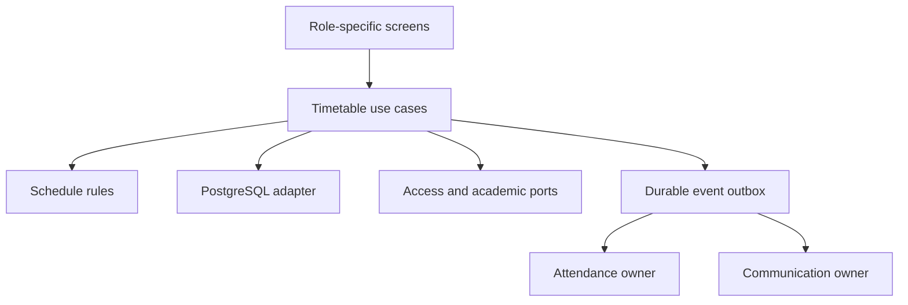

# Timetable HLD

## Boundary and ownership
Timetable is a Phase 3 capability owned by **Academics** in the existing modular monolith. Keep domain/application code framework-free under `backend/modules/academics/`; Next.js routes and React components are adapters. A future Nest.js HTTP adapter calls the same use cases and ports. Do not introduce a second identity, roster, family, attendance or notification system.

| Component | Responsibility |
|---|---|
| Timetable application | Day patterns, recurring plan drafts, publication, occurrences, dated overrides and teacher requests |
| Academic setup | Academic year/calendar, class/section, subject offerings, primary teacher eligibility |
| Access and People | Global identity, membership, teacher-person links and current role grants |
| Family access | Verified dated child relationship and explicit timetable read purpose |
| Attendance | Exact session roster, eligibility at opening, submission, correction and immutable receipts |
| Communication | Permission-filtered notices, delivery attempts, provider callbacks and preferences |
| Tenancy | Institution license, branch activation, scope and configuration evidence |
| Leadership | Read projection and source-owner follow-up links; no universal mutation authority |

## Aggregates and value objects
| Aggregate / entity | Invariants |
|---|---|
| SchoolDayPattern + Period | Branch/year/version; ordered local-time intervals; positive duration; no overlap; breaks never accept lessons |
| TimetableRevision + Slot | One branch/year scope; draft optimistic version; published content immutable; valid class/offering/teacher/room references; conflict-free across the complete scope |
| LessonOccurrence | Stable dated lesson identity independent of plan revision; expected version; effective assignment; cancellations retained; attendance opening pins the source snapshot |
| ScheduleChange | Exact occurrence, actor, reason, previous/current safe snapshot and receipt; historical evidence is append-only |
| CoverAssignment | One active effective assignment for the occurrence; eligible teacher; scoped date/interval; acknowledgement independent from authority |
| ScheduleRequest | Teacher-owned occurrence request; pending/resolved/returned lifecycle; one active duplicate key; resolution references source command |

Value objects: InstitutionId, BranchId, AcademicYearId, LocalDate, SchoolTimeZone, LocalTimeInterval, PublishedRevisionId, OccurrenceKey, TeacherAssignmentRef, RoomRef, ExpectedVersion, CommandId, OperationalReason, SourceReceiptRef. Keep times timezone-aware at boundaries; store both local schedule intent and materialized UTC occurrence bounds. Existing branch timezone is immutable here. Never identify actors by email equality.

## Ports
`AcademicScopePort`, `TeacherEligibilityPort`, `RoomAvailabilityPort`, `CurrentActorPort`, `FamilyPurposePort`, `TimetableRepository`, `AttendancePlanningPort`, `CommandReceiptPort`, `AuditPort`, `OutboxPort`, `Clock`. Adapters implement database queries, owner calls and transport. React never issues SQL or resolves a tenant from an untrusted form field.

## Entitlements
Effective access requires released capability + institution entitlement + branch activation + active institution/branch + actor capability + current entity scope. Foundations supply calendars and identities. Timetable can be licensed without Attendance. Attendance-only clients retain manual session workflows. Disabling Timetable stops its new planning actions, views and generation; it does not silently cancel existing Attendance records or disable the separate Attendance license. Attendance’s own source contract decides continued session availability.

## Delivery and growth
Start with weekly manual plans and bounded future occurrence generation. Preview changes before commit; use a durable outbox for cross-owner generation and notices. Outbox consumers must be idempotent. This existing infrastructure worker is distinct from the IAM admin-only email resend policy; do not silently change IAM retry behavior. If no durable worker exists, add the owner-managed dispatcher in the task plan rather than assuming a fire-and-forget call is durable.

Automatic optimization and two-week cycles extend the same published-plan interface later. They must submit a draft that passes the same validation and human publication step. No AI auto-publishes, grants permissions or interprets private staff availability.

## Security and phase boundary
Keep the existing account → Organization → School guard order. Protected reads authorize current scope; mutation paths take the appropriate write guard. Database RLS supplements application authorization and remains subject to TEN-03’s actual status. This design release does not claim RLS is enabled, that owner credentials are removed, or that production release is safe. No relaxation of TEN-03 or existing task gates is introduced.
