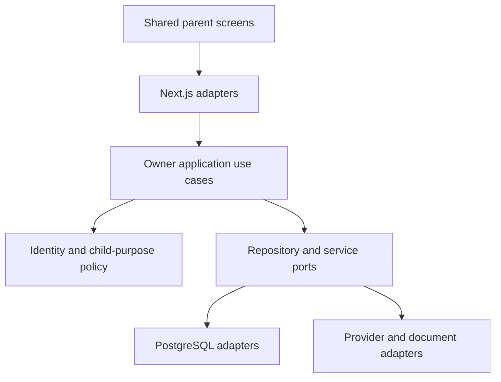
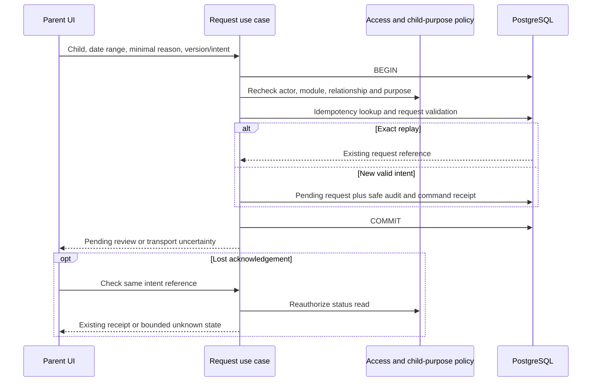
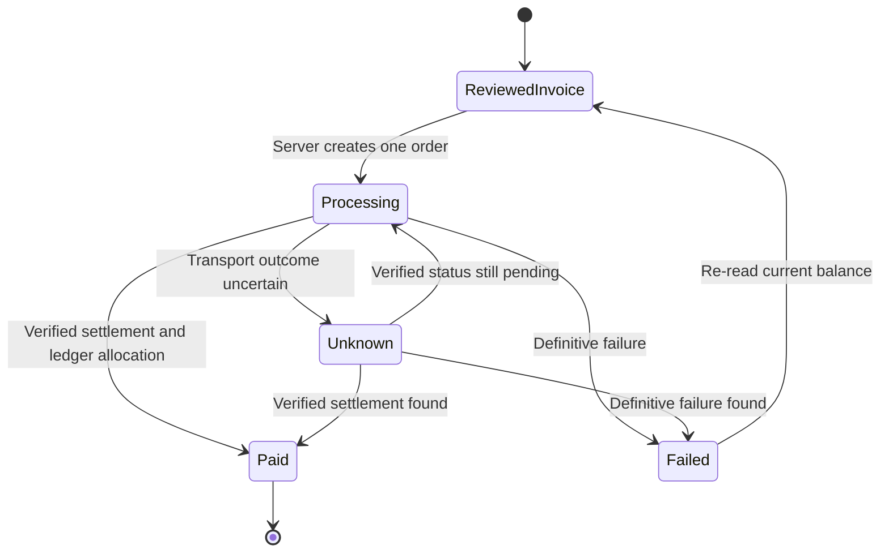

# Parent architecture and cross-module handoff

The Parent & Guardian workspace is a persona composition over existing bounded contexts, not a new owner of all student records. Next.js remains the UI/transport adapter; domain and application use cases stay framework independent for future Nest.js extraction.



Resolve account from the session, derive organization/branch/child/purpose on the server, and enforce owner-specific invariants. URL/hidden form IDs are references, not authority. Application queries and command transactions both recheck current grants; only mutations take their documented write locks. Preserve the actual repository’s account → Organization → School guard order and exact lock modes. RLS, runtime role separation and TEN-03 verification remain separate required repository work; this design does not close those gates.

## Domain ownership

| Aggregate / owner | Responsibility | Parent use |
|---|---|---|
| Access: UserAccount, invitation, session, recovery | Global identity, tokens, current sessions, trust-policy checks | School sign-in, verified activation/recovery, own contact/session |
| Guardians: Relationship, VerificationEvidenceReference, PurposeGrant | Institution/child relationship and dated purpose restrictions | Permitted child list, signer/payer context; never parent self-grant |
| Students / Academics | Official pupil identity, enrollment, class and published academic context | Minimal authorized child summary and school-local dates |
| Attendance | Exact session, frozen roster, marks/revisions | Read submitted child record; no direct parent write |
| Family requests | Originator, child, category, status/version and owner decision reference | Explanation/query, track and eligible withdrawal |
| Communication | Published notice version, conversation grants, messages and delivery attempts | Explicit acknowledgement and permitted replies |
| Learning / Assessments | Published task, returned feedback, published results/version/scale | Purpose-filtered read; no draft/moderation exposure |
| Consent | Request version, purpose, designated signer policy, decisions | Parent’s explicit response, separate overall completion |
| Finance / Payments | Invoice, exact amount/currency, mandate, order, provider evidence, ledger, receipt | Read/pay only under payer grants; unknown-status reconciliation |
| Admissions | Applicant-owned application/evidence/offer | Applicant journey remains separate from enrolled pupil grants |
| Service owners | Transport, library, activity, care and privacy policies | Narrow request/read/hand-off, never blanket Student 360 access |

## First connected journey

```mermaid
sequenceDiagram
  participant S as School verifier
  participant G as Guardians and Access
  participant P as Parent UI
  participant D as PostgreSQL
  S->>G: Verified relationship and intended purposes
  G->>D: Persist evidence reference and pending grant
  G-->>P: Account-bound invitation through permitted channel
  P->>G: Authenticate and accept invitation
  G->>D: Begin; recheck identity, token, live relationship and policy
  alt Valid and still permitted
    G->>D: Activate exact grants, consume token, record audit
    G-->>P: Authorized child summary and receipt
  else Expired, revoked, wrong account or failed delivery
    G-->>P: Safe unavailable/help response
  end
```

Use the institution’s existing trust modes. Preserve backfill-safe OPERATOR_CLI behavior, application-created HYBRID institutions and account-wide stricter recovery checks where applicable. Invitation/recovery delivery failure is an explicit state; it does not authorize token consumption. Follow the existing operator override and manual resend contracts. Verify the actual repository before reconciling this proposal.

## Explanation request transaction



No AttendanceRecord is written by this command. The school’s disposition and any authorized attendance correction have separate capabilities, audit and version transitions. Same-day date ranges are allowed. Define date limits, note limits, evidence policy and request-category routing in the physical LLD.

## Payment state and trust boundary



Only the provider adapter/reconciliation service can supply verified settlement evidence. A query parameter, browser return URL, uploaded screenshot or parent declaration cannot settle an invoice. Money is exact currency+minor-unit data; never floating-point accounting. Idempotency binds actor, issuer, invoice version and intended amount. A pending order blocks speculative new attempts. Duplicate provider events must not double-allocate; amount/currency/issuer/order mismatches need reconciliation, not optimistic success.

The demo provider functions are fixture-only. Real payment work requires chosen provider documentation, signed webhook verification, replay resistance, reconciliation, ledger/refund/accounting policy, observability and recovery LLD before production implementation. A refunded charge remains traceable to its original settlement.

## Published versions and consent

Guardians only read published results and returned feedback explicitly shared for their purpose. Private revisions and internal moderation never enter the DTO. Reauthorize downloads, attachments and historical revisions, even if a user once had access.

Consent decisions bind child, request/document version, purpose, signer identity and policy version. Store individual decisions separately from derived overall readiness. A form read, notice acknowledgement, RSVP, payment or one guardian’s response cannot implicitly satisfy other required approvals. Revocation, changed information, missing signers, withdrawal and deadline rules need their own explicit state transitions.

## Proposed application ports

`ListPermittedChildren`, `ResolveChildWorkspace`, `AcceptFamilyInvitation`, `ReadChildAttendance`, `SubmitAbsenceExplanation`, `GetRequestOutcome`, `WithdrawOwnRequest`, `AcknowledgeNoticeVersion`, `ReplyInGrantedConversation`, `ReadReturnedFeedback`, `ReadPublishedReport`, `RecordConsentDecision`, `ReviewPayableInvoice`, `CreatePaymentOrder`, `GetPaymentOutcome` and `RequestOwnerReview`.

Names are design labels; reconcile with existing use cases. Request DTOs reference owner IDs; authenticated scope is server derived. Typed outcomes distinguish validation, unauthenticated, forbidden/unavailable, stale version, exact replay, failed delivery and unknown outcome. Keep Next.js primitives out of domain/application code. Future Nest.js extraction replaces adapters/composition while preserving domain contracts, not necessarily every deployment concern.
