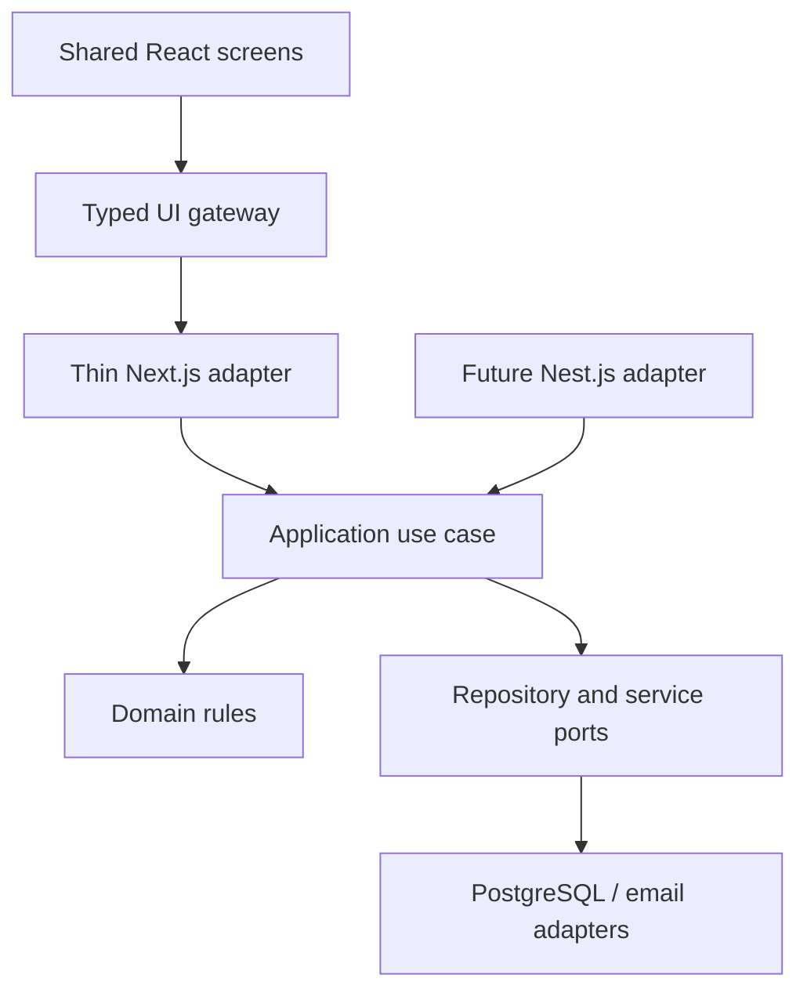

# Architecture and database handoff

This design pack must be reconciled into the real repository. Its conceptual data responsibilities are not a claim that later physical schemas exist. Keep all physical table names under the established `vs_` convention. Do not create duplicate student/person/account tables from UI terminology.

## Application boundary



No Next.js/React/ORM/environment imports in domain or application rules. Composition supplies clock, ID generation, transaction boundary, access, audit, outbox, email and repositories. Other modules call public facades; no cross-owner writes. Authorized read models may compose documented scoped joins, returning safe DTOs rather than ORM objects.

## Every protected command

```mermaid
sequenceDiagram
 participant UI as School screen
 participant API as Transport
 participant UC as Use case
 participant DB as PostgreSQL
 UI->>API: Command, expected version, request key
 API->>UC: Verified principal and typed input
 UC->>DB: Begin transaction; apply verified context
 UC->>DB: Recheck scope, capability and guard order
 UC->>DB: Check current state and dependencies
 alt Authorized and current
 UC->>DB: Owner writes + receipt + safe audit + outbox
 DB-->>UC: Commit
 UC-->>UI: Outcome and durable reference
 else Denied, stale or invalid
 UC->>DB: Roll back
 UC-->>UI: Safe error with recovery action
 end
```

Preserve the actual account → Organization → School guard contract; protected reads reauthorize but do not automatically take mutation write locks. Database RLS is a second layer, not a replacement for application checks. Do not mark TEN-03 or owner-role remediation complete because a design prototype works. Do not use caller-settable context alone as proof of identity.

## Database design worksheet required before a slice becomes implementation-ready

For each referenced aggregate, record: actual table/schema name; owner; institution/branch/global classification; column names/types/defaults/nullability; PK and scoped unique constraints; composite foreign keys; indexes and supported query shapes; state/version columns; retention/sensitive classification; audit redaction; migration/backfill plan; RLS policy/grant or documented exception; transaction/lock order; idempotency receipt; event/outbox contract.

For each read, give the exact joins with predicates for both sides, cardinalities, missing-row behavior and columns exposed to each role. A join by Person ID alone must not bypass branch, enrollment, purpose or current grant checks. Show EXPLAIN evidence for scale-critical reads after physical design. Physical details for later modules remain DESIGN_REQUIRED until their owning LLD is reviewed.

## Critical read and write compositions

| Screen / command | Owner references and composition |
|---|---|
| Today | Authorized sessions grouped by state, scoped import outcomes and permissible access statuses; no raw confidential message/case text |
| Student directory | Branch Student → organization Person; current-year Enrollment → effective SectionPlacement → authorized Section; exact scoped counts |
| Student attendance | Student → exact session frozen roster → latest effective AttendanceRecord revision; show session state before absence |
| Staff profile | Employee → Person → verified account binding; branch membership/role independent from employment and teacher eligibility |
| Offering / session | Academic Offering → dated eligible Teacher Assignment → Employee; session pins calendar; detect offering/date and teacher/date overlaps |
| Import confirm | Immutable source/preview context; per-row owner writes to Person/Student/Enrollment/Placement, external mapping, row receipt, audit and outbox |
| Family links | Student → dated StudentGuardianGrant → Guardian/Person → optional account binding; purpose and restrictive policy on each read; no global pupil search |
| Attendance correction | Submitted session/current revision + exact frozen roster membership → append correction revision with reason → receipt/audit/outbox |
| Finance panel | Student reference → permitted payer/ledger read model; separate financial grant; no writes from Students module |
| Health handoff | Minimal authorized referral metadata; no joins exposing clinical or safeguarding narrative in a general dashboard |

## Guardian relationship and invitation

```mermaid
sequenceDiagram
 participant Admin as Authorized school admin
 participant Guard as Guardian use case
 participant DB as Transaction
 participant IAM as Access module
 participant Mail as Email adapter
 Admin->>Guard: Student, adult, evidence reference, purposes
 Guard->>DB: Verify scope; create dated relationship grant
 DB-->>Guard: Relationship receipt and safe audit
 Admin->>Guard: Invite approved guardian
 Guard->>DB: Recheck live relationship and purposes
 Guard->>IAM: Issue scoped invitation under trust policy
 IAM->>DB: Token hash + issuance audit; commit
 IAM->>Mail: Send after commit
 Mail-->>IAM: Delivery result
 IAM->>DB: Record safe delivery outcome
```

Token consumption rechecks relation, account policy and grant state transactionally. A global UserAccount may belong to several institutions; an email reset must not bypass a stricter institution’s recovery policy. Revocation suppresses subsequent protected reads and queued sensitive delivery without destroying legitimate sibling grants.

## Poor network and bounded work

Phase 1 is online-first. Keep protected input in component memory only; do not use the prototype’s simplified in-memory model as a backend. On lost acknowledgement keep the same request key and payload, query receipt, then retry if safe. A 409 prompts review of current data. A 401/403 clears protected draft data. CSV uses bounded requests and resumable row outcomes; total file limits are distinct from the per-request body contract. The reviewed Imports LLD must settle and enforce both (including the previously specified 8 KiB request bound where applicable).

## AI and analytics

Audit and product analytics are separate. Audit belongs in the business transaction with safe diffs. Optional product events use allowlisted identifiers/outcomes/duration buckets without pupil names, contacts, CSV content or free text; analytics failure does not block the command. AI retrieves already-authorized evidence, cites its as-of source, uses deterministic calculations and creates a reviewable draft. It never bypasses normal command authorization.

<!-- EDITION02 -->
## Edition 02 — family owner extension
See [Families DESIGN](modules/families/DESIGN.md) for aggregates, ports, proposed physical tables, scoped joins, transaction workflows, sequence diagram and account-wide recovery integration gate. The schema is a reconciliation proposal, not migration-ready evidence. Guardians owns relationship/purpose, Access owns identity/invite, Students and Attendance remain source owners. Request claims never create relationships. The same hexagonal separation and future Nest.js extraction boundary apply.

<!-- EDITION03 -->
## Edition 03 owner handoff
Read [Communication HLD](modules/communication/HLD.md) and [LLD](modules/communication/LLD.md). Communication owns notices, content versions, manifests, attempts and acknowledgements. Guardians supplies independently verified purpose grants; Access supplies verified identity/contact; Students/Academics and staff memberships supply live audience scope. Framework-independent use cases depend on ports. Email adapter evidence is separate from the unchanged IAM invitation/reset delivery contract.
