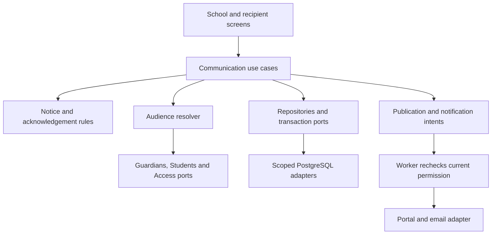

# Communication & Notices — HLD

Edition 03 · Phase 2 · Proposed implementation architecture, not deployed-state evidence.

## Purpose and product placement
Communication is an existing School Administrator area, alongside Families. Its first coherent release connects administrator SA-35/36, teacher TEA-17/18 and parent PAR-09/14. Families establishes verified relationships and explicit purposes; Communication uses those permissions without creating them. SA-37 remains the Requests owner's workflow. The first slice supports text notices, an optional email notification, teacher draft approval, scheduling, corrections, withdrawal, explicit acknowledgement, reminders and delivery recovery.

The complete administrator pack opens on Communication and defaults to Expanded school review. Families and Communication are directly visible in the main navigation. This is a design-preview setting; production entitlements and release configuration still control actual availability.

## Actors and responsibilities
| Actor | Responsibility | Not implied |
|---|---|---|
| Authorized school publisher | Review audience/content; publish, schedule, correct and withdraw branch notices | Institution-wide sending or identity administration |
| School communication reviewer | Review permitted draft and delivery follow-up | Access to private family disputes or credentials |
| Teacher | Read own notices; compose within assigned class and request approval | Direct publication or school-wide recipient access |
| Parent / guardian | Read currently permitted notices and acknowledge the current version | Other recipients, guardian lists, teacher address book or sibling-inherited access |
| Worker / provider adapter | Execute approved publication and notification intents with current checks | Interactive user authority or a bypass around module/tenant permissions |

## Boundaries and reusable components
Next.js transport adapters call framework-independent Communication application use cases. Domain code depends on ports for NoticeRepository, AudienceResolver, GuardianPurposeReader, StaffAudienceReader, Clock, SchoolTimeZone, UnitOfWork, CommandReceipt, Audit, PublicationQueue and NotificationSender. PostgreSQL, provider and Next.js code implement adapters. A future Nest.js extraction moves transport/composition, keeping domain and application code intact.

Reuse SchoolShell, page header, typed search toolbar, fluid filter/sort drawer, semantic table, notice editor recipe, confirmation dialog, error summary, field error, status label and toast. The communication CSS is scoped; theme uses the same semantic brand/surface/status tokens. The prototype's actor/failure controls are review tools, not production impersonation controls.

## Aggregates and domain concepts
- **Notice**: branch-scoped identity, lifecycle, current published version, expected revision and history. Published content is immutable; a correction creates a new version under the same notice identity.
- **NoticeVersion**: title/body, category, acknowledgement policy/date, approved audience manifest, publication time and immutable revision content.
- **NoticeDraft / ApprovalRequest**: author, assigned scope, editable revision, review feedback and status. An approval targets an exact draft revision and audience digest.
- **RecipientManifest**: approved account targets plus provenance to the exact child-purpose grants or staff memberships that justify each target. One account can have several valid child bindings; deduplication is by account, never by email string in production.
- **NotificationAttempt**: one delivery attempt, channel, stable intent, provider correlation and independently evidenced outcome. It is not a human read or acknowledgement.
- **Acknowledgement**: exact notice version, account, deliberate actor/method/time. A staff-recorded offline response has distinct staff actor and protected evidence, and never masquerades as parent interaction.
- **Value objects**: OrganizationId, SchoolId, AccountId, NoticeId, NoticeVersionId, DraftRevision, AudienceDigest, CommandIntent, SchoolLocalDate, ZonedPublicationTime, SafeFailureCode and VerificationReference.

## Permission and entitlement matrix (proposed names; reconcile actual registry)
| Capability | School admin | Teacher | Parent | Scope / rule |
|---|---|---|---|---|
| communication.compose | Explicit grant | Assigned class only | No | Branch + author scope |
| communication.publish | Explicit publisher grant | No default | No | Current branch/module and reviewed draft/audience |
| communication.review | Explicit reviewer grant | No default | No | Permitted approval queue |
| communication.manage_delivery | Explicit grant | No default | No | Sanitized own-branch delivery evidence |
| communication.record_offline_ack | Separate explicit grant | No default | No | Verified current-version response, staff actor/evidence |
| communication.read | Audience-limited | Own addressed notices | Own addressed notices | Current live audience/purpose grant |
| communication.acknowledge | Own addressed notice only | Own addressed notice only | Own addressed notice only | Current exact version and deliberate action |
| guardian.relationship.manage | Existing delegated verifier | No default | No | Separate owner establishes school-notice purpose |

First-slice notice-purpose key: `communication.notice.read`. It is independent from `attendance.read`, fees, pickup, emergency contacts and consent. Email preference never creates a guardian purpose. Adding a notice purpose requires an explicit verified grant and intended-account acceptance according to the existing family contract. A future purpose extension must not silently widen old attendance grants.

## Delivery phases
1. **Phase 2A — dependable notices:** permission extension; scoped drafts; audience preview; in-app publication; optional verified-email notification; parent/staff read and acknowledgement; correction/withdrawal; scheduling/cancellation and delivery follow-up. All are designed in this pack.
2. **Phase 2B — delegated authoring and operations:** teacher approval, verified offline acknowledgement and configured reminder limits. These are also demonstrated here but retain their own capability and task gates.
3. **Phase 2C — further communication:** secure attachments with Documents scanning/grants; private child-specific conversations; rich request handling and meeting scheduling. Existing SA-37, TEA-19/20 and PAR-15/16/17 contracts remain planned and are not declared fully implemented by this prototype.

No SMS/WhatsApp, emergency alert guarantees, legal consent collection, open parent directory or public student-specific notice content is included in this cut. Billing/consent/safeguarding decisions stay with their owners.

## Quality and rollout
Use the existing institution → branch model and module configuration. Validate limits, predicates and recipient manifests on the server. Keep protected reads current-authorized; use the existing account → Organization → School protocol and documented write locks for mutations. Record current RLS requirements per table; TEN-03 and real release gates remain unchanged.

The Bible's existing scale target of 5,000 pupils per branch × 20 branches guides dataset sizing. Do not apply the attendance submission latency goal to synchronous fan-out. Communication publication may accept an asynchronous command and expose Processing until the approved manifest and version are complete. Quantitative publish/queue SLOs are pending measured provider/runtime limits; no benchmark claim is made here.
