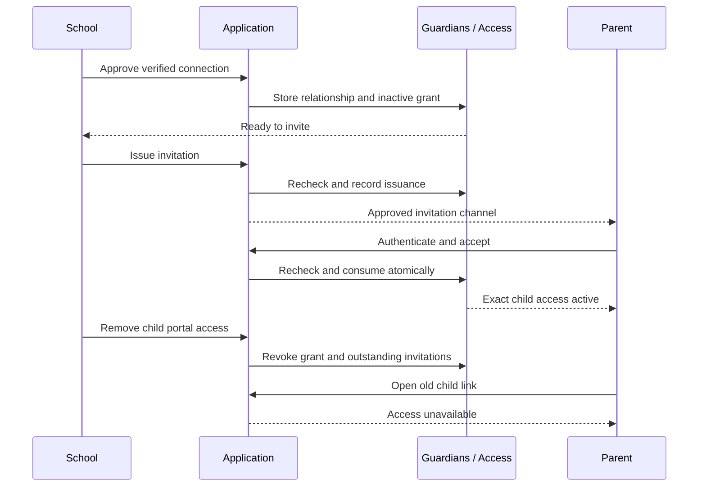

<!-- TT-01 contract -->
## Independent timetable purpose
TT-01 adds an explicit, initially unchecked Timetable read purpose alongside Attendance and School notices. It does not backfill real grants. The seeded Aarav/Kavya connection has this purpose explicitly for demonstration. Read the shared timetable LLD for the authorized relationship/enrollment join.

# Families — integrated School Administrator design

Edition 02 · Phase 2 · Stable administrator journeys SA-32, SA-33, SA-34. The current design exposes independently approved **attendance** and **school-notice** purposes. Other purpose grants remain explicit later contracts. This is an offline UX proposal, not an assessment of deployed code.

## One administrator workspace
Families appears under Enabled services in Expanded school review. Students → record → Family links opens the same connections; there is no second family database or separate school-admin application. Existing 63 workflow IDs and 22 module areas remain. SA-37 owns the wider family-request workflow; this slice supplies its access-help category. Parent acceptance and My children are a labeled handoff preview, not an administrator impersonation capability.

| Administrator responsibility | Stable journey | Result / next action |
|---|---|---|
| Connect a student and verified adult; save/resume a draft | SA-32 | Approved relationship, inactive grant; next Send invitation |
| Review recipient, send and monitor delivery | SA-33 | Waiting for parent, or visible delivery failure |
| Resend / recover expired or failed invite | SA-33 | Old invitation unusable; fresh invitation recorded |
| Review dates, remove portal access, end school relationship | SA-34 | Current exact-child permission changes with history |
| Review missing-access request | SA-37 → SA-32 | Private school verification; no automatic child match |
| Parent authenticates, accepts, opens child attendance | PAR-01/04/05/06 handoff | Only the accepted, dated child-purpose grant is active |

## SA-32 — Connect a family
1. Enter from Families → Connect a family, or Student → Family links. A student entry preselects only the authorized student; the adult and evidence stay blank.
2. Select the relationship and enter the verified adult’s name and contact. In production resolve the verified Person/Account binding through the existing owner use case; the prototype uses fictional labels.
3. Record a bounded school verification reference, Access starts, and inclusive Last day of access. Confirm completed school verification and select Attendance and/or School notices. Both purposes start unchecked; choose at least one.
4. Review child, adult, branch, dates and permitted view. Approve connection creates a verified relationship and inactive grant; it does not send mail or activate parent access.
5. Outcome detail says Ready to invite and offers Send invitation. Save draft and leave is separate from Back/Continue and enabled only after content is entered; draft is branch-specific and confers no access.

Validation: known branch student; approved relationship category; bounded name/email/reference; valid dates; verified restrictions; explicit purpose; duplicate verified binding / concurrent version checks. Resolve sensitive or disputed relationships privately. No raw identity documents or custody narratives in this form.

## SA-33 — Invite and establish access
1. Open a verified connection and review its intended recipient. The invite screen cannot change that identity; use separate verification for a contact change.
2. Confirm Send. Commit issuance/audit before external delivery, then record delivery outcome. The UI distinguishes Ready to invite, Waiting for parent, Delivery failed, Expired, Replaced, Revoked and Active.
3. On failure the detail shows timestamp and safe reason. An authorized explicit Resend creates a fresh invite and invalidates the old one. No background retry.
4. Intended parent authenticates through Access, reviews minimal child/purpose/dates and accepts. No child data at the public invalid-token boundary. The school’s connection becomes Active only after valid acceptance.
5. My children is grant-based. Attendance uses the same exact child and submitted roster revisions as the school, with Awaiting teacher submission distinct from Absent.

The interactive parent handoff is clearly labeled and uses fictional actor switching; it must never be implemented as an unapproved production impersonation feature. OPERATOR_CLI hands off to the existing verified operator process; HYBRID/EMAIL use email only within current policy.

## SA-34 — Manage access
Open connection → Manage access. Each action gets its own consequence review.
- **Change access dates:** reverify restrictions, review inclusive dates, save a new version. Prior invitations are invalidated; parent access pauses until fresh acceptance. Historical attendance access cannot expand silently.
- **Remove portal access:** choose a bounded reason, confirm this child/adult, revoke the child-purpose grant and outstanding tokens. Keep the school relationship/history; do not remove another child’s grant or source records.
- **End relationship:** require the verified school decision reference and confirmation. End this school record, revoke its grants/tokens and retain history. This records a school decision; it is not a legal guardianship determination.
- **Future purpose changes:** notices, finance, pickup, emergency and consent each require their own owner contract and approval. They are not silently bundled into Attendance.

Dates outside the current access window must remain reviewable by authorized school staff. Current implementation must offer an explicit verified renewal path; expiry never converts into ongoing access. Prototype date revision focuses on currently effective records; planned/future/expired cases remain documented implementation tasks.

## Screen / state coverage
| Surface | Normal | Important alternate states |
|---|---|---|
| Families / Student family tab | Branch-specific connections | Empty branch; no verified connection; multiple adults; removed link |
| Connect family | Three-step form | Inline errors, blank submit, draft resume, unsaved-leave guard |
| Connection / Invitations | Recipient, purpose, dates and history | Delivery failed, resend, expired, policy blocked, removed/ended |
| Manage access | Consequence-specific action | Missing verification/reason; stale grant in real implementation |
| Access requests | Reviewer queue | Empty, own request receipt, start empty verification |
| Parent handoff | Intended recipient → My children → attendance | Wrong account, unusable invite, no children, old-link denial |

## Scope and fidelity
All families in this pack are synthetic. Browser behavior illustrates authorization boundaries but proves no production authentication, RLS, email delivery or SQL isolation. Real account linking uses verified IDs, not the prototype’s email fixture matching. Existing security and acceptance gates remain authoritative.

## HLD and owner boundaries
Next.js page/route/server-action adapters → Guardians application use cases → domain and repository/access/clock/audit/transaction ports → PostgreSQL/Access/email adapters. Framework-independent policy belongs under backend/modules/guardians (or the actual existing owner). Shared frontend components stay in the existing design system. This keeps later Nest.js extraction limited to transport/adapter composition.

Access owns global UserAccount, identity proof and invitation lifecycle. Guardians owns the verified adult–student relationship and purpose grants. People/Students own identities and enrollment; Attendance owns sessions, roster snapshots and submitted revisions. Family requests owns the support claim; it never activates a relationship. lib/server/email.ts remains an adapter behind an EmailSender port, not a dependency imported by domain code.

## Aggregates and value objects
- GuardianRelationship: organization, student, verified adult Person reference, approved relationship type, verification state/reference, expected version and history. Verification, dispute, end and portal revocation are separate concepts.
- ChildPurposeGrant: relationship, organization, school, purpose, school-local effective interval, acceptance/account binding and revocation. It grants no wildcard or implicit sibling authority.
- Invitation: Access-owned single-use secret reference, intended identity, relationship/grant version, purpose/scope, expiry, issue/consume/revoke and delivery lifecycle.
- AccessHelpRequest: authenticated originator, organization/school help scope, safe issue, optional bounded school reference, assigned reviewer/state/version.
- Value objects: OrganizationId, SchoolId, StudentId, PersonId, AccountId, PurposeKey, EffectiveDateRange, VerificationReference, ExpectedVersion, CommandIntent, InvitationId.

## Core invariants
1. A designated school verifier establishes relationship evidence. Account/email possession alone is insufficient.
2. Identity is bound by verified Person/Account IDs through Access, never by email equality, surname, address or household membership.
3. No active parent portal grant until valid intended-account acceptance, effective relationship/grant dates, released module and current school/student scope all hold.
4. One adult can have multiple independently verified child links. No uniqueness or merge policy based on email alone.
5. Current authorization is checked on reads, writes, acceptance, status/replay and downloads. Branch transfer and restrictions require reauthorization.
6. The form asks for an inclusive Last day of access and converts it to the next calendar day as the stored exclusive end. Start is inclusive; stored end is exclusive in the branch calendar. Convert via the approved timezone/clock port; do not assume browser timezone. The first slice exposes attendance inside its approved record-date scope only. Historical access before grant start requires a separate explicit policy.
7. Exact replay returns the existing permitted result; changed payload under the same intent is conflict. Duplicate approval uses verified adult/child/scope identity, not prototype email matching.
8. Removing portal access revokes grants/tokens, not the legal relationship or source attendance; it must not remove unrelated sibling/institution access.

## Candidate physical table contracts
Names and columns are proposed mappings, not assertions that new tables are needed. Match existing Guardians/Access tables before writing migrations. All scope-bearing IDs need composite FKs or an equivalent documented owner constraint; nullable/global IDs do not authorize cross-tenant joins.

| Table / owner | Candidate stored fields | Responsibilities and constraints |
|---|---|---|
| vs_guardian_relationship / Guardians | id UUID PK; organization_id UUID NOT NULL; student_id UUID NOT NULL; adult_person_id UUID NOT NULL; relationship_type bounded enum/text; verification_state enum; verification_reference bounded protected text/ref; verified_by_account_id UUID; verified_at timestamptz; status enum; version bigint NOT NULL; created_at/updated_at timestamptz | Institution + Student + Person identity linkage; evidence is private. Unique active adult/student identity binding only after reconciliation of relationship-history rules. Ended/disputed history retained. |
| vs_guardian_purpose_grant / Guardians | id UUID PK; organization_id/school_id UUID; relationship_id UUID; purpose_key bounded text; intended_account_id UUID nullable until verified binding; accepted_account_id UUID nullable until acceptance; valid_from/valid_until DATE; record_from/record_until DATE if explicitly separate from access interval; accepted_at/revoked_at timestamptz nullable; version bigint; timestamps | Branch-scoped child-purpose permission. CHECK valid_from < valid_until, consistent nullable pairs, approved record interval. Acceptance and binding cannot conflict with verified identity. Prevent overlapping duplicate active grants with the approved scoped unique/exclusion strategy. Current purpose keys are attendance.read and communication.notice.read, selected and authorized independently. |
| Existing vs_access_invite or dedicated Access extension | id; organization/school scope; family relationship + grant refs; invitation kind; intended Person/Account identity refs; token_hash; expires_at; consumed_at; revoked_at; delivery_failed_at; safe delivery_failure_code; expected_relationship/grant versions; timestamps | Reuse only if it supports family-specific validation and scope without treating the parent as staff. Never reuse a staff-invite endpoint indiscriminately. Secret is generated by Access; raw token not persisted in general logs/audit. |
| vs_guardian_relationship_event or existing owner event/audit | event_id; organization_id; relationship_id; actor_id; event_type; safe result; previous/new version; occurred_at; command/correlation ref | Traceable verification/binding/purpose/revocation history. Restricted reasons/evidence stay in protected owner storage, not generic event payloads. |
| Existing command receipt / owner outbox | actor + scope + command + intent key/digest; protected outcome ref; state; timestamps | Unique intent; canonical payload comparison; lost-outcome recovery. Reauthorize receipt access. Respect existing delivery policy; an outbox is not permission for automatic email retries. |
| Existing family request / candidate vs_family_request | id; organization/school scope; originator_account_id; category; optional safe school ref; status; reviewer_account_id nullable; version; timestamps | Missing-access claim. No student foreign key inferred from unverified user input. Link to an approved relationship only through explicit school review. |

Dates, enum values, defaults, retention, deletion behavior and actual FK targets require the live owner LLD. Avoid generic JSON for searchable scope/state. Register each table’s institution/branch/global class and current TEN-03 obligations. This pack does not implement a migration, RLS or runtime-role setup.

## Query and join contracts
**Administrator list:** authorized school scope → Students enrollment in that branch → relevant GuardianRelationship → purpose grants for the same organization/school → latest invitation/delivery metadata. A school grant does not expose other branches’ restrictions.

**My children:** authenticated Account → accepted effective ChildPurposeGrant matching Account and current organization/school/module policy → verified non-disputed Relationship → same-institution Student + permitted Enrollment summary. Start from grants; never list all Students and filter in the browser. Return minimal name/class/school/purpose DTOs. No co-guardian directory.

**Attendance:** reauthorize selected child + current purpose and record-date window → exact school AttendanceSession → that student’s frozen roster membership → latest effective submitted revision/outcome. Missing submission is not Absent. Use both scope and owner IDs in joins; do not expose another roster member.

**Invitation review:** authenticate intended account via Access → bounded opaque invitation lookup → current grant/relationship/policy/date/version checks → minimal school/child/purpose review DTO. The public boundary never returns child existence/details. Acceptance rechecks rather than trusting this preview.

**Support review:** authorized reviewer’s school → request; parent reads only their own request under current policy. School input verification is separate from a student directory lookup on the parent endpoint.

## Transaction workflows
### Verify relationship and approve grant
BEGIN → derive current principal + organization/school scope → follow the existing account → Organization → School guard protocol → validate Student enrollment and verified adult reference/restrictions → check expected versions and existing active binding → insert/update Relationship and inactive purpose grant → store safe audit/receipt → COMMIT. No invitation or active parent access from the form draft. Retries must be idempotent.

### Issue / resend invitation
BEGIN → current school inviter permission, effective relationship/grant, intended verified account/contact, module and trust-policy checks → revoke outstanding invitation for the same purpose → generate fresh secret/hash and expiry using Access policy → write issuance audit/receipt → COMMIT. Send through the approved email adapter after commit. It returns {ok:true} or {ok:false,reason}; delivery failure is persisted in a new transaction with safe failure code and audit. Consume must deny failed delivery; model Pending delivery explicitly where the existing adapter requires it. No background retry: authorized Resend is required. Never change the recipient on Resend without separate school verification.

### Accept
BEGIN → current authenticated account and account-wide policy → existing guard order and locked invitation/grant/relationship records in one documented order → check intended verified identity, current module/trust rules, dates, non-revoked relationship, expected grant/relationship version, valid unconsumed non-failed token → bind account and activate the exact grant; consume invite; append safe evidence and command receipt atomically → COMMIT. Expiry/revocation/policy/version change fails closed. Exact completed acceptance returns the existing outcome only if the actor can still access it. Linking never changes a password.

### Remove portal access
BEGIN → current school permission + expected versions → lock in the same order as acceptance → revoke the exact child-purpose grants and outstanding invitations; append event/receipt; mark pending sensitive deliveries for suppression → COMMIT. Every subsequent read/send/download rechecks; clear client child caches. Concurrent acceptance cannot outlive the revocation. Delivered messages cannot be retrospectively erased, so minimize content at send time.

## API / application boundary proposal
Use cases: approveGuardianRelationship, issueFamilyInvitation, acceptFamilyInvitation, listMyChildren, getMyChildAttendance, revokeChildPortalAccess, createAccessHelpRequest, startAccessHelpReview. HTTP routes are adapters; map to existing route conventions rather than invent parallel endpoints.

Write DTOs contain intended resource refs, bounded user fields, expected version and command intent, never trusted actor/tenant claims. Server-derived principals/scopes and owner lookups are mandatory. Typed outcomes: success/existing outcome, validation error, no access, stale version, invitation unusable, delivery failed, confirmation pending. Public invitation errors remain generic. GETs never consume a token; require the protected confirm command, CSRF controls and rate limits appropriate to the existing Access stack.

## Account/trust integration gate
Existing OPERATOR_CLI/HYBRID/EMAIL behavior remains intact. No column defaults, staff flows or recovery policy are changed by this slice. Email issuance only where the actual policy allows it; operator-assisted flow remains a controlled fallback. Trust-mode tightening invalidates outstanding family invitations too.

A parent may have guardian links without SchoolMembership rows. Before shipping family access, reconcile the account-wide recovery resolver so every stricter institution relevant to the global identity—including active guardian bindings under the approved policy—is considered at issuance and consumption. Do not create a password reset shortcut in the family module or silently assume the older staff-membership query covers parents.

## Index and load design
Plan scoped child+adult active-binding lookup; actor+effective-purpose grants; school/student enrollment joins; outstanding relationship invitations; token-hash lookup; request reviewer queue. Inspect EXPLAIN ANALYZE using the intended runtime role and actual data distributions. The existing 5,000 pupils/branch × 20 branches profile remains an input; family-query concurrency, guardian links per child, attendance window bounds and response SLOs must be specified before performance acceptance. No benchmark claim is made here.

## Security references and interpretation
OWASP Authorization Cheat Sheet: https://cheatsheetseries.owasp.org/cheatsheets/Authorization_Cheat_Sheet.html — deny by default and validate authorization on each request.
OWASP Forgot Password Cheat Sheet: https://cheatsheetseries.owasp.org/cheatsheets/Forgot_Password_Cheat_Sheet.html — secure, expiring, single-use token principles. Applying these properties to invitations is a design analogy, not a claim that email proves guardianship or that this module implements password recovery.

## Additional transaction contracts for SA-34
**Date revision:** current verifier permission → guard and lock in the established order → validate expected relationship/grant version and new school-local interval → write grant revision and acceptance reset → revoke previous invitation versions → safe event + command receipt → commit. If the active grant is paused, communicate that consequence before commit. Reauthorize parent reads immediately. Changing dates never rewrites attendance records.

**Relationship end:** verified decision reference belongs in protected owner storage; safe event contains only action/IDs/versions. End the relationship, revoke all of its current grants and outstanding tokens atomically, suppress undelivered sensitive messages, and keep unrelated relationships intact. Use the same lock order as acceptance/revocation. Stale actions must return a reviewable conflict.

**Current-state read:** a connection detail joins the authorized school student, relevant relationship, exact-purpose grant and latest permitted invitation metadata. Never show another branch’s restrictions, another adult’s private requests, secrets, raw tokens or sensitive decision text in the shared audit.

<!-- EDITION03 -->
## Edition 03 purpose extension
School notices now has its own `communication.notice.read` selection in the family form. Existing attendance-only grants are not migrated, backfilled or treated as notice grants automatically. The fictional seed explicitly includes independently verified, accepted notice purposes for Kavya, Ravi and Sara; Leena remains attendance-only. New connections receive only checked purposes after valid acceptance. Existing grant extension/renewal must be designed in the real Guardians owner and map acceptance per purpose; do not copy the prototype's simplified aggregate flag as a production grant model.
