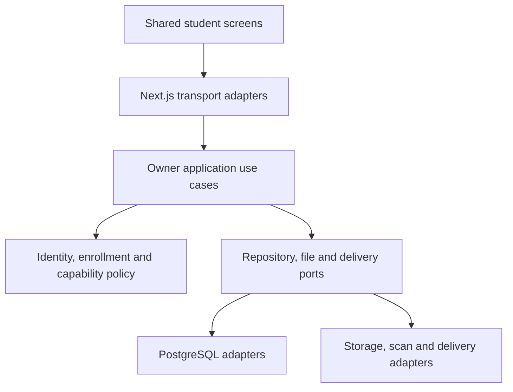
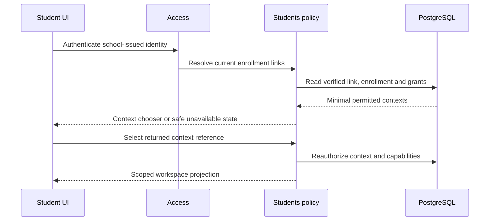
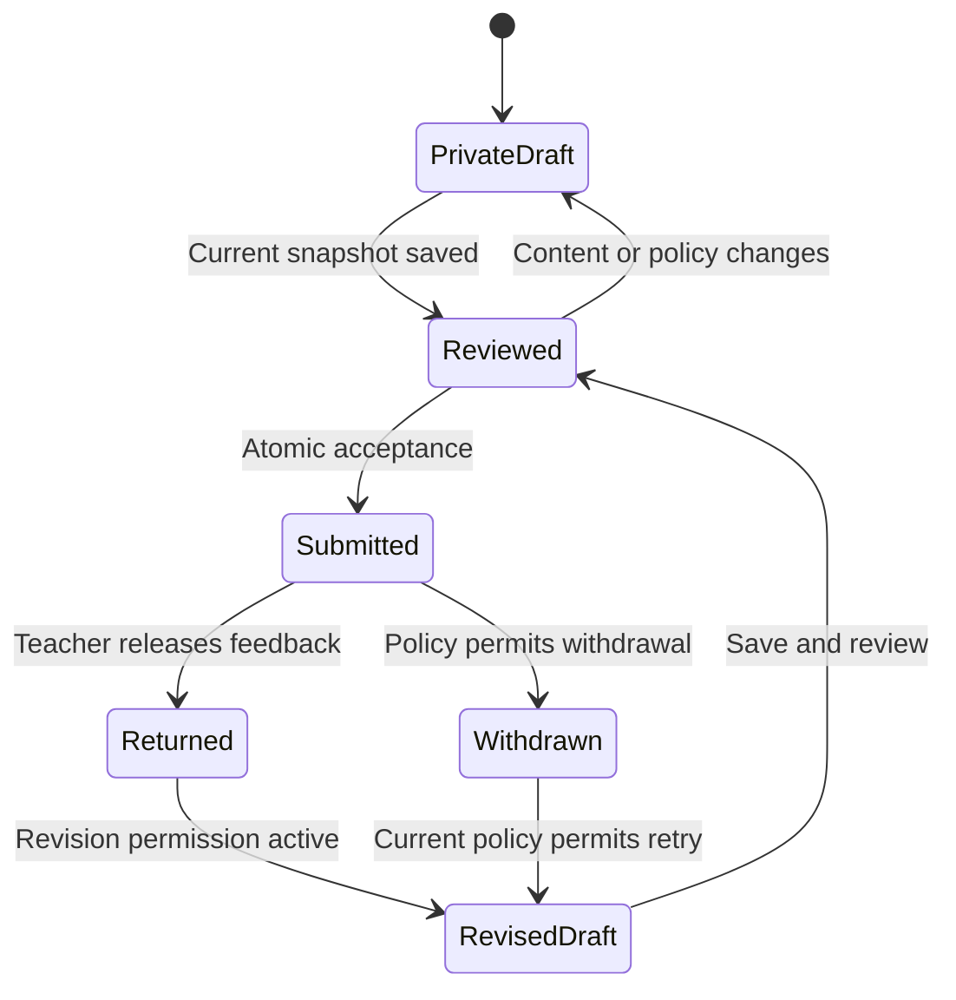
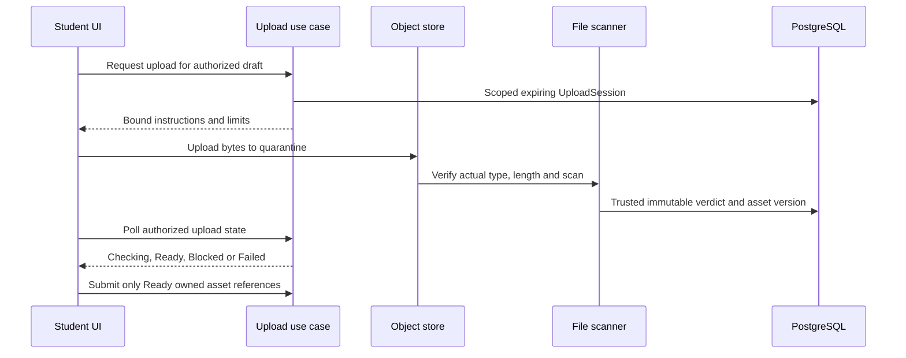

# Student workspace architecture
The workspace is a persona composition over bounded contexts. Preserve hexagonal architecture and the current account → Organization → School guard protocol. Next.js supplies UI/transport adapters; domain/application code stays independent of Next.js, React, Prisma and provider SDKs.



## Owner map
| Owner | Aggregates / values | Student use |
|---|---|---|
| Access | UserAccount, Session, Invitation, RecoveryPolicy | Authenticate; intended invitation; own sessions |
| Students | StudentAccountLink, Enrollment, VerificationReference | Verified self identity and active institution/branch scope |
| Academics | Offering, PublishedTimetable, Occurrence, SchoolLocalDate | Assigned classes and schedule |
| Learning | Assignment, Audience, SubmissionPolicy, PrivateDraft, SubmissionAttempt, FeedbackPublication | Published work, private writing, immutable accepted work, returned feedback |
| Files | UploadSession, AssetVersion, ScanVerdict | Quarantined upload then authorized clean attachment |
| Communication | NoticeVersion, Acknowledgement, ConversationGrant, Message | Acknowledgement and permitted staff conversation |
| Attendance | Session, FrozenRosterMember, AttendanceRecord/Revision | Self-only submitted outcome |
| Requests | OwnedRequest, Category, DecisionReference | Query, extension and support; never auto-approval |
| Assessments | PublishedReport, Outcome, ScaleVersion | Released self results |
| Services | Loan, Registration, TransportAssignment, SupportRequest | Narrow service requests/projections |

Value objects: OrganizationId, SchoolId, StudentId, EnrollmentId, AssignmentId, SchoolTimeZone, Instant, EffectiveDeadline, AssignmentVersion, DraftVersion, AttemptNumber, IntentKey, ContentDigest, FileSizeBytes, MimeType, PublicationState, Outcome. Validate at construction.

## Read authorization
Session account is server-derived. Resolve verified student account link and active enrollment at the requested institution/branch. Check release, entitlement, branch enablement, student capability and assignment audience. Reads use current scope without universal write locks. Minimized DTOs omit private teacher/guardian/peer data. Apply the same authorization to downloads, historical attempts, status lookup and exact replay.

Do not trust browser tenant IDs, school slug, role claim or caller-settable database settings. Preserve actual TEN-03 design and non-forgeable context requirements. This pack does not enable RLS, change runtime credentials or close production security gates.

## Command ports
ListOwnAssignments, ReadPublishedAssignment, SavePrivateDraft, BeginStudentUpload, ConfirmScannedAsset, ReviewSubmission, SubmitAssignment, GetSubmissionOutcome, StartRevision, WithdrawSubmission, ReadReturnedFeedback, ReadOwnAttendance, CreateOwnedRequest, AcknowledgeNotice, SendGrantedMessage, ReadPublishedReport, ResolveStudentWorkspace.

Commands take actor context from the authenticated adapter, expected versions from UI and an intent key where retries repeat effects. Typed outcomes: validation, unavailable/forbidden, unauthenticated, conflict, closed, pending, exact replay and accepted receipt. Routes remain thin.

## Student entry


Invitation and recovery retain existing OPERATOR_CLI/HYBRID/EMAIL rules, stricter account-wide recovery, token delivery failure rules and operator overrides. School verifies StudentAccountLink separately from token/email proof. Reconcile link types with real recovery-membership enumeration so student institutions cannot be skipped.

## Draft save and submission
```mermaid
sequenceDiagram
  participant UI as Student UI
  participant Learn as Learning use case
  participant Files as File policy
  participant DB as PostgreSQL
  UI->>Learn: Save draft with expected version
  Learn->>DB: Recheck scope; versioned private draft write
  Learn-->>UI: Committed version and saved time
  UI->>Learn: Submit reviewed snapshot and stable intent
  Learn->>DB: BEGIN; guard scope; lookup intent; lock assignment then draft
  Learn->>Files: Verify clean owned immutable assets
  alt Exact replay
    DB-->>Learn: Existing receipt
    Learn->>DB: End read transaction
    Learn-->>UI: Same receipt after current authorization
  else Current policy and snapshot valid
    Learn->>DB: Attempt, file snapshots, receipt and audit
    Learn->>DB: COMMIT
    Learn-->>UI: Accepted receipt
  else Policy or version changed
    Learn->>DB: ROLLBACK
    Learn-->>UI: Typed conflict; preserve private draft
  end
  opt Response is lost
    UI->>Learn: Check same intent
    Learn->>DB: Reauthorize and read command receipt
    Learn-->>UI: Receipt or explicit unresolved status
  end
```

Lock ordering extends the existing guard order and must align with Teacher review/withdrawal and file-owner transactions. No provider network call while holding database locks; the File policy reads trusted persisted verdicts.

## State model


Confirmation pending is a client knowledge state, not another server submission status. The server may already be Submitted. Teacher review lock is separate from feedback publication; release never implicitly grants resubmission.

## Upload sequence


A MIME header or browser flag cannot mark an asset clean. Provider callbacks require authentication, replay protection and scope/version matching. Abandoned-upload cleanup belongs to the file owner and cannot delete referenced attempt evidence.

## Future Nest.js extraction
Keep application ports/domain/tests under backend/modules/<owner>; Next.js adapters under current transport convention; shared UI under components; persistence/storage adapters under infrastructure; composition at the framework edge. Nest.js later replaces transport/composition/auth integration without moving business rules into controllers. Deployment, cookies, storage and queues still need migration work; do not promise zero effort.
