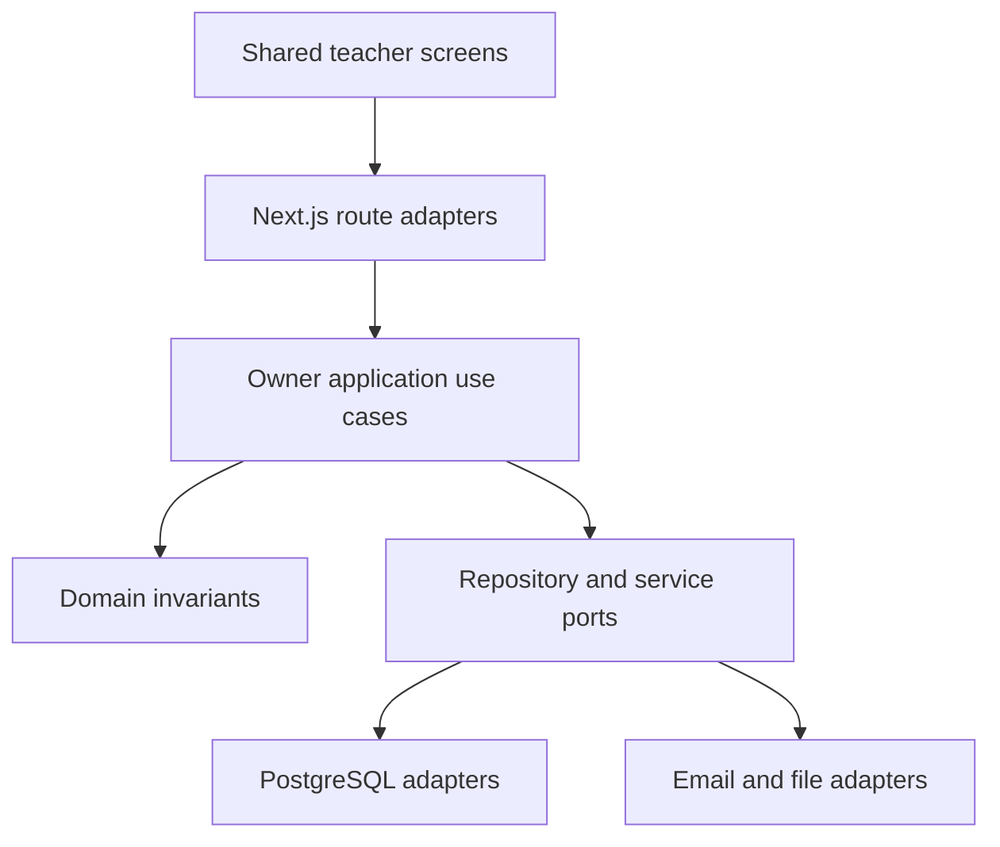
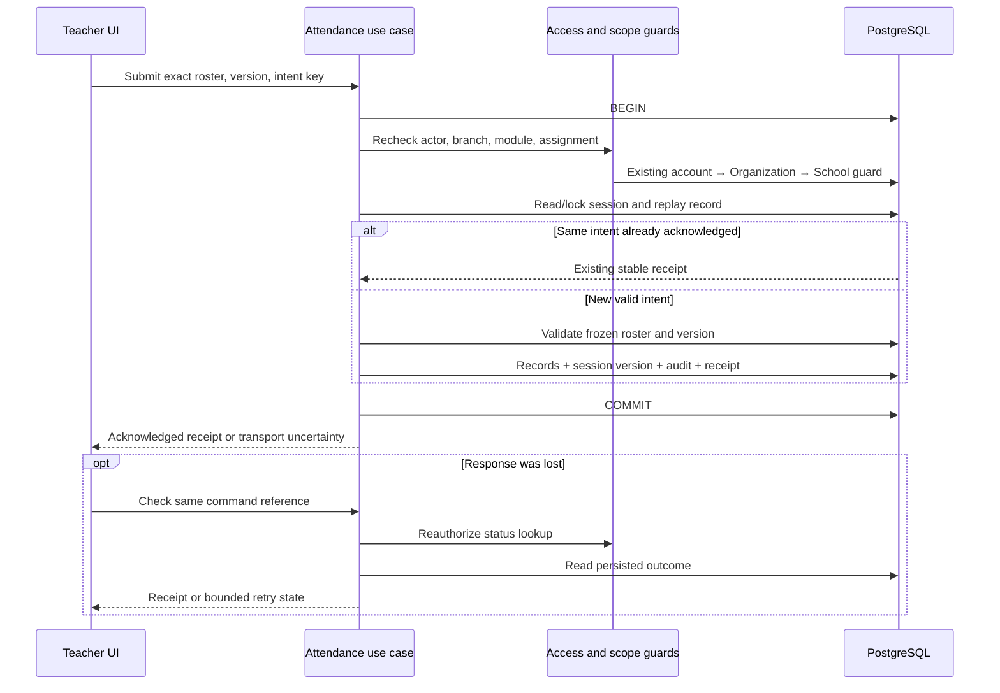
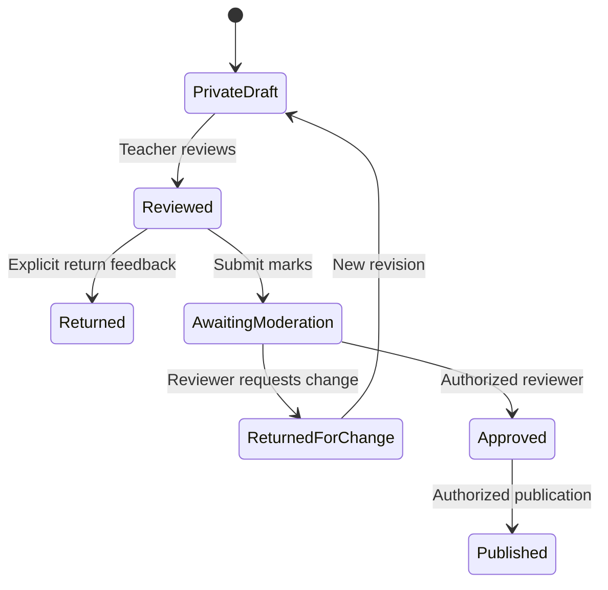
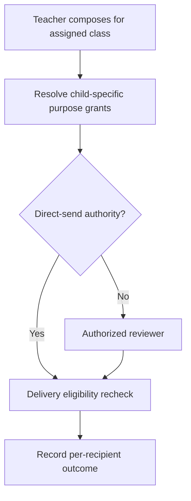

# Teacher architecture and data handoff

## Boundary

Teacher is a persona/read-model composition, not a new owner of all school data. Reuse the existing bounded contexts. This file describes application/domain contracts and database workflows; it is not a migration or a claim that a named physical table currently exists. Confirm actual entities, columns, indexes and ADRs in the repository before final physical LLD. Existing table naming stays `vs_`; propose new physical names only in the owning module’s approved schema registry.

## Hexagonal structure

UI consumes explicit DTOs and typed outcomes. Next.js owns HTTP/session/form translation only. Domain/application code has no React, Next, framework request or UI imports. A composition root supplies ports. A later Nest.js extraction replaces the transport/composition adapter while preserving application contracts and repository tests; it is not a promise of zero migration effort.

## Ownership and relational workflow

| Logical records / aggregate | Stored responsibility | How teacher experience joins / reads it | Write owner |
|---|---|---|---|
| UserAccount, session | Global identity and authenticated session | Server actor → active branch membership and grant | Access |
| Organization, School, enabled modules | Institution/branch lifecycle, timezone, trust mode and module access | Server scope filters every subsequent read; branch-local date from immutable zone contract | Tenancy |
| Person, StaffProfile, TeacherEligibility | Verified staff identity and dated eligibility | Account binding → eligible teacher → dated assignment | People |
| AcademicYear, ClassSection, Offering, TeachingAssignment | Class/subject and authorized dated teaching relationship | Filter by teacher, branch, date; join offering/section for display | Academics |
| Student, Enrollment | Pupil identity and dated class membership | Offering’s class + academic year + effective enrollment → minimal roster DTO | Students |
| AttendanceSession, frozen roster, AttendanceRecord, revision, submission receipt | Exact session window, roster snapshot, explicit statuses, revision history and replay result | Session → frozen roster → minimal names; records/receipt referenced by same branch/session and authorized actor | Attendance |
| Guardian relationship/purpose grant | Verified child–adult link and permitted purposes | Teacher assignment → specific child → live eligible purpose grant; no unrestricted family join | Guardians |
| Notice, conversation, audience, delivery attempt | Published message/version and exact recipient/delivery state | Current audience or child conversation grant; attachments independently checked | Communication |
| LessonPlan, Assignment, SubmissionVersion, FeedbackRevision | Teaching plan, published task, versioned pupil work, private/returned feedback | Offering assignment → task → eligible submission → feedback state/version | Learning |
| Assessment, SchemeVersion, MarkOutcome, ModerationBatch, PublishedResultVersion | Exact grading rules, score/outcome and controlled review/publication | Assigned assessment → enrollment scope → mark outcomes; publication is a separate owner command | Assessments |
| Referral, own leave request, resource reservation, duty assignment | Purpose-specific request, owner decisions and safe status | Self/grant references only; never blanket join private case or payroll data | Respective service module |
| Draft provenance / AI request | Authorized evidence references, generated draft and reviewed disposition | Reauthorize evidence on retrieval and action; retain minimal purpose-specific metadata | Assistant + action owner |

Prevent mixed-scope foreign-key references through existing composite constraints or equivalent owner validation; unguessable IDs alone are insufficient. Read joins must include authoritative institution/branch scope and effective dates. Do not duplicate a Student/Teacher master table inside each feature.

## Application contract examples (proposed names, bind to repository)

| Use case | Request shape | Response / invariant |
|---|---|---|
| GetTeachingDay | school-local date; authenticated scope from server | ordered authorized session DTOs, capability flags, timezone, as-of/version metadata |
| GetAssignedClass | offering ID | minimal roster and dated assignment; no guardian/fees/private health columns |
| OpenAttendanceSession | session ID, expected version | frozen roster/version; statuses begin unmarked; no duplicate open |
| SubmitAttendance | session ID, expected version, idempotency key, exact roster IDs/statuses | atomic persisted records + stable receipt; changed intent under same key rejected |
| GetSubmissionOutcome | session ID and command reference | acknowledged / still unknown / retry permitted; access rechecked |
| SaveFeedback | submission version, feedback content, expected version | private feedback revision |
| ReturnFeedback | revision ID, expected version | explicitly returned revision to current permitted learner |
| SubmitMarksForModeration | assessment/version, complete outcome set, idempotency key | Awaiting moderation; does not approve/publish |
| SubmitFamilyMessageForApproval | class/child scope, purpose, content/version | draft/request receipt; actual delivery recomputes allowed recipients |

HTTP and error names are transport mappings, not domain dependencies. Safe typed errors include validation, unauthenticated, forbidden, not found, stale version, replay conflict, delivery failure and unknown outcome. Use generic public account-recovery messages to avoid enumeration.

## Attendance transaction and uncertain outcome

Only mutations take the documented write locks. Protected reads still enforce current application scope. Do not broaden the established lock protocol based on this drawing; read its exact lock modes and order from the repository LLD. A failed mutation cannot partially mark pupils. A confirmed retry uses the same key and exact payload. Do not edit an unknown intent, use a fresh key speculatively or silently overwrite a changed roster.

Existing TEN-03 RLS and restricted-runtime decisions remain unchanged. This pack cannot establish their current status. It does not authorize a production launch with owner connections or forgeable context, and a frontend fixture is no proof of database isolation.

## Versioned learning / assessment flow

Feedback and marks have separate aggregate state machines; the diagram compares their transition discipline, not a single shared database enum. Freeze the version under review. A new change is a new traceable revision. A teacher cannot take reviewer transitions without an independent grant.

## Guardian communication handoff

No real messages are sent by this prototype. The implementation must keep queued, sent, provider-accepted, delivered, failed and unknown states truthful. Restricted relationships and detailed concerns stay out of broad audit logs and notifications.

## Query and index worksheet before implementation

Record actual table names, columns/types/nullability, primary/foreign/unique constraints, scope class, indexes and policy requirements in the owning DESIGN.md and database registry. For every teacher query record predicate, sort, paging, join path and EXPLAIN evidence where relevant:

1. Teacher + branch + effective assignment dates → offering and day sessions; existing teacher/date and offering/window overlap plans.
2. Exact branch/session → frozen roster and statuses; uniqueness per session/pupil; replay key uniqueness with safe intent binding.
3. Authorized offering + active enrollment dates → minimal pupil projection; admission identifier rules and deterministic sorting.
4. Assignment + submission version → review queue; explicit missing/late distinction.
5. Assessment/version + pupil → mark outcome; score numeric constraints and non-score mutual exclusion.
6. Child/purpose + live relationship → recipient grants; revocation and purpose checks at actual delivery.

Do not rename existing migrations, guess new physical tables or mark a future schema approved from this design pack.
