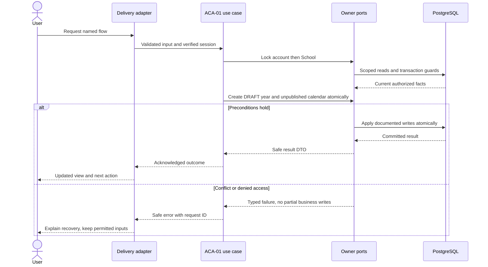
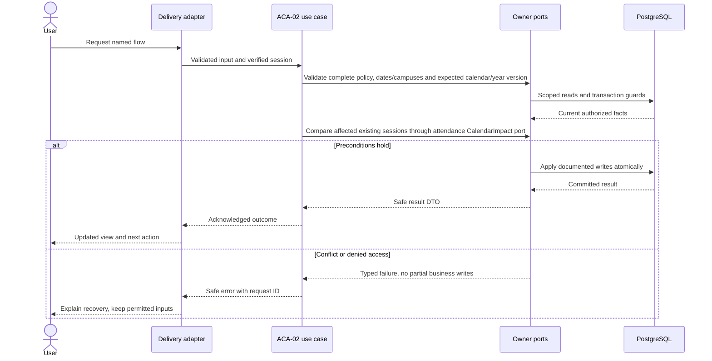
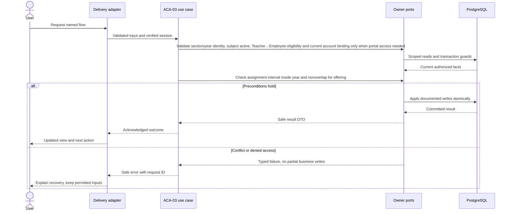

# Academic setup and teaching context — design

Phase 1 · Design revision 2 · 4 October 2026. ACA-01 implementation is in progress; later task schemas remain planned. Review unresolved deployment choices in FND-02 before real-data use.

## Database naming and physical mapping

All physical objects follow [the VS database contract](../../DATABASE_DESIGN.md). Table names and columns below are physical SQL names; workflow prose uses logical domain names. `organizationId` maps to `organization_id`, `schoolId` to `school_id`, and `scope` expands to both columns. Models retain PascalCase through Prisma `@@map`; camelCase fields use `@map`. Planned schemas are implemented only through their named tasks and reviewed migrations.

## Ownership, aggregates and values

AcademicYear aggregate owns term entities and DRAFT→OPEN→CLOSED transitions. Calendar aggregate owns immutable published revisions and exception values. GradeLevel and Subject are school roots; Section belongs to year/grade/campus. Teacher references People.Employee. CourseOffering means a subject taught to a section in a year; TeacherAssignment is a dated root. Values: half-open civil DateRange, Code(1–40; trimmed, uppercased, ASCII `A-Z`, digits, `_` or `-`, beginning with a letter/digit), Name(1–160 NFC characters), Weekday(1..7), CampusScope, CalendarRevisionNumber. Year and term form APIs accept exclusive end dates; screens ask for the last included civil date and add one day once at the boundary. Events: AcademicYearCreated/Opened/Closed.v1, CalendarPublished.v1, OfferingCreated.v1, TeacherAssigned.v1. No full timetable engine.

## Module decisions

ACA-ADR-001: half-open civil intervals and immutable calendar revisions. Alternative mutable calendar reused by historical sessions rejected. Publication changes future uncreated sessions only; if a change would affect an existing noncancelled future session, Phase 1 rejects publication until admin explicitly cancels/replans the affected unsubmitted sessions. Submitted sessions are never retroactively reinterpreted.

ACA-ADR-002: one primary dated teacher per offering at a time for pilot simplicity; co-teaching/substitution policy needs a later explicit design. Overlap validation happens under School guard; SQL CHECK alone does not enforce cross-row ranges.

ACA-ADR-003: academic setup is available only when the trusted server release manifest exposes `academic_core`, the institution entitlement is ACTIVE, the branch activation is ACTIVE, and the current scoped permission allows the operation. The default manifest releases no product modules. The ACA-01 local demo/test server may explicitly release only `academic_core`; this value is passed by its command/server process, never read from a browser or the private `.env`. The repository rechecks release, entitlement, activation, membership and capability inside the same guarded transaction. A closed year is historical: terms cannot be replaced and new sections cannot be added; existing grade/subject catalogs remain school-wide references.

## Physical data contract

ACA-01 first installs the six setup tables listed here; the remaining academic tables are installed only by their named tasks. `scope` below means `(organizationId,schoolId)`. All business roots have version >=1. All scoped references require composite FK targets with matching unique keys, even when abbreviated in the table. Creation times use server clock; IDs server generated. Required unless nullable is stated. Enum labels are constrained enums/CHECKs, not unchecked strings. Do not silently implement a weaker constraint because Prisma syntax cannot express it; use reviewed migration SQL.

| Table | Fields and data stored | Meaning | Keys / constraints / query support |
|---|---|---|---|
| `vs_academics_academic_year` (AcademicYear) | id uuid PK; organization_id uuid; school_id uuid; code varchar(40); name varchar(160); starts_on date; ends_on date; status DRAFT/OPEN/CLOSED; version int | Half-open year; terms are editable only while DRAFT. Multiple OPEN years are allowed; the active school year remains an explicit selection. | UNIQUE(scope,id); UNIQUE(scope,code); CHECK dates, status, version, code and name |
| `vs_academics_academic_term` (AcademicTerm) | id uuid PK; organization_id uuid; school_id uuid; year_id uuid; code varchar(40); name varchar(160); starts_on date; ends_on date | Half-open interval owned by year; terms do not overlap and remain within the year. | FK(scope,year_id); UNIQUE(scope,year_id,code); CHECK starts_on<ends_on; index(scope,year_id,starts_on) |
| `vs_academics_grade_level` (GradeLevel) | id uuid PK; organization_id uuid; school_id uuid; code varchar(40); name varchar(160); sort_order int; active boolean; version int | School-wide grade catalog. No cross-school shared write. Sort order is assigned under the School guard. | UNIQUE(scope,id); UNIQUE(scope,code) |
| `vs_academics_subject` (Subject) | id uuid PK; organization_id uuid; school_id uuid; code varchar(40); name varchar(160); active boolean; version int | School-wide subject catalog. | UNIQUE(scope,id); UNIQUE(scope,code) |
| `vs_academics_section` (Section) | id uuid PK; organization_id uuid; school_id uuid; year_id uuid; grade_id uuid; campus_id uuid nullable; code varchar(40); name varchar(160); active boolean; version int | Section in one year/grade/campus, including school-wide no-campus scope. New sections are allowed in DRAFT/OPEN years and denied in CLOSED years. | Scoped FKs year/grade/campus; UNIQUE(scope,id,year_id); two partial UNIQUE indexes (scope,year_id,grade_id,code) WHERE campus_id IS NULL and (scope,year_id,grade_id,campus_id,code) WHERE NOT NULL |
| `vs_academics_school_calendar` (SchoolCalendar) | id uuid PK; organization_id uuid; school_id uuid; year_id uuid; current_revision_id uuid nullable; version int | One calendar root per school year; no current pointer until publication. | UNIQUE(scope,year_id); UNIQUE(scope,id); FK year; deferred current_revision scoped FK added in SQL |
| `vs_academics_calendar_revision` (CalendarRevision) | id uuid PK; organization_id uuid; school_id uuid; calendar_id uuid; number int; teaching_weekdays int[]; published_at timestamptz(3); published_by uuid | Immutable full policy snapshot. No generic mutable JSON calendar. | UNIQUE(scope,calendar_id,number); UNIQUE(scope,calendar_id,id); FK calendar; published_by account; append-only guard |
| `vs_academics_calendar_exception` (CalendarException) | id uuid PK; organization_id uuid; school_id uuid; revision_id uuid; campus_id uuid nullable; on_date date; is_teaching_day boolean; label varchar(160) | Date exception; campus beats school beats weekly rule. Dates inside year. | Scoped revision/campus FKs; two NULL/non-NULL partial unique indexes(scope,revision_id,on_date[,campus_id]); immutable |
| `vs_academics_teacher` (Teacher) | id uuid PK; organization_id uuid; school_id uuid; employee_id uuid; active boolean; version int | Academic teacher profile, not a login identity. | UNIQUE(scope,employee_id); UNIQUE(scope,id); scoped Employee FK |
| `vs_academics_course_offering` (CourseOffering) | id uuid PK; organization_id uuid; school_id uuid; year_id uuid; section_id uuid; subject_id uuid; code varchar(40); version int; active boolean | One section subject offering in year. | UNIQUE(scope,year_id,code); UNIQUE(scope,year_id,section_id,subject_id); scoped section/year composite FK and subject FK; UNIQUE(scope,id) |
| `vs_academics_teacher_assignment` (TeacherAssignment) | id uuid PK; organization_id uuid; school_id uuid; offering_id uuid; teacher_id uuid; valid_from date; valid_to date; version int | Primary attendance duty only in Phase 1; one eligible teacher per offering/date. | Scoped offering/teacher FKs; CHECK from<to; range overlap protected by School guard and app query; index(scope,offering_id,valid_from,valid_to) |

## Read workflows and joins

Setup page reads scoped Year → Terms, Year → Sections → Grade/Campus, Subjects, and Calendar → currentRevision → Exceptions. Reference selectors return code/name/ID/version. Class list joins Offering→Section→Grade and Subject; current assignments join Teacher→Employee→Person for display name. All joins include scope, except Person joins organizationId+personId behind People contract. No account credentials appear.

Teacher Today is an Attendance read contract, not an Academics write. It uses dated TeacherAssignment to Offering and Session. Default lists are keyset-paged 50; calendar exception payload max 500. DB DATE maps to YYYY-MM-DD at adapter boundary; never parse civil dates with local-machine timezone assumptions.

## Screen contract

/admin/academics tabs Year & calendar, Grades & sections, Subjects; /admin/classes for offerings/assignments. Dependent selectors show friendly names, never require hand-entered UUIDs. Forms show exclusive end-date explanation as "last included day" input converted once to exclusive end in API. Preview that conversion. Calendar UI shows revision and unsaved changes. Offerings show teacher effective dates; no assignment is a clear warning, not a fake timetable.

All screens additionally follow Bible §8: loading, empty, validation, permission, stale/conflict, temporary failure and acknowledged success; semantic labels, focus and mobile layout. No future-module navigation.

## Application ports and transaction boundary

Each named flow below is an application use case. Inputs/outputs are plain DTOs; adapters implement owned repositories and public cross-module facades. Use SchoolCommand, ActorResolver, Clock, IdGenerator and transactional envelope writers from the shared contract. Do not pass Prisma.TransactionClient into application/domain code. Generic `save(any)` is not a replacement for named commands. Domain factories create new roots/events; rehydration restores without events.

Mutations use the account → Organization → School guard protocol in Bible §7. Read-only flows do not take write locks. Bootstrap/auth-only commands use their documented account/provisioning transaction. Scoped school uniqueness/range checks run after locks. Reauthorize before replay and commit; only a successful transaction stores a receipt. Aggregate version, audit, outbox and response commit together. Exact flow-specific reads and writes below refine this shared behavior.

## ACA-01 — Configure academic year, terms, grades and sections

**Success response contract:** Created/updated root `{id,version,code,name}` plus relevant `{yearId,gradeId,campusId,startsOn,endsOn,status}`; terms response `{yearId,version,terms:[{id,code,name,startsOn,endsOn}]}`.

**Transport:** POST /api/v1/academics/years; PUT /api/v1/academics/years/:id/terms; POST /api/v1/academics/grades|subjects|sections

**Input:** Year code/name/startsOn/endsOn; terms <=24 {code,name,startsOn,endsOn}; grade/subject code/name; section yearId/gradeId/campusId?/code/name. Each command has key; updates expectedVersion.

**Workflow:**

1. Require the trusted `academic_core` release, active institution entitlement, active branch activation, and current `school.manage` for year/terms or `class.manage` for catalogs.
2. Lock account → Organization → School; recheck the release/configuration, membership and capability before receipt replay and commit.
3. Create DRAFT year and unpublished calendar atomically; terms replace only while DRAFT, within year and nonoverlapping.
4. Create school grade/subject and section after validating active references and matching year/campus; reject a CLOSED year. Derive grade sort order from the school catalog under the guard.
5. Return joined display DTO; audit/outbox/receipt commit with version change.

**Database writes / atomicity:** AcademicYear + SchoolCalendar on create; AcademicTerm replacement under year; GradeLevel, Subject, Section; transactional envelopes.

**Errors and recovery:** Duplicate code/section →409; invalid range/overlap→422; terms after OPEN or a new section in CLOSED year→409; foreign/inactive references→404/409; absent release/contract/branch activation→409; revoked permission→403.

**Verification:** Unit — Civil dates, term overlap, state rules, code normalization. Functional PostgreSQL — Parallel no-campus duplicates: exactly one; cross-year/scope FK rejection; atomic year+calendar creation. E2E — Create year/terms/grade/subject/section then refresh; actionable duplicate and overlap errors.

## ACA-02 — Publish calendar and open or close the year

**Success response contract:** Publication `{calendarId,version,revisionId,revisionNumber}`; evaluation `{date,campusId,isTeachingDay,source,revisionId}`; year state `{yearId,version,status}`.

**Transport:** POST /api/v1/academics/calendars/:id/publish; POST /api/v1/academics/years/:id/open|close; GET /api/v1/academics/calendars/:id/evaluate?date=

**Input:** Publish expectedVersion, teachingWeekdays unique 1..7, exceptions <=500 {date,campusId?,isTeachingDay,label}, reason. Open/close expectedVersion and reason.

**Workflow:**

1. Authorize school.manage and acquire guards.
2. Validate complete policy, dates/campuses and expected calendar/year version.
3. Compare affected existing sessions through attendance CalendarImpact port; no-op adapter allowed only before attendance tables exist, then replace it in ATT-01.
4. Append immutable revision and exceptions, then change current pointer/version in one transaction.
5. Open year requires published calendar; close requires no noncancelled scheduled/open session on or after school-local today. Persist events/audit/receipt.

**Database writes / atomicity:** CalendarRevision, CalendarException, SchoolCalendar pointer/version; AcademicYear state/version; envelopes. No editing old revisions.

**Errors and recovery:** Affected existing future session→409 CALENDAR_IN_USE; no calendar on open→409; pending future sessions on close→409; stale revision→409.

**Verification:** Unit — Campus-over-school precedence; all weekdays validation; state transitions. Functional PostgreSQL — Publication failure leaves pointer unchanged; deferred pointer FK; immutable records; close-vs-schedule serialization. E2E — Publish holiday/campus exception and evaluate dates; open year; term edit denied; close empty disposable year.

## ACA-03 — Create offerings and assign teachers

**Success response contract:** `{offeringId,version,code,yearId,section:{id,code,name},subject:{id,code,name}}`; assignment `{assignmentId,version,teacherId,offeringId,validFrom,validTo}`.

**Transport:** POST /api/v1/offerings; POST /api/v1/teacher-assignments; PATCH /api/v1/teacher-assignments/:id/end

**Input:** Offering yearId/sectionId/subjectId/code; assignment offeringId/teacherId/validFrom/validTo; end expectedVersion/endDate/reason. Key required.

**Workflow:**

1. Require class.manage, acquire actor/School guards and recheck OPEN year.
2. Validate section/year identity, subject active, Teacher→Employee eligibility and current account binding only when portal access needed.
3. Check assignment interval inside year and nonoverlap for offering.
4. Ending assignment rejects intervals that leave future open sessions with no eligible teacher; admin must replan/cancel explicitly.
5. Persist offering/assignment and envelopes; class list displays joined teacher names and dates.

**Database writes / atomicity:** CourseOffering, TeacherAssignment; may create Teacher through academic owner when Employee already exists; envelopes.

**Errors and recovery:** Overlapping assignment→409; inactive teacher/employee→409; section from other year→422; foreign references→404.

**Verification:** Unit — Effective-date endpoints and teacher eligibility. Functional PostgreSQL — Assignment races serialize; cross-school FK; end-assignment vs teacher submit reauthorization. E2E — Create offering, assign teacher, inspect effective dates; reject overlap.

## Migration, retention and handoff

Implement tables only in the task that first uses them; migrate from empty database and the previous task checkpoint. Add scoped unique indexes before composite FKs; detect existing duplicates before adding constraints. SQL append-only/null-campus/range safeguards must appear in reviewed migrations and real-DB tests. No seed may erase prior data. Use synthetic fixtures and clean only owned test records. Preserve schema-compatible app rollback; use a reviewed forward migration when incompatible. Retention changes must preserve required immutable evidence and legal holds under the school-approved policy, not an ad hoc DELETE.

Real dates/leap years, adjacent terms, reversed ranges, nullable-campus duplicates, cross-year section reference, calendar precedence/publishing conflicts, immutable revisions, teacher eligibility and overlap races. Year closing rejects future scheduled/open noncancelled sessions to avoid stranded work; past submitted history remains readable.

See [tasks](TASKS.md), [current state](CURRENT_STATE.md), [Bible](../../VSchool_Bible.md) and [agent runbook](../../AGENT_RUNBOOK.md).

## v4.1 integration requirements

School means operational Branch and Organization means client Institution. Every protected flow checks current release availability, institution entitlement, branch activation and user/resource permission; foundational commands remain available only through their required capability projection. Apply the revised account → Organization shared guard → School guard protocol from Tenancy DESIGN. Use the shared components/tokens and current branch context; never invent a second visual system. No operational access is implied by institution administrator role.

## Portable backend integration

Follow [the backend extraction contract](../../BACKEND_EXTRACTION.md). Server module code belongs in backend/modules; UI consumes shared/contracts and a module gateway. Next delivery adapters resolve transport/session and invoke portable use cases. Future Nest controllers and provider factories reuse those use cases. Framework-specific context/ORM results never enter domain or browser DTOs.
