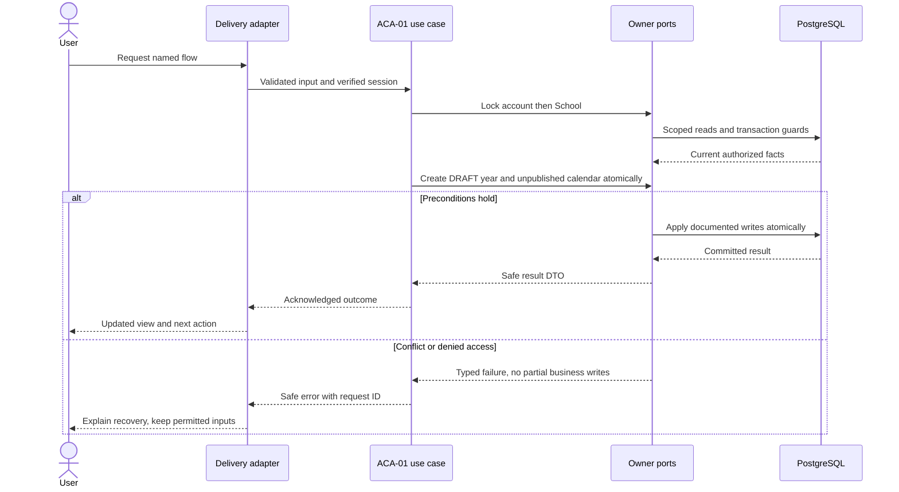
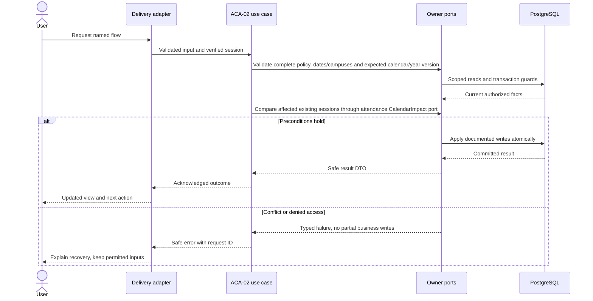
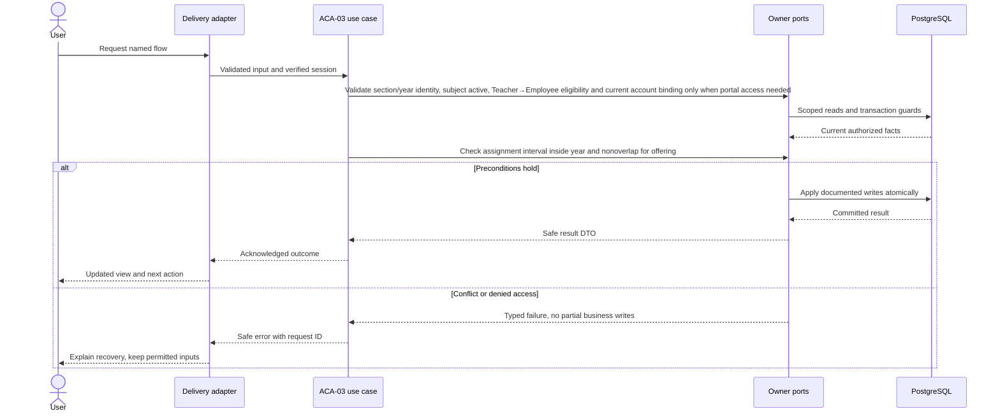
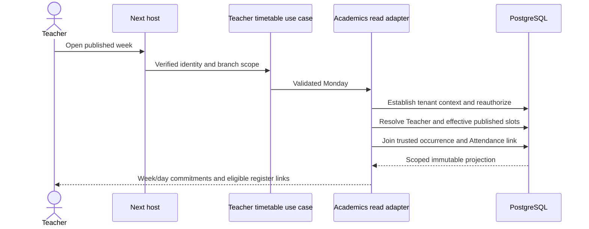
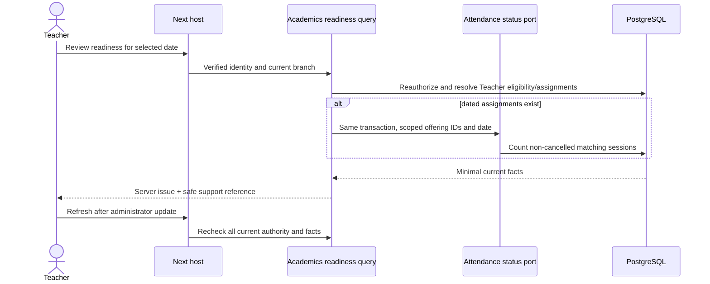

# Academic setup and teaching context — design

Phase 1 · Design revision 3 · 5 October 2026. ACA-01 and ACA-02 are implementation-verified; ACA-03 is in progress. CourseOffering and TeacherAssignment are installed by forward migration `20261005001900_academic_offerings`. Review unresolved deployment choices in FND-02 before real-data use.

## TT-00 timetable readiness reconciliation — 11 October 2026

The coordinated timetable pack is adopted as an Academics-owned later capability, without claiming SA-41 implementation or release. The first live checkpoint is read-only `/admin/timetable/readiness`: it reports the current server release, institution entitlement, branch activation and `timetable.manage` permission from trusted server data. It creates no schedule data and is intentionally absent from operational navigation until the capability is usable.

Academics owns day patterns, periods, timetable revisions/slots and stable lesson occurrences. Attendance alone owns registers and pins an opened/submitted session to its source occurrence. An acknowledgement never grants teaching or roster authority. Stable occurrence identity is `(organization, school, academic year, class section, local date, period key)`; publication reconciliation updates future unpinned projections under that key and never rewrites an opened/submitted session.

The first cut supports the approved pack's **weekly** plan only. The generic SA-41 card still lists a two-week option, but the coordinated timetable README explicitly defers two-week cycles; production must omit that unsupported option and record the reference deviation. The engineering bounds for the first cut are 256 KiB per draft command, at most 100 slots per command and a rolling 42-day occurrence horizon in seven-day batches. Rooms stay nullable until a Facilities-owned room source exists. TT-01 may add only day-pattern/period persistence after its exact live schema and Path A registry entries are reviewed. No timetable tables exist at TT-00.

## TT-01 day-pattern design readiness — 12 October 2026

TT-01 owns a versioned weekly day pattern and its ordered periods. It does not create timetable slots, publish a revision, generate occurrences, select teachers/rooms or alter Attendance. One branch/year may have one mutable `DRAFT` pattern. A future publication command will copy or transition a reviewed version under its own contract; TT-01 never mutates a `PUBLISHED` row. Saving requires the current draft version and a stable command key. Exact replay returns the original result; changed payload conflicts.

| Table | Exact columns and constraints | Read/index contract |
|---|---|---|
| `vs_academics_day_pattern` | `id uuid` PK; `organization_id uuid`; `school_id uuid`; `academic_year_id uuid`; `name varchar(80)`; `teaching_days smallint[]`; `state varchar(16)`; `version int`; `created_at timestamptz(3)`; `created_by_account_id uuid`; `updated_at timestamptz(3)`. Scoped Organization, School, AcademicYear and creator FKs; state `DRAFT|PUBLISHED`; positive version; nonblank name; unique scoped id and one partial unique DRAFT per branch/year. | `(organization_id,school_id,academic_year_id,state,updated_at DESC)`. Path A BRANCH table; application authorization remains mandatory and TEN-03 closes RLS. |
| `vs_academics_day_period` | `id uuid` PK; scope; `day_pattern_id uuid`; `period_key uuid`; `label varchar(60)`; `kind varchar(12)`; `start_local time`; `end_local time`; `position smallint`. Scoped pattern FK; kind `LESSON|BREAK`; positive duration/position; nonblank label; unique pattern/period key and position. | `(organization_id,school_id,day_pattern_id,position)`. Child is BRANCH classified and registered for TEN-03. |

`teaching_days` is a sorted, unique, nonempty subset of ISO weekdays 1–7. Period input is 1–32 rows, each with a stable UUID key, NFC label, kind, `HH:MM` local time and unique positive position. Period intervals may be adjacent but must not overlap; this is validated in the pure domain and rechecked under the mutation guard. At least one LESSON is required. Break periods can never be used for lessons in later slices. Branch timezone is read-only context and is not changed here.

The read joins scoped open/draft AcademicYear → DayPattern → ordered DayPeriod and returns only safe configuration fields. The mutation requires current account/token, active organization/school/membership, `timetable.manage`, trusted `timetable` release, active institution entitlement and branch activation, plus active `academic_core` and `staff_core` dependencies. It uses the existing account → Organization → School lock order, then locks the current draft. The serializable transaction creates or version-updates the draft, replaces only that draft's child periods, increments School configuration revision and writes audit/outbox/receipt atomically. Stale version, duplicate draft and serialization races return conflict without partial periods.

Transport is `GET /api/v1/timetable/day-patterns/current?academicYearId=` and `PUT /api/v1/timetable/day-patterns/current`, JSON at most 256 KiB. The command contains `{academicYearId, expectedVersion, name, teachingDays, periods, key, reason}`; `expectedVersion=0` creates the first draft. The Administrator editor retains safe input after validation, supports add/remove/reorder, and separates Save draft from future publication. Errors distinguish validation, permission, module availability, missing/closed year, stale version and unknown outcome. Unknown outcome retains the exact payload/key.

## TT-02 weekly timetable draft design readiness — 12 October 2026

TT-02 adds the private planning aggregate beneath the verified TT-01 day pattern. It stores one current `DRAFT` revision per branch/year and its recurring weekly slots; it does not publish, create dated occurrences, change Attendance, validate whole-branch clashes or claim a room source. TT-03 owns full teacher/class/room conflict preview and TT-04 owns effective publication. The first release is weekly only. The generic two-week choice is omitted under TT-00. Rooms remain nullable and absent from the selector until a Facilities-owned scoped source exists.

The draft root is `vs_academics_timetable_revision`: `id uuid` PK; branch scope; `academic_year_id`, `day_pattern_id`, `revision_no int`, `state varchar(16)`, `effective_from date`, `version int`, `created_at`, `created_by_account_id`, `updated_at`. State is `DRAFT` or `DISCARDED`; TT-04 adds published snapshots without mutating old content. Constraints are scoped AcademicYear and DayPattern FKs, positive revision/version, effective date within the year, and one partial unique live draft per branch/year. Index `(organization_id,school_id,academic_year_id,state,updated_at desc)` powers resume.

The child `vs_academics_timetable_slot` stores `id`, branch scope, `revision_id`, stable `slot_key`, scoped `class_section_id`, scoped `subject_offering_id`, scoped `teacher_assignment_id`, nullable future `room_id`, `day_of_week smallint`, `period_key uuid`, and `position smallint`. It has scoped FKs to the revision, section/year, offering/year/section, assignment/offering and day-pattern period; unique `(scope,revision_id,slot_key)` and `(scope,revision_id,class_section_id,day_of_week,period_key)` prevent duplicate class cells. Day is 1–7 and position positive. The mutation is bounded to 100 slots and never accepts browser-supplied labels or actor/scope.

The context read joins the current open/draft year, current TT-01 draft pattern/periods, active sections and offerings, and teacher assignments that cover `effective_from`; labels come from scoped Grade, Subject and People-owned Person joins. It returns only authorized branch data. The browser edits one selected class using a table/grid with an equivalent keyboard-accessible list. Safe in-flow edits stay in component state; durable Save writes the entire aggregate. A published timetable, when TT-04 exists, remains the source for all other users.

Save input is `{academicYearId, dayPatternId, effectiveFrom, expectedVersion, slots, key, reason}`. Create uses expected version 0. Each slot is `{slotKey, sectionId, offeringId, teacherAssignmentId, dayOfWeek, periodKey, position}`. Domain validation checks UUIDs, unique stable keys/cells, bounds and contiguous position. The transaction rechecks that the year is DRAFT/OPEN, effective date is within `[starts_on,ends_on)`, the day pattern is the current branch/year draft, every day is enabled, each period is a lesson, every active offering belongs to the selected section/year, and the chosen assignment belongs to that offering and covers effective date. TT-02 deliberately does not infer term-wide eligibility or teacher/class/room conflicts; TT-03 must recheck those before preview/publication.

Discard input is `{draftId, expectedVersion, key, reason}`. It transitions only the current draft to `DISCARDED`, increments its version and retains slots/history. It never deletes a draft or affects a published revision. Both mutations authenticate current account/token and branch membership, require `timetable.manage` plus trusted/released/licensed/active Timetable, Academics and Staff modules, acquire account → Organization → School locks, reauthorize before receipt replay, use serializable expected-version CAS, increment School configuration revision and write audit/outbox/receipt atomically. Same key/input replays; changed input conflicts; stale state returns the current-version recovery path. Reads remain repeatable-read without mutation locks.

Transport is `GET /api/v1/timetable/drafts/current?academicYearId=&effectiveFrom=`, `PUT /api/v1/timetable/drafts/current`, and `POST /api/v1/timetable/drafts/:id/discard`, JSON at most 256 KiB. Error mapping distinguishes validation 422, hidden foreign/inactive reference 404, permission 403, module state 409, stale/idempotency conflict 409 and unknown result 503. Unknown save/discard retains the exact payload/key; branch switch or permission loss clears protected local state.

Verification: domain tests cover duplicate cells/keys, bounds and invalid days. Real PostgreSQL proves scoped FKs, one live draft, save/reopen, discard retention, stale/exact replay, cross-branch denial and rollback on evidence failure. Browser tests save and resume a populated class, retain unsaved edits across class/day navigation, warn on unsaved leave, discard explicitly, recover stale state and verify desktop/mobile keyboard composition. TT-02 cannot satisfy SA-41 publication, conflict-preview or Attendance-generation acceptance.

## TT-03 whole-branch conflict and publication-impact preview — 12 October 2026

TT-03 is a read-only validation slice over the current TT-02 draft. It owns no publication transition and creates no Attendance session. The approved TT-03/TT-W03 contracts require the preview to recheck the whole branch rather than only the selected class: class interval collisions, teacher **Person** collisions across different TeacherAssignment rows, calendar teaching dates and assignment eligibility throughout the bounded horizon. Room collisions are checked when a non-null Academics-approved room reference exists. The current accepted nullable-room boundary supplies no room owner or `room_id` column, so this slice reports room validation as not applicable rather than inventing a facility record or claiming it was tested.

The preview input is `{draftId, expectedVersion}`. Transport is `POST /api/v1/timetable/drafts/:id/preview`, same-origin JSON at most 8 KiB. The JSON-safe result is `{draftId,draftVersion,effectiveFrom,horizonUntil,ready,issues,counts,previewHash}`. Issue codes are allowlisted `CLASS_CONFLICT`, `TEACHER_CONFLICT`, `ASSIGNMENT_INELIGIBLE`, `CALENDAR_UNAVAILABLE` and future `ROOM_CONFLICT`; each identifies safe class/day/period labels and affected slot keys without staff-private reasons. Counts distinguish draft slots, candidate teaching occurrences, added/changed/removed slots and existing protected Attendance sessions. Until TT-04 creates a published baseline, every candidate slot is `added`, with changed/removed counts zero; TT-04 must replace that comparison rather than reinterpret it silently.

The horizon is `[effective_from,min(effective_from + 42 days,academic_year.ends_on))`, evaluated in school-local civil dates. For each recurring slot, the preview generates only the slot weekday dates allowed by the current published SchoolCalendar revision after campus-specific then school-wide exception precedence. The selected TeacherAssignment and active Teacher/Employee must cover every generated date. Class conflicts compare the same Section and overlapping period intervals. Teacher conflicts resolve every assignment to its Teacher and People Person, then compare overlapping intervals on the same weekday across the entire draft; comparing assignment IDs alone is insufficient. The current TT-01 pattern makes period intervals authoritative and half-open, so adjacent periods do not clash.

Protected impact is an explicit pre-publication warning, not a mapping or mutation: count existing scoped `OPEN` or `SUBMITTED` AttendanceSession rows inside the horizon whose offering appears in the draft. TT-04/TT-05 still own exact occurrence reconciliation, dated-change checks, pinning and idempotent generation. The preview cannot promise that an existing manual session will be reused, cancelled or changed.

The repository performs a current authorization/module check and one repeatable-read snapshot without mutation locks. It loads the scoped live draft/version, pattern periods, Sections/campuses, Offerings, TeacherAssignments→Teacher→Employee→Person, current calendar revision/exceptions and bounded Attendance impact. A stale draft version returns `STALE_VERSION`; missing calendar returns a structured blocking issue; foreign references remain hidden. `previewHash` is a server digest of scope, draft/version, horizon, normalized issues and counts. TT-04 must reauthorize and recompute under the existing account→Organization→School mutation guard; the preview hash is review evidence, never authorization or a lock.

No migration is required for the bounded current draft (maximum 100 slots): the existing class-week index and scoped FKs supply the read, while the adapter resolves teacher Person identity in the bounded snapshot. Before larger-than-pilot use or a persisted room source, capture `EXPLAIN (ANALYZE, BUFFERS)` for the actual scoped predicates and add forward indexes only when the measured plan requires them. This does not replace the previously recorded ACA-03 offering/date and teacher/date plan evidence or the larger TEN-03 profile.

Verification requires domain interval/adjacency and cross-assignment same-Person cases; real PostgreSQL scope/current-permission/stale/calendar/assignment/whole-branch conflict and protected-count evidence; and a focused Administrator browser journey that previews a ready draft and an actionable conflict at desktop/mobile. Reads remain unlocked. Font portability, native accessibility, TEN-03, TT-04 publication and TT-05 Attendance handoff remain separate gates.

## TT-04 immutable timetable publication — 12 October 2026

Publication appends an immutable weekly timetable snapshot for one branch/year. Its applicability is `[effective_from,effective_until)`: the first publication has no predecessor, and a later publication must start after the latest published effective date and closes only that predecessor's `effective_until`. The academic-year exclusive end is the implicit final cap. Closing applicability is controlled lifecycle metadata; published day-pattern, period, slot and reproduction snapshot content never changes. The editable `DRAFT` remains separate and is version-incremented after publication so the reviewed draft version cannot publish twice under another key.

The 42-day interval remains the bounded validation and future reconciliation horizon. TT-04 records `validated_until=min(effective_from+42 days,year.ends_on)` and makes no claim about assignment/calendar validity beyond it. A published revision may remain the applicable weekly plan until superseded or year end, but TT-05 may consume it only through `validated_until`; extending generation requires another current-owner revalidation. TT-05 consumes the immutable revision, copied pattern/periods/slots, calendar revision and stable occurrence identity. TT-04 creates no Attendance rows and returns `reconciliationState=PENDING`.

The command is `{draftId,expectedVersion,previewHash,acknowledged:true,key,reason}`. Under the existing account → Organization → School mutation locks, a serializable transaction rechecks live identity, membership, `timetable.manage`, release/entitlement/activation, the draft row/version and the current preview inputs. The recomputed digest must match. The School lock serializes calendar, assignment and timetable mutations that use the established guard; the draft and latest published rows are additionally selected `FOR UPDATE`. The transaction copies the draft pattern and periods into a `PUBLISHED` pattern, copies slots, stores a JSON reproduction snapshot with safe labels and assignment bounds, appends publication metadata/evidence/outbox/receipt and bumps the draft version atomically. Receipt replay is checked only after current authorization and returns the original result; a changed payload conflicts.

Schema delta: `TimetableRevision` adds nullable `effective_until`, `validated_until`, `published_at`, `published_by_account_id`, `based_on_revision_id`, `based_on_draft_version`, `source_command_id`, `calendar_revision_id` and `content_snapshot`; state adds `PUBLISHED`; scoped revision number uniqueness and applicability lookup index are added. Published rows require all publication metadata and a JSON snapshot. SQL triggers reject published revision content changes (except a one-time predecessor `effective_until` close), and reject changes/deletes to periods, slots and patterns referenced by a published revision. Path A metadata remains registered for TEN-03; application authorization remains mandatory.

## TT-05 bounded Attendance reconciliation — 12 October 2026

| `vs_academics_lesson_occurrence` (LessonOccurrence; TT-05 MIGRATED) | id uuid PK; organization_id uuid; school_id uuid; academic_year_id uuid; class_section_id uuid; local_date date; period_key uuid; source_revision_id uuid; source_slot_key uuid; starts_at/ends_at timestamptz(3); subject_offering_id uuid; effective_teacher_assignment_id uuid; state varchar(20); generation_revision int; last_outcome varchar(40); last_error_code varchar(80) nullable; version int; created_at/updated_at timestamptz(3) | Stable dated occurrence derived from one immutable timetable publication, retaining its latest Attendance reconciliation outcome. | Scoped School/Year/Section/Revision/Slot/Offering/Assignment FKs; starts_at<ends_at; constrained state/outcome; positive versions; UNIQUE(scope,year,section,local_date,period_key); source/date and class/date indexes |
| `vs_academics_generation_checkpoint` (TimetableGenerationCheckpoint; TT-05 MIGRATED) | id uuid PK; organization_id uuid; school_id uuid; academic_year_id uuid; source_revision_id uuid; horizon_from/horizon_until/cursor_date date; state varchar(16); counts jsonb; last_error_code varchar(80) nullable; source_command_id uuid; version int; created_at/updated_at timestamptz(3) | Durable seven-day batch cursor and latest reconciliation summary for one immutable publication. | Scoped School/Year/Revision FKs; UNIQUE(scope,source_revision_id); bounded horizon/cursor check; constrained state; positive version; scope/state/update index |

Owner decision approved 12 October 2026: an unlinked manual Attendance session occupying a generated stable occurrence blocks that occurrence for explicit administrator resolution. Reconciliation never adopts, overwrites, cancels, relinks or duplicates that manual session. The administrator may use the existing guarded Attendance cancellation flow when allowed, then retry; frozen/open/submitted history is never bypassed.

Stable occurrence identity is `(organization_id, school_id, academic_year_id, class_section_id, local_date, period_key)`. `vs_academics_lesson_occurrence` stores that key plus immutable-source projection fields: source publication/slot, UTC interval derived from the branch timezone, offering, teacher assignment, state, generation revision, last outcome/error and version. It has scoped FKs to the publication, slot, Section, Offering and Assignment; a unique stable key; source/date and class/date interval indexes. `vs_academics_generation_checkpoint` is unique per scoped publication and stores `[horizon_from,horizon_until)`, exclusive `cursor_date`, PENDING/RUNNING/PARTIAL/COMPLETE/FAILED state, aggregate counts, last error, latest source command and version. Both are branch-class Path A tables with TEN-03 closure metadata.

The command is `{publicationId,key,reason}` and is exposed through a thin same-origin route. The current account/token, branch, `timetable.manage`, Timetable/Academics/Staff eligibility and Attendance release/entitlement/activation are rechecked on every run and retry. The server loads only the immutable publication, copied slots/pattern and pinned calendar revision, derives teaching dates from `max(effective_from, branch-local today)` through `validated_until`, and processes sequential seven-day transactions. Each batch acquires the established account → Organization → School locks, then the checkpoint/occurrence rows. The browser cannot supply an occurrence, existing-session ID or source link.

Academics invokes an enlisted Attendance planning port. Its Attendance infrastructure adapter alone creates/cancels AttendanceSession rows and enforces scoped Offering/Calendar/assignment facts, trusted `source_occurrence_id`, class-section occupancy and teacher-Person interval overlap against non-cancelled sessions. A matching trusted source returns `ALREADY_RECONCILED`. An unlinked manual overlap returns `BLOCKED_MANUAL_CONFLICT` with only authorized session/date/time/class/subject/status/link details. Other live generated/domain conflicts return `BLOCKED_DOMAIN_RULE`. Database/adapter failures mark the current batch `FAILED` in a recovery transaction. Removed future generated SCHEDULED sessions may be cancelled by the owner port; OPEN/SUBMITTED sessions stay pinned and block the affected occurrence.

Per-occurrence outcomes are `CREATED`, `ALREADY_RECONCILED`, `BLOCKED_MANUAL_CONFLICT`, `BLOCKED_DOMAIN_RULE` or `FAILED_TECHNICAL`. Logical blocks do not roll back unrelated creations in the same batch. Each committed batch advances the exclusive cursor and counts, so retry never recreates completed work. COMPLETE requires no blocked/failed outcome; otherwise the durable result is PARTIAL or FAILED. Final command receipt, audit/outbox evidence and checkpoint result are atomic in the finishing transaction; same actor/key/payload replays after current authorization, while changed payload conflicts. TT-05 does not alter the immutable publication.

Verification: unit interval/day/label bounds; real PostgreSQL scope FKs, one-draft constraint, create/update/replay/changed-key, stale/concurrent save, authorization and rollback; Administrator desktop/mobile save/reload, overlap validation, retained unknown result and keyboard order. No Teacher-facing route is part of TT-01.

## Database naming and physical mapping

All physical objects follow [the VS database contract](../../DATABASE_DESIGN.md). Table names and columns below are physical SQL names; workflow prose uses logical domain names. `organizationId` maps to `organization_id`, `schoolId` to `school_id`, and `scope` expands to both columns. Models retain PascalCase through Prisma `@@map`; camelCase fields use `@map`. Planned schemas are implemented only through their named tasks and reviewed migrations.

## Ownership, aggregates and values

AcademicYear aggregate owns term entities and DRAFT→OPEN→CLOSED transitions. Calendar aggregate owns immutable published revisions and exception values. GradeLevel and Subject are school roots; Section belongs to year/grade/campus. Teacher references People.Employee. CourseOffering means a subject taught to a section in a year; TeacherAssignment is a dated root. Values: half-open civil DateRange, Code(1–40; trimmed, uppercased, ASCII `A-Z`, digits, `_` or `-`, beginning with a letter/digit), Name(1–160 NFC characters), Weekday(1..7), CampusScope, CalendarRevisionNumber. Year and term form APIs accept exclusive end dates; screens ask for the last included civil date and add one day once at the boundary. Events: AcademicYearCreated/Opened/Closed.v1, CalendarPublished.v1, OfferingCreated.v1, TeacherAssigned.v1. No full timetable engine.

## Module decisions

ACA-ADR-001: half-open civil intervals and immutable calendar revisions. Alternative mutable calendar reused by historical sessions rejected. Publication changes future uncreated sessions only; if a change would affect an existing noncancelled future session, Phase 1 rejects publication until admin explicitly cancels/replans the affected unsubmitted sessions. Submitted sessions are never retroactively reinterpreted.

ACA-ADR-002: one primary dated teacher per offering at a time for pilot simplicity; co-teaching/substitution policy needs a later explicit design. Overlap validation happens under School guard; SQL CHECK alone does not enforce cross-row ranges.

ACA-ADR-003: academic setup is available only when the trusted server release manifest exposes `academic_core`, the institution entitlement is ACTIVE, the branch activation is ACTIVE, and the current scoped permission allows the operation. The default manifest releases no product modules. The ACA-01 local demo/test server may explicitly release only `academic_core`; this value is passed by its command/server process, never read from a browser or the private `.env`. The repository rechecks release, entitlement, activation, membership and capability inside the same guarded transaction. A closed year is historical: terms cannot be replaced and new sections cannot be added; existing grade/subject catalogs remain school-wide references.

## Physical data contract

ACA-01 installs the six setup tables; ACA-02 adds the immutable calendar revision and exception tables listed here; PER-02 installs Academics-owned Teacher eligibility because that task first enables and revokes the profile. Remaining academic tables are installed only by their named tasks. `scope` below means `(organizationId,schoolId)`. All business roots have version >=1. All scoped references require composite FK targets with matching unique keys, even when abbreviated in the table. Creation times use server clock; IDs server generated. Required unless nullable is stated. Enum labels are constrained enums/CHECKs, not unchecked strings. Do not silently implement a weaker constraint because Prisma syntax cannot express it; use reviewed migration SQL.

| Table | Fields and data stored | Meaning | Keys / constraints / query support |
|---|---|---|---|
| `vs_academics_academic_year` (AcademicYear) | id uuid PK; organization_id uuid; school_id uuid; code varchar(40); name varchar(160); starts_on date; ends_on date; status DRAFT/OPEN/CLOSED; version int | Half-open year; terms are editable only while DRAFT. Multiple OPEN years are allowed; the active school year remains an explicit selection. | UNIQUE(scope,id); UNIQUE(scope,code); CHECK dates, status, version, code and name |
| `vs_academics_academic_term` (AcademicTerm) | id uuid PK; organization_id uuid; school_id uuid; year_id uuid; code varchar(40); name varchar(160); starts_on date; ends_on date | Half-open interval owned by year; terms do not overlap and remain within the year. | FK(scope,year_id); UNIQUE(scope,year_id,code); CHECK starts_on<ends_on; index(scope,year_id,starts_on) |
| `vs_academics_grade_level` (GradeLevel) | id uuid PK; organization_id uuid; school_id uuid; code varchar(40); name varchar(160); sort_order int; active boolean; version int | School-wide grade catalog. No cross-school shared write. Sort order is assigned under the School guard. | UNIQUE(scope,id); UNIQUE(scope,code) |
| `vs_academics_subject` (Subject) | id uuid PK; organization_id uuid; school_id uuid; code varchar(40); name varchar(160); active boolean; version int | School-wide subject catalog. | UNIQUE(scope,id); UNIQUE(scope,code) |
| `vs_academics_section` (Section) | id uuid PK; organization_id uuid; school_id uuid; year_id uuid; grade_id uuid; campus_id uuid nullable; code varchar(40); name varchar(160); active boolean; version int | Section in one year/grade/campus, including school-wide no-campus scope. New sections are allowed in DRAFT/OPEN years and denied in CLOSED years. | Scoped FKs year/grade/campus; UNIQUE(scope,id,year_id); two partial UNIQUE indexes (scope,year_id,grade_id,code) WHERE campus_id IS NULL and (scope,year_id,grade_id,campus_id,code) WHERE NOT NULL |
| `vs_academics_school_calendar` (SchoolCalendar) | id uuid PK; organization_id uuid; school_id uuid; year_id uuid; current_revision_id uuid nullable; version int | One calendar root per school year; no current pointer until publication. | UNIQUE(scope,year_id); UNIQUE(scope,id); FK year; deferred current_revision scoped FK added in SQL |
| `vs_academics_calendar_revision` (CalendarRevision) | id uuid PK; organization_id uuid; school_id uuid; calendar_id uuid; number int; teaching_weekdays int[]; published_at timestamptz(3); published_by uuid | Immutable full policy snapshot. No generic mutable JSON calendar. | UNIQUE(scope,calendar_id,number); UNIQUE(scope,calendar_id,id); FK calendar; published_by account; append-only guard |
| `vs_academics_calendar_exception` (CalendarException) | id uuid PK; organization_id uuid; school_id uuid; revision_id uuid; campus_id uuid nullable; on_date date; is_teaching_day boolean; label varchar(160) | Date exception; campus beats school beats weekly rule. Dates inside year. | Scoped revision/campus FKs; two NULL/non-NULL partial unique indexes(scope,revision_id,on_date[,campus_id]); immutable |
| `vs_academics_teacher` (Teacher) | id uuid PK; organization_id uuid; school_id uuid; employee_id uuid; active boolean; version int | Academic teacher profile, not a login identity. | UNIQUE(scope,employee_id); UNIQUE(scope,id); scoped Employee FK |
| `vs_academics_course_offering` (CourseOffering) | id uuid PK; organization_id uuid; school_id uuid; year_id uuid; section_id uuid; subject_id uuid; code varchar(40); version int; active boolean | One section subject offering in year. | UNIQUE(scope,year_id,code); UNIQUE(scope,year_id,section_id,subject_id); scoped year, section/year and subject composite FKs; UNIQUE(scope,id); CHECK version>0 and code format |
| `vs_academics_teacher_assignment` (TeacherAssignment) | id uuid PK; organization_id uuid; school_id uuid; offering_id uuid; teacher_id uuid; valid_from date; valid_to date; version int | Primary attendance duty only in Phase 1; one eligible teacher per offering/date. | Scoped offering/teacher FKs; CHECK valid_from<valid_to and version>0; overlap guarded by School lock/application predicate; indexes(scope,offering_id,valid_from,valid_to) and (scope,teacher_id,valid_from,valid_to) |
| `vs_academics_day_pattern` (AcademicDayPattern) | id uuid PK; organization_id uuid; school_id uuid; academic_year_id uuid; name varchar(80); teaching_days smallint[]; state varchar(16); version int; created_at timestamptz(3); created_by_account_id uuid; updated_at timestamptz(3) | Versioned branch/year weekly day-pattern draft owned by Academics. | Scoped Organization/School/AcademicYear FKs; creator FK; DRAFT/PUBLISHED state; positive version; one partial unique DRAFT per branch/year; scoped context index |
| `vs_academics_day_period` (AcademicDayPeriod) | id uuid PK; organization_id uuid; school_id uuid; day_pattern_id uuid; period_key uuid; label varchar(60); kind varchar(12); start_local time; end_local time; position smallint | Ordered lesson/break intervals belonging to one Academics day-pattern version. | Scoped pattern FK; LESSON/BREAK kind; positive nonoverlapping interval and position; unique pattern/period key and position; scoped order index |
| `vs_academics_timetable_revision` (TimetableRevision) | id uuid PK; organization_id uuid; school_id uuid; academic_year_id uuid; day_pattern_id uuid; revision_no int; state varchar(16); effective_from date; effective_until date nullable; validated_until date nullable; published_at timestamptz(3) nullable; published_by_account_id uuid nullable; based_on_revision_id uuid nullable; based_on_draft_version int nullable; source_command_id uuid nullable; calendar_revision_id uuid nullable; content_snapshot jsonb nullable; version int; created_at timestamptz(3); created_by_account_id uuid; updated_at timestamptz(3) | Versioned private weekly draft plus immutable published timetable snapshots and half-open applicability metadata. | Scoped Organization/School/Year/Pattern, publisher, source-draft and calendar-revision FKs; DRAFT/DISCARDED/PUBLISHED state; positive revision/version; one live DRAFT and one open-ended PUBLISHED revision per branch/year; unique scoped revision number; complete publication metadata/snapshot check; immutable published content with controlled predecessor effective_until close; scoped resume and applicability indexes |
| `vs_academics_timetable_slot` (TimetableSlot) | id uuid PK; organization_id uuid; school_id uuid; revision_id uuid; slot_key uuid; academic_year_id uuid; day_pattern_id uuid; class_section_id uuid; subject_offering_id uuid; teacher_assignment_id uuid; day_of_week smallint; period_key uuid; position smallint | Recurring weekly lesson within a private draft or copied immutable published timetable snapshot. | Scoped Revision/Section/Offering/Assignment/Period FKs; day 1..7; positive position; unique stable slot key and unique class/day/period cell; scoped class-week index; update/delete guard when owned by a PUBLISHED revision |

## Read workflows and joins

Setup page reads scoped Year → Terms, Year → Sections → Grade/Campus, Subjects, and Calendar → currentRevision → Exceptions. Reference selectors return code/name/ID/version. Class list joins Offering→Section→Grade and Subject; current assignments join Teacher→Employee→Person for display name. All joins include scope, except Person joins organizationId+personId behind People contract. No account credentials appear.

Teacher Today is an Attendance read contract, not an Academics write. It uses dated TeacherAssignment to Offering and Session. The eligibility predicate is `organization_id=? AND school_id=? AND teacher_id=? AND valid_from<=school_date AND valid_to>school_date`; assignment-overlap validation uses `organization_id=? AND school_id=? AND offering_id=? AND valid_from<requested_valid_to AND valid_to>requested_valid_from`. Default lists are keyset-paged 50; calendar exception payload max 500. DB DATE maps to YYYY-MM-DD at adapter boundary; never parse civil dates with local-machine timezone assumptions.

## Screen contract

/admin/academics tabs Year & calendar, Grades & sections, Subjects; /admin/classes for offerings/assignments. Dependent selectors show friendly names, never require hand-entered UUIDs. Forms show exclusive end-date explanation as "last included day" input converted once to exclusive end in API. Preview that conversion. Calendar UI shows revision and unsaved changes. Offerings show teacher effective dates; no assignment is a clear warning, not a fake timetable.

All screens additionally follow Bible §8: loading, empty, validation, permission, stale/conflict, temporary failure and acknowledged success; semantic labels, focus and mobile layout. No future-module navigation.

## Application ports and transaction boundary

Each named flow below is an application use case. Inputs/outputs are plain DTOs; adapters implement owned repositories and public cross-module facades. Use SchoolCommand, ActorResolver, Clock, IdGenerator and transactional envelope writers from the shared contract. Do not pass Prisma.TransactionClient into application/domain code. Generic `save(any)` is not a replacement for named commands. Domain factories create new roots/events; rehydration restores without events.

Mutations use the account → Organization → School guard protocol in Bible §7. Every protected read and write reauthorizes current scope and resource permission. Read-only flows do not acquire write locks. Bootstrap/auth-only commands use their documented account/provisioning transaction. Scoped school uniqueness/range checks run after locks. Reauthorize before mutation receipt replay and commit; only a successful transaction stores a receipt. Aggregate version, audit, outbox and response commit together. Exact flow-specific reads and writes below refine this shared behavior.

## ACA-01 — Configure academic year, terms, grades and sections

### SA-COMP-02 catalog dependency review and prospective retirement

This delta completes SA-10's retirement alternative without deleting or rewriting history. `workspace` returns every scoped GradeLevel, Subject and Section with `version`, `active` and dependency counts: active sections, active offerings, current/future placements (`valid_to > school-local today`) and unresolved AttendanceSession rows in `SCHEDULED` or `OPEN`. Selectors continue to offer active records only; inactive rows remain visible as history. Stable ordering remains grade `sort_order,code`, subject `code`, and section `year.starts_on DESC,grade.sort_order,code`. Counts are complete scoped aggregates, never derived from a page.

The mutation contract is `retireCatalogItem(actor, organizationId, schoolId, type, id, {expectedVersion,key,reason})`, where type is `grade|subject|section`. Transport is `POST /api/v1/academics/catalog/:type/:id/retire`, same-origin JSON <=256 KiB with matching `Idempotency-Key`. It requires current `class.manage`, released/licensed/enabled `academic_core`, expected version and a 5–500 character reason. Errors are validation 422, hidden foreign/inactive record 404, stale 409, dependency conflict 409, current permission 403 and unknown service result 503; the UI retains the reason for retry and refreshes stale dependency counts.

The existing account → Organization → School lock order and Serializable transaction apply. The repository reauthorizes before receipt replay, locks the selected row after the School lock, recalculates dependencies, then changes only `active` and `version`. Grade retirement also retires its active Sections and their active CourseOfferings; Section retirement retires its active CourseOfferings; Subject retirement retires its active CourseOfferings. Existing rows, TeacherAssignments, enrollments, attendance sessions and roster history remain. Retirement is blocked while an affected Section has any current/future placement or an affected Offering has an unresolved SCHEDULED/OPEN session. The supported recovery is to transfer/archive/end the affected placement and cancel or complete the attendance session, then refresh and retry. Active offering counts are shown as impact but are retired atomically after those blockers clear.

Writes are scoped updates to `vs_academics_grade_level`, `vs_academics_subject`, `vs_academics_section` and `vs_academics_course_offering`, plus the existing School revision, audit, outbox and tenant receipt envelope. Existing scope-leading unique/index contracts and `vs_students_placement_roster_idx` / `vs_attendance_session_school_day_idx` support the bounded pilot query; the integrated checkpoint records EXPLAIN evidence before adding an index. No migration or backfill is required. TEN-03 continues to require RLS on every tenant table independently.

```mermaid
sequenceDiagram
  actor A as School administrator
  participant W as Academics screen
  participant U as Academics use case
  participant R as Academics repository
  participant D as PostgreSQL
  A->>W: Review dependency counts and enter reason
  W->>U: retire type/id/version/key/reason
  U->>R: Validated command and verified session scope
  R->>D: Set tenant context; lock account, organization, school, selected item
  R->>D: Reauthorize and recalculate scoped dependencies
  alt Current/future placement or unresolved session
    R-->>W: CONFLICT with refreshed recovery guidance
  else Safe prospective retirement
    R->>D: Deactivate item and affected section/offering rows
    R->>D: Commit revision, audit, outbox and receipt
    R-->>W: Retired result and impact counts
  end
```

Verification adds domain/application input tests; real PostgreSQL no-delete/history, cascade, dependency-block, stale/replay, revoked permission and cross-scope tests; and desktop/mobile browser confirmation, reason validation, blocked counts, successful retirement, focus/overflow and refresh evidence.

**Success response contract:** Created/updated root `{id,version,code,name}` plus relevant `{yearId,gradeId,campusId,startsOn,endsOn,status}`; terms response `{yearId,version,terms:[{id,code,name,startsOn,endsOn}]}`.

**Transport:** POST /api/v1/academics/years; PUT /api/v1/academics/years/:id/terms; POST /api/v1/academics/grades|subjects|sections

**Input:** Year code/name/startsOn/endsOn; terms <=24 {code,name,startsOn,endsOn}; grade/subject code/name; section yearId/gradeId/campusId?/code/name. Each command has key; updates expectedVersion.

**Workflow:**

1. Require the trusted `academic_core` release, active institution entitlement, active branch activation, and current `school.manage` for year/terms or `class.manage` for catalogs.
2. Lock account → Organization → School; recheck the release/configuration, membership and capability before receipt replay and commit.
3. Create DRAFT year and unpublished calendar atomically; terms replace only while DRAFT, within year and nonoverlapping.
4. Create school grade/subject and section after validating active references and matching year/campus; reject a CLOSED year. Derive grade sort order from the school catalog under the guard.
5. Return joined display DTO; audit/outbox/receipt commit with version change.

**Database writes / atomicity:** AcademicYear + SchoolCalendar on create; AcademicTerm replacement under year; GradeLevel, Subject, Section; transactional envelopes.

**Errors and recovery:** Duplicate code/section →409; invalid range/overlap→422; terms after OPEN or a new section in CLOSED year→409; foreign/inactive references→404/409; absent release/contract/branch activation→409; revoked permission→403.



**Verification:** Unit — Civil dates, term overlap, state rules, code normalization. Functional PostgreSQL — Parallel no-campus duplicates: exactly one; cross-year/scope FK rejection; atomic year+calendar creation. E2E — Create year/terms/grade/subject/section then refresh; actionable duplicate and overlap errors.

## ACA-02 — Publish calendar and open or close the year

**Success response contract:** Publication `{calendarId,version,revisionId,revisionNumber}`; evaluation `{date,campusId,isTeachingDay,source,revisionId}`; year state `{yearId,version,status}`.

**Transport:** POST /api/v1/academics/calendars/:id/publish; POST /api/v1/academics/years/:id/open|close; GET /api/v1/academics/calendars/:id/evaluate?date=

**Input:** Publish expectedVersion, teachingWeekdays unique 1..7, exceptions <=500 {date,campusId?,isTeachingDay,label}, reason. Open/close expectedVersion and reason.

**Workflow:**

1. Require the trusted `academic_core` release, active institution entitlement, active branch activation, and current `school.manage`; lock account → Organization → School and recheck authorization before receipt replay and commit.
2. Publish only for a DRAFT or OPEN year. Validate expected calendar version, unique weekdays 1..7, at most 500 unique (date,campus) exceptions inside the year, active campus scope and normalized labels.
3. Evaluate an in-year civil date against the immutable current revision: exact campus exception first, school-wide exception second, weekday policy last. No current revision or a date outside the year is a typed failure.
4. Ask Attendance's CalendarImpact port whether publication changes any existing noncancelled future session. Append a new immutable revision and exceptions, then update the current pointer/version atomically. Existing submissions are never reinterpreted.
5. Open only DRAFT→OPEN after a calendar is published. Close only OPEN→CLOSED and only when the CalendarImpact port reports no noncancelled SCHEDULED/OPEN session on or after the school-local current date. Every mutation checks expected year/calendar version and writes audit/outbox/receipt atomically.

**Attendance integration boundary:** No AttendanceSession table or session-creation use case exists in ACA-02. Until those owned tables exist, composition supplies an explicit zero-impact adapter. This adapter is safe only while no sessions can be created; ATT-01 must replace it before session workflows are released and must add the real close-versus-schedule shared-School-guard concurrency test. ACA-02 tests the nonzero-impact rejection branch using the port and does not claim the absent session race was exercised.

**Database writes / atomicity:** CalendarRevision, CalendarException, SchoolCalendar pointer/version; AcademicYear state/version; envelopes. No editing old revisions.

**Errors and recovery:** Affected existing future session→409 CALENDAR_IN_USE; no current revision on evaluate or no published calendar on open→409; pending future sessions on close→409; CLOSED-year publication or invalid state transition→409; foreign/inactive campus→404; date/weekday/exception validation→422; stale revision→409. Reapply against a refreshed version; never edit or delete a published revision.



**Verification:** Unit — Campus-over-school precedence; all weekdays validation; date boundaries; state transitions. Functional PostgreSQL — Publication failure leaves pointer unchanged; deferred scoped pointer FK; immutable records; nonzero CalendarImpact rejects publication/close without partial writes. E2E — Publish holiday/campus exception and evaluate dates; open year; term edit denied; close empty disposable year. The session-creation race is explicitly deferred to ATT-01 because Attendance owns no session table yet.

## ACA-03 — Create offerings and assign teachers

**Success response contract:** `{offeringId,version,code,yearId,section:{id,code,name},subject:{id,code,name}}`; assignment `{assignmentId,version,teacherId,offeringId,validFrom,validTo}`.

**Transport:** GET /api/v1/offerings?yearId=; POST /api/v1/offerings; POST /api/v1/teacher-assignments; PATCH /api/v1/teacher-assignments/:id/end. Admin screen `/admin/classes`.

**Input:** Read yearId required and page cursor optional. Offering yearId/sectionId/subjectId/code; assignment offeringId/teacherId/validFrom/validTo; end expectedVersion/endDate/reason. All assignment ranges are half-open civil dates `[validFrom,validTo)`; `validTo` and `endDate` are exclusive API dates. The UI asks for the last included day and adds one day at its boundary. Key required for each mutation.

**Workflow:**

1. Require the trusted `academic_core` release, active institution entitlement, active branch activation and current `class.manage` for every read/write. Mutations lock account → Organization → School and recheck scope/permission before replay and commit; reads reauthorize without write locks.
2. Create an offering only in an OPEN scoped year, for an active section belonging to that same year and an active same-school subject. A scoped unique key prevents duplicate section/subject offerings in a year.
3. Assign only an active Academics Teacher whose People Employee is active for the full requested interval. The interval must lie inside the OPEN year and Employee's half-open employment interval. Do not require AccountPersonBinding for the teaching assignment; account access is separate from instructional eligibility.
4. Permit one primary assignment per offering at a time. Under the shared School guard, reject a same-offering overlap using `organization_id=? AND school_id=? AND offering_id=? AND valid_from<requested_valid_to AND valid_to>requested_valid_from`. Do not impose cross-offering time/room clashes; ATT-01 owns session timing.
5. End an assignment with expected-version CAS by shortening `valid_to`; reject an empty/reversed range, an extension beyond the current `valid_to`, or future sessions that would have no eligible teacher. The assignment's Employee offboarding path also rejects an end date that would leave any assignment beyond the Employee's new exclusive `employed_to`.
6. Read the selected year's offering list scoped by organization/school/year, joining Section→GradeLevel and Subject, with the date-effective primary assignment joined to Teacher→Employee→Person. Derive `school_date` from the server-owned school timezone. Return no credentials; portal access remains a separate badge.
7. Persist offering/assignment and shared evidence in the same guarded transaction. Exact replay returns the recorded result only after current actor/resource authorization.

**Database writes / atomicity:** Academics owns CourseOffering and TeacherAssignment. Employee and Person remain People-owned; Teacher eligibility is read/disabled through its Academics owner facade and Access owns AccountPersonBinding. Create Offering/Assignment, update assignment end/version, School configuration revision and audit/outbox/receipt atomically; no cross-owner table writes.

**Errors and recovery:** Same-offering overlap, stale version, inactive teacher/employee, closed year, or impacted future session→409; section/year mismatch→422; foreign/out-of-scope references→404; current permission denied→403; invalid civil dates or interval bounds→422; unavailable release/entitlement/branch activation→409. Refresh the class list and effective dates before retrying.

**Attendance boundary:** AttendanceSession does not exist yet. ACA-03 uses an explicit `NO_ATTENDANCE_SESSIONS` assignment-impact port, safe only while session scheduling/submission is absent. ATT-01 replaces it with Attendance-owned future-session impact checks before scheduling is released. Assignment end versus actual teacher-submit reauthorization is verified in ATT-02, when submission exists; ACA-03 verifies that the assignment mutation and People offboarding use current versions and the shared School guard. Do not report the absent session race as tested here.



**Verification:** Unit — Half-open civil-date endpoints, Employee eligibility and assignment state transitions. Functional PostgreSQL — Offering/assignment uniqueness and scoped FKs; concurrent same-offering assignments serialize; assignment end CAS; Teacher/Employee offboarding rejects surviving assignments and rolls back; current authorization and exact replay. Capture `EXPLAIN (ANALYZE, BUFFERS)` for both documented predicates at the Bible §20 initial-pilot profile (20 branches across multiple institutions, at least 5,000 pupils per branch and realistic concurrent teacher activity); record actual rows, plan and timing. The plan check is evidence, not a new latency gate. Do not apply TEN-03's larger dataset or thresholds as the pilot gate. E2E — Create an offering, assign an eligible employee, inspect joined effective dates; reject an overlap and an assignment past employment; end/reassign before offboarding.

**Design-readiness note (4 October 2026):** Dependency links are satisfied by VERIFIED implementation even when human review is PENDING, unless a task explicitly declares an acceptance gate. Academics owns offerings, teacher eligibility and dated assignments; People owns Employee and Access owns bindings. Existing physical contracts define scoped uniqueness/FKs; use teacher/date lookup index `(organization_id,school_id,teacher_id,valid_from,valid_to)` beside offering overlap index. School guard serializes cross-row overlap checks; versioned commands and receipts make retries exact. Portal binding is required only for portal access, never teaching eligibility. ATT-01 owns time-slot clash enforcement; until then ACA-03 prevents overlapping effective assignments for the same offering and does not invent room/timetable allocation. Protected reads/writes reauthorize current scope/resource permission; only mutations lock. Path A records classification/policy intent in the registry and defers enforcement to TEN-03.

**Design-readiness note (5 October 2026):** Dated dependency snapshot: ACA-02 VERIFIED/PENDING and PER-02 VERIFIED/PENDING. Their task files declare no human-acceptance gate, so both are eligible dependencies while review remains pending. The registry records both new table contracts as Academics-owned BRANCH rows with `(organization_id,school_id)`, composite constraints, the offering/date and teacher/date indexes, intended scoped policies and TEN-03 closure. No account binding is required to assign an eligible Teacher; it only controls portal access. Date intervals and API end values are exclusive at `valid_to`. There are no attendance session rows yet: use an explicit zero-impact port until ATT-01 replaces it, then test teacher-submit reauthorization in ATT-02. Existing locks remain account→Organization→School for mutations; scoped reads remain unlocked. The Bible §20 pilot load profile informs plan capture; TEN-03's separate large scale profile and acceptance thresholds are not imported. No remaining product decision blocks implementation.

**Implementation evidence (5 October 2026):** Forward migration `20261005001900_academic_offerings` installs the scoped tables, composite foreign keys, checks and date indexes; Path A RLS remains deferred to TEN-03. App authorization remains checked on every read/write. Employee offboarding asks the Academics owner port to reject any assignment ending after the exclusive employment cutoff, inside the same transaction. `EXPLAIN (ANALYZE, BUFFERS)` was captured on 100,000 temporary synthetic assignment rows across 20 branches/5 institutions (5,000 rows per branch). The offering/date index scan returned 5 rows in 0.041 ms; the teacher/date index scan returned 3 rows in 0.018 ms. This is predicate plan evidence only: no concurrent teacher-submit load or pilot latency target was exercised because session submit does not exist until ATT-02.

## Migration, retention and handoff

Implement tables only in the task that first uses them; migrate from empty database and the previous task checkpoint. Add scoped unique indexes before composite FKs; detect existing duplicates before adding constraints. SQL append-only/null-campus/range safeguards must appear in reviewed migrations and real-DB tests. No seed may erase prior data. Use synthetic fixtures and clean only owned test records. Preserve schema-compatible app rollback; use a reviewed forward migration when incompatible. Retention changes must preserve required immutable evidence and legal holds under the school-approved policy, not an ad hoc DELETE.

Real dates/leap years, adjacent terms, reversed ranges, nullable-campus duplicates, cross-year section reference, calendar precedence/publishing conflicts, immutable revisions, teacher eligibility and overlap races. Year closing rejects future scheduled/open noncancelled sessions to avoid stranded work; past submitted history remains readable.

See [tasks](TASKS.md), [current state](CURRENT_STATE.md), [Bible](../../VSchool_Bible.md) and [agent runbook](../../AGENT_RUNBOOK.md).

## TT-06 — Teacher published timetable projection — 13 October 2026

The first TT-06 slice owns TEA-22 only. A signed-in Teacher reads the immutable published weekly commitments currently assigned to their active Teacher identity at `/teacher/timetable`. Student and Parent projections remain outside this slice, so TT-06 as a cross-role task remains partial. Draft revisions, administrator planning controls, cover acceptance and schedule-change requests are never exposed.

`teacherTimetableWeek(actor, organizationId, schoolId, weekStart)` accepts an ISO civil Monday and returns a JSON-safe seven-day projection. The read resolves `AccountPersonBinding → Person → active Employee → active Teacher`, then joins effective `PUBLISHED TimetableRevision → TimetableSlot → CourseOffering/Subject/Section → TeacherAssignment` using branch scope and half-open publication, year, employment and assignment intervals. It also projects the immutable published pattern periods so the view can distinguish breaks and unassigned lesson periods without inventing slots. It joins `LessonOccurrence` by trusted revision/slot/date identity and AttendanceSession only through `source_occurrence_id`; a browser value cannot create or assert that link. Room stays explicitly unavailable because the current accepted timetable schema has no room owner.

Every read establishes verified tenant context and rechecks live account/token, active organization/branch/membership, `timetable.read`, release, institution entitlement and branch activation for Timetable, Academics and Staff. It uses a repeatable-read transaction without mutation locks and writes no row. Foreign branch, unbound/inactive Teacher and revoked permission are hidden or denied; invalid week input is validation failure; unavailable infrastructure is retryable. The existing scope-leading publication, slot, assignment, occurrence-source and Attendance source-occurrence indexes support the joins. No schema or migration changes.



Verification covers input validation; real PostgreSQL published-only projection, immutable break/unassigned-period display, trusted Attendance linking, branch isolation and current authority; and sequential desktop/mobile browser navigation, URL week state, responsive layout and register link. The exact reference is `VSchool_Teacher_Review.html#/planning`. Unsupported cover/request cards are recorded gaps rather than dead controls. Font portability and native assistive-technology evidence remain separate gates.

## TT-07 / TEA-23 — Cover and substitution design readiness — 13 October 2026

This is a narrow readiness proposal, not implemented authority. The actual owner contracts show that a Teacher-only timetable projection can depend on the verified TT-06 Teacher slice rather than waiting for Student and Parent TT-06 projections: the candidate occurrence, original assignment, substitute Teacher identity and any trusted Attendance session are all resolved from Academics, People and Attendance owner data. The proposed dependency is therefore `TT-05 + TT-06 Teacher slice`; Student/Parent projection work is not on the command path. This dependency change does not authorize a cover command.

The proposed aggregate is one exact dated published occurrence. The browser may submit only a candidate occurrence and expected cover version; the server derives the immutable publication/slot identity, current original Teacher, eligible substitute Teacher and trusted Attendance link. Proposed mutations use the existing account → Organization → School guard, then lock the occurrence/cover row; current authorization, dated eligibility and overlap are rechecked before replay and commit. Same scope/actor/command/key plus the same canonical payload returns the original result; changed payload conflicts. Every transition appends audit/outbox/receipt evidence and an immutable cover-history entry.

The smallest unresolved product decisions are:

1. **Assignment authority:** proposed `timetable.cover.manage` for an explicitly granted school administrator in the current branch. Role name alone grants nothing. No grant is added until approved.
2. **Teacher response:** proposed `timetable.cover.respond` lets only the named substitute acknowledge or decline that exact active occurrence. Decide whether manager assignment immediately changes teaching/Attendance authority, with response as acknowledgement, or whether acceptance is required before authority changes. The recommended option is acceptance-before-authority because it prevents an unaware Teacher gaining a live register.
3. **Lifecycle:** proposed states `PROPOSED → ACCEPTED | DECLINED | WITHDRAWN | CANCELLED | REPLACED`. Only the manager withdraws/cancels/replaces; the named substitute accepts/declines. Replacement is one atomic command that closes the previous proposal and creates its successor. Decide whether a decline may include an administrator-visible reason and its retention.
4. **Eligibility and overlap:** require active account/membership, active dated Employee/Teacher identity for the whole occurrence, and no Teacher-Person interval overlap. Decide whether additional dated eligibility beyond existing employment/Teacher status is required; none is inferred.
5. **Access effect:** proposed original Teacher keeps historical visibility allowed by existing policy but loses open/mark authority for the exact occurrence only after an accepted cover; the substitute gains only that occurrence. Decide whether the original Teacher retains live read access after acceptance.
6. **Attendance state:** proposed cover changes are allowed only before a trusted Attendance session becomes `OPEN`; `OPEN` or `SUBMITTED` blocks assignment/replacement and never rewrites the frozen roster or revision history. Decide whether a `SCHEDULED` trusted session is updated atomically through an Attendance owner port or cancelled/recreated before acceptance.

Until these decisions are accepted, there is no cover table, capability, grant, button or authority transition. TEA-23 remains blocked by product policy; TEA-22 may only display supported published schedule facts.

## TEA-07/TEA-08 — Assigned classes and minimal roster — 13 October 2026

The Teacher class workspace uses the approved `class.read` and assigned-roster `student.read` policy. Academics owns the dated teaching assignment and class context; Students owns the minimal pupil projection. It does not expose the school-wide Student directory, Student detail, guardian/contact information, financial, clinical or administrative fields.

`teacherClasses(actor, organizationId, schoolId, schoolDate, offeringId?)` validates an ISO civil date and optional UUID. In one repeatable-read transaction, Academics establishes verified tenant context, rechecks the live account/token, organization, branch, membership, both capabilities, release, entitlement and activation for Academics, Staff and Students, resolves `AccountPersonBinding → active Employee → active Teacher`, and selects at most 100 active Offerings with a half-open TeacherAssignment effective on that date. A supplied offering must occur in that authorized result or returns not found. Academics then invokes `TeacherClassRosterPort` inside the same transaction for each authorized Section. The Students adapter reads only active Student identity, admission number and effective Enrollment/SectionPlacement on that exact date, bounded at 200 pupils per class. It returns name, school reference and roll number; no Person search or generic Student DTO is reused.

The read uses the existing scope-leading TeacherAssignment `(organization_id, school_id, teacher_id, valid_from, valid_to)` and SectionPlacement date indexes plus scoped joins. It acquires no write lock and writes no business, receipt or audit row; idempotency is not applicable. No schema or migration changes. Existing application authorization remains active while TEN-03 stays a separate production gate.

```mermaid
sequenceDiagram
  actor T as Teacher
  participant H as Next host
  participant A as Academics query
  participant S as Students roster port
  participant D as PostgreSQL
  T->>H: Open My classes / class + roster date
  H->>A: Verified identity and current branch
  A->>D: Reauthorize and resolve dated Teacher assignments
  alt offering is assigned on date
    A->>S: Same transaction, authorized Section and date
    S->>D: Read effective minimal roster
    D-->>S: Name, school reference and roll only
    S-->>A: Bounded roster
    A-->>H: Assigned class workspace
  else foreign, ended or changed assignment
    A-->>H: Not found / unavailable; no pupil data
  end
```

The host routes are `GET /api/v1/teacher/classes?date=&offeringId=`, `/teacher/classes`, and `/teacher/classes/[offeringId]?date=`. The list provides URL-backed class/subject search and deterministic class/subject ordering over the complete bounded assigned set; the detail provides an explicit roster-date refresh, minimal table, teaching context and return paths. Validation failure is 422; foreign resources are hidden as 404; revoked identity/capability is 401/403; release/license/activation or infrastructure failures retain their established safe errors. Verification requires application validation, real PostgreSQL dated assignment/roster joins plus foreign/revoked denials, and sequential desktop/mobile list/detail/search/date-boundary browser checks against `VSchool_Teacher_Review.html#/classes` and `#/classes/c1`.

## TEA-06 — Missing or changed assignment readiness — 13 October 2026

This Phase 1 workflow is an informational three-stage handoff. Academics owns the account-to-Teacher eligibility and dated-assignment diagnosis; Attendance supplies only whether any non-cancelled session exists for the authorized offering IDs and selected school date through `TeacherSessionReadinessPort`. The browser cannot choose the diagnosed issue, assert a Teacher/session identity, create an assignment, or see another Teacher's session. No durable support ticket or draft is created.

`teacherReadiness(actor, organizationId, schoolId, schoolDate)` validates a non-future ISO civil date. In one repeatable-read transaction it establishes verified tenant context; rechecks the account/token, active Institution/Branch/Teacher membership, `self.read`, release/entitlement/activation for Academics, Staff and Attendance; resolves AccountPersonBinding → active dated Employee → active Teacher; and reads at most 100 active Offering assignments effective on that date. The result is exactly one server-derived status: missing binding/Employee/Teacher eligibility → `TEACHER_ELIGIBILITY_NOT_READY`; eligible Teacher with no dated assignment → `NO_ACTIVE_ASSIGNMENT`; dated assignment with no current non-cancelled Attendance session → `SESSION_CHANGED_OR_CANCELLED`; otherwise `READY`. The support reference is a non-sensitive stable digest of the verified scope, account, date and issue. It is informational and grants no authority.

The read joins existing scope-leading binding, Employee, Teacher and TeacherAssignment indexes. It writes no business, audit, outbox or receipt row, takes no mutation lock, and adds no table or migration. Refresh performs the complete query again. If membership or assignment is revoked while the flow is open, the next request fails closed or returns the newly derived status; the client retains only the selected next-step label and clears it on navigation.



The UI route is `/teacher/readiness?date=` and the JSON endpoint is `GET /api/v1/teacher/readiness?date=`. The three stages use the approved `Readiness`, `Handoff` and `Confirm` labels, preserve an in-flow next-step choice across Back/Continue, and offer either the existing school support channel or a live refresh. Errors are safe and retryable through existing academic error mapping. Verification covers all three incomplete-state classifications plus ready, cross-scope/current-authority denial, no mutation, stage retention, desktop/mobile reference comparison and keyboard focus. The exact authority is `VSchool_Teacher_Review.html#/flow/TEA-06`. Generic durable-draft semantics do not apply.

## v4.1 integration requirements

School means operational Branch and Organization means client Institution. Every protected flow checks current release availability, institution entitlement, branch activation and user/resource permission; foundational commands remain available only through their required capability projection. Apply the revised account → Organization shared guard → School guard protocol from Tenancy DESIGN. Use the shared components/tokens and current branch context; never invent a second visual system. No operational access is implied by institution administrator role.

## Portable backend integration

Follow [the backend extraction contract](../../BACKEND_EXTRACTION.md). Server module code belongs in backend/modules; UI consumes shared/contracts and a module gateway. Next delivery adapters resolve transport/session and invoke portable use cases. Future Nest controllers and provider factories reuse those use cases. Framework-specific context/ORM results never enter domain or browser DTOs.
