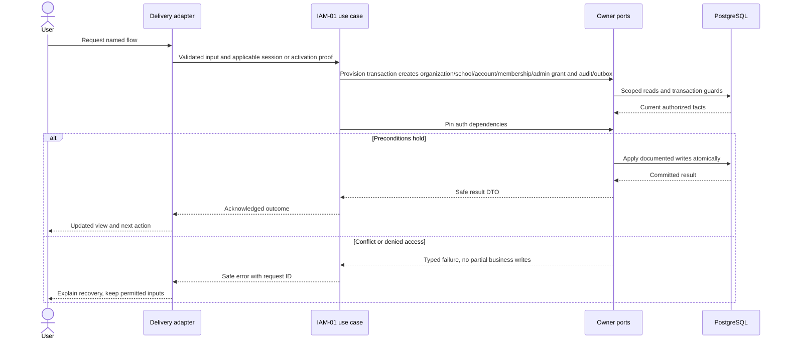
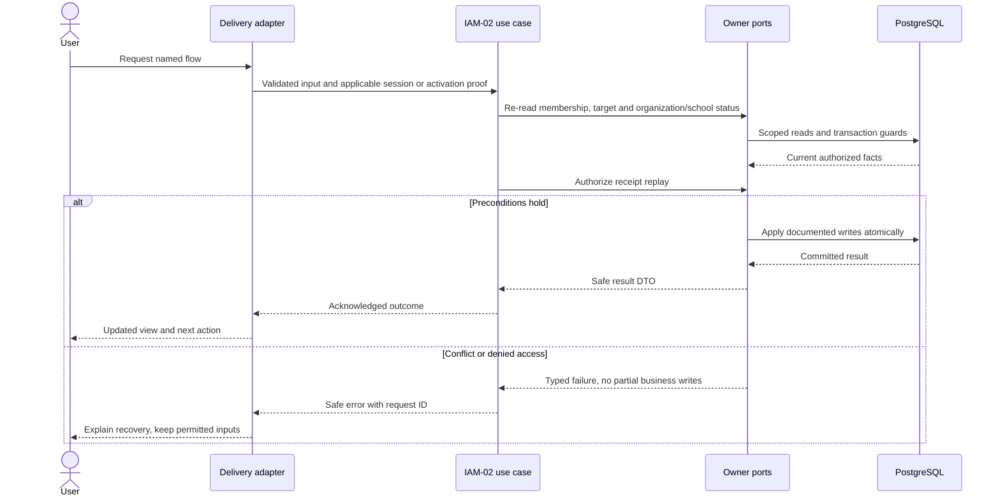
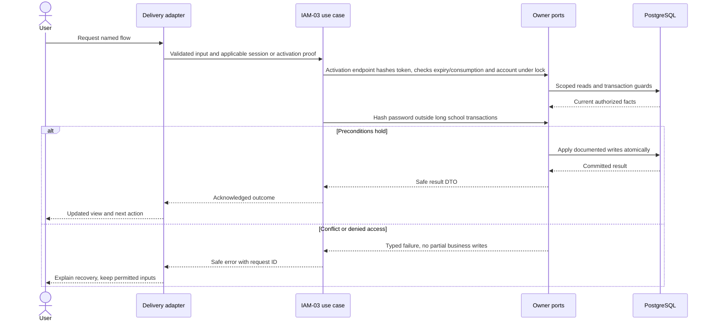

# School scope, authentication and permissions — design

Phase 1 · Design revision 2 · 4 October 2026. IAM-01 through IAM-03 are implemented; IAM-04 is the next reconciled implementation task. Review unresolved deployment choices in FND-02 before real-data use.

## Database naming and physical mapping

All physical objects follow [the VS database contract](../../DATABASE_DESIGN.md). Table names and columns below are physical SQL names; workflow prose uses logical domain names. `organizationId` maps to `organization_id`, `schoolId` to `school_id`, and `scope` expands to both columns. Models retain PascalCase through Prisma `@@map`; camelCase fields use `@map`. Planned schemas are implemented only through their named tasks and reviewed migrations.

## Ownership, aggregates and values

Organization is the contractual tenant. Tenancy owns trust-mode configuration on the Access-owned Organization root. School aggregate owns operational status, timezone and campuses. UserAccount is a global authentication root with status/tokenVersion and one globally verified login/recovery address. SchoolMembership owns fixed role grants and active/suspended/revoked lifecycle. AccountPersonBinding associates one account to an organization-local Person only after an explicit verified operation; identity and institutional profiles remain separate. Values include NormalizedEmail, SchoolScope, RoleCode, IanaTimezone, hashed Activation/Invite/Reset tokens, TrustMode and ExpectedVersion. No public organization/account registration.

## Module decisions

IAM-ADR-001: credentials via NextAuth adapter behind Identity ports; first task installs a compatible pinned next-auth/bcryptjs version and proves cookie/CSRF behavior. Starter intentionally has no empty authentication stub that grants access.

IAM-ADR-002: operator-assisted, identity-verified staff activation for the pilot. Online activation accepts a token pasted into a form POST; token alone is never permission to choose a different Person. Alternative public self-registration rejected. Delivering a token outside the synthetic local demo requires the school's approved secure identity-verification procedure. A production pilot cannot proceed until that procedure and recovery are rehearsed.

IAM-ADR-003: no selected-campus grant editing in Phase 1. Admin is school-wide; teacher scope comes from assignments. Campus remains a data/reference constraint. Configurable RBAC is Phase 2.

IAM-ADR-008: institution trust mode controls only staff provisioning/recovery channels. `OPERATOR_CLI` preserves the IAM-02 pending staff plus IAM-03 operator activation/recovery path and denies email invitations/password resets. `HYBRID` and `EMAIL` enable email invitations and ordinary email resets while retaining independently verified operator emergency recovery; `HYBRID` is the explicit application default for institutions created after this migration. Existing rows are explicitly backfilled to `OPERATOR_CLI`, and the database/Prisma default remains conservative. Neither trust mode grants capability, membership, entitlement or branch access. Account/UserAccount is global, so reset policy evaluates every current institution-level access grant before changing the one global credential.

## Physical data contract

IAM-01 installs Organization, School, UserAccount, SchoolMembership, RoleGrant and AuthSecurityEvent. PER-01 installs the Access-owned AccountPersonBinding only after the People-owned Person table exists. IAM-04 adds TrustMode, verified email, recovery evidence and the two email token tables in a forward migration. `scope` below means `(organizationId,schoolId)`. All business roots have version >=1. All scoped references require composite FK targets with matching unique keys, even when abbreviated in the table. Creation times use server clock; IDs server generated. Required unless nullable is stated. Enum labels are constrained enums/CHECKs, not unchecked strings. Do not silently implement a weaker constraint because Prisma syntax cannot express it; use reviewed migration SQL.

| Table | Fields and data stored | Meaning | Keys / constraints / query support |
|---|---|---|---|
| `vs_access_organization` (Organization) | id uuid PK; name varchar(160); status ACTIVE/SUSPENDED; trust_mode OPERATOR_CLI/HYBRID/EMAIL varchar(20) default OPERATOR_CLI; version int; created_at timestamptz(3); configuration_version int default 1 | Contractual tenant; Tenancy owns provisioning/recovery policy; no implicit access to schools. Existing rows backfilled conservatively. | CHECK trust_mode allowed; CHECK version>0; UNIQUE(id); CHECK configuration_version>0 |
| `vs_access_school` (School) | id uuid PK; organization_id uuid; code varchar(40); name varchar(160); timezone varchar(64); office_email varchar(254) nullable; office_phone varchar(40) nullable; office_address varchar(500) nullable; status ACTIVE/SUSPENDED; version int; created_at timestamptz(3); configuration_version int default 1 | Operational scope, office contact projection and serialization guard. Legacy contact nulls mean unrecorded; new profile edits require email/address. Timezone is immutable after branch creation in Phase 1. | FK organization; UNIQUE(organization_id,id); UNIQUE(organization_id,code); contact normalization/bounds checks; CHECK configuration_version>0 |
| `vs_access_campus` (Campus) | id uuid PK; organization_id uuid; school_id uuid; code varchar(40); name varchar(160); status ACTIVE/INACTIVE; version int | Optional subordinate site; no campus-level grants in first release. | FK(scope)→School; UNIQUE(scope,id); UNIQUE(scope,code) |
| `vs_access_user_account` (UserAccount) | id uuid PK; normalized_email varchar(254); email_verified_at timestamptz(3) nullable; password_hash text nullable; status PENDING/ACTIVE/DISABLED; token_version int; failed_attempts int; locked_until timestamptz(3) nullable; version int; created_at timestamptz(3) | Globally unique login; recovery only to an already verified address; no school access without membership. Never return hash/counters. | UNIQUE(normalized_email); counters>=0; index(status,id) |
| `vs_access_school_membership` (SchoolMembership) | id uuid PK; organization_id uuid; school_id uuid; account_id uuid; status PENDING/ACTIVE/SUSPENDED/REVOKED; version int | School access root; granting role does not prove teacher eligibility. | FK school; FK account; UNIQUE(scope,id); UNIQUE(scope,account_id) |
| `vs_access_role_grant` (RoleGrant) | id uuid PK; organization_id uuid; school_id uuid; membership_id uuid; code SCHOOL_ADMIN/TEACHER | Fixed permission mapping in code; no arbitrary permission JSON. | FK(scope,membership_id)→membership; UNIQUE(scope,membership_id,code) |
| `vs_access_account_person_binding` (AccountPersonBinding) | id uuid PK; organization_id uuid; account_id uuid; person_id uuid; verified_at timestamptz(3); verified_by uuid | Deliberate verified account-to-person link; People supplies scoped Person reference. Installed empty in PER-01; rows are created only by the later identity-verified PER-02 workflow. | FK organization/account/verifier; FK(organization_id,person_id)→Person; UNIQUE(organization_id,account_id); UNIQUE(organization_id,person_id) |
| `vs_access_account_activation` (AccountActivation) | id uuid PK; account_id uuid; token_hash char(64); expires_at timestamptz(3); consumed_at timestamptz(3) nullable; revoked_at timestamptz(3) nullable; created_by uuid; operator_id uuid; case_reference varchar(80); reason varchar(500); issued_token_version int | One-time 256-bit random opaque activation, hash stored; 24h expiry. Raw token shown once to authorized local operator, never audit/log/URL query. | UNIQUE(token_hash); FK account and created_by (subject account, with explicit operator provenance); UNIQUE(account_id,id); index(account_id,expires_at) |
| `vs_access_account_activation_membership` (AccountActivationMembership) | id uuid PK; activation_id uuid; account_id uuid; organization_id uuid; school_id uuid; membership_id uuid; expected_version int | Activation-owned intended membership snapshot. | UNIQUE(activation_id,membership_id); scoped account/membership FK and activation/account FK; CHECK expected_version>0 |
| `vs_access_auth_security_event` (AuthSecurityEvent) | id uuid PK; account_id uuid nullable; kind varchar(40); occurred_at timestamptz(3); request_id uuid; actor_account_id uuid nullable; decision varchar(12) nullable; safe_reason varchar(80) nullable; policy_snapshot jsonb nullable | Redacted auth/recovery evidence, including internal cross-institution policy decisions. `request_id` is the correlation ID. No password, raw token or raw identifier for unknown-account attempts. | FK accounts when present; index(account_id,occurred_at,id); immutable except one guarded NULL→account_id association for an initially unknown reset attempt resolved in the same locked transaction; cross-institution details only via operator/security authorization |
| `vs_access_invite` (AccessInvite) | id uuid PK; account_id uuid; organization_id uuid; school_id uuid; inviter_account_id uuid; token_hash char(64); proposed_roles text[]; membership_version int; organization_configuration_version int; school_configuration_version int; delivery_status varchar(24); delivery_failed_at timestamptz(3) nullable; delivery_failure_reason varchar(120) nullable; created_at/expires_at/accepted_at/revoked_at timestamptz(3) | Email invitation bound to a global account and scoped pending membership. Recipient is read from the normalized global account email; current inviter authority, trust mode, branch and proposed roles are rechecked at acceptance. Existing active credentials/status remain unchanged. Never creates Person/Employee binding or teaching eligibility. | FK account, organization, scoped school and inviter; UNIQUE(token_hash); CHECK delivery status, roles and expiry/failure relation; indexes(scope,delivery_status,created_at),(account_id,expires_at) |
| `vs_access_password_reset_token` (PasswordResetToken) | id uuid PK; account_id uuid; issuing_organization_id uuid nullable; token_hash char(64); delivery_status varchar(24); policy_snapshot jsonb; organization_configuration_versions jsonb; delivery_failed_at timestamptz(3) nullable; delivery_failure_reason varchar(120) nullable; created_at/expires_at/consumed_at/revoked_at timestamptz(3) nullable | One short-lived account-global recovery token. The snapshot includes every active membership and institution grant trust mode/configuration version; account-wide policy is rechecked at consumption. | FK account and optional issuer; UNIQUE(token_hash); CHECK delivery status and expiry/failure relation; indexes(account_id,created_at),(issuing_organization_id,created_at) |

## Read workflows and joins

Sign-in account lookup by normalizedEmail unique index, followed by password check and atomic attempt/lockout update; constant generic public failure. Successful JWT carries accountId/tokenVersion only, not trusted permanent grants. ResolveActor loads account + exact active membership + RoleGrant + active School/Organization. Effective permissions are server-side fixed map. People linkage is only needed for teacher/profile use cases, avoiding a bootstrap cycle.

User list joins scoped Membership → Account (safe email/status) → RoleGrant; account Person binding joins organization then school Employee, never an unrestricted Person directory. List is 50 items by accountId cursor. School settings query joins scoped School with Campus; other organization schools never appear automatically.

Recovery policy read is account-global and security-only: `UserAccount` → every ACTIVE `SchoolMembership` → scoped `School` → `Organization`, plus ACTIVE `InstitutionGrant` → `Organization` even when no branch membership exists. The projection is `{accountId, decision, reason, applicable:[{organizationId,trustMode,configurationVersion,accessKind}]}` and stays inside Access security/application code. No tenant-facing profile, directory, invitation or reset response includes another institution's name, ID, grant, membership or trust mode. Cross-institution snapshots/events are returned only by a separate platform-operator/security-authorized interface; no tenant API is defined here.

## Screen contract

Routes /sign-in, /activate, /admin/school, /admin/users, `/invite`, `/forgot-password`, and `/reset-password`. Sign-in has labeled email/password and generic invalid/locked feedback. Activation uses pasted operator token + password/confirmation; clears token on failure/navigation and never stores it in localStorage. School settings edits show version conflicts. In `OPERATOR_CLI`, staff UI retains pending membership creation and directs activation/recovery to the documented operator procedure; it exposes no email invitation/reset action. In `HYBRID`/`EMAIL`, current branch administrators with `user.manage` can invite and inspect only their branch's sanitized delivery state, then explicitly resend after reauthorization. The message shown for a failure is `Last delivery failed at <timestamp>, reason: <sanitized message>.` Existing active accounts receive only a new pending membership/invite; invitation acceptance verifies the global address and activates that membership without changing account status/password. New/PENDING accounts may set an initial password on acceptance. All invitation branches leave Person/Employee binding and teacher eligibility untouched. Forgot-password and reset pages always show generic completion/invalid-link language; no account lookup outcome is revealed. Invite/reset email URLs use a configured trusted origin and token in a fragment; the page immediately removes the fragment from browser history and POSTs it in the body. Pages send no-referrer/no-store and clear in-memory secrets on every result. Expired, revoked, used and unsent/failed tokens share a safe invalid-link outcome; authorized invitation administrators see only sanitized delivery state. No token list/download endpoint exists.

All screens additionally follow Bible §8: loading, empty, validation, permission, stale/conflict, temporary failure and acknowledged success; semantic labels, focus and mobile layout. No future-module navigation.

## Application ports and transaction boundary

Each named flow below is an application use case. Inputs/outputs are plain DTOs; adapters implement owned repositories and public cross-module facades. Use SchoolCommand, ActorResolver, Clock, IdGenerator and transactional envelope writers from the shared contract. Do not pass Prisma.TransactionClient into application/domain code. Generic `save(any)` is not a replacement for named commands. Domain factories create new roots/events; rehydration restores without events.

Mutations use the account → Organization → School guard protocol in Bible §7. Read-only flows do not take write locks. Bootstrap/auth-only commands use their documented account/provisioning transaction. Scoped school uniqueness/range checks run after locks. Reauthorize before replay and commit; only a successful transaction stores a receipt. Aggregate version, audit, outbox and response commit together. Exact flow-specific reads and writes below refine this shared behavior. Recovery-policy writes additionally take the reserved PostgreSQL transaction advisory guard `(1448302674,1)` as the first statement, before any row lock, then acquire account IDs sorted, Organization IDs sorted, and School IDs sorted. Reset issue/consume, trust-mode changes, invitation issue/accept/resend/revocation, membership/grant changes in IAM-02/TEN-01, and IAM-03 account/membership transitions all use this guard. The single conservative gate prevents predicate races from new or removed membership/institution access and prevents a reset from committing after a stricter trust/access transition. It serializes these rare recovery/admin operations across institutions; ordinary reads and unrelated business writes do not take it. Transaction-by-itself or an account row lock without this shared serialization is insufficient.

## IAM-01 — Provision a school and sign in as its administrator

**Success response contract:** Auth provider session exposes accountId/tokenVersion and safe identity only; application ResolveActor returns `{accountId,scope,membershipId,capabilities,requestId}`. Provision CLI returns IDs, not credentials in logs.

**Transport:** Restricted operator CLI provision-school; POST /api/auth/*; GET /admin

**Input:** CLI: organizationName, schoolCode, schoolName, timezone, adminEmail; password through hidden prompt. Login email/password handled by maintained auth adapter.

**Workflow:**

1. Add Organization, School, UserAccount, SchoolMembership, RoleGrant and AuthSecurityEvent; add shared audit/outbox/receipt migrations and immutable guards. Campus belongs to IAM-02, AccountActivation to IAM-03, the empty AccountPersonBinding table to PER-01, binding rows to verified PER-02, and InstitutionGrant to TEN-01; do not install speculative tables.
2. Provision transaction creates organization/school/account/membership/admin grant and audit/outbox; CLI refuses duplicate school/email without explicit recovery. Operator is a distinct audited provisioning principal.
3. Pin auth dependencies; validate input, check account lockout and bcrypt credential, issue secure session through provider.
4. Resolve current account tokenVersion and school membership on each admin request.
5. Render a minimal authenticated school home with sign-out and setup link; no feature statistics yet.

**Database writes / atomicity:** Organization, School, UserAccount, SchoolMembership, RoleGrant; AuditEntry and OutboxEvent for provisioning; AuthSecurityEvent for login/security facts. Bootstrap audit uses created admin account + explicit operator provenance field in safe payload; never impersonates an interactive login.

**Errors and recovery:** Duplicate email/school → explicit conflict with no partial school; invalid zone → validation; wrong password/lockout/disabled → same generic public error.



**Verification:** Unit — Capability map; input normalization; disabled/stale-token actor. Functional PostgreSQL — Provision rollback; unique email race; concurrent lockout; session revoked after tokenVersion bump. E2E — Sign in/out; denied admin route when logged out; other-school resource denied.

## IAM-02 — Manage school settings and staff access

**Success response contract:** `{resourceId,version,status,roles?,schoolCode?,name?,timezone?}`. All list responses use `{items,nextCursor}` and never include password/token/activation hashes.

**Transport:** PATCH /api/v1/school; POST /api/v1/campuses; POST /api/v1/memberships; PATCH /api/v1/memberships/:id

**Input:** Settings name/timezone/version; campus code/name; membership targetAccountId or new email, roles array, action, expectedVersion, reason; command key. Only SCHOOL_ADMIN/TEACHER role values.

**Workflow:**

1. Resolve actor; pre-read target account IDs, lock account rows sorted then current School guard.
2. Re-read membership, target and organization/school status; require user.manage or school.manage.
3. Authorize receipt replay; enforce assignable roles, scope and last-active-admin invariant.
4. Persist versioned settings/campus/membership/grants; new accounts remain PENDING without credentials; IAM-03 provides the separate verified operator activation action.
5. Return safe updated DTO and append audit/outbox/receipt atomically.

**Database writes / atomicity:** School/Campus or SchoolMembership/RoleGrant/UserAccount(PENDING); audit/outbox/receipt; activation belongs to IAM-03 through an explicit operator command, never automatic message send.

**Errors and recovery:** Last admin removal → 409 LAST_ADMIN; stale update → 409; changing an existing branch timezone → 409 TIMEZONE_IN_USE; foreign target → 404.



**Verification:** Unit — Last admin transition; fixed roles; timezone policy. Functional PostgreSQL — Two admin revocations serialize; forged cross-school grants fail constraints; failed audit rolls settings back. E2E — Create staff access, suspend/reinstate; verify protected request denied immediately.

## IAM-03 — Activate and recover staff accounts safely

**Success response contract:** `{activated:true}` or generic activation failure. Recovery CLI returns activation instructions privately; public response never discloses another account/person. No receipt containing a raw token.

**Transport:** POST /api/v1/activate; restricted operator recover-account CLI

**Input:** Activation: opaque token, new password; recovery: target account + verified operator case/reference and reason. Password minimum 12, maximum 72 UTF-8 bytes for selected bcrypt adapter; no truncation.

**Workflow:**

1. Operator verifies intended person outside the software and records a non-sensitive case reference; create/revoke activation under account lock.
2. Activation endpoint hashes token, checks expiry/consumption and account under lock; rate-limit both account/IP attempts without exposing token existence.
3. Hash password outside long school transactions; recheck token validity before commit.
4. Consume token atomically, activate intended pending memberships and bump tokenVersion; lock affected schools sorted when changing membership.
5. Recovery revokes old activation tokens/sessions; user sets password through a fresh one-time activation; append security evidence.

**Database writes / atomicity:** AccountActivation, UserAccount, intended pending SchoolMembership rows, AuthSecurityEvent; per-school audit/outbox for membership activation.

**Errors and recovery:** Expired/reused/revoked token → generic invalid activation; existing bound account mismatch → denied; replay cannot reset password twice.



**Verification:** Unit — Token expiry boundary; password byte limits; verification case required. Functional PostgreSQL — Concurrent redemption only once; token never plaintext; recovery revokes old sessions in every affected school. E2E — Paste activation token, set password, sign in; replay fails; recovery invalidates old session.

## Migration, retention and handoff

Implement tables only in the task that first uses them; migrate from empty database and the previous task checkpoint. Add scoped unique indexes before composite FKs; detect existing duplicates before adding constraints. SQL append-only/null-campus/range safeguards must appear in reviewed migrations and real-DB tests. No seed may erase prior data. Use synthetic fixtures and clean only owned test records. Preserve schema-compatible app rollback; use a reviewed forward migration when incompatible. Retention changes must preserve required immutable evidence and legal holds under the school-approved policy, not an ad hoc DELETE.

Exercise invalid credentials, concurrent failed attempts, lockout, disabled account, stale tokenVersion, revoked membership, two school isolation, last-admin race, activation expiry/reuse, token hash storage and recovery. No credential fixtures in source; generate local synthetic secrets. School settings commits cannot race with suspension using a stale actor.

See [tasks](TASKS.md), [current state](CURRENT_STATE.md), [Bible](../../VSchool_Bible.md) and [agent runbook](../../AGENT_RUNBOOK.md).

## v4.1 integration requirements

School means operational Branch and Organization means client Institution. Every protected flow checks current release availability, institution entitlement, branch activation and user/resource permission; foundational commands remain available only through their required capability projection. Apply the revised account → Organization shared guard → School guard protocol from Tenancy DESIGN. Use the shared components/tokens and current branch context; never invent a second visual system. No operational access is implied by institution administrator role.

## Institution configuration grant schema ownership

InstitutionGrant is Access-owned; its VS physical column/constraint contract is listed in the tenancy LLD and database catalog because TEN-01 implements its control-plane flow. It is distinct from branch SchoolMembership and never confers implicit pupil access. Organization/School.configuration_version is configuration metadata, separate from aggregate version and positive from 1.

## Portable backend integration

Follow [the backend extraction contract](../../BACKEND_EXTRACTION.md). Server module code belongs in backend/modules; UI consumes shared/contracts and a module gateway. Next delivery adapters resolve transport/session and invoke portable use cases. Future Nest controllers and provider factories reuse those use cases. Framework-specific context/ORM results never enter domain or browser DTOs.

## IAM-01 implementation decisions (local checkpoint)

IAM-ADR-004: IAM-01 bootstrap creates a new institution and its first branch. It refuses any existing normalized institution name or normalized login email rather than implicitly attaching to existing tenants/accounts. A transaction advisory guard keyed by NFC/trim institution name serializes duplicate bootstrap requests, while account email is backed by physical uniqueness. This CLI guard does not introduce globally unique institution names in the business schema; deliberate same-name institutions or additional branches require the explicit ID-based TEN-01 operator flow. Duplicate bootstrap returns PROVISION_CONFLICT and rolls back every created row. No bootstrap replay or generic school mutation endpoint exists.

Restricted operator authority is supplied only by local CLI configuration (UUID operator identity plus an explicit provisioning action); it is never accepted from an HTTP request. Bootstrap evidence identifies the created administrator as the FK actor and records principalKind=OPERATOR plus operatorId/requestId in the safe audit/outbox provenance. This is not an interactive administrator session. Initial password is supplied through a hidden terminal prompt or secure stdin and hashed before the transaction. Local synthetic demo tooling generates a random password and saves it only in ignored mode-0600 artifacts. Production operator verification/recovery is still a pilot gate.

IAM-ADR-005: pin next-auth 4.24.15 (published peer range includes Next 16/React 19) and bcryptjs 3.0.3. JWT sessions last 8 hours and contain accountId/tokenVersion only. Next hosting decodes the authenticated cookie; the portable application rechecks ACTIVE account/tokenVersion, current ACTIVE membership, current active Organization/School and fixed capabilities on every protected page/API. IAM-01 exposes only foundational access/setup metadata; no operational module entitlement is implied. TEN-02 adds licensed module configuration before school business modules are enabled.

Password policy: at least 12 characters and at most 72 UTF-8 bytes; never truncate. bcrypt cost 12 is measured locally. Authentication does bcrypt work outside the account-lock transaction, then rechecks the exact hash/current status under account FOR UPDATE before updating failure counters/security event. Five failures lock the account for 15 minutes. An expired lock resets the next failure cycle; successful authentication clears failures. Locked/disabled/unknown/wrong-password inputs receive one generic error. Missing accounts use a generated dummy hash. Security events are append-only; unknown identifiers/passwords are never recorded. Unknown reset attempts first append a null-account denial; within the same guarded transaction, a now-resolved verified account may be associated by updating only the previously NULL account_id field. All other event fields and all later updates/deletes remain database-guarded immutable. A bounded host-local request limiter caps auth POSTs (100/minute across the local host); this process-local guard is not a distributed production rate limiter.

POST auth adapters enforce configured same-origin plus the provider's CSRF protocol; foreign callback destinations are reduced to /admin; same-origin /account callbacks resolve administrators onward to /admin. Local HTTP cookies are HttpOnly/SameSite=Lax; HTTPS configuration enables Secure cookies. A private auth-only .env.local may be created without touching existing .env; existing secret configuration is preserved. No secret, credential or raw provider exception enters logs or source control.

Read transport: /sign-in is real unbranded administrator login. /sign-in/:synthetic-slug remains the non-authenticating BRD-01 preview until BRD-02. /admin and /admin/setup are force-dynamic, no-store protected metadata pages. /api/v1/school optionally accepts a schoolId candidate, resolves current exact membership on the server and returns safe 404 for foreign/missing scope; request schoolId is never authority. A logged-out/stale account redirects pages to /sign-in; API returns 401. Active account without school.manage gets safe 404 for the candidate. Service failures produce a safe retryable 503/error page, not SQL text or a fake login success.

Platform-owned infrastructure enlists an Audit/Outbox writer through the Platform contracts facade in the same provisioning transaction; Access never writes foreign-module tables directly. CommandReceipt is installed as the required shared envelope, while bootstrap intentionally has no receipt replay (duplicate requests require operator inspection). Immutable platform audit/receipt and auth security triggers prohibit UPDATE/DELETE, including accidental application cleanup. Test fixtures use fresh synthetic scoped records and leave append-only evidence intact; tests never disable guards or reset databases.

## IAM-02 resolved command contract — IAM-ADR-006

IAM-02 creates pending accounts/memberships without passwords or activation records. IAM-03 owns activation; its dependency cannot be required to demo IAM-02. Existing active staff fixtures test immediate enforcement; pending staff in the manual demo stay pending until IAM-03. Existing targetAccountId may be attached only when already affiliated to the current institution; unknown/foreign IDs receive safe 404. A new email conflicts generically with any existing global login, without auto-binding.

Foundational settings/staff commands require current school.manage/user.manage and active account, organization, school and membership. No operational module is enabled. Resolve default admin school on the server; optional schoolId selects a candidate that must match authorized membership. Account locks sort actor and pre-read target IDs; then Organization FOR SHARE and School FOR UPDATE; new account creation subsequently uses unique email. All actor/target/status/version/last-admin decisions are re-read inside the transaction. Last-admin count includes ACTIVE accounts + ACTIVE memberships + SCHOOL_ADMIN grants. Pending, disabled, suspended and revoked principals never count. Suspending/revoking/demoting the last active administrator returns LAST_ADMIN; no global tokenVersion bump for branch-only changes. Reinstate returns ACTIVE for active accounts, PENDING otherwise; REVOKED can only be explicitly reinstated by an administrator. Role replacement is additive union of fixed role codes; no implicit attendance.mark for admin.

Settings PATCH payload name/timezone and expectedVersion; campus POST code/name; membership POST email or targetAccountId (exactly one), roles; membership PATCH action SET_ROLES/SUSPEND/REINSTATE/REVOKE, roles for SET_ROLES, expectedVersion, mandatory reason (1–500). Text NFC/trim, names 1–160, codes 1–40, no control characters; email trim/lowercase <=254; IANA zone <=64; duplicate campus/email/membership => 409 CONFLICT. Versions positive integers; command keys 16–100 ASCII alphanumeric/underscore/hyphen. HTTP payload envelope, same-origin, 16 KiB bound, safe code/message/requestId/retryable errors.

Receipt SHA-256 canonical v1 input includes selected scope, normalized payload, expectedVersion and target ID; actor/scope/command/key uniqueness. Reauthorize target before replay; identical input replays committed safe response despite expectedVersion now stale; changed input => IDEMPOTENCY_CONFLICT. Guard serializes mutations. Three bounded deadlock/serialization retries reuse the same key; other storage failures => safe UNAVAILABLE. Platform-owned enlisted writer atomically writes audit/outbox/receipt; audit payload includes permitted school metadata/status/roles and the mandatory non-sensitive reason; it excludes login email, arbitrary request bodies, passwords and tokens. Mutation response has resourceId/version/status and appropriate safe fields.

Authorized GET /api/v1/school returns settings + bounded campuses; GET /api/v1/memberships returns 50 records by accountId UUID with a signed opaque cursor bound to actor/scope/filter and current authorization. Email/status/roles are minimal staff-directory fields; hashes/counters never leave storage. A self-only /api/v1/me and /account show current active membership roles/school metadata; no pupil data. Sign-in routes administrators to /admin and other active staff to /account; suspension takes effect on the next request. New UI screens /admin/school and /admin/users compose shared primitives, include pending/empty, validation, loading/submitting, success, conflict/unknown-result, permission and temporary-failure states. Same intent retry keeps its key/payload; conflicting edits require refresh and review.

Timezone is supplied when a branch is created and is immutable through the Phase 1 school-settings command. The guarded write compares the submitted value with the locked School row and rejects any difference, including a forged browser request. A future timezone migration requires a separately authorized operator workflow and impact analysis. Campus uses its documented composite school FK, unique scope/id and scope/code, positive version and ACTIVE/INACTIVE checks.

IAM-02 campus bound: at most 100 campuses per school, serialized under its School guard; exceeding the bound returns CONFLICT. Settings reads return all of those bounded campuses.

## IAM-03 resolved activation contract — IAM-ADR-007

Restricted local operator authority is the configured UUID control-plane principal, not a login account. Following the existing bootstrap provenance convention, AccountActivation.created_by references the verified subject account; operator_id records the actual operator. A mandatory 1–80 ASCII case reference and non-sensitive reason 1–500 identify outside-software verification. No HTTP caller can supply operator authority. Issue/recover take explicit accountId and intended membershipIds (1–100 for initial activation; 0–100 for recovery), each current PENDING membership must belong to that account and an active institution/branch. Unknown/foreign selection fails safely. DISABLED accounts cannot be activated or recovered by this flow. This flow never guesses or creates Person bindings; only the explicit identity-verified PER-02 use case may write them.

AccountActivationMembership is an owned child first used here: id uuid PK, activation_id uuid, account_id uuid, organization_id uuid, school_id uuid, membership_id uuid, expected_version int. UNIQUE(activation_id,membership_id); FK(account_id,activation_id) to activation(account_id,id); FK(organization_id,school_id,membership_id,account_id) to membership(organization_id,school_id,id,account_id). Membership adds this composite unique target. This relational intent snapshot prevents a token activating newly added or unrelated memberships. Role/status/version changes after issuance invalidate consumption rather than silently approving changed access.

Token is 32 random bytes encoded as 43 base64url characters, SHA-256 hash only in PostgreSQL, 24-hour expiry with expires_at > now (equality is expired). New issuance revokes unconsumed older tokens under account lock. Public activation accepts token/password/confirmation, never account/scope input; malformed/expired/revoked/used/version-mismatched tokens share INVALID_ACTIVATION. Password validation reuses the 12-character/72-byte bcrypt policy. Hash password outside database transactions after guarded eligibility/attempt checks, then recheck token/account/intended memberships under account → sorted Organization → sorted School locks before consuming. Serialization/deadlock failures retry at most three transaction attempts with the same token hash and password hash; other failures never trigger an uncertain-outcome replay. One redemption wins; success has no token-bearing receipt and returns only activated:true. Per-school audit/outbox and append-only security facts enlist atomically.

Recovery immediately clears the old password, moves account to PENDING and increments tokenVersion/version under account and all affiliated Organization/School guards, invalidating sessions across institutions/branches. It preserves existing ACTIVE/SUSPENDED/REVOKED memberships; only explicitly snapshotted PENDING memberships activate on consumption. Recovery is an audited operator security action, allowed even for the sole administrator; it is not a branch administrator removal command. Successful consumption restores ACTIVE account, resets login counters and bumps tokenVersion/version again. Operator recovery never restores a suspended/revoked membership or disabled account.

Before bcrypt, known-token attempts are serialized under account lock, recorded as redacted ACTIVATION_ATTEMPT security facts and limited to five per account in fifteen minutes. Excess account attempts use the same generic invalid activation response. The host also limits activation POSTs before token lookup to twenty per minute per verified IP. Next does not expose a trustworthy direct socket IP: with no explicitly trusted proxy, a shared anonymous-host bucket is the conservative fallback (cannot be bypassed by forged forwarded headers); production trusted-proxy wiring is a FND-02 gate. IP limit returns generic 429 independent of token validity. Same-origin, 4 KiB request bound, no-store and safe 503 apply. UI clears token/passwords after every submission outcome, shows no credential in URL/storage/log, supports confirmation/validation/submitting/success/generic failure/unknown outcome and sign-in link. A lost success response never replays password changes: try sign-in or request a fresh operator token.

Operator scripts issue-activation and recover-account write a new ignored mode-0600 private-*.json output file in the artifacts root or artifacts/iam-03 (never a served build/static directory), never overwrite an existing one and never print tokens. Recovery's private instructions are not external messages. Persistence tests verify concurrent consumption/expiry/revocation, scoped FK/intent mismatch, actual envelope rollback and account-wide session/password invalidation; browser tests cover activation/sign-in/replay/recovery, generic errors and credential clearing. Schema remains forward-only and earlier demos remain tied to immutable build snapshots when review is PENDING.


TEN-01 authority and context are resolved by TEN-ADR-004 in the Tenancy design. Access owns InstitutionGrant and all Organization/School/membership writes through its portable facade; Tenancy evidence is enlisted through its owner contract. Institution authority grants metadata administration only; verified operator controls institution authority and cross-branch account attachment. Existing branch-local IAM-02 rules remain enforced.

### 4 October 2026 — PER-01 table timing

PER-01 installs the Access-owned AccountPersonBinding table with a scoped FK to People.Person. The table remains empty in PER-01; only the later identity-verified PER-02 use case may add bindings. IAM-03 activation remains account/membership-only and never infers a person link.

## IAM-04 — trust modes, email invitation and password recovery (IAM-ADR-008)

**SA-COMP-03 design-readiness note (10 October 2026).** The existing IAM-04 contract fully resolves SA-15: Access owns invitation state and hashed tokens; `/admin/users` reads only branch-scoped sanitized failure projections; `user.manage`, current identity/token, organization/branch status and trust mode are rechecked; resend uses the same issue transaction and recovery advisory guard, revokes the prior open invitation before creating the replacement, then performs delivery outside the transaction and records only `SENT` or sanitized `FAILED`. Exact recipient and proposed roles come from the authorized branch projection, and acceptance still rechecks inviter, membership, grants and configuration snapshots. No schema, migration, new capability or cross-owner write is required. Closure requires the existing PostgreSQL token-lifecycle proof plus a desktop/mobile browser journey through failure visibility and resend. Production provider review remains outside this synthetic workflow and blocks release, not local implementation.

**Purpose and boundary.** Tenancy owns Organization trust-mode configuration and transition history. Access owns account credentials, email invites/reset tokens, current recovery policy and security events. Access exposes a typed invalidation application port; Tenancy enlists it in the same configuration unit of work. No invitation/reset changes role policy, entitlement, branch activation, Person binding or teaching eligibility. SQL and Prisma defaults remain `OPERATOR_CLI`; Access bootstrap and operator `CreateInstitution` explicitly supply `HYBRID` for institutions created after IAM-04 ships. Clients cannot choose that default.

**Policy.** `OPERATOR_CLI` permits IAM-02 pending staff and IAM-03 operator activation/account-wide recovery only; email invitations and password reset are denied. `HYBRID` enables email staff invitations, authorized resend and ordinary forgot-password, retaining independently verified operator recovery. `EMAIL` uses the same email channels and separately authorized audited emergency operator recovery; an inbox cannot authorize its own recovery. Modes never imply membership, capability, entitlement or branch access. Because UserAccount is global, password reset is denied when any currently applicable organization is `OPERATOR_CLI`.

**Schema/workflows.** IAM-04 forward migration adds `trust_mode` nullable, explicitly updates every existing row to `OPERATOR_CLI`, then sets conservative database DEFAULT, NOT NULL and CHECK. It adds `UserAccount.email_verified_at` NULL for all existing accounts and nullable decision/reason/versioned policy JSON fields to AuthSecurityEvent; `request_id` is the correlation ID. A follow-forward migration retains append-only event rows while allowing only an unassociated NULL `account_id` to be set once; all other fields and subsequent UPDATE/DELETE remain rejected. Existing email is not assumed verified. Accepting an email invitation proves control of the exact normalized global login address. AuthSecurityEvent policy snapshots can contain multiple institutions and are security evidence, never tenant-visible audit projections.

`vs_access_invite` is one token for one `(organization_id,school_id,membership_id,account_id)`. Fields: id, normalized recipient_email, scoped target, issuer_account_id/issuer_membership_id, token_hash, `purpose=STAFF_INVITATION`, `issuance_channel=EMAIL`, trust/configuration snapshots, issuer/account versions, proposed fixed grants JSON, created/expires/accepted/revoked/sent/delivery_failed instants, delivery status and allowlisted failure reason. Scoped composite FKs bind target and inviter to their memberships. `token_hash` is unique; a partial unique key allows one unaccepted/unrevoked invitation per target membership. The invitation references a PENDING SchoolMembership. New identities create one PENDING UserAccount, pending membership and RoleGrant set atomically; pending identities from IAM-02 are reused. An existing ACTIVE account receives only the new pending membership/invite; account status, password and token_version remain unchanged.

`vs_access_password_reset_token` has id, account_id, optional trusted issuing_organization_id, nullable self-service issuer account, token_hash, `purpose=PASSWORD_RESET`, `issuance_channel=EMAIL`, versioned account-wide policy snapshot, created/expires/consumed/revoked/sent/delivery_failed instants, delivery status and allowlisted failure reason. A partial unique index permits one outstanding token per account. Snapshot entries hold organization ID, trust mode, configuration version, access kind (active branch membership or active InstitutionGrant), decision and safe reason. Reset issue requires active eligible account, password, verified email and account-wide policy allow; request never accepts replacement email. Optional issuer institution comes from a public slug resolved by the hosting adapter through Branding's public facade, then is checked as applicable access. A missing/foreign slug or account, unverified address, ineligible state or OPERATOR_CLI policy returns the same generic public 202 and sends nothing.

Both token tables constrain purpose/channel/status labels, hash format, timestamps and a fixed failure vocabulary (`PROVIDER_UNAVAILABLE`, `TIMEOUT`, `INVALID_RECIPIENT`, `SIMULATED_FAILURE`, `UNKNOWN_DELIVERY_FAILURE`). Provider raw error text never enters evidence. Only SENT, unused, unrevoked and unexpired tokens can be consumed. Authorized invite listing returns branch-scoped membership/role and sanitized delivery facts only; it never returns tokens, hashes or global policy. Password-reset records/snapshots are not exposed through tenant APIs.

**Account-wide evaluator.** A portable Access application function accepts explicit `{organizationId,trustMode,configurationVersion,accessKind}` facts. Its repository reads every ACTIVE SchoolMembership joined through its exact School to Organization, and every ACTIVE InstitutionGrant joined directly to Organization, deduplicated by institution/access kind. It validates active account, password hash, verified email and lock/eligibility state. Any OPERATOR_CLI organization denies. Public issue result is the same status/body for missing account, policy denial or issue success; host/IP and account event limits use no untrusted forwarded headers. Cross-institution facts are only accessible through an explicitly platform-operator/security-authorized interface, which IAM-04 does not expose to school admins.

**Delivery phases.** Generate 32 cryptographically random bytes and store only SHA-256 hash. Under the recovery-policy guard, reauthorize and re-evaluate, revoke prior live token as required, insert PENDING_DELIVERY plus safe issuance evidence, then commit. Call the backend `EmailSender` port outside the transaction using trusted configured origin, typed purpose, recipient, expiry and correlation ID. A second guarded transaction conditionally records SENT/sent_at or FAILED/delivery_failed_at/safe reason plus delivery evidence. Crash/unknown outcome leaves PENDING_DELIVERY unusable. Late results update only still-live pending rows, never a revoked/accepted token. No worker retries. Resend repeats auth/trust/scope/eligibility checks, revokes old token, creates fresh token/expiry, commits evidence, then sends. Rate limits prevent duplicate concurrent issuance.

`EmailSender` is a portable backend application port. The local-only adapter writes one private mode-0600 sink message below ignored `artifacts/mail-sink/`, using configured `NEXTAUTH_URL`, and never serves or logs message bodies. A reserved synthetic recipient domain deterministically injects failure for demos. No real provider is configured or called. Expected network/provider failures become `{ok:false,reason:<allowlisted>}`; unrelated programming errors propagate. `lib/server/email.ts` supplies Next/environment composition only. Token-bearing messages are not returned by HTTP, logs, receipts, audit or committed evidence.

**Invite acceptance.** Link carries token in a fragment. Client removes it from history on load and submits only bounded same-origin POST body; page is no-store/no-referrer, uses trusted origin and clears token/password fields on every outcome. In one transaction after the serialization guard, Access rechecks invite status/expiry, current HYBRID/EMAIL mode, organization/branch status, target account and normalized recipient, inviter account+membership+`user.manage`, issuer authorization, current proposed-grant validity and unchanged target membership/version/grants. Changed issuer rights, scope, trust or proposed grants reject without writes. Existing ACTIVE accounts retain status/password/token_version; exact-address email_verified_at may be set and only the invited membership becomes ACTIVE. PENDING accounts with no password may choose initial password; only that membership becomes active and other pending memberships stay pending. Consume invitation atomically and append safe audit/outbox/security evidence. Never create Employee, Teacher or AccountPersonBinding.

**Reset consumption.** Lookup token candidate, hash password outside the long transaction, acquire the recovery guard first, lock the account, then re-read token/account and current policy. Require sent, unused, unrevoked, unexpired token; active account, verified address, current allow policy and an applicable issuer organization when supplied. Atomically consume, set global password, clear login lockout, bump token_version/version and revoke every other outstanding account reset token. Preserve every membership, role, binding and account status; never sign in automatically. Record account ID, issuance+consumption policy snapshots, trust modes/configuration versions, allow/deny, fixed safe reason and correlation ID. No cross-institution detail is included in tenant responses.

**Trust transition.** `setTrustMode` is a Tenancy application use case requiring verified platform `OperatorPrincipal`, organization ID, expected configuration revision, key, non-sensitive reason and a valid in-organization audit-anchor account. Institution admins cannot change it. Same-mode is an idempotent no-op with no revision/event. Actual change updates trust_mode and organization configuration/root versions and enlists `ConfigurationChange`, `TenantCommandReceipt`, `TenantOutbox`, Access token invalidation and per-account AuthSecurityEvent evidence in one transaction. Operator evidence identifies principalKind=OPERATOR/operatorId; the anchor account is provenance only. On transition to OPERATOR_CLI, revoke unused/unaccepted invitations in the organization; find current applicable accounts from active memberships and InstitutionGrant; revoke their outstanding reset tokens across every issuer plus every outstanding reset issued by the changed organization. Record token IDs directly in the configuration change for small sets and linked Access correlation IDs/counts for large sets. Preserve all AccountActivation tokens. Returning to HYBRID/EMAIL does not revive revoked email tokens.

**Serialization.** The first transaction statement for reset issue/consume, trust change, invitation issue/accept/resend, IAM-02 membership/grant commands, TEN-01 InstitutionGrant/branch membership writes and IAM-03 activation/recovery membership transitions is the reserved advisory transaction guard `pg_advisory_xact_lock(1448302674,1)`. Then lock account IDs sorted, Organization IDs sorted, School IDs sorted; reauthorize and write. This shared guard prevents access predicate phantoms and guarantees reset cannot commit from a stale policy after stricter access/configuration commits. It serializes only low-frequency access/recovery configuration transactions across institutions; reads and ordinary business writes do not use it. Transaction isolation/account locks alone are insufficient. Real PostgreSQL tests cover two concurrent consumes (one winner), resend, institution B tightening a reset issued by A, membership/grant races and configuration-vs-consume consistency.

**Failure contract and verification.** Same-origin, bounded body, no-store, no-referrer, configured link origin, token fragment removal, generic 202 forgot-password and rate limits. Public reset cannot distinguish missing, denied, unverified, pending/failed-delivery, expired, revoked or consumed. Authorized branch admins see exactly `Last delivery failed at <timestamp>, reason: <sanitized message>.` Invitation endpoints return safe 401/403/404/409/422/503. Unit tests cover evaluator and token/provider states; real PostgreSQL covers backfill, explicit HYBRID creation, no-membership institution access, policy tightening, cross-issuer invalidation, unchanged active credentials, authorization recheck, rollback, delivery and races; Playwright desktop/mobile covers all modes, operator path regression, invite/resend/accept, generic reset and session invalidation. Only private development mail sink is used. Manual acceptance remains PENDING until explicit owner feedback.

## SA-06 and SA-14 completion-review deltas

### SA-06 branch office profile corrective contract

The Edition 03 SA-06 field set and `school.manage` authority are `EXISTING_ACCEPTED_CONTRACT`: branch display name, required office email, optional office phone, required address, mandatory reason, read-only existing timezone, revisioned activity and stale comparison. Keeping legacy rows nullable while requiring complete values on every new update is a `ROUTINE_ENGINEERING_CHOICE` needed for a forward-only migration; no historical contact values are guessed.

Access owns `updateSchoolProfile(actor,{name,timezone,officeEmail,officePhone,officeAddress,reason,expectedVersion,key})`. Email is NFC/trim/lowercase, 3–254 and basic address-shaped; phone is absent/empty or 5–40 characters from digits, spaces and `+().-`; address is NFC/trim 1–500; reason is non-sensitive NFC/trim 1–500. Office details are operational public contact data for authorized branch readers and may later feed approved school contact projections; the reason is internal evidence only. School code, institution and timezone are not editable here.

The forward migration adds nullable `office_email varchar(254)`, `office_phone varchar(40)` and `office_address varchar(500)` to `vs_access_school`, with bounds/normalization checks. Existing `(organization_id,id)` keys and the primary-key lookup support the guarded read/write; no index is added. GET joins the exact authorized School and returns empty strings for legacy nulls. PATCH uses the existing 16 KiB same-origin transport and command key. It reauthorizes, takes the recovery advisory guard plus account → Organization → School locks, compares `expectedVersion`, rejects any timezone change, and updates only normalized profile fields with `version+1`. No-op input returns the current version without evidence. A real change commits School plus Platform audit/outbox/receipt atomically. Audit stores actor/scope, reason, version and changed field identifiers, excluding contact/address values; source hashes remain in the receipt owner.

```mermaid
sequenceDiagram
  actor A as School administrator
  participant H as PATCH /api/v1/school
  participant U as Access management use case
  participant D as PostgreSQL
  A->>H: Profile, reason, expectedVersion, stable key
  H->>U: Verified session and bounded normalized command
  U->>D: Lock account, organization and school; reauthorize school.manage
  D-->>U: Current School and version
  alt Version and immutable timezone match
    U->>D: Update changed fields and append redacted evidence atomically
    D-->>A: Saved revision
  else Stale version
    D-->>A: 409 STALE_VERSION; no writes
    A->>H: Read latest authorized settings
    H-->>A: Current values beside preserved attempted inputs
  end
```

The settings card uses the approved grouping and shared form controls. On stale conflict it preserves attempted values, fetches current authorized settings only after the user asks to compare, shows the current revision, and lets the user adopt that revision before an explicit retry. Verification covers normalization, validation, no-op, immutable timezone, redacted audit, replay, stale conflict, rollback, unauthorized scope, persistence/readback, desktop/mobile keyboard flow and visual inspection.

### SA-14 verified-Employee access grant contract

SA-14 starts from an exact active Employee selected from the authorized branch. `grantEmployeeAccess(actor,{employeeId,email,verificationReference,roles,confirmed,key})` never treats email equality as identity proof. The non-sensitive verification reference records the administrator's independent out-of-band check; the explicit confirmation binds that check to the selected role and branch. Existing independent membership and invitation operations remain available for their established recovery/operator uses, but they do not satisfy SA-14.

Access owns the command and transaction. People publishes only `EmployeeAccessVerificationPort.findActiveEmployee(transaction,{organizationId,schoolId,employeeId,schoolDate})`, which reads the exact `vs_people_employee` row joined to its scoped `vs_people_person` and returns the employee/person identity fact. It requires `status='ACTIVE'`, `employed_from <= schoolDate`, and absent or exclusive `employed_to > schoolDate`. The Access transaction reads `vs_access_user_account` by normalized global email; `vs_access_account_person_binding` by both organization/account and organization/person; and any exact scoped `vs_access_school_membership`. It writes a missing account, verified binding, pending membership, role grants, invitation, redacted security events, platform audit/outbox and a command receipt. No schema or migration is added; existing unique constraints on global normalized email, organization/account and organization/person bindings, scoped memberships and receipt intent keys enforce races. Existing invitation delivery and expiry indexes cover the post-commit status view.

The mutation supports all three trust modes while preserving one identity contract. `HYBRID` and `EMAIL` create the pending grant plus an email invitation. `OPERATOR_CLI` creates the same verified binding and pending grant but no invitation or delivery attempt; the UI names the required verified-operator activation. Every protected read and write still performs application authorization. The transaction takes the Access advisory serialization guard, inviter account `FOR UPDATE`, Organization `FOR SHARE`, School `FOR UPDATE`, then the Employee and Person `FOR SHARE`. It establishes verified transaction-local context, rechecks the live account token, active institution/branch, active administrator membership and `SCHOOL_ADMIN` grant, then verifies the Employee. A pre-existing binding is accepted only when both account and Person match; either side bound elsewhere conflicts. An existing scoped membership is a duplicate grant conflict. New membership status is `PENDING` regardless of target account status and becomes active only through the selected existing invitation or operator activation policy.

`GrantEmployeeAccess` receipts are scoped by organization, school, actor, command and caller UUID key. Their SHA-256 input binds Employee, normalized email, verification reference and sorted roles. Same-key/same-input replay reauthorizes and re-verifies the Employee, then returns the current invitation delivery result without sending a second email; same-key/different-input fails. Verification reference is retained only in the restricted `PERSON_BINDING_VERIFIED` security snapshot and excluded from platform audit, outbox, HTTP messages and logs. Account email is likewise excluded from platform evidence. Issuance commits before development-sink delivery; `finishDelivery` compare-and-sets `PENDING_DELIVERY` to `SENT` or `FAILED`. A failed delivery leaves the verified pending grant visible and eligible for the existing authorized resend, which revokes the old token before issuing its replacement.

```mermaid
sequenceDiagram
  actor A as School administrator
  participant H as POST /api/v1/invitations/employee
  participant U as Access grant use case
  participant P as People verification port
  participant D as PostgreSQL
  participant M as Development mail sink
  A->>H: Employee, email, verification, role, confirmation, stable key
  H->>U: Verified session and exact branch candidate
  U->>D: Lock Access guard rows; reauthorize user.manage
  U->>P: Verify exact active Employee in enlisted transaction
  P->>D: Scoped Employee + Person read
  U->>D: Bind Person; create pending membership, roles, invite, evidence and receipt
  D-->>U: Committed invitation
  U->>M: Send token after commit
  U->>D: Compare-and-set SENT or FAILED
  U-->>A: Pending access and permitted activation/delivery state
```

Validation failures cover missing confirmation, invalid email/UUID/key, duplicate/unknown roles, and a verification reference outside 3–80 safe characters. `NOT_FOUND` covers an absent, foreign, ended or not-yet-effective Employee without exposing foreign identity data. `CONFLICT` covers disabled/mismatched/bound accounts and duplicate grants. Permission or trust-mode loss denies the command; a receipt input mismatch returns `IDEMPOTENCY_CONFLICT`; provider failure returns a sanitized, visible failure while preserving the committed access grant. Verification requires application validation tests; real PostgreSQL proof of atomic rows/evidence, cross-scope denial, duplicate binding/grant rollback, redaction, replay and delivery failure; and desktop/mobile Playwright proof of selection, confirmation, persisted reload, keyboard flow and denied/empty/error states.
