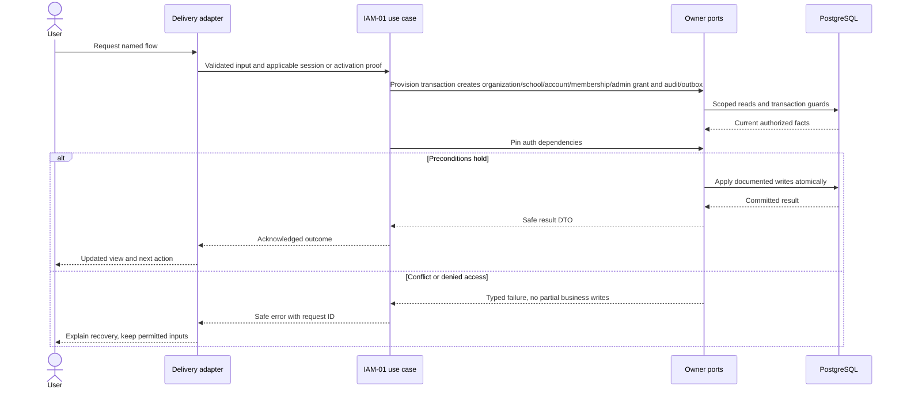
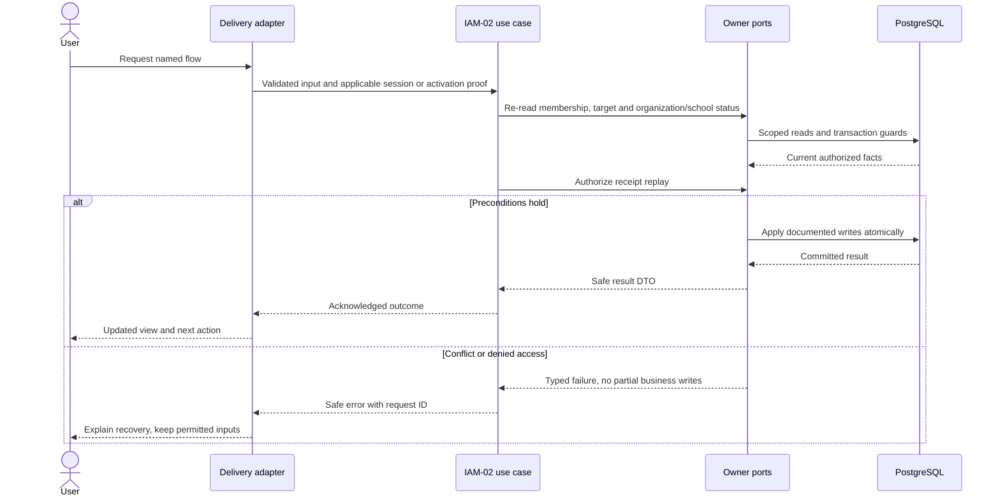
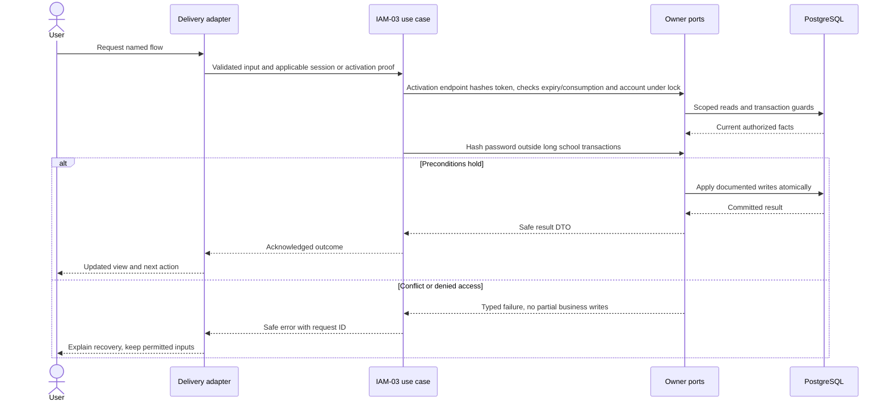

# School scope, authentication and permissions — design

Phase 1 · Design revision 1 · 3 October 2026. Status: IAM-01 through IAM-03 are implemented; TEN-01 extends institution authority through the owner facade. Review unresolved deployment choices in FND-02 before real-data use.

## Database naming and physical mapping

All physical objects follow [the VS database contract](../../DATABASE_DESIGN.md). Table names and columns below are physical SQL names; workflow prose uses logical domain names. `organizationId` maps to `organization_id`, `schoolId` to `school_id`, and `scope` expands to both columns. Models retain PascalCase through Prisma `@@map`; camelCase fields use `@map`. Planned schemas are implemented only through their named tasks and reviewed migrations.

## Ownership, aggregates and values

Organization is the contractual tenant. School aggregate owns operational status, timezone and campuses. UserAccount is an authentication root with status/tokenVersion. SchoolMembership owns fixed role grants and active/suspended/revoked lifecycle. AccountPersonBinding associates one account to an organization-local Person only after an explicit verified operation; identity and institutional profiles remain separate. Values: NormalizedEmail (trim/lowercase for login only), SchoolScope, RoleCode, IanaTimezone, ActivationTokenHash, ExpectedVersion. Events: SchoolProvisioned.v1, MembershipChanged.v1, AccountRevoked.v1. No public organization/account registration.

## Module decisions

IAM-ADR-001: credentials via NextAuth adapter behind Identity ports; first task installs a compatible pinned next-auth/bcryptjs version and proves cookie/CSRF behavior. Starter intentionally has no empty authentication stub that grants access.

IAM-ADR-002: operator-assisted, identity-verified staff activation for the pilot. Online activation accepts a token pasted into a form POST; token alone is never permission to choose a different Person. Alternative public self-registration rejected. Delivering a token outside the synthetic local demo requires the school's approved secure identity-verification procedure. A production pilot cannot proceed until that procedure and recovery are rehearsed.

IAM-ADR-003: no selected-campus grant editing in Phase 1. Admin is school-wide; teacher scope comes from assignments. Campus remains a data/reference constraint. Configurable RBAC is Phase 2.

## Physical data contract

IAM-01 installs Organization, School, UserAccount, SchoolMembership, RoleGrant and AuthSecurityEvent; remaining access tables are planned. `scope` below means `(organizationId,schoolId)`. All business roots have version >=1. All scoped references require composite FK targets with matching unique keys, even when abbreviated in the table. Creation times use server clock; IDs server generated. Required unless nullable is stated. Enum labels are constrained enums/CHECKs, not unchecked strings. Do not silently implement a weaker constraint because Prisma syntax cannot express it; use reviewed migration SQL.

| Table | Fields and data stored | Meaning | Keys / constraints / query support |
|---|---|---|---|
| `vs_access_organization` (Organization) | id uuid PK; name varchar(160); status ACTIVE/SUSPENDED; version int; created_at timestamptz(3); configuration_version int default 1 | Contractual tenant; no implicit access to all schools. | CHECK version>0; UNIQUE(id); CHECK configuration_version>0 |
| `vs_access_school` (School) | id uuid PK; organization_id uuid; code varchar(40); name varchar(160); timezone varchar(64); status ACTIVE/SUSPENDED; version int; created_at timestamptz(3); configuration_version int default 1 | Operational scope and serialization guard. Timezone immutable once sessions exist in Phase 1. | FK organization; UNIQUE(organization_id,id); UNIQUE(organization_id,code); CHECK configuration_version>0 |
| `vs_access_campus` (Campus) | id uuid PK; organization_id uuid; school_id uuid; code varchar(40); name varchar(160); status ACTIVE/INACTIVE; version int | Optional subordinate site; no campus-level grants in first release. | FK(scope)→School; UNIQUE(scope,id); UNIQUE(scope,code) |
| `vs_access_user_account` (UserAccount) | id uuid PK; normalized_email varchar(254); password_hash text nullable; status PENDING/ACTIVE/DISABLED; token_version int; failed_attempts int; locked_until timestamptz(3) nullable; version int; created_at timestamptz(3) | Globally unique login; no school access without membership. Never return hash or failed-attempt details. | UNIQUE(normalized_email); counters>=0; index(status,id) |
| `vs_access_school_membership` (SchoolMembership) | id uuid PK; organization_id uuid; school_id uuid; account_id uuid; status PENDING/ACTIVE/SUSPENDED/REVOKED; version int | School access root; granting role does not prove teacher eligibility. | FK school; FK account; UNIQUE(scope,id); UNIQUE(scope,account_id) |
| `vs_access_role_grant` (RoleGrant) | id uuid PK; organization_id uuid; school_id uuid; membership_id uuid; code SCHOOL_ADMIN/TEACHER | Fixed permission mapping in code; no arbitrary permission JSON. | FK(scope,membership_id)→membership; UNIQUE(scope,membership_id,code) |
| `vs_access_account_person_binding` (AccountPersonBinding) | id uuid PK; organization_id uuid; account_id uuid; person_id uuid; verified_at timestamptz(3); verified_by uuid | Deliberate verified account-to-person link; People supplies scoped Person reference. | FK account; FK(organization_id,person_id)→Person; UNIQUE(organization_id,account_id); UNIQUE(organization_id,person_id) |
| `vs_access_account_activation` (AccountActivation) | id uuid PK; account_id uuid; token_hash char(64); expires_at timestamptz(3); consumed_at timestamptz(3) nullable; revoked_at timestamptz(3) nullable; created_by uuid; operator_id uuid; case_reference varchar(80); reason varchar(500); issued_token_version int | One-time 256-bit random opaque activation, hash stored; 24h expiry. Raw token shown once to authorized local operator, never audit/log/URL query. | UNIQUE(token_hash); FK account and created_by (subject account, with explicit operator provenance); UNIQUE(account_id,id); index(account_id,expires_at) |
| `vs_access_account_activation_membership` (AccountActivationMembership) | id uuid PK; activation_id uuid; account_id uuid; organization_id uuid; school_id uuid; membership_id uuid; expected_version int | Activation-owned intended membership snapshot. | UNIQUE(activation_id,membership_id); scoped account/membership FK and activation/account FK; CHECK expected_version>0 |
| `vs_access_auth_security_event` (AuthSecurityEvent) | id uuid PK; account_id uuid nullable; kind varchar(40); occurred_at timestamptz(3); request_id uuid; actor_account_id uuid nullable | Redacted auth/recovery evidence where a school transaction is not available. No password, raw token or raw identifier for unknown-account attempts. | FK accounts when present; index(account_id,occurred_at,id); append-only |

## Read workflows and joins

Sign-in account lookup by normalizedEmail unique index, followed by password check and atomic attempt/lockout update; constant generic public failure. Successful JWT carries accountId/tokenVersion only, not trusted permanent grants. ResolveActor loads account + exact active membership + RoleGrant + active School/Organization. Effective permissions are server-side fixed map. People linkage is only needed for teacher/profile use cases, avoiding a bootstrap cycle.

User list joins scoped Membership → Account (safe email/status) → RoleGrant; account Person binding joins organization then school Employee, never an unrestricted Person directory. List is 50 items by accountId cursor. School settings query joins scoped School with Campus; other organization schools never appear automatically.

## Screen contract

Routes /sign-in, /activate, /admin/school, /admin/users. Sign-in has labeled email/password and generic invalid/locked feedback. Activation uses pasted token + password/confirmation; clears token on failure/navigation and never stores it in localStorage. School settings edits show version conflicts. User list exposes role/status, grant/suspend/revoke and reason; protects last active administrator. Empty teachers need profile/assignment guidance, not implicit access. Use private operator output for activation tokens, no downloadable public token list.

All screens additionally follow Bible §8: loading, empty, validation, permission, stale/conflict, temporary failure and acknowledged success; semantic labels, focus and mobile layout. No future-module navigation.

## Application ports and transaction boundary

Each named flow below is an application use case. Inputs/outputs are plain DTOs; adapters implement owned repositories and public cross-module facades. Use SchoolCommand, ActorResolver, Clock, IdGenerator and transactional envelope writers from the shared contract. Do not pass Prisma.TransactionClient into application/domain code. Generic `save(any)` is not a replacement for named commands. Domain factories create new roots/events; rehydration restores without events.

Mutations use the account → Organization → School guard protocol in Bible §7. Read-only flows do not take write locks. Bootstrap/auth-only commands use their documented account/provisioning transaction. Scoped school uniqueness/range checks run after locks. Reauthorize before replay and commit; only a successful transaction stores a receipt. Aggregate version, audit, outbox and response commit together. Exact flow-specific reads and writes below refine this shared behavior.

## IAM-01 — Provision a school and sign in as its administrator

**Success response contract:** Auth provider session exposes accountId/tokenVersion and safe identity only; application ResolveActor returns `{accountId,scope,membershipId,capabilities,requestId}`. Provision CLI returns IDs, not credentials in logs.

**Transport:** Restricted operator CLI provision-school; POST /api/auth/*; GET /admin

**Input:** CLI: organizationName, schoolCode, schoolName, timezone, adminEmail; password through hidden prompt. Login email/password handled by maintained auth adapter.

**Workflow:**

1. Add Organization, School, UserAccount, SchoolMembership, RoleGrant and AuthSecurityEvent; add shared audit/outbox/receipt migrations and immutable guards. Campus belongs to IAM-02, AccountActivation to IAM-03, Person binding to PER-01 and InstitutionGrant to TEN-01; do not install speculative tables.
2. Provision transaction creates organization/school/account/membership/admin grant and audit/outbox; CLI refuses duplicate school/email without explicit recovery. Operator is a distinct audited provisioning principal.
3. Pin auth dependencies; validate input, check account lockout and bcrypt credential, issue secure session through provider.
4. Resolve current account tokenVersion and school membership on each admin request.
5. Render a minimal authenticated school home with sign-out and setup link; no feature statistics yet.

**Database writes / atomicity:** Organization, School, UserAccount, SchoolMembership, RoleGrant; AuditEntry and OutboxEvent for provisioning; AuthSecurityEvent for login/security facts. Bootstrap audit uses created admin account + explicit operator provenance field in safe payload; never impersonates an interactive login.

**Errors and recovery:** Duplicate email/school → explicit conflict with no partial school; invalid zone → validation; wrong password/lockout/disabled → same generic public error.

**Verification:** Unit — Capability map; input normalization; disabled/stale-token actor. Functional PostgreSQL — Provision rollback; unique email race; concurrent lockout; session revoked after tokenVersion bump. E2E — Sign in/out; denied admin route when logged out; other-school resource denied.

## IAM-02 — Manage school settings and staff access

**Success response contract:** `{resourceId,version,status,roles?,schoolCode?,name?,timezone?}`. All list responses use `{items,nextCursor}` and never include password/token/activation hashes.

**Transport:** PATCH /api/v1/school; POST /api/v1/campuses; POST /api/v1/memberships; PATCH /api/v1/memberships/:id

**Input:** Settings name/timezone/version; campus code/name; membership targetAccountId or new email, roles array, action, expectedVersion, reason; command key. Only SCHOOL_ADMIN/TEACHER role values.

**Workflow:**

1. Resolve actor; pre-read target account IDs, lock account rows sorted then current School guard.
2. Re-read membership, target and organization/school status; require user.manage or school.manage.
3. Authorize receipt replay; enforce assignable roles, scope and last-active-admin invariant.
4. Persist versioned settings/campus/membership/grants; new accounts remain PENDING without credentials; IAM-03 provides the separate verified operator activation action.
5. Return safe updated DTO and append audit/outbox/receipt atomically.

**Database writes / atomicity:** School/Campus or SchoolMembership/RoleGrant/UserAccount(PENDING); audit/outbox/receipt; activation belongs to IAM-03 through an explicit operator command, never automatic message send.

**Errors and recovery:** Last admin removal → 409 LAST_ADMIN; stale update → 409; changing timezone after any session → 409 TIMEZONE_IN_USE; foreign target → 404.

**Verification:** Unit — Last admin transition; fixed roles; timezone policy. Functional PostgreSQL — Two admin revocations serialize; forged cross-school grants fail constraints; failed audit rolls settings back. E2E — Create staff access, suspend/reinstate; verify protected request denied immediately.

## IAM-03 — Activate and recover staff accounts safely

**Success response contract:** `{activated:true}` or generic activation failure. Recovery CLI returns activation instructions privately; public response never discloses another account/person. No receipt containing a raw token.

**Transport:** POST /api/v1/activate; restricted operator recover-account CLI

**Input:** Activation: opaque token, new password; recovery: target account + verified operator case/reference and reason. Password minimum 12, maximum 72 UTF-8 bytes for selected bcrypt adapter; no truncation.

**Workflow:**

1. Operator verifies intended person outside the software and records a non-sensitive case reference; create/revoke activation under account lock.
2. Activation endpoint hashes token, checks expiry/consumption and account under lock; rate-limit both account/IP attempts without exposing token existence.
3. Hash password outside long school transactions; recheck token validity before commit.
4. Consume token atomically, activate intended pending memberships and bump tokenVersion; lock affected schools sorted when changing membership.
5. Recovery revokes old activation tokens/sessions; user sets password through a fresh one-time activation; append security evidence.

**Database writes / atomicity:** AccountActivation, UserAccount, intended pending SchoolMembership rows, AuthSecurityEvent; per-school audit/outbox for membership activation.

**Errors and recovery:** Expired/reused/revoked token → generic invalid activation; existing bound account mismatch → denied; replay cannot reset password twice.

**Verification:** Unit — Token expiry boundary; password byte limits; verification case required. Functional PostgreSQL — Concurrent redemption only once; token never plaintext; recovery revokes old sessions in every affected school. E2E — Paste activation token, set password, sign in; replay fails; recovery invalidates old session.

## Migration, retention and handoff

Implement tables only in the task that first uses them; migrate from empty database and the previous task checkpoint. Add scoped unique indexes before composite FKs; detect existing duplicates before adding constraints. SQL append-only/null-campus/range safeguards must appear in reviewed migrations and real-DB tests. No seed may erase prior data. Use synthetic fixtures and clean only owned test records. Preserve schema-compatible app rollback; use a reviewed forward migration when incompatible. Retention changes must preserve required immutable evidence and legal holds under the school-approved policy, not an ad hoc DELETE.

Exercise invalid credentials, concurrent failed attempts, lockout, disabled account, stale tokenVersion, revoked membership, two school isolation, last-admin race, activation expiry/reuse, token hash storage and recovery. No credential fixtures in source; generate local synthetic secrets. School settings commits cannot race with suspension using a stale actor.

See [tasks](TASKS.md), [current state](CURRENT_STATE.md), [Bible](../../VSchool_Bible.md) and [agent runbook](../../AGENT_RUNBOOK.md).

## v4.1 integration requirements

School means operational Branch and Organization means client Institution. Every protected flow checks current release availability, institution entitlement, branch activation and user/resource permission; foundational commands remain available only through their required capability projection. Apply the revised account → Organization shared guard → School guard protocol from Tenancy DESIGN. Use the shared components/tokens and current branch context; never invent a second visual system. No operational access is implied by institution administrator role.

## Institution configuration grant schema ownership

InstitutionGrant is Access-owned; its VS physical column/constraint contract is listed in the tenancy LLD and database catalog because TEN-01 implements its control-plane flow. It is distinct from branch SchoolMembership and never confers implicit pupil access. Organization/School.configuration_version is configuration metadata, separate from aggregate version and positive from 1.

## Portable backend integration

Follow [the backend extraction contract](../../BACKEND_EXTRACTION.md). Server module code belongs in backend/modules; UI consumes shared/contracts and a module gateway. Next delivery adapters resolve transport/session and invoke portable use cases. Future Nest controllers and provider factories reuse those use cases. Framework-specific context/ORM results never enter domain or browser DTOs.

## IAM-01 implementation decisions (local checkpoint)

IAM-ADR-004: IAM-01 bootstrap creates a new institution and its first branch. It refuses any existing normalized institution name or normalized login email rather than implicitly attaching to existing tenants/accounts. A transaction advisory guard keyed by NFC/trim institution name serializes duplicate bootstrap requests, while account email is backed by physical uniqueness. This CLI guard does not introduce globally unique institution names in the business schema; deliberate same-name institutions or additional branches require the explicit ID-based TEN-01 operator flow. Duplicate bootstrap returns PROVISION_CONFLICT and rolls back every created row. No bootstrap replay or generic school mutation endpoint exists.

Restricted operator authority is supplied only by local CLI configuration (UUID operator identity plus an explicit provisioning action); it is never accepted from an HTTP request. Bootstrap evidence identifies the created administrator as the FK actor and records principalKind=OPERATOR plus operatorId/requestId in the safe audit/outbox provenance. This is not an interactive administrator session. Initial password is supplied through a hidden terminal prompt or secure stdin and hashed before the transaction. Local synthetic demo tooling generates a random password and saves it only in ignored mode-0600 artifacts. Production operator verification/recovery is still a pilot gate.

IAM-ADR-005: pin next-auth 4.24.15 (published peer range includes Next 16/React 19) and bcryptjs 3.0.3. JWT sessions last 8 hours and contain accountId/tokenVersion only. Next hosting decodes the authenticated cookie; the portable application rechecks ACTIVE account/tokenVersion, current ACTIVE membership, current active Organization/School and fixed capabilities on every protected page/API. IAM-01 exposes only foundational access/setup metadata; no operational module entitlement is implied. TEN-02 adds licensed module configuration before school business modules are enabled.

Password policy: at least 12 characters and at most 72 UTF-8 bytes; never truncate. bcrypt cost 12 is measured locally. Authentication does bcrypt work outside the account-lock transaction, then rechecks the exact hash/current status under account FOR UPDATE before updating failure counters/security event. Five failures lock the account for 15 minutes. An expired lock resets the next failure cycle; successful authentication clears failures. Locked/disabled/unknown/wrong-password inputs receive one generic error. Missing accounts use a generated dummy hash. Security events are append-only; unknown identifiers/passwords are never recorded. A bounded host-local request limiter caps auth POSTs (100/minute across the local host); this process-local guard is not a distributed production rate limiter.

POST auth adapters enforce configured same-origin plus the provider's CSRF protocol; foreign callback destinations are reduced to /admin; same-origin /account callbacks resolve administrators onward to /admin. Local HTTP cookies are HttpOnly/SameSite=Lax; HTTPS configuration enables Secure cookies. A private auth-only .env.local may be created without touching existing .env; existing secret configuration is preserved. No secret, credential or raw provider exception enters logs or source control.

Read transport: /sign-in is real unbranded administrator login. /sign-in/:synthetic-slug remains the non-authenticating BRD-01 preview until BRD-02. /admin and /admin/setup are force-dynamic, no-store protected metadata pages. /api/v1/school optionally accepts a schoolId candidate, resolves current exact membership on the server and returns safe 404 for foreign/missing scope; request schoolId is never authority. A logged-out/stale account redirects pages to /sign-in; API returns 401. Active account without school.manage gets safe 404 for the candidate. Service failures produce a safe retryable 503/error page, not SQL text or a fake login success.

Platform-owned infrastructure enlists an Audit/Outbox writer through the Platform contracts facade in the same provisioning transaction; Access never writes foreign-module tables directly. CommandReceipt is installed as the required shared envelope, while bootstrap intentionally has no receipt replay (duplicate requests require operator inspection). Immutable platform audit/receipt and auth security triggers prohibit UPDATE/DELETE, including accidental application cleanup. Test fixtures use fresh synthetic scoped records and leave append-only evidence intact; tests never disable guards or reset databases.

## IAM-02 resolved command contract — IAM-ADR-006

IAM-02 creates pending accounts/memberships without passwords or activation records. IAM-03 owns activation; its dependency cannot be required to demo IAM-02. Existing active staff fixtures test immediate enforcement; pending staff in the manual demo stay pending until IAM-03. Existing targetAccountId may be attached only when already affiliated to the current institution; unknown/foreign IDs receive safe 404. A new email conflicts generically with any existing global login, without auto-binding.

Foundational settings/staff commands require current school.manage/user.manage and active account, organization, school and membership. No operational module is enabled. Resolve default admin school on the server; optional schoolId selects a candidate that must match authorized membership. Account locks sort actor and pre-read target IDs; then Organization FOR SHARE and School FOR UPDATE; new account creation subsequently uses unique email. All actor/target/status/version/last-admin decisions are re-read inside the transaction. Last-admin count includes ACTIVE accounts + ACTIVE memberships + SCHOOL_ADMIN grants. Pending, disabled, suspended and revoked principals never count. Suspending/revoking/demoting the last active administrator returns LAST_ADMIN; no global tokenVersion bump for branch-only changes. Reinstate returns ACTIVE for active accounts, PENDING otherwise; REVOKED can only be explicitly reinstated by an administrator. Role replacement is additive union of fixed role codes; no implicit attendance.mark for admin.

Settings PATCH payload name/timezone and expectedVersion; campus POST code/name; membership POST email or targetAccountId (exactly one), roles; membership PATCH action SET_ROLES/SUSPEND/REINSTATE/REVOKE, roles for SET_ROLES, expectedVersion, mandatory reason (1–500). Text NFC/trim, names 1–160, codes 1–40, no control characters; email trim/lowercase <=254; IANA zone <=64; duplicate campus/email/membership => 409 CONFLICT. Versions positive integers; command keys 16–100 ASCII alphanumeric/underscore/hyphen. HTTP payload envelope, same-origin, 16 KiB bound, safe code/message/requestId/retryable errors.

Receipt SHA-256 canonical v1 input includes selected scope, normalized payload, expectedVersion and target ID; actor/scope/command/key uniqueness. Reauthorize target before replay; identical input replays committed safe response despite expectedVersion now stale; changed input => IDEMPOTENCY_CONFLICT. Guard serializes mutations. Three bounded deadlock/serialization retries reuse the same key; other storage failures => safe UNAVAILABLE. Platform-owned enlisted writer atomically writes audit/outbox/receipt; audit payload includes permitted school metadata/status/roles and the mandatory non-sensitive reason; it excludes login email, arbitrary request bodies, passwords and tokens. Mutation response has resourceId/version/status and appropriate safe fields.

Authorized GET /api/v1/school returns settings + bounded campuses; GET /api/v1/memberships returns 50 records by accountId UUID with a signed opaque cursor bound to actor/scope/filter and current authorization. Email/status/roles are minimal staff-directory fields; hashes/counters never leave storage. A self-only /api/v1/me and /account show current active membership roles/school metadata; no pupil data. Sign-in routes administrators to /admin and other active staff to /account; suspension takes effect on the next request. New UI screens /admin/school and /admin/users compose shared primitives, include pending/empty, validation, loading/submitting, success, conflict/unknown-result, permission and temporary-failure states. Same intent retry keeps its key/payload; conflicting edits require refresh and review.

Timezone protection uses the Attendance owner contract ScheduledSessionQuery in the same guard transaction. Until ATT-01 installs AttendanceSession, the schema-aware owner adapter returns false only when the relation is genuinely absent; database errors fail closed. Once present, any scoped session blocks timezone changes, including cancelled/submitted sessions. No speculative Attendance table or Access writes to foreign tables. Campus uses its documented composite school FK, unique scope/id and scope/code, positive version and ACTIVE/INACTIVE checks.

IAM-02 campus bound: at most 100 campuses per school, serialized under its School guard; exceeding the bound returns CONFLICT. Settings reads return all of those bounded campuses.

## IAM-03 resolved activation contract — IAM-ADR-007

Restricted local operator authority is the configured UUID control-plane principal, not a login account. Following the existing bootstrap provenance convention, AccountActivation.created_by references the verified subject account; operator_id records the actual operator. A mandatory 1–80 ASCII case reference and non-sensitive reason 1–500 identify outside-software verification. No HTTP caller can supply operator authority. Issue/recover take explicit accountId and intended membershipIds (1–100 for initial activation; 0–100 for recovery), each current PENDING membership must belong to that account and an active institution/branch. Unknown/foreign selection fails safely. DISABLED accounts cannot be activated or recovered by this flow. Person bindings are not installed until PER-01; this flow never guesses or creates them.

AccountActivationMembership is an owned child first used here: id uuid PK, activation_id uuid, account_id uuid, organization_id uuid, school_id uuid, membership_id uuid, expected_version int. UNIQUE(activation_id,membership_id); FK(account_id,activation_id) to activation(account_id,id); FK(organization_id,school_id,membership_id,account_id) to membership(organization_id,school_id,id,account_id). Membership adds this composite unique target. This relational intent snapshot prevents a token activating newly added or unrelated memberships. Role/status/version changes after issuance invalidate consumption rather than silently approving changed access.

Token is 32 random bytes encoded as 43 base64url characters, SHA-256 hash only in PostgreSQL, 24-hour expiry with expires_at > now (equality is expired). New issuance revokes unconsumed older tokens under account lock. Public activation accepts token/password/confirmation, never account/scope input; malformed/expired/revoked/used/version-mismatched tokens share INVALID_ACTIVATION. Password validation reuses the 12-character/72-byte bcrypt policy. Hash password outside database transactions after guarded eligibility/attempt checks, then recheck token/account/intended memberships under account → sorted Organization → sorted School locks before consuming. Serialization/deadlock failures retry at most three transaction attempts with the same token hash and password hash; other failures never trigger an uncertain-outcome replay. One redemption wins; success has no token-bearing receipt and returns only activated:true. Per-school audit/outbox and append-only security facts enlist atomically.

Recovery immediately clears the old password, moves account to PENDING and increments tokenVersion/version under account and all affiliated Organization/School guards, invalidating sessions across institutions/branches. It preserves existing ACTIVE/SUSPENDED/REVOKED memberships; only explicitly snapshotted PENDING memberships activate on consumption. Recovery is an audited operator security action, allowed even for the sole administrator; it is not a branch administrator removal command. Successful consumption restores ACTIVE account, resets login counters and bumps tokenVersion/version again. Operator recovery never restores a suspended/revoked membership or disabled account.

Before bcrypt, known-token attempts are serialized under account lock, recorded as redacted ACTIVATION_ATTEMPT security facts and limited to five per account in fifteen minutes. Excess account attempts use the same generic invalid activation response. The host also limits activation POSTs before token lookup to twenty per minute per verified IP. Next does not expose a trustworthy direct socket IP: with no explicitly trusted proxy, a shared anonymous-host bucket is the conservative fallback (cannot be bypassed by forged forwarded headers); production trusted-proxy wiring is a FND-02 gate. IP limit returns generic 429 independent of token validity. Same-origin, 4 KiB request bound, no-store and safe 503 apply. UI clears token/passwords after every submission outcome, shows no credential in URL/storage/log, supports confirmation/validation/submitting/success/generic failure/unknown outcome and sign-in link. A lost success response never replays password changes: try sign-in or request a fresh operator token.

Operator scripts issue-activation and recover-account write a new ignored mode-0600 private-*.json output file in the artifacts root or artifacts/iam-03 (never a served build/static directory), never overwrite an existing one and never print tokens. Recovery's private instructions are not external messages. Persistence tests verify concurrent consumption/expiry/revocation, scoped FK/intent mismatch, actual envelope rollback and account-wide session/password invalidation; browser tests cover activation/sign-in/replay/recovery, generic errors and credential clearing. Schema remains forward-only and earlier demos remain tied to immutable build snapshots when review is PENDING.

TEN-01 authority and context are resolved by TEN-ADR-004 in the Tenancy design. Access owns InstitutionGrant and all Organization/School/membership writes through its portable facade; Tenancy evidence is enlisted through its owner contract. Institution authority grants metadata administration only; verified operator controls institution authority and cross-branch account attachment. Existing branch-local IAM-02 rules remain enforced.
