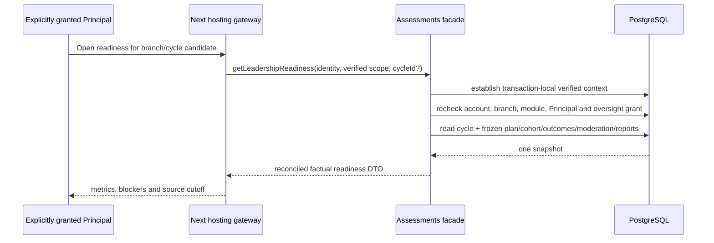
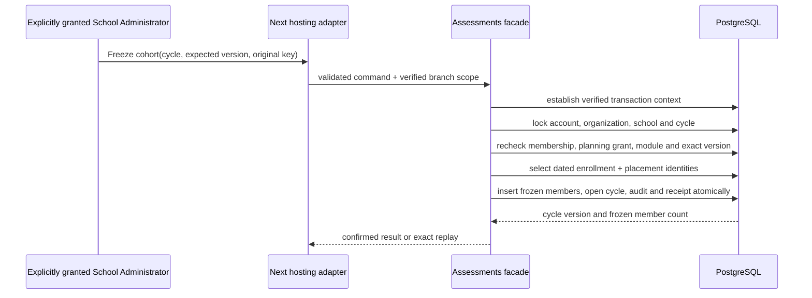

# Assessments owner design

Status: **D11 SYNTHETIC BASELINE APPROVED / F11-A VERIFIED / F11-B DESIGN READY**.

The repository owner approved D11 for synthetic-only implementation on 17 October 2026. Assessments owns its scale, cycle, frozen cohort, plan items, mark outcomes and revisions, moderation decisions, report revisions and publication receipts. Academics supplies exact year, section and subject identities; Students supplies dated enrollment/placement facts; Access supplies live accounts and branch memberships. Assessments never writes those owners. Documents will own generated report bytes later; no PDF or download is claimed by F11-A.

## F11-A / LEA-20 vertical slice

The first slice provides one versioned cycle and an explicit Principal oversight projection. Its outcome is an explainable readiness page where required outcome slots reconcile to `numeric + not assessed + absent + excused + missing`, zero remains a real numeric score, moderation and report states remain distinct, and READY never means PUBLISHED. A separately granted Principal may read this projection. Principal role alone grants nothing and the projection exposes no pupil names or marks.

### Domain invariants and ownership

- A scale pins integer `minimum_scaled`, `maximum_scaled`, `precision` and rounding mode. Decimal values are stored and compared as scaled integers; JavaScript floating-point totals are prohibited.
- A cycle pins one academic year, section, scale and immutable `scheme_version`. Its bounded lifecycle is `DRAFT -> OPEN -> MARKING -> MODERATION -> APPROVED -> RELEASED`, with explicit `WITHDRAWN` only after release.
- Plan items pin subject, maximum scaled score, weight basis points and required/optional status. Unique subject per cycle; required-item weights total 10,000 before the cycle can become OPEN.
- The cohort freezes exact Student, enrollment and placement identities. Dated source eligibility is validated before insertion; later transfer never rewrites the cohort.
- Each plan-item/cohort pair has at most one current outcome. `NUMERIC` requires an in-range integer score, including zero. `NOT_ASSESSED`, `ABSENT` and `EXCUSED` require NULL score. Revisions are append-only.
- Moderation binds the exact cycle version and evidence digest. Pending moderation is a readiness blocker. Approval never publishes a report.
- A report revision binds the exact approved cycle/evidence version and one frozen cohort member. `WITHHELD`, `APPROVED`, `PUBLISHED` and `WITHDRAWN` stay distinct. Publication belongs to the later LEA-22 slice.

### Authorization and scope

Every operation establishes verified transaction-local account and branch context, then rechecks live account token version, active Organization/School, active membership, release availability, active `assessments` entitlement and activation. F11-A read additionally requires current Principal membership and an active `AssessmentsOversightGrant`. Later recorder, moderator and publisher grants are distinct. A hidden navigation entry is never authority.

All new tables are BRANCH classified with `organization_id` and `school_id`, scoped composite foreign keys, `vs_assessments_*` physical names and snake_case columns. They are registered for the TEN-03 closure gate under TEN-ADR-006 Path A. Application authorization stays mandatory after RLS.

### Physical schema

| Physical table (logical model) | Exact physical columns | Purpose | Constraints / indexes |
|---|---|---|---|
| `vs_assessments_oversight_grant` (AssessmentsOversightGrant) | id/org/school/membership/account/operator uuid; grant/revoke timestamps; version | Explicit Principal oversight designation; Principal role alone is insufficient. | Scoped membership/account FKs; unique scope account; active lookup index; positive version. |
| `vs_assessments_scale` (AssessmentsScale) | id/org/school uuid; code/name; integer min/max; precision/rounding; status/version/time | Versioned exact-decimal scoring scale. | Scoped School FK; unique code; bounded precision/range/rounding/status checks. |
| `vs_assessments_cycle` (AssessmentsCycle) | id/org/school/year/section/scale uuid; code/name; scheme/state/cutoff/version/timestamps | Assessment scheme and readiness root pinned to exact academic scope. | Scoped School/Year/Section/Scale FKs; unique code; state/version checks; state/update index. |
| `vs_assessments_plan_item` (AssessmentsPlanItem) | id/org/school/cycle/subject uuid; max scaled; weight bp; required; position | Frozen required or optional subject requirement. | Scoped Cycle/Subject FKs; unique cycle subject; score/weight/position checks; cycle index. |
| `vs_assessments_cohort_member` (AssessmentsCohortMember) | id/org/school/cycle/student/enrollment/placement/year uuid; state/position/frozen time | Frozen dated learner denominator member. | Scoped Cycle/Student/Enrollment/Placement FKs; unique cycle student; state/position checks; cohort index. |
| `vs_assessments_outcome` (AssessmentsOutcome) | id/org/school/cycle/plan/cohort/recorder uuid; state/score/revision/version/time | Current exact assessment outcome; zero is distinct from missing. | Scoped Cycle/Plan/Cohort FKs; unique plan/cohort slot; state-score consistency; cycle/state index. |
| `vs_assessments_outcome_revision` (AssessmentsOutcomeRevision) | id/org/school/outcome/recorder uuid; number/state/score/time | Append-only mark/outcome evidence. | Scoped Outcome FK; unique revision number; state-score consistency; immutable trigger. |
| `vs_assessments_moderation` (AssessmentsModeration) | id/org/school/cycle/plan uuid; evidence version/digest; status/version/time | Exact-revision moderation readiness state. | Scoped Cycle/Plan FKs; unique cycle plan; digest/status/version checks; cycle/status index. |
| `vs_assessments_report_revision` (AssessmentsReportRevision) | id/org/school/cycle/cohort uuid; number/source version/digest/status/time | Immutable per-learner report readiness/publication revision. | Scoped Cycle/Cohort FKs; unique report revision; digest/status/version checks; immutable trigger. |

### Read contract

`getLeadershipReadiness(identity, scope, cycleId?)` selects the newest visible cycle when no ID is supplied and returns:

- cycle, scheme, scale, source cutoff and branch timezone;
- exact required slots from required plan items × frozen active cohort;
- mutually exclusive numeric/not-assessed/absent/excused/missing counts;
- optional configured slots separately;
- pending/approved/returned/rejected moderation counts;
- withheld/approved/published/withdrawn report counts;
- readiness blockers and `readyForApproval`, where missing required outcomes or pending/returned/rejected moderation always prevents readiness.

The query runs in one `REPEATABLE READ` transaction and uses plan/cohort/outcome indexes. It never substitutes missing outcomes with zero and never reads current enrollment in place of the frozen cohort.

### Write, concurrency and recovery contracts

F11-A setup is an operator-only synthetic provisioner used to establish exact owner fixtures and grants. User-facing cycle planning and mark entry are later F11 subtasks. Those commands will lock account -> Organization -> School -> Cycle -> affected outcome/report roots, require expected versions and use owner receipts keyed by scope/actor/command/key. Same-key same-payload returns one semantic result; changed payload conflicts. Moderation and publication recheck current evidence after locking. Reads acquire no write locks.

### API and UI contract

`/leadership/assessments` is recipe L. It shows cycle/source context, reconciled outcome metrics, distinct moderation/report blockers, populated/empty/unavailable/forbidden states and no mutation controls. The later Coordination handoff is enabled only after an Assessments source adapter can reauthorize the exact cycle/evidence version; F11-A does not relabel another owner adapter.

### Sequence

### Verification criteria

- Unit: scaled score/state validation and reconciliation, including numeric zero.
- PostgreSQL: scope/FKs, grant requirement, frozen denominator, all outcome states, revoked grant/module denial and snapshot consistency.
- Browser: populated/empty/unavailable and forbidden deep-link states at 1440×1000 and 390×844, keyboard focus and no overflow.
- Direct reference comparison uses Principal explorer LEA-20 for stage/labels and recipe L for production composition. Human acceptance, native accessibility, font portability, TEN-03 and production enablement remain separate.

## Remaining F11 slices

### F11-B — authorized cycle planning and frozen cohort

F11-B adds a School Administrator counterpart at `/admin/assessments`. Planning authority is a live `SCHOOL_ADMIN` membership plus an active, membership-bound `AssessmentsPlanningGrant`; neither the role nor the Principal oversight grant implies planning authority. The same Assessments release, entitlement and branch-activation checks used by the readiness projection apply on every read, command and receipt lookup.

The planning workspace is a single repeatable-read projection of active scales, academic years, active sections, subjects and existing cycles. It exposes only exact owner identities. An academic year, section and subject remain owned by Academics; eligibility is checked in the command transaction and a section must belong to the selected year. The screen has three explicit operations:

1. `CreateAssessmentScale` creates an immutable active numeric scale. `code` is normalized uppercase ASCII, name is trimmed, precision is 0–3, `minimumScaled < maximumScaled`, and rounding is `HALF_UP` or `HALF_EVEN`. A scale cannot be edited in place after creation.
2. `CreateAssessmentCyclePlan` creates one `DRAFT` cycle and its ordered plan items atomically. Code and name are normalized, source cutoff is an ISO instant, all subjects must exist in the branch, each subject appears once, maximum scores are positive and within the scale, weights are 1–10,000 basis points, and required-item weights total exactly 10,000. The command pins `scheme_version = 1`; it does not freeze pupils or open marking.
3. `FreezeAssessmentCohort` locks the exact draft cycle, rechecks its expected version and Academics scope, selects Students whose enrollment in the pinned academic year and placement in the pinned section contain the cycle cutoff (`valid_from <= cutoff-date < valid_to`), and writes their exact Student, Enrollment and SectionPlacement identities. The cohort must be non-empty. It then changes the cycle from `DRAFT` to `OPEN`, increments the cycle version and never recomputes that cohort later.

All commands lock account → Organization → School → Cycle when a cycle exists. They run at `SERIALIZABLE`, require a UUID idempotency key, and write one Assessments-owned receipt keyed by organization, school, actor, command and key. The receipt stores a canonical input hash and a minimized result. Same-key/same-input replay reauthorizes the actor and returns the original semantic result; same-key/different-input fails with `IDEMPOTENCY_CONFLICT`. `getPlanningCommandStatus` also reauthorizes before returning `FOUND`; absence is `UNKNOWN`, never failure. Expected-version mismatch returns `STALE_VERSION` with no partial cohort rows. A transaction also appends a Platform audit entry with IDs, versions and counts only; pupil names and marks are excluded.

`AssessmentsPlanningGrant` and `AssessmentsCommandReceipt` are BRANCH tables registered for the TEN-03 closure gate. The grant has scoped membership/account foreign keys and an active lookup index. The receipt has scoped actor and school foreign keys, a unique intent key and created-time index. No browser-supplied role, scope, source identity or trusted link is authority.

The planning UI preserves safe entered values after validation, disables duplicate submission, reports unknown outcomes with a retry/status action using the original key, and links an opened cycle to the Principal readiness view. Reloaded drafts come from owner persistence; no browser durable draft is introduced. Empty, unavailable, forbidden, validation, stale and replay states are explicit. F11-B does not add mark entry, moderation, publication or report download.

F11-B verification requires domain validation/reconciliation tests; real-PostgreSQL scope, grant, dated cohort, stale version, atomic rollback, replay/conflict, revocation and concurrent-freeze tests; and a one-worker browser journey for create scale → create plan → reload draft → freeze → Principal readiness link, including recovery, desktop/mobile composition and keyboard focus.

F11-C adds assigned-Teacher mark revisions. F11-D adds independent moderation and LEA-21. F11-E adds report revisions, explicit publication delegation and LEA-22; Documents must provide a real-scanned generated artifact before report download is complete.
