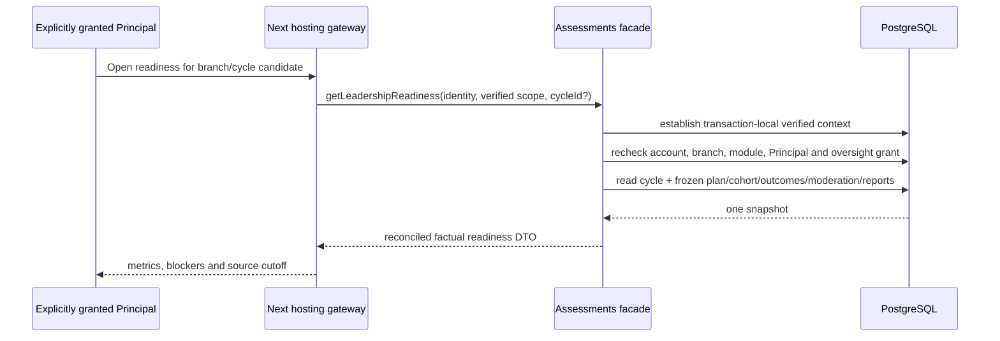

# Assessments owner design

Status: **D11 SYNTHETIC BASELINE APPROVED / F11-A DESIGN READY / IMPLEMENTATION PENDING**.

The repository owner approved D11 for synthetic-only implementation on 17 October 2026. Assessments owns its scale, cycle, frozen cohort, plan items, mark outcomes and revisions, moderation decisions, report revisions and publication receipts. Academics supplies exact year, section and subject identities; Students supplies dated enrollment/placement facts; Access supplies live accounts and branch memberships. Assessments never writes those owners. Documents will own generated report bytes later; no PDF or download is claimed by F11-A.

## F11-A / LEA-20 vertical slice

The first slice provides one versioned cycle and an explicit Principal oversight projection. Its outcome is an explainable readiness page where required outcome slots reconcile to `numeric + not assessed + absent + excused + missing`, zero remains a real numeric score, moderation and report states remain distinct, and READY never means PUBLISHED. A separately granted Principal may read this projection. Principal role alone grants nothing and the projection exposes no pupil names or marks.

### Domain invariants and ownership

- A scale pins integer `minimum_scaled`, `maximum_scaled`, `precision` and rounding mode. Decimal values are stored and compared as scaled integers; JavaScript floating-point totals are prohibited.
- A cycle pins one academic year, section, scale and immutable `scheme_version`. Its bounded lifecycle is `DRAFT -> OPEN -> MARKING -> MODERATION -> APPROVED -> RELEASED`, with explicit `WITHDRAWN` only after release.
- Plan items pin subject, maximum scaled score, weight basis points and required/optional status. Unique subject per cycle; required-item weights total 10,000 before the cycle can become OPEN.
- The cohort freezes exact Student, enrollment and placement identities. Dated source eligibility is validated before insertion; later transfer never rewrites the cohort.
- Each plan-item/cohort pair has at most one current outcome. `NUMERIC` requires an in-range integer score, including zero. `NOT_ASSESSED`, `ABSENT` and `EXCUSED` require NULL score. Revisions are append-only.
- Moderation binds the exact cycle version and evidence digest. Pending moderation is a readiness blocker. Approval never publishes a report.
- A report revision binds the exact approved cycle/evidence version and one frozen cohort member. `WITHHELD`, `APPROVED`, `PUBLISHED` and `WITHDRAWN` stay distinct. Publication belongs to the later LEA-22 slice.

### Authorization and scope

Every operation establishes verified transaction-local account and branch context, then rechecks live account token version, active Organization/School, active membership, release availability, active `assessments` entitlement and activation. F11-A read additionally requires current Principal membership and an active `AssessmentsOversightGrant`. Later recorder, moderator and publisher grants are distinct. A hidden navigation entry is never authority.

All new tables are BRANCH classified with `organization_id` and `school_id`, scoped composite foreign keys, `vs_assessments_*` physical names and snake_case columns. They are registered for the TEN-03 closure gate under TEN-ADR-006 Path A. Application authorization stays mandatory after RLS.

### Read contract

`getLeadershipReadiness(identity, scope, cycleId?)` selects the newest visible cycle when no ID is supplied and returns:

- cycle, scheme, scale, source cutoff and branch timezone;
- exact required slots from required plan items × frozen active cohort;
- mutually exclusive numeric/not-assessed/absent/excused/missing counts;
- optional configured slots separately;
- pending/approved/returned/rejected moderation counts;
- withheld/approved/published/withdrawn report counts;
- readiness blockers and `readyForApproval`, where missing required outcomes or pending/returned/rejected moderation always prevents readiness.

The query runs in one `REPEATABLE READ` transaction and uses plan/cohort/outcome indexes. It never substitutes missing outcomes with zero and never reads current enrollment in place of the frozen cohort.

### Write, concurrency and recovery contracts

F11-A setup is an operator-only synthetic provisioner used to establish exact owner fixtures and grants. User-facing cycle planning and mark entry are later F11 subtasks. Those commands will lock account -> Organization -> School -> Cycle -> affected outcome/report roots, require expected versions and use owner receipts keyed by scope/actor/command/key. Same-key same-payload returns one semantic result; changed payload conflicts. Moderation and publication recheck current evidence after locking. Reads acquire no write locks.

### API and UI contract

`/leadership/assessments` is recipe L. It shows cycle/source context, reconciled outcome metrics, distinct moderation/report blockers, populated/empty/unavailable/forbidden states and no mutation controls. The later Coordination handoff is enabled only after an Assessments source adapter can reauthorize the exact cycle/evidence version; F11-A does not relabel another owner adapter.

### Sequence

### Verification criteria

- Unit: scaled score/state validation and reconciliation, including numeric zero.
- PostgreSQL: scope/FKs, grant requirement, frozen denominator, all outcome states, revoked grant/module denial and snapshot consistency.
- Browser: populated/empty/unavailable and forbidden deep-link states at 1440×1000 and 390×844, keyboard focus and no overflow.
- Direct reference comparison uses Principal explorer LEA-20 for stage/labels and recipe L for production composition. Human acceptance, native accessibility, font portability, TEN-03 and production enablement remain separate.

## Remaining F11 slices

F11-B adds authorized cycle/plan/frozen-cohort commands and screens. F11-C adds assigned-Teacher mark revisions. F11-D adds independent moderation and LEA-21. F11-E adds report revisions, explicit publication delegation and LEA-22; Documents must provide a real-scanned generated artifact before report download is complete.
