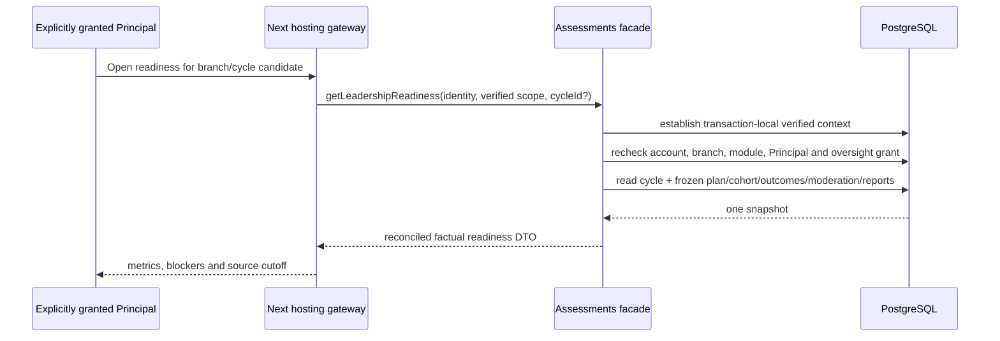
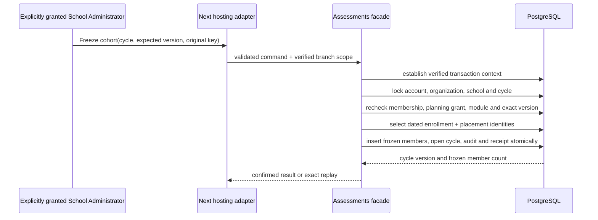

# Assessments owner design

Status: **D11 SYNTHETIC BASELINE APPROVED / F11-A, F11-B AND F11-C VERIFIED / F11-D READY**.

The repository owner approved D11 for synthetic-only implementation on 17 October 2026. Assessments owns its scale, cycle, frozen cohort, plan items, mark outcomes and revisions, moderation decisions, report revisions and publication receipts. Academics supplies exact year, section and subject identities; Students supplies dated enrollment/placement facts; Access supplies live accounts and branch memberships. Assessments never writes those owners. Documents will own generated report bytes later; no PDF or download is claimed by F11-A.

## F11-A / LEA-20 vertical slice

The first slice provides one versioned cycle and an explicit Principal oversight projection. Its outcome is an explainable readiness page where required outcome slots reconcile to `numeric + not assessed + absent + excused + missing`, zero remains a real numeric score, moderation and report states remain distinct, and READY never means PUBLISHED. A separately granted Principal may read this projection. Principal role alone grants nothing and the projection exposes no pupil names or marks.

### Domain invariants and ownership

- A scale pins integer `minimum_scaled`, `maximum_scaled`, `precision` and rounding mode. Decimal values are stored and compared as scaled integers; JavaScript floating-point totals are prohibited.
- A cycle pins one academic year, section, scale and immutable `scheme_version`. Its bounded lifecycle is `DRAFT -> OPEN -> MARKING -> MODERATION -> APPROVED -> RELEASED`, with explicit `WITHDRAWN` only after release.
- Plan items pin subject, maximum scaled score, weight basis points and required/optional status. Unique subject per cycle; required-item weights total 10,000 before the cycle can become OPEN.
- The cohort freezes exact Student, enrollment and placement identities. Dated source eligibility is validated before insertion; later transfer never rewrites the cohort.
- Each plan-item/cohort pair has at most one current outcome. `NUMERIC` requires an in-range integer score, including zero. `NOT_ASSESSED`, `ABSENT` and `EXCUSED` require NULL score. Revisions are append-only.
- Moderation binds the exact cycle version and evidence digest. Pending moderation is a readiness blocker. Approval never publishes a report.
- A report revision binds the exact approved cycle/evidence version and one frozen cohort member. `WITHHELD`, `APPROVED`, `PUBLISHED` and `WITHDRAWN` stay distinct. Publication belongs to the later LEA-22 slice.

### Authorization and scope

Every operation establishes verified transaction-local account and branch context, then rechecks live account token version, active Organization/School, active membership, release availability, active `assessments` entitlement and activation. F11-A read additionally requires current Principal membership and an active `AssessmentsOversightGrant`. Later recorder, moderator and publisher grants are distinct. A hidden navigation entry is never authority.

All new tables are BRANCH classified with `organization_id` and `school_id`, scoped composite foreign keys, `vs_assessments_*` physical names and snake_case columns. They are registered for the TEN-03 closure gate under TEN-ADR-006 Path A. Application authorization stays mandatory after RLS.

### Physical schema

| Physical table (logical model) | Exact physical columns | Purpose | Constraints / indexes |
|---|---|---|---|
| `vs_assessments_oversight_grant` (AssessmentsOversightGrant) | id/org/school/membership/account/operator uuid; grant/revoke timestamps; version | Explicit Principal oversight designation; Principal role alone is insufficient. | Scoped membership/account FKs; unique scope account; active lookup index; positive version. |
| `vs_assessments_planning_grant` (AssessmentsPlanningGrant) | id/org/school/membership/account/operator uuid; grant/revoke timestamps; version | Explicit School Administrator planning designation. | Scoped membership/account FKs; unique scope account; active lookup index; positive version. |
| `vs_assessments_command_receipt` (AssessmentsCommandReceipt) | id/org/school/actor uuid; command/key/hash/result/time | Owner replay and lost-response evidence for planning commands. | Scoped School/actor FKs; unique actor command intent; hash and actor-time indexes. |
| `vs_assessments_scale` (AssessmentsScale) | id/org/school uuid; code/name; integer min/max; precision/rounding; status/version/time | Versioned exact-decimal scoring scale. | Scoped School FK; unique code; bounded precision/range/rounding/status checks. |
| `vs_assessments_cycle` (AssessmentsCycle) | id/org/school/year/section/scale uuid; code/name; scheme/state/cutoff/version/timestamps | Assessment scheme and readiness root pinned to exact academic scope. | Scoped School/Year/Section/Scale FKs; unique code; state/version checks; state/update index. |
| `vs_assessments_plan_item` (AssessmentsPlanItem) | id/org/school/cycle/subject uuid; max scaled; weight bp; required; position | Frozen required or optional subject requirement. | Scoped Cycle/Subject FKs; unique cycle subject; score/weight/position checks; cycle index. |
| `vs_assessments_cohort_member` (AssessmentsCohortMember) | id/org/school/cycle/student/enrollment/placement/year uuid; state/position/frozen time | Frozen dated learner denominator member. | Scoped Cycle/Student/Enrollment/Placement FKs; unique cycle student; state/position checks; cohort index. |
| `vs_assessments_outcome` (AssessmentsOutcome) | id/org/school/cycle/plan/cohort/recorder uuid; state/score/revision/version/time | Current exact assessment outcome; zero is distinct from missing. | Scoped Cycle/Plan/Cohort FKs; unique plan/cohort slot; state-score consistency; cycle/state index. |
| `vs_assessments_outcome_revision` (AssessmentsOutcomeRevision) | id/org/school/outcome/recorder uuid; number/state/score/time | Append-only mark/outcome evidence. | Scoped Outcome FK; unique revision number; state-score consistency; immutable trigger. |
| `vs_assessments_moderation` (AssessmentsModeration) | id/org/school/cycle/plan uuid; evidence version/digest; status/version/time | Exact-revision moderation readiness state. | Scoped Cycle/Plan FKs; unique cycle plan; digest/status/version checks; cycle/status index. |
| `vs_assessments_report_revision` (AssessmentsReportRevision) | id/org/school/cycle/cohort uuid; number/source version/digest/status/time | Immutable per-learner report readiness/publication revision. | Scoped Cycle/Cohort FKs; unique report revision; digest/status/version checks; immutable trigger. |

### Read contract

`getLeadershipReadiness(identity, scope, cycleId?)` selects the newest visible cycle when no ID is supplied and returns:

- cycle, scheme, scale, source cutoff and branch timezone;
- exact required slots from required plan items × frozen active cohort;
- mutually exclusive numeric/not-assessed/absent/excused/missing counts;
- optional configured slots separately;
- pending/approved/returned/rejected moderation counts;
- withheld/approved/published/withdrawn report counts;
- readiness blockers and `readyForApproval`, where missing required outcomes or pending/returned/rejected moderation always prevents readiness.

The query runs in one `REPEATABLE READ` transaction and uses plan/cohort/outcome indexes. It never substitutes missing outcomes with zero and never reads current enrollment in place of the frozen cohort.

### Write, concurrency and recovery contracts

F11-A setup is an operator-only synthetic provisioner used to establish exact owner fixtures and grants. User-facing cycle planning and mark entry are later F11 subtasks. Those commands will lock account -> Organization -> School -> Cycle -> affected outcome/report roots, require expected versions and use owner receipts keyed by scope/actor/command/key. Same-key same-payload returns one semantic result; changed payload conflicts. Moderation and publication recheck current evidence after locking. Reads acquire no write locks.

### API and UI contract

`/leadership/assessments` is recipe L. It shows cycle/source context, reconciled outcome metrics, distinct moderation/report blockers, populated/empty/unavailable/forbidden states and no mutation controls. The later Coordination handoff is enabled only after an Assessments source adapter can reauthorize the exact cycle/evidence version; F11-A does not relabel another owner adapter.

### Sequence



### Verification criteria

- Unit: scaled score/state validation and reconciliation, including numeric zero.
- PostgreSQL: scope/FKs, grant requirement, frozen denominator, all outcome states, revoked grant/module denial and snapshot consistency.
- Browser: populated/empty/unavailable and forbidden deep-link states at 1440×1000 and 390×844, keyboard focus and no overflow.
- Direct reference comparison uses Principal explorer LEA-20 for stage/labels and recipe L for production composition. Human acceptance, native accessibility, font portability, TEN-03 and production enablement remain separate.

## Remaining F11 slices

### F11-B — authorized cycle planning and frozen cohort

F11-B adds a School Administrator counterpart at `/admin/assessments`. Planning authority is a live `SCHOOL_ADMIN` membership plus an active, membership-bound `AssessmentsPlanningGrant`; neither the role nor the Principal oversight grant implies planning authority. The same Assessments release, entitlement and branch-activation checks used by the readiness projection apply on every read, command and receipt lookup.

The planning workspace is a single repeatable-read projection of active scales, academic years, active sections, subjects and existing cycles. It exposes only exact owner identities. An academic year, section and subject remain owned by Academics; eligibility is checked in the command transaction and a section must belong to the selected year. The screen has three explicit operations:

1. `CreateAssessmentScale` creates an immutable active numeric scale. `code` is normalized uppercase ASCII, name is trimmed, precision is 0–3, `minimumScaled < maximumScaled`, and rounding is `HALF_UP` or `HALF_EVEN`. A scale cannot be edited in place after creation.
2. `CreateAssessmentCyclePlan` creates one `DRAFT` cycle and its ordered plan items atomically. Code and name are normalized, source cutoff is an ISO instant, all subjects must exist in the branch, each subject appears once, maximum scores are positive and within the scale, weights are 1–10,000 basis points, and required-item weights total exactly 10,000. The command pins `scheme_version = 1`; it does not freeze pupils or open marking.
3. `FreezeAssessmentCohort` locks the exact draft cycle, rechecks its expected version and Academics scope, selects Students whose enrollment in the pinned academic year and placement in the pinned section contain the cycle cutoff (`valid_from <= cutoff-date < valid_to`), and writes their exact Student, Enrollment and SectionPlacement identities. The cohort must be non-empty. It then changes the cycle from `DRAFT` to `OPEN`, increments the cycle version and never recomputes that cohort later.

All commands lock account → Organization → School → Cycle when a cycle exists. They run at `SERIALIZABLE`, require a UUID idempotency key, and write one Assessments-owned receipt keyed by organization, school, actor, command and key. The receipt stores a canonical input hash and a minimized result. Same-key/same-input replay reauthorizes the actor and returns the original semantic result; same-key/different-input fails with `IDEMPOTENCY_CONFLICT`. `getPlanningCommandStatus` also reauthorizes before returning `FOUND`; absence is `UNKNOWN`, never failure. Expected-version mismatch returns `STALE_VERSION` with no partial cohort rows. A transaction also appends a Platform audit entry with IDs, versions and counts only; pupil names and marks are excluded.

`AssessmentsPlanningGrant` and `AssessmentsCommandReceipt` are BRANCH tables registered for the TEN-03 closure gate. The grant has scoped membership/account foreign keys and an active lookup index. The receipt has scoped actor and school foreign keys, a unique intent key and created-time index. No browser-supplied role, scope, source identity or trusted link is authority.

The planning UI preserves safe entered values after validation, disables duplicate submission, reports unknown outcomes with a retry/status action using the original key, and links an opened cycle to the Principal readiness view. Reloaded drafts come from owner persistence; no browser durable draft is introduced. Empty, unavailable, forbidden, validation, stale and replay states are explicit. F11-B does not add mark entry, moderation, publication or report download.



F11-B verification requires domain validation/reconciliation tests; real-PostgreSQL scope, grant, dated cohort, stale version, atomic rollback, replay/conflict, revocation and concurrent-freeze tests; and a one-worker browser journey for create scale → create plan → reload draft → freeze → Principal readiness link, including recovery, desktop/mobile composition and keyboard focus.

### F11-C — assigned-Teacher mark revisions

F11-C implements the D11 and approved TEA-33 subset needed by LEA-20. `/teacher/assessments` lists only `OPEN` or `MARKING` cycle-plan items for which the signed-in Teacher has a current, dated `TeacherAssignment` to the exact active `CourseOffering(academicYearId, sectionId, subjectId)`. The Teacher account must still bind through Account → Person → active Employee → active Teacher and an active `TEACHER` membership. The relevant `assessments`, `academic_core`, `staff_core` and `student_core` release, entitlement and branch activation checks apply on every read, write and protected receipt lookup. Role alone is insufficient.

Academics owns assignment resolution through `AssessmentMarkAuthorityPort`; Assessments never reads Academics tables directly. Students owns the bounded frozen-member display projection through `AssessmentCohortPort`; the port returns only exact Student ID, display name and admission number for the already-authorized frozen identities. Assignment validity uses the current branch-local date. Later transfers do not rewrite the frozen cohort, and an actor who no longer holds the exact current subject assignment cannot read or write the gradebook.

`SaveAssessmentMarkRevision` accepts one exact `cycleId`, `planItemId`, `cohortMemberId`, outcome state, nullable scaled integer score, `expectedOutcomeVersion`, required reviewed acknowledgement and UUID key. `NUMERIC` requires an integer within the pinned scale minimum and plan-item maximum, including zero. `ABSENT`, `EXCUSED` and `NOT_ASSESSED` require a null score. The browser label follows the live D11 owner vocabulary (`Excused`); it does not silently reinterpret that state as a different national-board exemption rule. Expected version `0` means the slot is not yet recorded; an existing slot then returns `STALE_VERSION`. Existing outcomes require the exact positive version. The current row and a new immutable `AssessmentsOutcomeRevision` are written atomically. First successful entry changes the cycle from `OPEN` to `MARKING`; no command publishes family-visible results or creates moderation approval.

The write runs at `SERIALIZABLE` and locks account → Organization → School → Cycle → current outcome slot. It rechecks current assignment after the locks and uses the existing Assessments receipt table with command `SaveAssessmentMarkRevision`. The receipt response contains only cycle/plan/cohort/outcome identities, revision/version and state. Same-key/same-payload reauthorizes the exact assignment and returns the original result; changed payload conflicts. `getMarkCommandStatus` returns `UNKNOWN` when absent and reauthorizes the exact current assignment before a `FOUND` result. Revoked membership, module access or assignment denies protected replay disclosure. Platform audit records IDs/state/version only; names and scores remain in Assessments-owned rows and are excluded from audit/receipt response.

The Teacher screen uses the approved TEA-33 two-stage composition: choose one frozen pupil and explicit outcome, then review the pinned subject/scale and acknowledge before the final save. Back/Continue retains in-flow edits. Validation occurs before confirmation; only the final action mutates. A committed response loss retains the exact payload/key for status/retry. Stale state reloads the current permitted value and requires fresh confirmation. Reload reads the persisted revision. No durable browser draft, result publication, moderation or assessment-schedule creation is introduced.

```mermaid
sequenceDiagram
  participant T as Assigned Teacher
  participant H as Next hosting adapter
  participant A as Assessments facade
  participant AC as Academics authority port
  participant DB as PostgreSQL
  T->>H: Save reviewed outcome(expected version, key)
  H->>A: validated command + verified branch scope
  A->>DB: establish context; lock account, org, school, cycle and slot
  A->>AC: recheck current exact subject assignment
  A->>DB: append revision; create/update current outcome; audit + receipt
  DB-->>A: one owner-confirmed revision
  A-->>H: confirmed result or exact replay
```

Verification requires domain state/score/version validation; real-PostgreSQL exact-assignment, cross-branch, revoked assignment, zero/non-score distinction, new/update revision, stale version, exact replay/conflict, protected status and concurrent-editor tests; and sequential one-worker desktop/mobile journeys for staged entry, retained Back/Continue edits, committed-response recovery, persisted reload, stale recovery, keyboard focus and no overflow. The approved Teacher reference supplies TEA-33 stage semantics; production uses the established Teacher shell and measured shared recipes. Human review and native accessibility remain separate.

### F11-D — independent moderation and LEA-21

F11-D implements D11 and LEA-21 through the Assessments owner plus the existing typed Leadership decision registry. It registers owner code `ASSESSMENTS_MODERATION`; the registry remains transport-neutral and delegates every read, action, status, information request and recusal to the Assessments adapter. An inbox row or Principal role is never authority. Every operation rechecks the live account/token, active branch Principal membership, `assessments` release/entitlement/activation and a current explicit moderation grant. Result publication remains a separate F11-E authority.

`vs_assessments_moderation_grant` is BRANCH-scoped: id, organization/school/membership/account UUIDs, operator issuer, granted/revoked timestamps and version. It has scoped membership/account FKs, one current row per account and a runtime index. `vs_assessments_moderation` gains nullable compatibility columns for `submitted_by_account_id`, `assigned_reviewer_account_id`, `submitted_at`, `decided_by_account_id`, `decided_at` and `decision_reason`; existing synthetic readiness rows remain readable but are not actionable until explicitly submitted/assigned. `vs_assessments_moderation_event` is append-only and stores moderation/version, type, evidence version/digest, actor and timestamp; it contains no pupil names or scores. `vs_assessments_moderation_information` stores one versioned current request per moderation with bounded question, exact current mark originator recipient, optional response/due time and OPEN/ANSWERED/CANCELLED state. SQL checks constrain statuses, reason/question lengths and paired decision columns; scoped FKs prevent cross-branch references. Indexes cover assigned-reviewer/status/submitted order, cycle/status and moderation event/information history. All are registered for the deferred TEN-03 gate; application authorization remains mandatory.

`SubmitAssessmentMarksForModeration(cycleId, planItemId, expectedModerationVersion, key)` is the Teacher counterpart. The exact current assigned Teacher must have recorded the current revision for every ACTIVE frozen cohort slot; no missing outcome is accepted. Assessments hashes the ordered tuple `(cycle, plan, scale, cohort member, outcome id, revision, state, score)` and records its count as `evidence_version`. Exactly one current eligible moderation grantee other than every outcome recorder must exist; the owner assigns that account server-side. The browser cannot choose or assert a reviewer. Submission creates or replaces a RETURNED moderation as `PENDING`, pins the digest/version and changes the cycle from `MARKING` to `MODERATION`. It never publishes a report.

`DecideAssessmentModeration(moderationId, APPROVE|RETURN|REJECT, expectedVersion, expectedEvidenceDigest, reason, key)` permits only the assigned current reviewer. Self-moderation is denied even if the account later obtains another workspace. RETURN and REJECT require a normalized 1–1000 character actionable reason; APPROVE permits an optional bounded note. The transaction recomputes the full current evidence digest after locking. A mismatch returns `STALE_VERSION`; no decision is stored. APPROVE/REJECT are terminal for that evidence. RETURN changes the cycle to `MARKING`, after which the exact assigned Teacher may append new outcome revisions; a fresh submission pins a new digest and increments moderation version. An old approval is never silently carried to new evidence.

`RequestAssessmentModerationInformation` is available only to the assigned reviewer while PENDING. The recipient is resolved server-side as the current mark originator for the exact plan; another guardian, Teacher or arbitrary account cannot be selected. While the request is OPEN, decision actions are unavailable. `RespondAssessmentModerationInformation` permits only that current originator with continued exact assignment; the answer increments moderation/information versions and forces fresh reviewer confirmation. Protected synthetic text remains barred from production use until retention/disclosure policy is approved. `RecuseAssessmentModerator` appends evidence, excludes the actor, and server-routes only to another current moderation grantee; if none exists the item becomes unassigned and is absent from decision inboxes until trusted reassignment. Recusal grants no source authority.

Writes run at `SERIALIZABLE` with account → Organization → School → Cycle → Moderation → affected Outcome order. Every command uses the existing Assessments owner receipt key `(organization, school, actor, command, key)` and canonical input hash. Exact replay reauthorizes the actor and exact moderation assignment before returning the original minimized result; changed payload conflicts. Status returns `UNKNOWN`, `CHANGED` or `FOUND` and never treats unknown as failure. Revocation prevents protected receipt disclosure. Owner audit, receipt and moderation event commit atomically.

The Teacher counterpart extends `/teacher/assessments` with submit/revise/information-response states. Principal navigation enters the registered decision inbox and `/leadership/decisions/ASSESSMENTS_MODERATION/:id`, rendered with recipe W: exact class/subject/scale, aggregate outcome counts and evidence version/digest prefix; no pupil names or individual marks are exposed in this Principal slice. It supports request information, recuse, consequence review, final approve/return/reject, stale evidence and original-key recovery. The approved catalogue dialog maps to these routed production screens.

Verification requires pure transition/digest validation; real PostgreSQL complete-set submission, missing-slot denial, explicit grant/assignment, self-review denial, evidence invalidation, return-and-resubmit, information originator, recusal, replay/conflict, protected status, concurrency and cross-scope/revocation tests; one-worker desktop/mobile Teacher → Principal → Teacher journeys; direct reference/application inspection; and an idempotent fictional seed. Human review, font portability, native accessibility, actual browser 200% zoom, TEN-03 and production text retention remain pending.

F11-D adds independent moderation and LEA-21. F11-E adds report revisions, explicit publication delegation and LEA-22; Documents must provide a real-scanned generated artifact before report download is complete.
