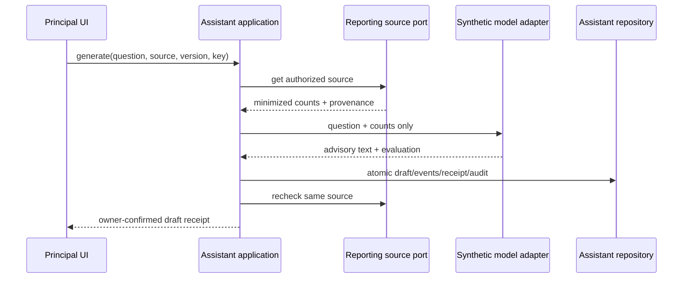

# Assistant — reviewed source-linked drafts

Status: narrow F17 / WF-45 / LEA-45 synthetic implementation contract. D19 is approved for synthetic-only implementation. Production provider selection, data region, retention and evaluation remain unresolved release gates, so this slice stays PARTIAL.

## Ownership and invariants

Assistant owns generation intent, advisory text, human-review/discard state, immutable events and exact command receipts. Reporting owns retained aggregate sources and authorizes every retrieval/open. Source text is never treated as an instruction. Assistant has no owner-command, publication, notification, approval or mutation tool.

- One draft belongs to one organization, branch, creator and one immutable Reporting snapshot version.
- Question is 10–500 normalized characters and rejects common secret-bearing prompts. Generated/reviewed text is 20–4000 characters.
- Lifecycle is `GENERATED -> HUMAN_REVIEWED | DISCARDED`. Generation records `REQUESTED` and `GENERATED`; terminal events are append-only.
- Every numeric claim in the deterministic draft or reviewed text must be one of the cited retained counts. Citation/source validation is fail closed.
- Only the creator with a live Principal membership, explicit `GENERATE` designation and current Reporting source access may list, open, review, discard or recover a receipt.
- Human review records advisory evidence only. It never sends, publishes, approves, changes attendance or calls another owner command.

## Ports and composition

`AssistantSourcePort` is the only cross-owner read boundary. `ReportingSnapshotAssistantSource` calls the existing Reporting snapshot facade, which rechecks Attendance/reporting scope and returns only `{due, received, awaiting}` plus definition/version/cutoff. `AssistantModelPort` receives that minimized fact object and a bounded question. The local `DeterministicAssistantModel` has no network or tools and identifies itself as synthetic. `AssistantRepository` owns persistence and live Assistant authority. `backend/composition/assistant.ts` wires explicit database, module and mode configuration; `lib/server/assistant.ts` is the Next host adapter.

## Persistence

All four tables are BRANCH scoped and Path A registered for TEN-03:

| Physical table (classification) | Columns | Responsibility | Constraints and indexes |
| --- | --- | --- |
| `vs_assistant_capability_grant` (BRANCH) | id/org/school/membership/account uuid; capability/operator/times/version | Explicit operator-designated Assistant generation purpose. | Scoped membership and School FKs; unique account/capability; active lookup; capability/version checks. |
| `vs_assistant_draft` (BRANCH) | id/org/school/creator/source uuid; source version/definition/cutoff; question/text/citations/evaluation/provider/state/version/times | Current source-linked advisory draft lifecycle. | Scoped Reporting source/account/School FKs; state/text/version/terminal checks; creator/source indexes. |
| `vs_assistant_draft_event` (BRANCH) | id/org/school/draft/actor uuid; number/type/version/evidence/time | Append-only Assistant generation and human-decision evidence. | Scoped draft/account FKs; unique sequence; history index; append-only trigger. |
| `vs_assistant_command_receipt` (BRANCH) | id/org/school/actor/draft/key uuid; command/hash/result/time | Exact Assistant command replay and recovery receipt. | Scoped draft/account FKs; unique actor/key; draft index; append-only trigger. |

Reads join draft to its events only after live Assistant authorization; application then reopens the source through Reporting before disclosure. No Assistant query reads Reporting private tables.

## Authorization, transactions and recovery

The browser supplies only candidate IDs, expected versions and UUID intent keys. Server composition resolves the authenticated organization/branch. Writes use Serializable transactions and lock account `UPDATE`, organization `SHARE`, school `SHARE`, then the draft `UPDATE` for transitions. Authorization is rechecked after locks. Same actor/key/same input returns the original semantic result; changed input conflicts. Status returns `UNKNOWN` when no receipt exists and rechecks both Assistant authority and current source access before a found result is disclosed. Source removal or grant/membership revocation blocks draft and receipt disclosure.

Generation reads the current source, invokes the minimized adapter, commits draft/events/receipt/audit, and reopens the exact source before returning. A removal race can leave retained Assistant metadata, but no generated content is disclosed after the post-commit source check; later reads also fail closed. Review/discard use expected draft version and repeat the source check before and after the owner transaction.

## API and UI

- `GET/POST /api/v1/assistant/drafts`: availability/list and generate.
- `GET/POST /api/v1/assistant/drafts/:id`: open and review/discard.
- `GET /api/v1/assistant/status/:key`: exact-key recovery.
- `/leadership/assistant`, `/new`, `/:id`: recipe W list, staged question/source preview/generation, then human review/receipt.

Failure states distinguish unavailable provider mode, no designation, no authorized sources, validation, stale source/draft, unknown outcome, revoked source and terminal-state conflict. Back/Continue preserves current in-flow values. No durable pre-generation draft is claimed.

## Verification criteria

Unit: question/text bounds, secret rejection, factual numeric validation and no-action deterministic output. PostgreSQL: explicit grant, tenant isolation, exact replay/conflict, optimistic concurrency, one terminal transition under race, revoked designation, source removal denial and protected receipt recovery. Browser: staged source preview, lost-response status recovery, edit/review, persisted reload, source link, discard state, desktop/mobile geometry and keyboard focus. Provider/data-region/retention evaluation and real model quality are deliberately unperformed and prevent engineering-complete status.
