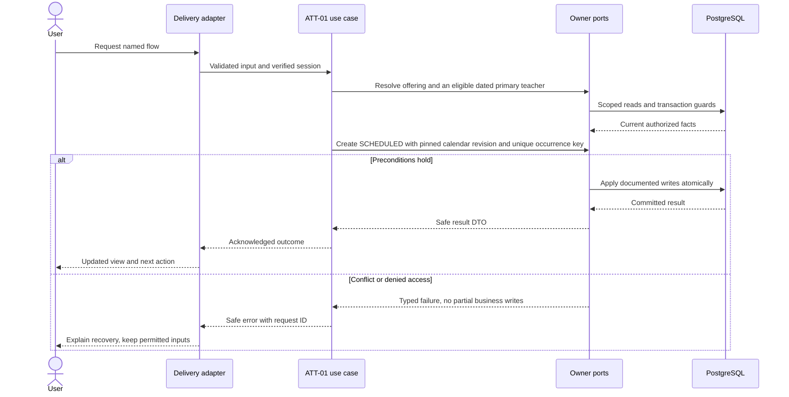
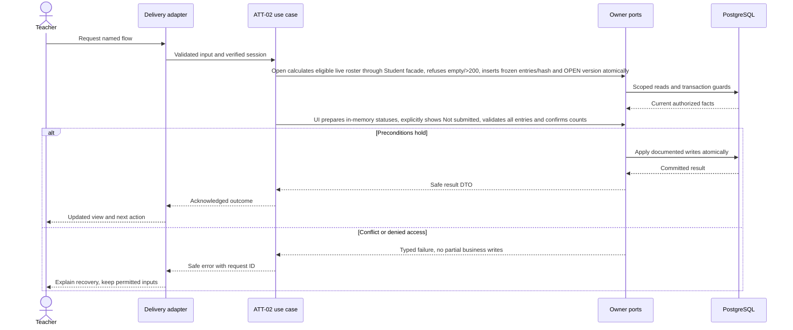
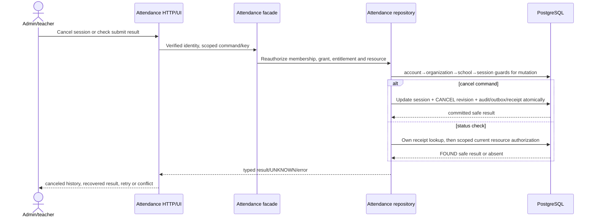
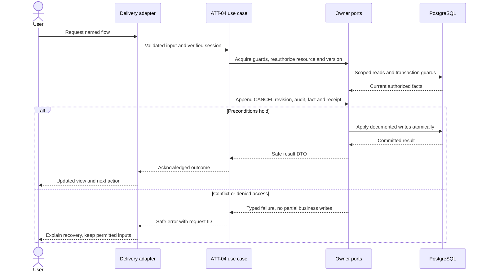

# Session attendance and accountable corrections — design

Phase 1 · Design revision 1 · 3 October 2026. Status: ATT-01 is implemented locally; ATT-02 design-ready and implementation in progress; later attendance workflows remain planned. Review unresolved deployment choices in FND-02 before real-data use.

## Database naming and physical mapping

All physical objects follow [the VS database contract](../../DATABASE_DESIGN.md). Table names and columns below are physical SQL names; workflow prose uses logical domain names. `organizationId` maps to `organization_id`, `schoolId` to `school_id`, and `scope` expands to both columns. Models retain PascalCase through Prisma `@@map`; camelCase fields use `@map`. Planned schemas are implemented only through their named tasks and reviewed migrations.

## Ownership, aggregates and values

AttendanceSession is the aggregate root; roster snapshot entries and attendance records are owned children. Lifecycle SCHEDULED→OPEN→SUBMITTED; any permitted nonterminal/session can become CANCELLED through explicit policy, with submitted cancellation restricted to attendance.correct. Values: SessionOccurrenceKey, SchoolDate, RosterRevision(hash of sorted student/placement/version membership), AttendanceStatus, LateMinutes(1..480), CorrectionReason(5..500). Events: SessionScheduled/Opened/Submitted/Corrected/Cancelled.v1. Records are mutable current projection only through aggregate methods; immutable revisions preserve prior submissions/corrections. Session version is the optimistic write guard.

## Module decisions

ATT-ADR-001: explicit OPEN freezes roster and version; no silent roster refresh at submission. Opening a future session is disallowed: schoolDate must equal school-local today and server now must be at or after startsAt. Submitting permitted only on that date; missed historical sessions require admin cancellation/replanning policy, not fabricated late teacher submission. An administrator can review incomplete history but cannot mark without teacher role+assignment.

ATT-ADR-002: complete atomic roster submission, no server-side partial draft. Mark all present only edits in-memory draft after explicit action. Alternative automatic all-present-on-open rejected. Exact missing/extra/duplicate student IDs fail validation.

ATT-ADR-003: correction is an admin command and immutable revision, not resubmission. A cancelled submitted session retains records, removes its contribution from metrics and records reason. Returning it to active is not supported in Phase 1.

## Physical data contract

All tables remain planned until their named task migrates them; ATT-01 installs only `AttendanceSession` in this module. `scope` below means `(organizationId,schoolId)`. All business roots have version >=1. All scoped references require composite FK targets with matching unique keys, even when abbreviated in the table. Creation times use server clock; IDs server generated. Required unless nullable is stated. Enum labels are constrained enums/CHECKs, not unchecked strings. Do not silently implement a weaker constraint because Prisma syntax cannot express it; use reviewed migration SQL.

| Table | Fields and data stored | Meaning | Keys / constraints / query support |
|---|---|---|---|
| `vs_attendance_session` (AttendanceSession; ATT-01 MIGRATED) | id uuid PK; organization_id uuid; school_id uuid; offering_id uuid; school_date date; starts_at timestamptz(3); ends_at timestamptz(3); occurrence_key varchar(80); calendar_revision_id uuid; status SCHEDULED/OPEN/SUBMITTED/CANCELLED; version int; roster_revision char(64) nullable; opened_at timestamptz(3) nullable; submitted_at timestamptz(3) nullable; submitted_by uuid nullable; cancelled_at timestamptz(3) nullable | One actual offering occurrence; retains calendar version and scope. School timezone used to validate local date. | Scoped Offering/CalendarRevision FKs; UNIQUE(scope,offering_id,occurrence_key); UNIQUE(scope,id); CHECK starts<ends, known status and version>=1; index(scope,school_date,status,starts_at,id). |
| `vs_attendance_session_roster_entry` (SessionRosterEntry; ATT-02) | id uuid PK; organization_id uuid; school_id uuid; session_id uuid; student_id uuid; student_version int; enrollment_version int; display_name_snapshot varchar(210); roll_number_snapshot varchar(30) nullable | Exact membership, versions and minimal name/roll display frozen at OPEN. Access remains current. No mutable roster after OPEN in Phase 1. | Scoped Session and Student FKs; UNIQUE(scope,session_id,student_id); CHECK both snapshot versions>=1; immutable trigger; session cancellation retains rows; unique key supports read and record join |
| `vs_attendance_record` (AttendanceRecord; ATT-02) | id uuid PK; organization_id uuid; school_id uuid; session_id uuid; student_id uuid; status PRESENT/ABSENT/LATE/EXCUSED; late_minutes int nullable; current_revision int | Current submitted status; one per roster pupil. No blank record stored before submit. | FK(scope,session_id,student_id)→SessionRosterEntry UNIQUE(scope,session_id,student_id); UNIQUE(scope,session_id,student_id); CHECK recognized status; CHECK (status='LATE' AND late_minutes BETWEEN 1 AND 480) OR (status<>'LATE' AND late_minutes IS NULL); current_revision>=1; unique key supports roster join |
| `vs_attendance_revision` (AttendanceRevision; ATT-02) | id uuid PK; organization_id uuid; school_id uuid; session_id uuid; number int; kind SUBMIT/CORRECT/CANCEL; actor_account_id uuid; occurred_at timestamptz(3); reason varchar(500) nullable; changes jsonb | Immutable status diff with old/new values and affected student IDs; SUBMIT includes the complete initial status set and counts. No names, roll values or raw private notes in changes. | Scoped session FK; global UserAccount actor FK; UNIQUE(scope,session_id,number); number>=1; CHECK recognized kind; SUBMIT requires null reason and CORRECT/CANCEL require reason length 5..500; append-only trigger; unique key supports ordered history |

## Read workflows and joins

Teacher Today: current account→verified Person→Employee ACTIVE→Teacher active→Assignment covering schoolDate→Offering→Session. Requires attendance.read_class; assignment effective for the requested date plus current active membership/account. Query date is school-local today by default; explicit history date is no later than today and remains within the open academic year containing today, not browser timezone. An eligible teacher with no sessions receives an empty list; missing open-year/service state is an error, not an empty schedule.

ATT-01 query predicates are explicit. Admin offering selection resolves one active offering by `(organization_id, school_id, id)` and joins its active OPEN year, section/calendar, subject, plus the dated assignment predicate `valid_from <= schoolDate AND valid_to > schoolDate`; session creation only needs the eligible assignment rows for that offering/date. The teacher read is `AttendanceSession.organization_id=? AND school_id=? AND school_date=? AND status<>'CANCELLED'`, joined to assignment on the same scope/offering with `teacher_id=currentTeacher AND valid_from<=schoolDate AND valid_to>schoolDate`. Current membership, Person binding, active Employee/Teacher, attendance.read_class, module release/entitlement and branch activation are resolved server-side on every protected request. The session day index `(organization_id,school_id,school_date,status,starts_at,id)` supports the scoped date scan; Academics' `vs_academics_teacher_assignment_teacher_date_idx` and `..._offering_date_idx` support the join and offering/date check. Detail additionally requires attendance.read_school or a currently eligible, date-assigned teacher. No write locks are acquired for these reads.

Session detail authorizes by scope+assignment before returning children. SCHEDULED detail shows calculated roster preview; OPEN detail reads SessionRosterEntry; SUBMITTED joins each roster row to AttendanceRecord and latest revision metadata. Never left-join absent record into ABSENT. Admin detail requires attendance.read_school/class, with correction controls only attendance.correct. Report calculations delegated to reporting read contract, never stored competing daily totals.

## Screen contract

/teacher/today cards show time, subject, section, status. /teacher/sessions/:id supports explicit Open, P/A/L/E buttons, search, unmarked count, optional late minutes, Mark all present and confirmation summary. No default saved attendance. Announce validation/status to screen readers; 44px targets. Unknown result keeps draft+key and offers Check status, not a new save. /admin/attendance/sessions schedules dated instances and inspects correction history. Cross-date, cancelled and submitted states are read-only to teacher.

All screens additionally follow Bible §8: loading, empty, validation, permission, stale/conflict, temporary failure and acknowledged success; semantic labels, focus and mobile layout. No future-module navigation.

## Application ports and transaction boundary

Each named flow below is an application use case. Inputs/outputs are plain DTOs; adapters implement owned repositories and public cross-module facades. Use SchoolCommand, ActorResolver, Clock, IdGenerator and transactional envelope writers from the shared contract. Do not pass Prisma.TransactionClient into application/domain code. Generic `save(any)` is not a replacement for named commands. Domain factories create new roots/events; rehydration restores without events.

Mutations use the account → Organization → School guard protocol in Bible §7. Read-only flows do not take write locks. Bootstrap/auth-only commands use their documented account/provisioning transaction. Scoped school uniqueness/range checks run after locks. Reauthorize before replay and commit; only a successful transaction stores a receipt. Aggregate version, audit, outbox and response commit together. Exact flow-specific reads and writes below refine this shared behavior.

## ATT-01 — Schedule sessions and show each teacher their day

**Success response contract:** `{sessionId,version,status,schoolDate,startsAt,endsAt,offering:{id,subjectName,sectionName}}`. Teacher list uses `{items,nextCursor}` and only eligible sessions.

**Transport:** POST /api/v1/sessions; GET /api/v1/teacher/sessions?date=; GET /api/v1/sessions/:id. The scheduling metadata/envelope is capped at 8 KiB; time values are offset-bearing ISO instants and the idempotency header must match the body key. The response never accepts tenant/branch IDs from request data.

**Input:** Schedule offeringId,schoolDate,startsAt,endsAt,occurrenceKey,key; instants include explicit offset/UTC. Teacher read date optional.

**Workflow:**

1. Require current class.manage, attendance release, institution entitlement and branch activation for schedule; acquire account→Organization→School locks and validate the OPEN year/current calendar teaching day for section campus. Calendar publication, year closure, timezone updates and scheduling use this same School serialization boundary.
2. Resolve an active offering and exactly one eligible, active dated primary teacher; validate explicit-offset start/end instants map to schoolDate in the school timezone, end follows start and `endsAt - 1 ms` is still on that day. schoolDate cannot be before today (an elapsed start time earlier today is allowed).
3. Create SCHEDULED with pinned calendar revision and unique occurrence key; legitimately different occurrences need distinct keys/times.
4. Enlist Attendance-owned CalendarImpact reads so calendar publication/year close and teacher-assignment end query session state inside their existing owner transactions. Existing sessions prevent calendar changes that turn their dates non-teaching, year closure while pending sessions remain, and assignment end that strands a future session. The Student-owned transfer impact port is deferred to STU-03, which defines the first transfer workflow; no current Student mutation changes an existing placement.
5. Teacher query returns only own dated assigned sessions; empty schedule and service failure are distinct.

**Database writes / atomicity:** AttendanceSession + envelopes; no attendance records/roster rows yet.

**Errors and recovery:** Duplicate occurrence→409 unless same receipt replay; nonteaching day→422; no eligible teacher→409; same-teacher time overlap→409; ambiguous, offset-free, past or mismatched date/time→422; stale scope/configuration and concurrent duplicate races→409; missing calendar→409. Unknown service failure is 503 and invites retrying the same command key. Reads distinguish an empty schedule from permission, module and service failures.



**Verification:** Unit — Occurrence/date/calendar eligibility and role policy. Functional PostgreSQL — Schedule-vs-calendar publication serialization; occurrence race; scope/year consistency. E2E — Admin schedules; intended teacher sees it; other teacher does not.

**Design-readiness note (4 October 2026; implementation reconciliation 5 October):** Attendance owns scheduled occurrences and envelopes; Academics owns offering, immutable calendar revision and dated primary-teacher assignment; Students owns placement history. Schedule takes account→Organization→School guards and enlists Attendance-owned calendar/year/assignment-impact reads through the existing Academic transaction; same-offering duplicate receipt uses `UNIQUE(scope,offering_id,occurrence_key)` and the command receipt, while teacher overlap uses the School guard. Scoped offering/calendar FKs and `(scope,school_date,status,starts_at,id)` support scoped day reads. `TeacherAssignment` has both offering/date and teacher/date indexes; assignment facts are not copied into Attendance. No room allocation is modeled. `/admin/attendance/sessions` and `/teacher/today` reuse shared UI; attendance routes stay thin. Path A registers the migrated AttendanceSession as BRANCH with `(organization_id,school_id)`, owner/policy/constraints/indexes and TEN-03 closure; application authorization remains enforced and database policies/restricted roles remain deferred. Student transfer impact is deferred until STU-03 defines a placement-changing use case to consume it. The separate Bible pilot query-plan/latency profile applies to pilot evidence; TEN-03 owns its distinct larger RLS scale profile. No product decision blocks ATT-01.

**Planned query evidence:** At ATT-01 pilot verification, run `EXPLAIN (ANALYZE, BUFFERS)` for (1) active offering plus date-effective assignment by `(organization_id,school_id,offering_id,schoolDate)` and (2) the scoped session date read joined to assignment by `(organization_id,school_id,teacher_id,schoolDate)`. Record actual synthetic row counts, index names, buffers and latency in the task evidence; do not treat the TEN-03 multi-client scale profile as an initial pilot gate. Query plans do not replace TEN-03 restricted-role policy tests.

## ATT-02 — Open the exact roster and submit attendance

**Success response contract:** Open `{sessionId,version,status:"OPEN",rosterRevision,roster:[{studentId,displayName,rollNumber}]}`; submit `{sessionId,version,status:"SUBMITTED",revision,submittedAt,counts:{present,absent,late,excused}}`.

**Transport:** POST /api/v1/sessions/:id/open; POST /api/v1/sessions/:id/submit

**Input:** Open expectedVersion,key; Submit expectedVersion,rosterRevision,entries[{studentId,status,lateMinutes?}],key. Max 200 pupils per pilot session.

**Workflow:**

1. Require attendance.mark and dated assignment; lock account/School then session; recheck school-local today.
2. Open calculates eligible live roster through Student facade, refuses empty/>200, inserts frozen entries/hash and OPEN version atomically.
3. UI prepares in-memory statuses, explicitly shows Not submitted, validates all entries and confirms counts.
4. Submit reauthorizes and validates version/hash/exact roster ID set/status fields; save all current records plus immutable SUBMIT revision.
5. Set SUBMITTED/by/at/version; audit/outbox/receipt commit; on replay return original authorized receipt after scope check.

**Database writes / atomicity:** Open: SessionRosterEntry + session version/hash/status. Submit: AttendanceRecord for every pupil + AttendanceRevision + session metadata + envelopes.

**Errors and recovery:** Empty roster→409 EMPTY_ROSTER; changed version/hash→409; missing/extra/duplicate entries→422; revoked assignment→403; closed date/session→409.

**Authorization and roster query:** Every open, submit, detail and replay resolves the current account/token, active branch membership, effective `attendance` release/entitlement/activation (including its `student_core`, `academic_core` and `staff_core` dependencies), `attendance.mark`, active Employee/Teacher and assignment effective on the session's schoolDate. Only the assigned teacher may open or submit; `attendance.read_school` permits admin inspection but never marking. No tenant ID is accepted from the request. The Student-owned enlisted roster read scopes all rows to the active session's branch and offering Section, requires an ACTIVE Student, an OPEN year and Enrollment/Placement intervals containing `schoolDate`, and joins Person name and Placement roll. This read is used only after Attendance authorization; it does not mutate Student data. Read-only detail does not take write locks; mutation retries reauthorize and take the normal guards/locks before returning a receipt.

**Snapshot and submit consistency:** Open requires SCHEDULED, expected session version, school-local today equal to `schoolDate`, and server time at/after `starts_at`. Lock order is account → Organization → School → AttendanceSession, with the School lock taken before querying the live roster. Enrollment/transfer and open therefore see a single School-serialized state: the first committed state wins; once OPEN, that exact snapshot is never refreshed. Empty roster and >200 rows reject without state change. Store Student/enrollment version and display/roll snapshot, sorted by student ID; `roster_revision` is SHA-256 over canonical sorted student ID, both versions and snapshot display/roll fields. Submit requires OPEN, same school-local date, expected session version, exact stored roster hash, and exactly one valid entry for each frozen student; `late_minutes` is allowed only for LATE. It writes every record, one SUBMIT revision numbered 1, and session SUBMITTED metadata in one transaction. Same actor/scope/key and same canonical payload replays the committed result after fresh authorization; changed payload under that key conflicts. A lost response retains the exact in-memory payload/key for retry; after refresh the read model is authoritative.

**Read and query support:** The roster query uses `(organization_id,school_id,section_id,valid_from,valid_to,enrollment_id)` on SectionPlacement plus its date/year/status joins; the source Enrollment and Student scope keys are mandatory. At most 201 rows are fetched to distinguish 0, 1–200, and overflow. Frozen roster/detail joins are by `(organization_id,school_id,session_id)`; the unique session/student key supplies exact membership and AttendanceRecord joins. Revision history orders by number. Pilot query evidence will use `EXPLAIN (ANALYZE, BUFFERS)` for the live Section/date roster and frozen roster/record read at the documented representative pilot size; record actual row counts, indexes and buffers. The larger TEN-03 load profile is separate.

**Database classification and migration:** All three added tables are BRANCH-classified with `(organization_id,school_id)`, owner `attendance`, current-membership read/write intent and `WITH CHECK` scope intent registered under TEN-ADR-006 Path A. The migration must add that metadata and TEN-03 closure gate before creating any tenant table; RLS enforcement is deferred to consolidated TEN-03. Application authorization remains active. No existing Student or People row is updated by ATT-02.

**Design-readiness note (5 October 2026):** Resolved exact source Section/date/OPEN-year roster predicate; `attendance.mark` versus read-only admin permission; current assignment and module dependency checks; lock order and point-in-time freeze behavior; 200-row limit; deterministic hash/version contents; exact physical table constraints/indexes; atomic submit, immutable history and stable-key retry; typed conflict/validation/authorization/unavailable outcomes; UI draft recovery and verification. No unresolved product decision blocks implementation. ATT-01 is VERIFIED/PENDING; its task does not require human PASSED as an ATT-02 dependency.



**Verification:** Unit — Exact set equality, status/late validation, lifecycle, deterministic roster hash. Functional PostgreSQL — Atomic rollback after records; submit lost-response replay once; open vs enrollment transfer; two-tab conflict. E2E — Teacher marks exceptions, confirms, refreshes read-only result; network retry and stale tab.

## ATT-03 — Review and correct submitted attendance

**Success response contract:** `{sessionId,version,revision,correctedAt,changes:[{studentId,from,to,lateMinutes}]}`; history has actor safe display name, time, reason and immutable revisions.

**Transport:** POST /api/v1/sessions/:id/corrections; GET /api/v1/sessions/:id/history

**Input:** expectedVersion,changes[{studentId,status,lateMinutes?}],reason 5–500,key. Changed subset nonempty; reject duplicate student IDs and no-op changes.

**Workflow:**

1. Require attendance.correct for command; acquire guards and submitted session.
2. Validate students belong to frozen roster, expected version and meaningful mandatory reason.
3. Calculate old/new diff; reject ordinary teacher correction despite class-read permission.
4. Update affected current AttendanceRecord rows, append CORRECT revision and increment session version.
5. Commit audit/outbox/receipt; show prior/current values and corrected badge with author/time.

**Database writes / atomicity:** AttendanceRecord statuses/revision, immutable AttendanceRevision, AttendanceSession.version and envelopes.

**Authorization and physical contract:** Recheck active account/token, Organization/School, membership, `attendance` and its `student_core`/`academic_core`/`staff_core` dependencies and current resource permission for every history read or correction. `attendance.correct` is currently granted only to School administrators; class-read teachers cannot mutate. History requires current `attendance.read_school` and returns only rows for the scoped session. No tenant ID comes from the request. Correction locks account → Organization → School → AttendanceSession, then reads current roster/records and derives old values server-side. Read paths use no write locks.

ATT-02 already provides the physical contract: `vs_attendance_record` has scoped `(organization_id,school_id,session_id,student_id)` membership and `current_revision >= 1`; `vs_attendance_revision` has scoped session and global actor FKs, unique `(organization_id,school_id,session_id,number)` (`vs_attendance_revision_number_key`), known-kind/reason constraints and an immutable trigger. No new table or migration is expected. A correction updates only selected current record rows to the next revision, appends one CORRECT JSON change set with student IDs and from/to status values, increments session version, and commits safe evidence atomically. Revision changes may retain student IDs/statuses in Attendance-owned history, but names, roll values, emails and raw pupil PII are excluded from audit/outbox/receipt.

History reads filter by `(organization_id,school_id,session_id)` and order by `number` on the revision unique index. Current record values join the frozen roster by scoped session/student key. After branch authorization, actor display resolves through AccountPersonBinding→Person; an unbound administrator receives the generic “School administrator” label. No email is returned. Record EXPLAIN ANALYZE/BUFFERS for history and roster/current-record join with counts, indexes and buffers; small synthetic plan evidence is separate from the Bible pilot performance gate and TEN-03's scale profile.

Failures are typed: invalid reason/status/late-minute shape→422; teacher/unauthorized→403 or resource-safe 404; no-op, duplicate/out-of-roster IDs, wrong lifecycle or stale version→409; foreign session→404; database/evidence failure→503 with record, session, revision and receipt rollback. Same actor/scope/key/canonical command replays the prior result after current authorization; changed payload conflicts. Concurrent correction writes serialize on the session, so only the command with the current expected session version can commit.

**Errors and recovery:** Teacher denial→403; missing reason→422; cancelled/non-submitted→409; stale concurrent correction→409.

```mermaid
sequenceDiagram
  actor U as School administrator
  participant W as Next hosting adapter
  participant A as Attendance use case
  participant R as Attendance repository
  participant D as PostgreSQL
  U->>W: POST correction with version, changes, reason and key
  W->>A: Verified identity and bounded input
  A->>R: correct(sessionId, command)
  R->>D: Recheck current account, branch, modules and attendance.correct
  R->>D: Lock account → organization → school → session
  R->>D: Read scoped session, frozen roster and current records
  alt Submitted session, version and change subset valid
    R->>R: Derive old/new values and next revision
    R->>D: Update selected records, append CORRECT revision, increment version and write evidence
    D-->>R: Commit all or roll back all
    R-->>A: Safe correction result
    A-->>W: Result
    W-->>U: Updated values and correction status
  else Permission, lifecycle, version or validation failure
    R-->>A: Typed failure; transaction writes nothing
    A-->>W: Safe error and request ID
    W-->>U: Explain recovery and retain editable draft
  end
  U->>W: GET scoped revision history
  W->>A: Verified identity
  A->>R: history(sessionId)
  R->>D: Recheck read permission; no write locks
  R->>D: Read ordered scoped revisions and safe actor labels
  D-->>R: History
  R-->>W: Safe revision DTOs
  W-->>U: Current values, reasons and history
```

**Verification:** Unit — Correction subset/diff/no-op; normalized reason bounds; status/late-minute pairing. Functional PostgreSQL — scoped current-row update, next revision number/session version, concurrent correction with stale loser, same-key replay and changed-payload conflict, forced evidence failure rollback of every write, immutable trigger, current permission/dependency and foreign-scope denial. E2E desktop/mobile — admin corrects absent to excused and sees history values/reason/safe actor/time; assigned teacher remains read-only and direct action is denied. Run EXPLAIN ANALYZE/BUFFERS for revision history and roster/current-record join. Keep pilot benchmark and TEN-03 load evidence distinct.

**Design-readiness note (5 October 2026):** ATT-02 is implementation-VERIFIED/PENDING and no explicit acceptance gate blocks this dependency. Reused existing revision schema and `attendance.correct` capability; resolved current admin/history permission boundaries, transaction guard order, version/revision numbering, subset/no-op/reason semantics, safe history projection, idempotency, race/rollback/errors, query indexes and browser acceptance. No unresolved product or schema decision blocks ATT-03.

## ATT-04 — Cancel sessions and recover failed submissions

**Design-readiness note (5 October 2026):** ATT-03 and STU-03 are VERIFIED/PENDING; their implementation status satisfies this task's dependencies, with no human-PASSED gate recorded. The existing `vs_attendance_session` already has `cancelled_at`, `status`, `version` and scoped day/occurrence indexes; `vs_attendance_revision` already permits immutable `CANCEL` rows keyed by `(organization_id,school_id,session_id,number)`. `vs_tenancy_tenant_command_receipt` is organization/account/command/key unique and stores a safe response JSON, but has no branch column; every found response therefore must resolve its session ID and pass current branch/resource authorization before returning it. No migration/table/index is needed for ATT-04. Path A remains in force: application authorization runs on every read/write; RLS is deferred to TEN-03, and the existing BRANCH table registry entry remains gated on TEN-03 closure.

Cancellation owner is Attendance. `AttendanceSession` owns `SessionRosterEntry`, `AttendanceRecord`, and immutable `AttendanceRevision`; cancellation changes only session status/time/version, adds one revision and standard tenancy audit/outbox/receipt evidence. It never deletes rows or reverses status. Reason is NFC-normalized/trimmed, 5–500 chars, stored only in the owned revision; audit reason stays a fixed generic label and outbox/receipt contain no student IDs, names, roll numbers or free-text reason. The command hash binds schema version, organization, school, actor, session, expected version, reason and key. Reuse by the same actor/scope/command/key with the same hash returns the safe original result after fresh authorization; a different payload is IDEMPOTENCY_CONFLICT.

For SCHEDULED/OPEN, cancel requires current `class.manage`; for SUBMITTED it requires `attendance.correct`. Recheck active account/token, active organization/school membership, current grant, active Attendance and dependency entitlements/branch activations, release manifest and the session in scope on every call. No teacher can cancel. Session detail/history remain administrator school-read operations after cancellation; show the retained submitted records and revisions read-only. The admin day list includes CANCELLED rows so history is reachable; teacher lists continue excluding them. Future metrics must predicate out `status='CANCELLED'`; no report is added in this task.

Add `GET /api/v1/commands/:command/key/:key` for the allowlisted opaque names `attendance.submit` and `attendance.cancel`. It queries receipts by current organization and actor. If the key exists only for another actor, return resource-safe 404; if the actor's matching receipt is found, resolve its `sessionId`, re-run current scoped read authorization (including current teacher assignment for a submit receipt), and return only the allowlisted safe result. A receipt from another branch or revoked authorization is 404. Only a truly absent key returns UNKNOWN. This makes a leaked/replayed URL insufficient to recover receipt data. The cancel command has no response-loss mutation in the UI; submission preserves its key and draft when transport outcome is unknown, checks status, and offers same-payload/same-key retry only after UNKNOWN. FOUND renders the committed result. Status checks are reads and acquire no write locks.

Mutation protocol preserves account → organization → school → session lock order. Submit and cancel both lock the same scoped session row before state/version checks, then write session/revision/evidence within one serializable/transactional boundary using the repository's established isolation and School configuration guard. If submit wins, a stale cancellation returns 409 and changes nothing; if cancel wins, submit returns 409 and writes no records. Exactly one transition/revision/receipt/outbox is committed. Same-key replay occurs only after current permission/scope checks. Reads remain lock-free. Existing indexes support scope/date/status list reads and session/revision lookup; receipt uniqueness supports actor command reconciliation.

**Failure/API/UI details:** cancel POST accepts `{expectedVersion,reason,key}` and returns `{sessionId,version,status:"CANCELLED",cancelledAt,revision}`. Errors: unauthenticated 401; forbidden current grant 403; foreign/revoked resource 404; malformed or short/long reason 422; stale version, already cancelled, or concurrent transition 409; DB/evidence failure 503 with full rollback. Admin detail offers a reasoned cancel confirmation only for SCHEDULED/OPEN/SUBMITTED; CANCELLED is read-only and displays retained history. The teacher sees no cancelled sessions. Use existing shared controls, accessible status/error feedback, and no optimistic status change before the response.

**Query contract and evidence:** admin day list uses `(organization_id,school_id,school_date,status,starts_at,id)` and includes all four statuses. Teacher/date reads retain current assignment join and `status <> 'CANCELLED'`. Receipt lookup uses its existing unique organization/actor/command/key index. Record EXPLAIN ANALYZE for these predicates/receipt lookup in functional evidence; do not claim the Bible pilot latency target from a tiny fixture or conflate it with TEN-03's larger scale profile.



**Verification criteria:** unit cancellation-state and reconciliation tests; real PostgreSQL submit-vs-cancel race proving one winner, no duplicate evidence and retained rows; revoked membership/assignment and other-actor/branch receipt checks; injected evidence failure rollback; explain plans for admin/teacher day predicates and receipt lookup. Playwright simulates a committed submission whose response is dropped, recovers FOUND, then cancels a separate synthetic submitted session and verifies it remains visible to admin with history while omitted from the teacher list and any attendance denominator. Metrics denominator assertion is a direct scoped query contract until reporting ships.

**Success response contract:** Cancel `{sessionId,version,status:"CANCELLED",cancelledAt,revision}`; command status `{state:"FOUND",result}` or `{state:"UNKNOWN"}`. UNKNOWN is not proof the command failed; same-key retry is safe.

**Transport:** POST /api/v1/sessions/:id/cancel; GET /api/v1/commands/:command/key/:key (key URL opaque, no student/token content)

**Input:** Cancel expectedVersion,reason,key; status query requires current actor/scope and command allowlist, returns only own safe receipt or UNKNOWN.

**Workflow:**

1. For SCHEDULED/OPEN require class.manage; SUBMITTED requires attendance.correct, always reason.
2. Acquire guards, reauthorize resource and version; set CANCELLED without deleting snapshots/records/revisions.
3. Append CANCEL revision, audit, fact and receipt.
4. Unknown submission result: check receipt with the same actor/scope/key and read current session; FOUND reconciles success, UNKNOWN permits same-payload retry.
5. On cancellation/conflict/revocation return accurate UI state; clear drafts on denied access; cancelled sessions excluded from attendance denominator.

**Database writes / atomicity:** Session cancellation state/time/version + immutable cancellation revision + envelopes. No deleting records or mutating earlier revision.

**Errors and recovery:** Status lookup foreign/other actor→404; cancellation race→409; duplicate same command key returns receipt; no resurrection route.



**Verification:** Unit — Cancellation capability by state; result reconciliation state machine. Functional PostgreSQL — Submit-vs-cancel serialization; no duplicate outbox; revoked actor cannot read prior receipt payload. E2E — Simulated response loss recovers; cancel submitted session retains visible history and excludes metrics.

## Administrator daily-attendance milestone contract — 11 October 2026

The bounded journey is `/sign-in` → `/admin` → `/admin/attendance/sessions/:id` for a submitted register → correct one or more marks with a reason → confirm the immutable revision/history → reload to prove persistence → return to `/admin`. Its approved reference states are `VSchool_School_Admin_Review.html#/home`, `#/flow/SA-26` and `#/flow/SA-27`; production excludes the prototype review banner, simulated navigation and fictional values. The page reuses the approved Administrator shell, `PageHeader`, `Card`, `SectionHeader`, status `Alert`/`Badge`, shared fields/buttons and semantic brand tokens. Evidence belongs in `docs/evidence/admin-attendance-journey-2026-10-11/`.

No persistence or read-model extension is required. Existing scoped detail and history reads already return subject, section, branch-local date/time, frozen roster, current effective records and immutable revisions. Reporting keeps deterministic chronological session order before the bounded Today selection. Application authorization remains active: `attendance.read_school` permits inspection, `attendance.correct` permits correction of an already submitted register, and an administrator never receives `attendance.mark` through this screen.

Correction uses explicit editable, submitting, confirmed-success, confirmed-rejection, stale-version and unknown-outcome states. An unknown outcome retains and retries the exact normalized payload and idempotency key while preventing edits. A confirmed success remains successful if the independent history read fails; history offers its own refresh without repeating the mutation. A stale rejection retains the attempted change/reason, reloads authoritative detail and history, shows the comparison, and requires explicit review before creating a new command against the current version. Cancellation follows the same retained-command rule, cannot run concurrently with correction, and preserves read-only records/history after confirmation. Today distinguishes a successfully loaded empty schedule from attendance-summary failure, other-overview failure and unavailable capability/module.

Acceptance requires focused unit/browser coverage of state transitions, real-PostgreSQL replay/concurrency/authorization evidence from the existing owner tests, desktop/mobile reference comparison at 1440×1000 and 390×844, actual persistence after reload, visible focus/keyboard operation and a production build. Human visual acceptance, native assistive-technology checks and TEN-03 remain separate gates.

## Migration, retention and handoff

Implement tables only in the task that first uses them; migrate from empty database and the previous task checkpoint. Add scoped unique indexes before composite FKs; detect existing duplicates before adding constraints. SQL append-only/null-campus/range safeguards must appear in reviewed migrations and real-DB tests. No seed may erase prior data. Use synthetic fixtures and clean only owned test records. Preserve schema-compatible app rollback; use a reviewed forward migration when incompatible. Retention changes must preserve required immutable evidence and legal holds under the school-approved policy, not an ad hoc DELETE.

Roster completeness/exact identity set, all-excused denominator, retries lost after commit, same key/different payload, stale version, two tabs, revoked assignment, school-midnight/DST invalid/ambiguous time, open-vs-transfer, calendar changes, correction-vs-cancel, audit/outbox rollback, scope isolation and 40-pupil usability. Time entry ambiguity requires explicit offset selection; do not guess a DST instant.

See [tasks](TASKS.md), [current state](CURRENT_STATE.md), [Bible](../../VSchool_Bible.md) and [agent runbook](../../AGENT_RUNBOOK.md).

## v4.1 integration requirements

School means operational Branch and Organization means client Institution. Every protected flow checks current release availability, institution entitlement, branch activation and user/resource permission; foundational commands remain available only through their required capability projection. Apply the revised account → Organization shared guard → School guard protocol from Tenancy DESIGN. Use the shared components/tokens and current branch context; never invent a second visual system. No operational access is implied by institution administrator role.

## Portable backend integration

Follow [the backend extraction contract](../../BACKEND_EXTRACTION.md). Server module code belongs in backend/modules; UI consumes shared/contracts and a module gateway. Next delivery adapters resolve transport/session and invoke portable use cases. Future Nest controllers and provider factories reuse those use cases. Framework-specific context/ORM results never enter domain or browser DTOs.

## IAM-02 owner read seam

`ScheduledSessionQuery` remains the Attendance-owned impact seam for academic calendar, assignment and student-history operations. Access no longer queries Attendance when editing school settings because the Phase 1 branch timezone is immutable after creation; the Access guard rejects every changed timezone value before any write. Attendance scheduling continues to use the stored branch timezone and its existing School guard.
