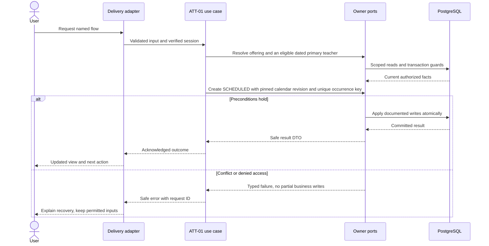
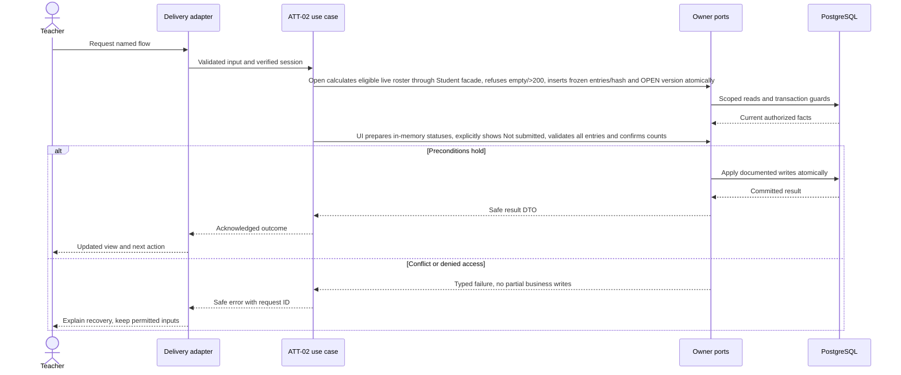
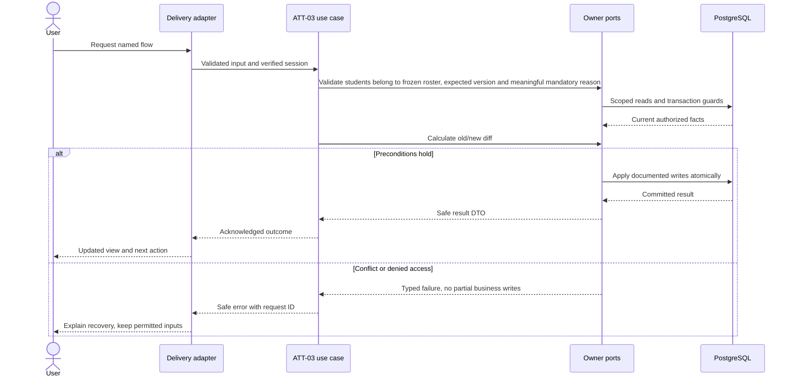
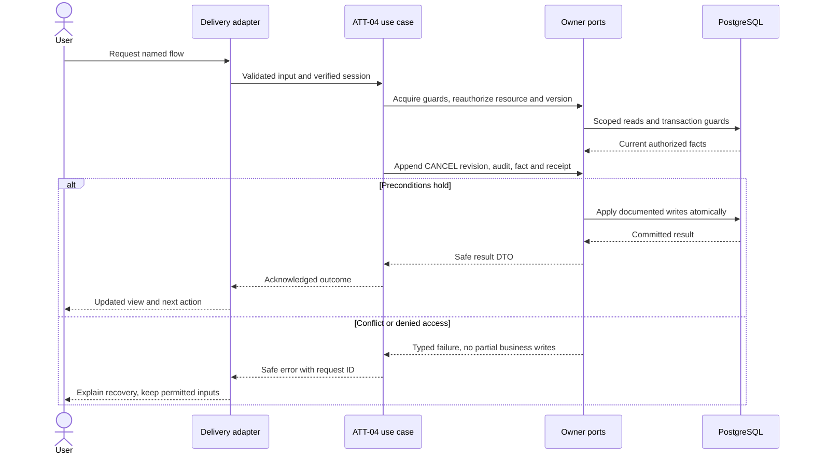

# Session attendance and accountable corrections — design

Phase 1 · Design revision 1 · 3 October 2026. Status: ATT-01 is implemented locally; later attendance workflows remain planned. Review unresolved deployment choices in FND-02 before real-data use.

## Database naming and physical mapping

All physical objects follow [the VS database contract](../../DATABASE_DESIGN.md). Table names and columns below are physical SQL names; workflow prose uses logical domain names. `organizationId` maps to `organization_id`, `schoolId` to `school_id`, and `scope` expands to both columns. Models retain PascalCase through Prisma `@@map`; camelCase fields use `@map`. Planned schemas are implemented only through their named tasks and reviewed migrations.

## Ownership, aggregates and values

AttendanceSession is the aggregate root; roster snapshot entries and attendance records are owned children. Lifecycle SCHEDULED→OPEN→SUBMITTED; any permitted nonterminal/session can become CANCELLED through explicit policy, with submitted cancellation restricted to attendance.correct. Values: SessionOccurrenceKey, SchoolDate, RosterRevision(hash of sorted student/placement/version membership), AttendanceStatus, LateMinutes(1..480), CorrectionReason(5..500). Events: SessionScheduled/Opened/Submitted/Corrected/Cancelled.v1. Records are mutable current projection only through aggregate methods; immutable revisions preserve prior submissions/corrections. Session version is the optimistic write guard.

## Module decisions

ATT-ADR-001: explicit OPEN freezes roster and version; no silent roster refresh at submission. Opening a future session is disallowed: schoolDate must equal school-local today and server now must be at or after startsAt. Submitting permitted only on that date; missed historical sessions require admin cancellation/replanning policy, not fabricated late teacher submission. An administrator can review incomplete history but cannot mark without teacher role+assignment.

ATT-ADR-002: complete atomic roster submission, no server-side partial draft. Mark all present only edits in-memory draft after explicit action. Alternative automatic all-present-on-open rejected. Exact missing/extra/duplicate student IDs fail validation.

ATT-ADR-003: correction is an admin command and immutable revision, not resubmission. A cancelled submitted session retains records, removes its contribution from metrics and records reason. Returning it to active is not supported in Phase 1.

## Physical data contract

All tables remain planned until their named task migrates them; ATT-01 installs only `AttendanceSession` in this module. `scope` below means `(organizationId,schoolId)`. All business roots have version >=1. All scoped references require composite FK targets with matching unique keys, even when abbreviated in the table. Creation times use server clock; IDs server generated. Required unless nullable is stated. Enum labels are constrained enums/CHECKs, not unchecked strings. Do not silently implement a weaker constraint because Prisma syntax cannot express it; use reviewed migration SQL.

| Table | Fields and data stored | Meaning | Keys / constraints / query support |
|---|---|---|---|
| `vs_attendance_session` (AttendanceSession; ATT-01 MIGRATED) | id uuid PK; organization_id uuid; school_id uuid; offering_id uuid; school_date date; starts_at timestamptz(3); ends_at timestamptz(3); occurrence_key varchar(80); calendar_revision_id uuid; status SCHEDULED/OPEN/SUBMITTED/CANCELLED; version int; roster_revision char(64) nullable; opened_at timestamptz(3) nullable; submitted_at timestamptz(3) nullable; submitted_by uuid nullable; cancelled_at timestamptz(3) nullable | One actual offering occurrence; retains calendar version and scope. School timezone used to validate local date. | Scoped Offering/CalendarRevision FKs; UNIQUE(scope,offering_id,occurrence_key); UNIQUE(scope,id); CHECK starts<ends, known status and version>=1; index(scope,school_date,status,starts_at,id). |
| `vs_attendance_session_roster_entry` (SessionRosterEntry) | id uuid PK; organization_id uuid; school_id uuid; session_id uuid; student_id uuid; enrollment_id uuid; placement_id uuid; display_name_snapshot varchar(210); roll_number_snapshot varchar(30) nullable | Frozen at OPEN. Minimal name/roll historical display; access remains current. No mutable roster after OPEN in Phase 1. | Scoped session/student/enrollment/placement FKs; UNIQUE(scope,session_id,student_id); append-only; session cancellation retains rows |
| `vs_attendance_record` (AttendanceRecord) | id uuid PK; organization_id uuid; school_id uuid; session_id uuid; student_id uuid; status PRESENT/ABSENT/LATE/EXCUSED; late_minutes int nullable; current_revision int | Current submitted status; one per roster pupil. No blank record stored before submit. | FK(scope,session_id,student_id)→roster unique; UNIQUE(scope,session_id,student_id); CHECK (status='LATE' AND late_minutes BETWEEN 1 AND 480) OR (status<>'LATE' AND late_minutes IS NULL) |
| `vs_attendance_revision` (AttendanceRevision) | id uuid PK; organization_id uuid; school_id uuid; session_id uuid; number int; kind SUBMIT/CORRECT/CANCEL; actor_account_id uuid; occurred_at timestamptz(3); reason varchar(500) nullable; changes jsonb | Immutable status diff with old/new values and affected student IDs; submit includes complete initial set, cancel includes state transition. No raw private notes field in pilot. | Scoped session FK; actor FK; UNIQUE(scope,session_id,number); reason required for CORRECT/CANCEL; append-only guard |

## Read workflows and joins

Teacher Today: current account→verified Person→Employee ACTIVE→Teacher active→Assignment covering schoolDate→Offering→Session. Requires attendance.read_class; assignment effective for the requested date plus current active membership/account. Query date is school-local today by default; explicit history date is no later than today and remains within the open academic year containing today, not browser timezone. An eligible teacher with no sessions receives an empty list; missing open-year/service state is an error, not an empty schedule.

ATT-01 query predicates are explicit. Admin offering selection resolves one active offering by `(organization_id, school_id, id)` and joins its active OPEN year, section/calendar, subject, plus the dated assignment predicate `valid_from <= schoolDate AND valid_to > schoolDate`; session creation only needs the eligible assignment rows for that offering/date. The teacher read is `AttendanceSession.organization_id=? AND school_id=? AND school_date=? AND status<>'CANCELLED'`, joined to assignment on the same scope/offering with `teacher_id=currentTeacher AND valid_from<=schoolDate AND valid_to>schoolDate`. Current membership, Person binding, active Employee/Teacher, attendance.read_class, module release/entitlement and branch activation are resolved server-side on every protected request. The session day index `(organization_id,school_id,school_date,status,starts_at,id)` supports the scoped date scan; Academics' `vs_academics_teacher_assignment_teacher_date_idx` and `..._offering_date_idx` support the join and offering/date check. Detail additionally requires attendance.read_school or a currently eligible, date-assigned teacher. No write locks are acquired for these reads.

Session detail authorizes by scope+assignment before returning children. SCHEDULED detail shows calculated roster preview; OPEN detail reads SessionRosterEntry; SUBMITTED joins each roster row to AttendanceRecord and latest revision metadata. Never left-join absent record into ABSENT. Admin detail requires attendance.read_school/class, with correction controls only attendance.correct. Report calculations delegated to reporting read contract, never stored competing daily totals.

## Screen contract

/teacher/today cards show time, subject, section, status. /teacher/sessions/:id supports explicit Open, P/A/L/E buttons, search, unmarked count, optional late minutes, Mark all present and confirmation summary. No default saved attendance. Announce validation/status to screen readers; 44px targets. Unknown result keeps draft+key and offers Check status, not a new save. /admin/attendance/sessions schedules dated instances and inspects correction history. Cross-date, cancelled and submitted states are read-only to teacher.

All screens additionally follow Bible §8: loading, empty, validation, permission, stale/conflict, temporary failure and acknowledged success; semantic labels, focus and mobile layout. No future-module navigation.

## Application ports and transaction boundary

Each named flow below is an application use case. Inputs/outputs are plain DTOs; adapters implement owned repositories and public cross-module facades. Use SchoolCommand, ActorResolver, Clock, IdGenerator and transactional envelope writers from the shared contract. Do not pass Prisma.TransactionClient into application/domain code. Generic `save(any)` is not a replacement for named commands. Domain factories create new roots/events; rehydration restores without events.

Mutations use the account → Organization → School guard protocol in Bible §7. Read-only flows do not take write locks. Bootstrap/auth-only commands use their documented account/provisioning transaction. Scoped school uniqueness/range checks run after locks. Reauthorize before replay and commit; only a successful transaction stores a receipt. Aggregate version, audit, outbox and response commit together. Exact flow-specific reads and writes below refine this shared behavior.

## ATT-01 — Schedule sessions and show each teacher their day

**Success response contract:** `{sessionId,version,status,schoolDate,startsAt,endsAt,offering:{id,subjectName,sectionName}}`. Teacher list uses `{items,nextCursor}` and only eligible sessions.

**Transport:** POST /api/v1/sessions; GET /api/v1/teacher/sessions?date=; GET /api/v1/sessions/:id. The scheduling metadata/envelope is capped at 8 KiB; time values are offset-bearing ISO instants and the idempotency header must match the body key. The response never accepts tenant/branch IDs from request data.

**Input:** Schedule offeringId,schoolDate,startsAt,endsAt,occurrenceKey,key; instants include explicit offset/UTC. Teacher read date optional.

**Workflow:**

1. Require current class.manage, attendance release, institution entitlement and branch activation for schedule; acquire account→Organization→School locks and validate the OPEN year/current calendar teaching day for section campus. Calendar publication, year closure, timezone updates and scheduling use this same School serialization boundary.
2. Resolve an active offering and exactly one eligible, active dated primary teacher; validate explicit-offset start/end instants map to schoolDate in the school timezone, end follows start and `endsAt - 1 ms` is still on that day. schoolDate cannot be before today (an elapsed start time earlier today is allowed).
3. Create SCHEDULED with pinned calendar revision and unique occurrence key; legitimately different occurrences need distinct keys/times.
4. Enlist Attendance-owned CalendarImpact reads so calendar publication/year close and teacher-assignment end query session state inside their existing owner transactions. Existing sessions prevent calendar changes that turn their dates non-teaching, year closure while pending sessions remain, and assignment end that strands a future session. The Student-owned transfer impact port is deferred to STU-03, which defines the first transfer workflow; no current Student mutation changes an existing placement.
5. Teacher query returns only own dated assigned sessions; empty schedule and service failure are distinct.

**Database writes / atomicity:** AttendanceSession + envelopes; no attendance records/roster rows yet.

**Errors and recovery:** Duplicate occurrence→409 unless same receipt replay; nonteaching day→422; no eligible teacher→409; same-teacher time overlap→409; ambiguous, offset-free, past or mismatched date/time→422; stale scope/configuration and concurrent duplicate races→409; missing calendar→409. Unknown service failure is 503 and invites retrying the same command key. Reads distinguish an empty schedule from permission, module and service failures.

**Verification:** Unit — Occurrence/date/calendar eligibility and role policy. Functional PostgreSQL — Schedule-vs-calendar publication serialization; occurrence race; scope/year consistency. E2E — Admin schedules; intended teacher sees it; other teacher does not.

**Design-readiness note (4 October 2026; implementation reconciliation 5 October):** Attendance owns scheduled occurrences and envelopes; Academics owns offering, immutable calendar revision and dated primary-teacher assignment; Students owns placement history. Schedule takes account→Organization→School guards and enlists Attendance-owned calendar/year/assignment-impact reads through the existing Academic transaction; same-offering duplicate receipt uses `UNIQUE(scope,offering_id,occurrence_key)` and the command receipt, while teacher overlap uses the School guard. Scoped offering/calendar FKs and `(scope,school_date,status,starts_at,id)` support scoped day reads. `TeacherAssignment` has both offering/date and teacher/date indexes; assignment facts are not copied into Attendance. No room allocation is modeled. `/admin/attendance/sessions` and `/teacher/today` reuse shared UI; attendance routes stay thin. Path A registers the migrated AttendanceSession as BRANCH with `(organization_id,school_id)`, owner/policy/constraints/indexes and TEN-03 closure; application authorization remains enforced and database policies/restricted roles remain deferred. Student transfer impact is deferred until STU-03 defines a placement-changing use case to consume it. The separate Bible pilot query-plan/latency profile applies to pilot evidence; TEN-03 owns its distinct larger RLS scale profile. No product decision blocks ATT-01.

**Planned query evidence:** At ATT-01 pilot verification, run `EXPLAIN (ANALYZE, BUFFERS)` for (1) active offering plus date-effective assignment by `(organization_id,school_id,offering_id,schoolDate)` and (2) the scoped session date read joined to assignment by `(organization_id,school_id,teacher_id,schoolDate)`. Record actual synthetic row counts, index names, buffers and latency in the task evidence; do not treat the TEN-03 multi-client scale profile as an initial pilot gate. Query plans do not replace TEN-03 restricted-role policy tests.

## ATT-02 — Open the exact roster and submit attendance

**Success response contract:** Open `{sessionId,version,status:"OPEN",rosterRevision,roster:[{studentId,displayName,rollNumber}]}`; submit `{sessionId,version,status:"SUBMITTED",revision,submittedAt,counts:{present,absent,late,excused}}`.

**Transport:** POST /api/v1/sessions/:id/open; POST /api/v1/sessions/:id/submit

**Input:** Open expectedVersion,key; Submit expectedVersion,rosterRevision,entries[{studentId,status,lateMinutes?}],key. Max 200 pupils per pilot session.

**Workflow:**

1. Require attendance.mark and dated assignment; lock account/School then session; recheck school-local today.
2. Open calculates eligible live roster through Student facade, refuses empty/>200, inserts frozen entries/hash and OPEN version atomically.
3. UI prepares in-memory statuses, explicitly shows Not submitted, validates all entries and confirms counts.
4. Submit reauthorizes and validates version/hash/exact roster ID set/status fields; save all current records plus immutable SUBMIT revision.
5. Set SUBMITTED/by/at/version; audit/outbox/receipt commit; on replay return original authorized receipt after scope check.

**Database writes / atomicity:** Open: SessionRosterEntry + session version/hash/status. Submit: AttendanceRecord for every pupil + AttendanceRevision + session metadata + envelopes.

**Errors and recovery:** Empty roster→409 EMPTY_ROSTER; changed version/hash→409; missing/extra/duplicate entries→422; revoked assignment→403; closed date/session→409.

**Verification:** Unit — Exact set equality, status/late validation, lifecycle, deterministic roster hash. Functional PostgreSQL — Atomic rollback after records; submit lost-response replay once; open vs enrollment transfer; two-tab conflict. E2E — Teacher marks exceptions, confirms, refreshes read-only result; network retry and stale tab.

## ATT-03 — Review and correct submitted attendance

**Success response contract:** `{sessionId,version,revision,correctedAt,changes:[{studentId,from,to,lateMinutes}]}`; history has actor safe display name, time, reason and immutable revisions.

**Transport:** POST /api/v1/sessions/:id/corrections; GET /api/v1/sessions/:id/history

**Input:** expectedVersion,changes[{studentId,status,lateMinutes?}],reason 5–500,key. Changed subset nonempty; reject duplicate student IDs and no-op changes.

**Workflow:**

1. Require attendance.correct for command; acquire guards and submitted session.
2. Validate students belong to frozen roster, expected version and meaningful mandatory reason.
3. Calculate old/new diff; reject ordinary teacher correction despite class-read permission.
4. Update affected current AttendanceRecord rows, append CORRECT revision and increment session version.
5. Commit audit/outbox/receipt; show prior/current values and corrected badge with author/time.

**Database writes / atomicity:** AttendanceRecord statuses/revision, immutable AttendanceRevision, AttendanceSession.version and envelopes.

**Errors and recovery:** Teacher denial→403; missing reason→422; cancelled/non-submitted→409; stale concurrent correction→409.

**Verification:** Unit — Correction policy/diff/no-op; reason bounds. Functional PostgreSQL — Concurrent corrections CAS; forced audit failure rolls records back; immutable revision trigger. E2E — Admin corrects absent to excused; teacher remains read-only; history and rate update.

## ATT-04 — Cancel sessions and recover failed submissions

**Success response contract:** Cancel `{sessionId,version,status:"CANCELLED",cancelledAt,revision}`; command status `{state:"FOUND",result}` or `{state:"UNKNOWN"}`. UNKNOWN is not proof the command failed; same-key retry is safe.

**Transport:** POST /api/v1/sessions/:id/cancel; GET /api/v1/commands/:command/key/:key (key URL opaque, no student/token content)

**Input:** Cancel expectedVersion,reason,key; status query requires current actor/scope and command allowlist, returns only own safe receipt or UNKNOWN.

**Workflow:**

1. For SCHEDULED/OPEN require class.manage; SUBMITTED requires attendance.correct, always reason.
2. Acquire guards, reauthorize resource and version; set CANCELLED without deleting snapshots/records/revisions.
3. Append CANCEL revision, audit, fact and receipt.
4. Unknown submission result: check receipt with the same actor/scope/key and read current session; FOUND reconciles success, UNKNOWN permits same-payload retry.
5. On cancellation/conflict/revocation return accurate UI state; clear drafts on denied access; cancelled sessions excluded from attendance denominator.

**Database writes / atomicity:** Session cancellation state/time/version + immutable cancellation revision + envelopes. No deleting records or mutating earlier revision.

**Errors and recovery:** Status lookup foreign/other actor→404; cancellation race→409; duplicate same command key returns receipt; no resurrection route.

**Verification:** Unit — Cancellation capability by state; result reconciliation state machine. Functional PostgreSQL — Submit-vs-cancel serialization; no duplicate outbox; revoked actor cannot read prior receipt payload. E2E — Simulated response loss recovers; cancel submitted session retains visible history and excludes metrics.

## Migration, retention and handoff

Implement tables only in the task that first uses them; migrate from empty database and the previous task checkpoint. Add scoped unique indexes before composite FKs; detect existing duplicates before adding constraints. SQL append-only/null-campus/range safeguards must appear in reviewed migrations and real-DB tests. No seed may erase prior data. Use synthetic fixtures and clean only owned test records. Preserve schema-compatible app rollback; use a reviewed forward migration when incompatible. Retention changes must preserve required immutable evidence and legal holds under the school-approved policy, not an ad hoc DELETE.

Roster completeness/exact identity set, all-excused denominator, retries lost after commit, same key/different payload, stale version, two tabs, revoked assignment, school-midnight/DST invalid/ambiguous time, open-vs-transfer, calendar changes, correction-vs-cancel, audit/outbox rollback, scope isolation and 40-pupil usability. Time entry ambiguity requires explicit offset selection; do not guess a DST instant.

See [tasks](TASKS.md), [current state](CURRENT_STATE.md), [Bible](../../VSchool_Bible.md) and [agent runbook](../../AGENT_RUNBOOK.md).

## v4.1 integration requirements

School means operational Branch and Organization means client Institution. Every protected flow checks current release availability, institution entitlement, branch activation and user/resource permission; foundational commands remain available only through their required capability projection. Apply the revised account → Organization shared guard → School guard protocol from Tenancy DESIGN. Use the shared components/tokens and current branch context; never invent a second visual system. No operational access is implied by institution administrator role.

## Portable backend integration

Follow [the backend extraction contract](../../BACKEND_EXTRACTION.md). Server module code belongs in backend/modules; UI consumes shared/contracts and a module gateway. Next delivery adapters resolve transport/session and invoke portable use cases. Future Nest controllers and provider factories reuse those use cases. Framework-specific context/ORM results never enter domain or browser DTOs.

## IAM-02 owner read seam

`ScheduledSessionQuery.hasAny(organizationId, schoolId)` is an enlisted, scope-bound read used by Access timezone changes under the shared School guard. It returns true for any session regardless of lifecycle. Before ATT-01 installs the session relation, the owner adapter verifies its absence and returns false; any database failure propagates and blocks the settings transaction. ATT-01 scheduling retains the same School guard so scheduling and timezone changes serialize. This read seam does not implement an attendance workflow or install speculative tables.
