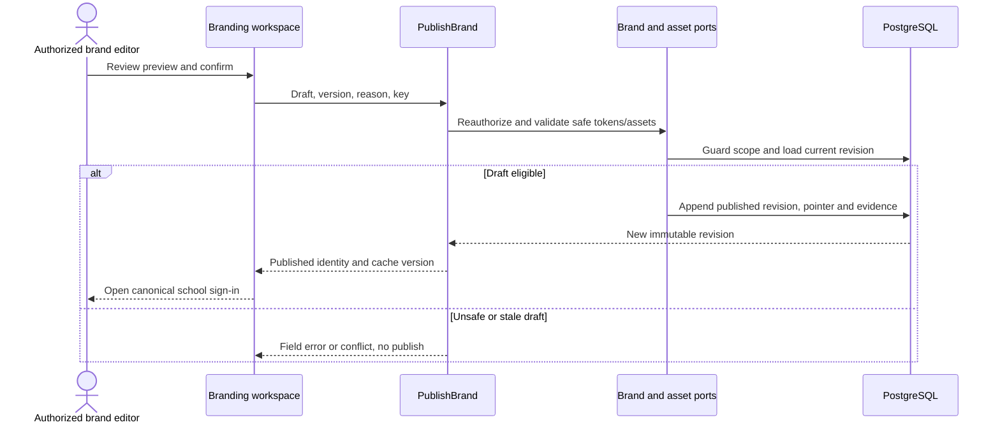

# School branding and sign-in identity — design

Phase 1 · Revision 1 · 3 October 2026. Runtime implementation limits are explicit in CURRENT_STATE.md.

## Database naming and physical mapping

All physical objects follow [the VS database contract](../../DATABASE_DESIGN.md). Table names and columns below are physical SQL names; workflow prose uses logical domain names. `organizationId` maps to `organization_id`, `schoolId` to `school_id`, and `scope` expands to both columns. Models retain PascalCase through Prisma `@@map`; camelCase fields use `@map`. Planned schemas are implemented only through their named tasks and reviewed migrations.

## Model and decisions

PublicBrand is an immutable sanitized projection. BrandProfile belongs to an institution or branch and owns one mutable draft plus append-only published revisions; BrandAsset belongs to the same exact nullable-safe scope. Palette choice is constrained. Branding never carries session, membership, pupil name or entitlement data.

UX-03 keeps public Branding publication separate from authenticated portal appearance. Access owns `Organization.theme_id` and nullable `School.theme_override` because those values participate in institution/branch creation, Access authorization and configuration versions. Branding continues to own draft, publication, rollback, public slug and public sign-in projection. A portal theme update cannot mutate a BrandRevision, advance its publication pointer or leak an unpublished preview to public sign-in. UX-05 may compose a published public theme with the Access portal selection only through the explicitly documented context; it must not bypass this boundary.

The approved presentation catalogue is `forest`, `amethyst`, `porcelain`, and `linen`. During UX-02, persisted revision values remain constrained by the existing applied migration (`forest`/`indigo`/`clay`); reads project `indigo` as Amethyst and `clay` as Linen, while unknown values fail safely to Forest. UX-03 owns the forward migration, institution concrete default, nullable branch override, and write-side rejection contract. This temporary read compatibility does not modify applied migrations or create a second appearance owner.

The shared admin and teacher shells resolve their effective palette on every dynamic request after validating the current account token and active branch membership. A PUBLISHED branch revision takes precedence; otherwise inherit the PUBLISHED institution default; with neither, use Forest. Drafts are never returned by this read. The query is restricted to the verified organization/branch IDs, has no cross-request cache, and fails closed to the generic Forest surface if theme lookup is unavailable. Existing application authorization remains active for every workspace read/write. Publishing or rolling back already uses the authorized serializable branding transaction; `router.refresh()` causes the dynamic shell to read the resulting current publication. This read exposes only an approved palette token to the authenticated member; it grants no branding-management permission.

Brand preview is local component state. It renders the production PageHeader, fields, buttons, card, badge and table inside an isolated BrandSurface. Cancel removes that subtree and therefore restores the published surface without writing a draft or changing another tab/user. Public branded sign-in continues to select only a published public profile; a slug never authenticates or grants tenant access.

BRD-ADR-001: safe tokens and assets over arbitrary themes/scripts. Alternative per-client CSS override rejected. Primary/on-primary and text/surface contrast remain checked independently of brand preference. Semantic status colors and focus styles stay fixed.

BRD-ADR-002: published immutable versions with explicit branch override and rollback. Published school name/logo is public by policy; drafts and configuration audits are protected. BRD-02 persists exact DNS-verified host mappings, but custom-host use requires deployment TLS and trusted forwarding. The local demo uses only the configured canonical host.

BRD-ADR-003: the checkout has no configured object-store or image-processing provider. For this vertical slice, accept only bounded 8-bit, non-interlaced RGB/RGBA PNG; verify its structure, CRCs, dimensions and decompression, discard ancillary metadata, and persist only the reconstructed canonical PNG in PostgreSQL. Do not retain the submitted source. This keeps the source private and the approved derivative same-scope without inventing an external dependency or upload-signing credentials. Public JSON uses `no-store`; logo URLs include the canonical SHA-256 and immutable asset id and may be cached immutably. A production CDN/object-store migration remains a separate reviewed adapter change.

BRD-ADR-004: a custom host is usable only after an exact `_vschool-verify.<hostname>` DNS TXT challenge is verified and the host maps to the same published profile. Never trust wildcard hosts or `Host` alone. DNS ownership does not provision TLS; custom hosts remain unavailable until the deployment provides verified TLS and a trusted host-forwarding path. The local demo uses the configured canonical host.

## Planned tables and database workflows

| Table | Fields | Keys / reads |
|---|---|---|
| `vs_branding_brand_profile` (BrandProfile) | id uuid PK; organization_id uuid; school_id uuid nullable; version int; current_revision_id uuid nullable; public_slug varchar(80); created_at timestamptz(3); updated_at timestamptz(3) | one institution default and one per branch via separate partial unique indexes; scoped School FK; globally UNIQUE(public_slug); lowercase slug check; pointer trigger requires same profile/scope published revision |
| `vs_branding_brand_revision` (BrandRevision) | id uuid PK; profile_id uuid; organization_id uuid; school_id uuid nullable; revision int; state varchar(20) DRAFT/PUBLISHED; display_name varchar(160); branch_label varchar(160) nullable; logo_asset_id uuid nullable; palette varchar(20) forest/indigo/clay; welcome varchar(180); support_email varchar(254); locale varchar(35); published_at timestamptz(3) nullable; published_by uuid nullable | UNIQUE(profile_id,revision); one DRAFT per profile; exact null-safe profile/asset owner trigger; published rows cannot update/delete; publisher/time both present only for PUBLISHED |
| `vs_branding_brand_asset` (BrandAsset) | id uuid PK; organization_id uuid; school_id uuid nullable; sha256 char(64); mime varchar(100); content_bytes bytea; bytes int; width int; height int; state varchar(20) APPROVED; created_at timestamptz(3) | Scoped organization/nullable School FKs; exact-owner checks; bytea length=bytes<=2 MiB; dims 1..2048; SHA-256; approved content immutable |
| `vs_branding_verified_brand_host` (VerifiedBrandHost) | id uuid PK; organization_id uuid; school_id uuid nullable; hostname varchar(253); verification_token_hash char(64); state varchar(20) PENDING/VERIFIED/REVOKED; verified_at timestamptz(3) nullable; profile_id uuid | globally unique canonical lowercase hostname; exact null-safe profile scope; no wildcard/IP; verified_at iff VERIFIED; deployment TLS/trusted-host requirement |
| `vs_branding_publication_delegation` (BrandingPublicationDelegation) | id uuid PK; organization_id uuid; school_id uuid; membership_id uuid; account_id uuid; status varchar(20) ACTIVE/REVOKED; version int; granted_at timestamptz(3); granted_by uuid; revoked_at timestamptz(3) nullable; revoked_by uuid nullable | Scoped School and exact SchoolMembership/account FKs; grantor/revoker account FKs; UNIQUE(organization_id,school_id,account_id); status/version/revocation checks; scope/status and account/status indexes |

Draft read and mutation require current `branding.manage` on the exact active branch. The application rechecks current account, token version, membership, SCHOOL_ADMIN capability, organization and branch inside every read/mutation; transaction lock order is account→Organization→School. No client-supplied branch identifier is accepted by the BFF. Current foundation receipt, configuration-change and outbox rows commit atomically with profile/draft/publish/rollback/host changes. Any conflict, stale version, scope mismatch, evidence failure or DB error rolls back the full write set. Public DTOs allowlist slug/name/branch/approved logo URL/palette/welcome/support/locale; drafts and configuration audit remain private. Public identity JSON is `Cache-Control: no-store`; immutable logo bytes use an asset-id+SHA-256 URL. No mutable server cache is introduced. Institution default rows are supported by the schema but institution-admin editing UI is not part of this branch-admin task.

## HTTP and UX

GET /api/v1/branding returns the current branch draft/publication summary. POST /api/v1/branding/profile creates the branch profile and first draft. POST /api/v1/branding/preview validates editable fields without publication. PUT /api/v1/branding/draft saves with `{expectedVersion,reason,key}`. POST .../assets accepts at most 2 MiB PNG and returns an approved derivative id only after server validation; never trust file extension alone. POST .../publish accepts `{expectedVersion,reason,key}` and returns `{profileId,revisionId,version,publishedAt}`. POST .../rollback creates a new published revision from an approved historical revision rather than mutating history. Public `GET /api/v1/public/branding/:slug` exact-matches canonical/verified host and slug; unknown, unpublished or wrong-host lookups return 404. Host challenge/verification is protected and exact DNS TXT only. Custom-domain TLS/proxy setup remains deployment work.

Login uses shared TextField/Button/error components. Error feedback focuses summary; forgot access follows the real identity procedure rather than fake success. School selector never lists private memberships anonymously. The current form explicitly labels preview, resets both entered sample fields and password reveal after submission, focuses its informational summary, and makes no auth request or credential storage. Help feedback is informational and focuses the same summary without claiming recovery or activation. Native required/email/minimum-password validation prevents an invalid sample submission.

## BRD-01 public preview validation

PublicBrand validation fails safely for malformed runtime values: slug is lowercase 3–80 characters, institution/branch names are nonblank and at most 160 characters, monogram is nonblank and at most 3 characters, welcome is at most 180 characters, support email has a valid basic email shape and at most 254 characters, and theme must be one of the four approved public identifiers. These limits align with the planned public identity columns; malformed/missing fields return false rather than throwing. The fixtures use Forest for Greenwood North, Linen for Greenwood South and Amethyst for Aster Central without arbitrary CSS. These are public synthetic profiles, not persisted or authorized branch overrides. Institution/branch/welcome/support labels wrap within the shared login layout, including unbroken text at the supported length bounds; the monogram retains its size.

## Tests and release gate

Unit: safe palette/text/email/slug/host validation and malformed/oversized/interlaced/CRC/decompression PNG rejection plus ancillary metadata removal. Functional: real PostgreSQL partial uniqueness, current-authority/foreign scope denial, role denial, owner mismatch triggers, stale/replayed commands, transactional evidence rollback, published immutability, draft lifecycle, rollback-as-new-version, exact host/slug pairing and DNS challenge. Playwright desktop/mobile: authorized publish/rollback, current authorized branch sign-in, bad credentials, unknown/wrong host slug, keyboard/mobile errors and safe logo display. Validate with owner; no accessibility certification is claimed.

## BRD-01 — Review reusable brand palettes and school login previews

Review the included synthetic fixture profiles, palette validator and school sign-in pages. Verify two institutions and two branches, unknown slug not-found, labeled inputs, password reveal and explicit non-auth preview result. Update source/evidence after owner visual review; no credentials should be sent/stored.

**Manual demo:** Open Greenwood North, Greenwood South and Aster Central sign-in URLs. Compare identity/palette. Use sample form values and confirm preview message, not a signed-in session.

## BRD-02 — Publish authorized school branding and connect real sign-in

Implement BrandProfile/Revision/Asset/VerifiedBrandHost and preview/publish/rollback contracts. Add safe logo pipeline and exact public DTO. Integrate real NextAuth flow with current tenant membership and context selector. Unknown host/slug fails closed; no arbitrary CSS or redirects. Validate scoped asset refs, contrast, publication race, cache invalidation and mobile/keyboard error states.

**Manual demo:** Edit a branch logo/palette/welcome, preview and publish; open canonical sign-in; unauthorized branch edit denied; rollback produces a new version and actual sign-in reaches only permitted branches.

## Physical owner and public identity constraints

BrandProfile.public_slug is globally unique, lowercase 3–80 characters and exact-matched; unknown/unpublished slugs return 404. Same-profile current_revision and asset references must match organization_id and school_id with explicit null-safe comparisons. Add reviewed SQL constraints/triggers and transaction tests for institution defaults vs branch overrides; SQL NULL equality cannot establish this owner invariant. published_at and published_by are both present for PUBLISHED and both NULL for DRAFT. Profile partial unique indexes distinguish institution defaults and branch overrides. Public cache keys include slug/verified host and the published revision.

## Portable backend integration

Follow [the backend extraction contract](../../BACKEND_EXTRACTION.md). Server module code belongs in backend/modules; UI consumes shared/contracts and a module gateway. Next delivery adapters resolve transport/session and invoke portable use cases. Future Nest controllers and provider factories reuse those use cases. Framework-specific context/ORM results never enter domain or browser DTOs.

## SA-07 branch publication delegation

The Phase 1 authority decision separates existing `branding.manage` draft/read access from publication. An active `INSTITUTION_ADMIN` for the current institution may publish and may grant or revoke publication for an eligible active SCHOOL_ADMIN membership in an explicitly selected branch. A delegate may publish or roll back only in that branch. Delegation cannot change fixed roles, grant onward delegation, or authorize another branch. Institution administrators cannot create a redundant self-delegation because their publication authority is already derived from their current institution grant. Existing draft editing, preview, asset and host-verification permissions remain `branding.manage`; no durable publication-request workflow is introduced.

`vs_branding_publication_delegation` is Branding-owned: UUID key; required `organization_id`, `school_id`, `membership_id`, `account_id`; ACTIVE/REVOKED status; positive version; grant time/actor; nullable paired revocation time/actor. It has an exact composite FK to the branch SchoolMembership/account, scoped School and account actor FKs, one row per branch/account, and indexes for account publication checks plus branch administration lists. It is a BRANCH table under TEN-ADR-006 Path A, with TEN-03 as the database-enforcement closure gate.

`setPublisher(identity, trusted organizationId, trusted schoolId, {accountId,status,expectedVersion,key,reason})` locks both accounts in UUID order, then Organization and School; rechecks live token, current institution authority, target active account, exact active SCHOOL_ADMIN membership and branch scope; applies optimistic versioning; and commits delegation, branch configuration revision, receipt, audit and outbox atomically. Same-key/same-input returns the original result; changed input conflicts. Publish and rollback keep their established account→Organization→School locks and recheck either current institution authority or an ACTIVE delegation whose account and SCHOOL_ADMIN membership remain active before receipt disclosure or mutation. Revocation therefore denies a stale open page. Reads do not acquire mutation locks.

The workspace DTO exposes `canPublish`, `canDelegate`, active/revoked publishers and eligible branch administrators. The page shows draft controls under existing permission, publication only when currently authorized, and a delegation panel only to institution administrators. Failure states are 403 for lost/onward/cross-scope authority, 404 for an ineligible target, 409 for stale version/idempotency conflict and 422 for malformed input. Verification covers scoped grant/revoke, self/onward/cross-institution denial, delegated publication, stale-page denial after revocation, draft/public separation, replay and rollback.

### SA-07 approved review composition overlay — 11 October 2026

`/admin/branding` is the approved three-stage review entry: **Preview school identity → Review before publication → Confirm**. It keeps palette, display name, welcome text and acknowledgement in in-flow component state, restores focus to each stage heading, and sends the final values through the existing server preview validation. Confirmation does not publish. Full profile, asset, host, draft, publication, rollback and delegation controls remain available at `/admin/branding/manage` and retain the authorization and transaction rules above.

The approved catalog outcome also says a nonpublisher can “request a branding update.” The accepted SA-COMP-14 authority contract explicitly introduced no durable publication-request lifecycle. The review entry therefore must not fabricate a request receipt or claim that a request was stored. Adding that outcome remains a separate product contract for request ownership, persistence, recipients, state transitions and recovery. The disabled reference “Save draft and leave” control remains visibly disabled; SA-07 does not authorize durable cross-session wizard drafts.
