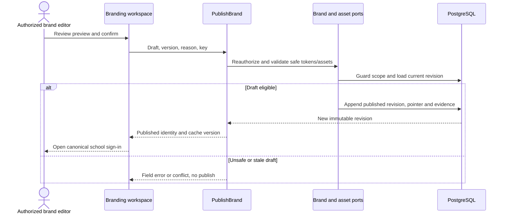

# School branding and sign-in identity — design

Phase 1 · Revision 1 · 3 October 2026. Runtime implementation limits are explicit in CURRENT_STATE.md.

## Database naming and physical mapping

All physical objects follow [the VS database contract](../../DATABASE_DESIGN.md). Table names and columns below are physical SQL names; workflow prose uses logical domain names. `organizationId` maps to `organization_id`, `schoolId` to `school_id`, and `scope` expands to both columns. Models retain PascalCase through Prisma `@@map`; camelCase fields use `@map`. Planned schemas are implemented only through their named tasks and reviewed migrations.

## Model and decisions

PublicBrand is an immutable sanitized projection. BrandProfile root belongs to institution or branch and owns draft→published revisions; Asset belongs to shared file storage support. Palette choice is a constrained value. Branding never carries session, membership, pupil name or entitlement data.

BRD-ADR-001: safe tokens and assets over arbitrary themes/scripts. Alternative per-client CSS override rejected. Primary/on-primary and text/surface contrast remain checked independently of brand preference. Semantic status colors and focus styles stay fixed.

BRD-ADR-002: published immutable versions with explicit branch override and rollback. Published school name/logo is public by policy; drafts and configuration audits are protected. Starter uses synthetic fixture profiles only. No custom-domain auth or persistence is claimed.

## Planned tables and database workflows

| Table | Fields | Keys / reads |
|---|---|---|
| `vs_branding_brand_profile` (BrandProfile) | id uuid PK; organization_id uuid; school_id uuid nullable; version int; current_revision_id uuid nullable; public_slug varchar(80) | one institution default WHERE school_id IS NULL; one per branch WHERE school_id IS NOT NULL; separate partial unique indexes; scoped School FK; UNIQUE(public_slug); lowercase slug format check |
| `vs_branding_brand_revision` (BrandRevision) | id uuid PK; profile_id uuid; organization_id uuid; school_id uuid nullable; revision int; state varchar(20) DRAFT/PUBLISHED; display_name varchar(160); branch_label varchar(160) nullable; logo_asset_id uuid nullable; palette varchar(20) forest/indigo/clay; welcome varchar(180); support_email varchar(254); locale varchar(35); published_at timestamptz(3) nullable; published_by uuid nullable | UNIQUE(profile_id,revision); composite owner FK; published rows immutable; pointer references same profile revision |
| `vs_branding_brand_asset` (BrandAsset) | id uuid PK; organization_id uuid; school_id uuid nullable; object_key varchar(512); sha256 char(64); mime varchar(100); bytes int; width int; height int; state varchar(20) UPLOADED/SCANNING/APPROVED/REJECTED; created_at timestamptz(3) | private source; approved derivative reference; size<=2MiB and dims<=2048; scoped retrieval; object_key server assigned |
| `vs_branding_verified_brand_host` (VerifiedBrandHost) | id uuid PK; organization_id uuid; school_id uuid nullable; hostname varchar(253); verification_token_hash char(64); state varchar(20) PENDING/VERIFIED/REVOKED; verified_at timestamptz(3) nullable; brand_profile_id uuid | UNIQUE(lowercase canonical hostname); ownership challenge; exact verified lookup, no wildcard arbitrary Host trust |

Draft read requires branding.manage or delegated branding.manage_branch; institution defaults LEFT JOIN branch override, then published pointer join to BrandRevision and APPROVED BrandAsset. Public DTO allowlist is slug/name/branch/approved logo URL/palette/welcome/support/locale, no raw objectKey or grant. Cache key is verified host/slug+published revision; draft never enters public cache. Publishing locks account→Organization→School when branch, checks version and assets, validates contrast/content, appends revision, updates pointer, writes appropriate branch or institution receipt/audit/outbox, then invalidates public cache. Cache invalidation failure must be observable and bounded with TTL; publishing response states current revision so the UI can verify it.

## HTTP and UX

GET /sign-in/:slug: resolve exact public published identity, unknown→404. POST /api/v1/branding/:profileId/preview: validate editable fields and return safe preview without publishing. POST .../publish: `{draftId,expectedVersion,reason,key}`; response `{profileId,revisionId,version,publishedAt}`. POST .../rollback creates a new published revision from approved historical fields rather than mutating history. Logo upload through signed private destination with final server validation; never trust file extension alone. Custom-domain setup is a reviewed deployment substep with TLS and trusted-proxy rules.

Login uses shared TextField/Button/error components. Error feedback focuses summary; forgot access follows the real identity procedure rather than fake success. School selector never lists private memberships anonymously. The current form explicitly labels preview, resets both entered sample fields and password reveal after submission, focuses its informational summary, and makes no auth request or credential storage. Help feedback is informational and focuses the same summary without claiming recovery or activation. Native required/email/minimum-password validation prevents an invalid sample submission.

## BRD-01 public preview validation

PublicBrand validation fails safely for malformed runtime values: slug is lowercase 3–80 characters, institution/branch names are nonblank and at most 160 characters, monogram is nonblank and at most 3 characters, welcome is at most 180 characters, support email has a valid basic email shape and at most 254 characters, and palette must be an own approved catalog key. These limits align with the planned public identity columns; malformed/missing fields return false rather than throwing. The fixtures use Forest for Greenwood North, Clay for Greenwood South and Indigo for Aster Central to demonstrate all approved palettes without arbitrary CSS. These are public synthetic profiles, not persisted or authorized branch overrides. Institution/branch/welcome/support labels wrap within the shared login layout, including unbroken text at the supported length bounds; the monogram retains its size.

## Tests and release gate

Unit: hex/color validation, all allowed contrast pairs, invalid palette, text bounds, no prototype-key lookup. Functional: institution/branch partial uniqueness, cross-owner assets rejected, publish rollback, immutable revision, wrong-host mapping and invalidation retry. Browser: each approved palette, long school names, mobile/zoom, keyboard login labels/errors, focus, no cross-school fallback, CSP/asset failure. Validate school branding with owner; no claim of accessibility certification from token checks.

## BRD-01 — Review reusable brand palettes and school login previews

Review the included synthetic fixture profiles, palette validator and school sign-in pages. Verify two institutions and two branches, unknown slug not-found, labeled inputs, password reveal and explicit non-auth preview result. Update source/evidence after owner visual review; no credentials should be sent/stored.

**Manual demo:** Open Greenwood North, Greenwood South and Aster Central sign-in URLs. Compare identity/palette. Use sample form values and confirm preview message, not a signed-in session.

## BRD-02 — Publish authorized school branding and connect real sign-in

Implement BrandProfile/Revision/Asset/VerifiedBrandHost and preview/publish/rollback contracts. Add safe logo pipeline and exact public DTO. Integrate real NextAuth flow with current tenant membership and context selector. Unknown host/slug fails closed; no arbitrary CSS or redirects. Validate scoped asset refs, contrast, publication race, cache invalidation and mobile/keyboard error states.

**Manual demo:** Edit a branch logo/palette/welcome, preview and publish; open canonical sign-in; unauthorized branch edit denied; rollback produces a new version and actual sign-in reaches only permitted branches.

## Physical owner and public identity constraints

BrandProfile.public_slug is globally unique, lowercase 3–80 characters and exact-matched; unknown/unpublished slugs return 404. Same-profile current_revision and asset references must match organization_id and school_id with explicit null-safe comparisons. Add reviewed SQL constraints/triggers and transaction tests for institution defaults vs branch overrides; SQL NULL equality cannot establish this owner invariant. published_at and published_by are both present for PUBLISHED and both NULL for DRAFT. Profile partial unique indexes distinguish institution defaults and branch overrides. Public cache keys include slug/verified host and the published revision.

## Portable backend integration

Follow [the backend extraction contract](../../BACKEND_EXTRACTION.md). Server module code belongs in backend/modules; UI consumes shared/contracts and a module gateway. Next delivery adapters resolve transport/session and invoke portable use cases. Future Nest controllers and provider factories reuse those use cases. Framework-specific context/ORM results never enter domain or browser DTOs.
