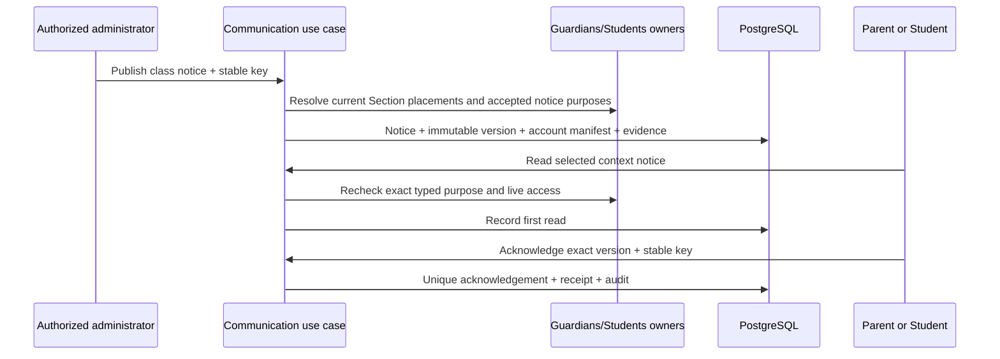

# Communication notice foundation

The live Communication slice implements the approved Administrator school-notice composition, Parent PAR-14 read/acknowledge, and Student STW-27/STW-28 read/acknowledge. Administrator withdrawal is included because the approved Student recovery state must fail closed without exposing withdrawn content. Scheduling, email delivery, drafts, corrections, teacher authoring, preferences, attachments and private conversations remain later slices.

## Invariants and ownership

Communication owns the stable Notice, immutable NoticeVersion, frozen account Recipient manifest, typed Guardian/Student purpose provenance, first-read evidence and exact-version Acknowledgement. Guardians owns child access and the independently selected `communication.notice.read` purpose. Students owns Student portal access and the independently selected `communication.notice.read_self` purpose; the designated `student.access.manage` administrator may add/remove it with optimistic concurrency and no backfill. Students/Academics own current enrollment and Section placement. Access owns accounts and memberships. Communication never writes those foreign owners.

An operator provisions a branch `CommunicationPublisherGrant` for a current School Administrator. Publication and withdrawal also require the live `communication.publish` role capability, Communication release, and active Communication, Family, Student and Academics module configuration. Parent reads require an active account/token, an accepted non-revoked child link, the exact Parent purpose, selected child binding and frozen Parent recipient provenance. Student reads require an active account/token, exact accepted non-revoked Student access and Person binding, the exact Student purpose, a current enrollment in the original school scope and frozen Student recipient provenance. A same-branch transfer does not erase a prior frozen audience entry; a later grant/enrollment never adds one. Revocation denies the next read or acknowledgement. Navigation visibility is only presentation.

## Commands, reads and failure contract

- `publishNotice`: strict 32 KiB JSON envelope; title 1–120, body 1–5,000, exact active Section and acknowledgement flag. The server derives tenant, publisher and audience. Same actor/key/payload replays; changed payload conflicts.
- `listAdminNotices`: branch-scoped current versions with frozen recipient, first-read and acknowledgement counts.
- `listMyNotices` / `getMyNotice`: starts at the authenticated account's Recipient row and exact selected-child binding; revoked or foreign child access returns unavailable.
- `markNoticeRead`: idempotently records `first_read_at`; it never creates an acknowledgement.
- `acknowledgeNotice`: requires the current published version, a requested acknowledgement and current recipient authority. Same key/payload replays and the unique version/account constraint prevents duplicates.
- `listStudentNotices` / `getStudentNotice` / `markStudentNoticeRead` / `acknowledgeStudentNotice`: use the typed Student binding and recheck live Student authority before returning data or replaying a receipt. Student acknowledgement confirms receipt only and is never Guardian consent.
- `withdrawNotice`: requires current publisher authority, expected Notice revision, a 10–500 character reason and stable key. It changes only lifecycle status/revision, appends audit/outbox/receipt evidence, and never deletes immutable content/history. Recipient detail then returns safe context with a null body and rejects read/acknowledgement.

Failures are the existing `UNAUTHENTICATED`, `FORBIDDEN`, `NOT_FOUND`, `VALIDATION`, `CONFLICT`, `STALE_VERSION`, `IDEMPOTENCY_CONFLICT`, `RELEASE_UNAVAILABLE`, `MODULE_NOT_LICENSED`, `MODULE_DISABLED` and `UNAVAILABLE` responses. Protected Parent failures do not reveal whether another account received a notice.

## Persistence and query design

| Model / physical table | Fields | Constraints and indexes |
|---|---|---|
| `vs_communication_publisher_grant` (CommunicationPublisherGrant) | id uuid PK; organization_id/school_id/membership_id/account_id uuid; granted_by_operator_id uuid; granted_at/revoked_at timestamptz; version int | Scoped membership/account FK; unique scope/account; positive version; active lookup index |
| `vs_communication_notice_workflow_grant` (CommunicationNoticeWorkflowGrant) | id/org/school/membership/account/operator uuid; action AUTHOR/REVIEW/PUBLISH; granted/revoked timestamps; version | Scoped membership FK; closed action vocabulary; unique scope/account/action; active action lookup index |
| `vs_communication_notice_proposal` (CommunicationNoticeProposal) | id/org/school uuid; status; author/reviewer/current_revision/published_notice uuid; version; timestamps | Scoped School/published Notice FKs; global actor FKs; status/version/published-state checks; author/reviewer indexes |
| `vs_communication_notice_proposal_revision` (CommunicationNoticeProposalRevision) | id/org/school/proposal/section/creator uuid; number; audience/title/body/ack; attachment/approval digests; PORTAL/IMMEDIATE; created_at | Scoped Proposal/Section FKs; creator FK; unique proposal number; digest/channel/schedule checks; sequence index |
| `vs_communication_notice_proposal_decision` (CommunicationNoticeProposalDecision) | id/org/school/proposal/revision/reviewer uuid; action; reason; approval_digest; created_at | Scoped Proposal/Revision FKs; reviewer FK; closed action/digest checks; one decision per exact revision; history index |
| `vs_communication_notice_proposal_attachment` (CommunicationNoticeProposalAttachment) | id/organization_id/school_id/proposal_id/revision_id/document_version_id/document_grant_id uuid; position int; display_filename varchar(180); created_at timestamptz | Immutable ordered clean DocumentVersion set reviewed with one proposal revision. | Scoped Proposal/Revision and exact Document grant-version FKs; position 1-5; scoped id, revision-position and revision-version uniqueness; proposal/revision index; immutable trigger |
| `vs_communication_notice` (CommunicationNotice) | id/org/school uuid; status; current_version_id; revision; creator and timestamps | Scoped school/creator/current-version FKs; status/revision checks; branch list index |
| `vs_communication_notice_version` (CommunicationNoticeVersion) | id/org/school/notice uuid; version_no; title/body; requires_acknowledgement; audience section/label/digest; published_at | Scoped Notice and Section FKs; unique notice/version; published list index |
| `vs_communication_notice_attachment` (CommunicationNoticeAttachment) | id/organization_id/school_id/notice_version_id/document_version_id/document_grant_id uuid; position int; display_filename varchar(180); created_at timestamptz | Frozen ordered attachment set for one immutable published NoticeVersion. | Scoped NoticeVersion and exact Document grant-version FKs; position 1-5; scoped id, version-position and version-document uniqueness; version index; immutable trigger |
| `vs_communication_recipient` (CommunicationRecipient) | id/org/school/version/account uuid; first_read_at; created_at | Scoped version and account FKs; unique version/account; account inbox index |
| `vs_communication_recipient_binding` (CommunicationRecipientBinding) | id/org/school/recipient/access/student uuid | Scoped recipient and Guardian access+Student FKs; unique recipient/access; Student lookup index |
| `vs_communication_student_recipient_binding` (CommunicationStudentRecipientBinding) | id/org/school/recipient/access/student uuid | Scoped recipient and Student portal access+Student FKs; unique recipient/access; Student lookup index |
| `vs_communication_acknowledgement` (CommunicationAcknowledgement) | id/org/school/version/recipient_account/actor_account uuid; acknowledged_at | Scoped version and account FKs; actor equals recipient; unique version/recipient; account history index |
| `vs_communication_reminder_manager_grant` (CommunicationReminderManagerGrant) | id/org/school/membership/account/operator uuid; grant/revoke timestamps; version | Scoped membership/account FK; unique scope/account; positive version; active lookup index |
| `vs_communication_reminder` (CommunicationReminder) | id/org/school/notice/version/actor uuid; revision; audience/channel; key/hash; aggregate outcome counts; created_at | Scoped Notice/Version FKs; actor FK; unique actor/key; exact audience/channel and reconciled-count checks; version history index |
| `vs_communication_reminder_delivery` (CommunicationReminderDelivery) | id/org/school/reminder/version/recipient/account uuid; channel/outcome/dedup hash; created_at | Scoped Reminder/Recipient/Version and account FKs; unique dedup and reminder/recipient; outcome/channel checks; policy and portal indexes |

Migration `20261015120000_communication_notice_foundation` adds the branch-scoped publisher grant, notice, version, recipient, recipient binding and acknowledgement tables. `20261015121000_communication_notice_foundation_recovery` is an additive compatibility migration for a local PostgreSQL run that retained the first two DDL statements from a failed migration; it is a no-op on fresh databases after ensuring every missing object exists. `20261015122000_guardian_notice_purpose` extends the Guardians purpose constraint forward-only. `20261015130000_student_notice_projection` extends the Students purpose check and adds the typed Student binding without changing existing grants. `20261017220000_communication_notice_review` adds the D13 source authority, proposal, immutable revision and immutable decision contracts. Its applied Path A comment used a legacy label form; forward migration `20261017221000_communication_notice_review_metadata` records the canonical TEN-ADR-006 metadata without altering business data.

Publication locks account → organization SHARE → school UPDATE, rechecks authority/configuration, resolves current school-local enrollment/placement and accepted Parent/Student notice-purpose links, deduplicates the account Recipient while preserving every typed provenance binding, then commits Notice, immutable Version, Recipient/Binding manifest, audit, outbox and command receipt in one Serializable transaction. A publication with zero eligible accounts returns `CONFLICT`. Read/ack queries start from account + selected Student + typed binding; no school-wide result is filtered in the browser. Acknowledgement and withdrawal are Serializable. Acknowledgement is unique on organization/school/version/account; withdrawal locks the stable Notice and uses revision compare-and-swap plus an exact-payload receipt.

Indexes support branch notice order, account inbox lookup, Student binding lookup and acknowledgement history. All new tables are TEN-ADR-006 Path A branch tables: application authorization is active; TEN-03 RLS enforcement remains the production gate.



## UI and verification

Administrator composition follows Message → Recipients → Review and publishes only on final confirmation. Withdrawal follows Reason → Confirm → Complete. Parent and Student Messages list only notices for the selected authorized context; detail separates read evidence from deliberate acknowledgement and uses a content-free withdrawn state. Desktop 1440×1000 and mobile 390×844 use the approved shared shell, cards, stepper and theme tokens. The documented application-font exception remains.

Focused verification covers input rejection, publisher denial, exact purpose/audience resolution, replay, persisted read/ack, revocation denial and the complete browser journey. Cross-tenant keys are constrained and all queries carry organization/school scope. Native accessibility and TEN-03 remain independent gates.

## Principal notice-coverage projection (LEA-34 read slice)

Communication owns `notice-coverage.v1`. A live branch-scoped Principal receives only `communication.read_leadership`; this does not grant publication, withdrawal, draft, reminder, resend, recipient identity, contact, message-body, family-relationship or acknowledgement mutation authority. Every query rechecks the current account token, active exact Principal membership, Communication release, institution entitlement, branch activation and the Family, Student and Academics dependency chain.

`listLeadership({limit})` returns one `REPEATABLE READ` snapshot with server `asOf`, school timezone, the exact current-publication `total` and 1–100 current immutable publication versions ordered by `(published_at DESC, id DESC)`. The current-version join is applied before the bound, so old versions cannot displace current records. Each row contains the notice/version reference, safe title, frozen audience label, published time, lifecycle state, eligible account count, first-read account count, explicit acknowledgement count and whether acknowledgement was requested. Eligible, read and acknowledged remain distinct facts. Withdrawn publications retain their immutable aggregate evidence. The projection excludes recipient/account/student identifiers, notice body, delivery-channel inference and all write controls. Existing scoped publication and acknowledgement indexes support the bounded joins; no schema or migration changes.

For LEA-39, Reporting requests a 50-row owner page and refuses generation when `total > items.length`. The exported allowlist is the same versioned aggregate projection plus safe notice/version references, title, audience label, state and counts. Communication continues to authorize and calculate the source; Reporting cannot read Communication tables, infer delivery or invoke reminder/resend. The independent `reporting.export` designation and live `communication.read_leadership`/module chain are rechecked before safe ExportRun/audit metadata is committed.

This slice supports inspection only. The LEA-34 reminder/resend outcome remains unavailable until Communication defines current-recipient reauthorization, channel delivery outcomes, deduplication and a separately authorized command. Application authorization remains active on every read.

## Principal acknowledgement reminders (F10 / LEA-34)

The 17 October 2026 approval of Principal decision D13 authorizes a synthetic-only, provider-less portal reminder. Communication owns the command and two durable records: one logical reminder intent and one per-recipient outcome. A reminder is bound to the exact current immutable NoticeVersion, the stable Notice revision, the `ACKNOWLEDGEMENT` audience and the `IN_APP` channel. It is not email, delivery evidence, a read or an acknowledgement. The existing frozen Recipient manifest remains the candidate audience.

Mutation authority is narrower than Principal coverage read. The actor must retain the live Principal membership and `communication.read_leadership` capability and an active operator-designated branch `CommunicationReminderManagerGrant`. The grant never confers publish, withdraw, recipient-identity or message-body access. Every preview and command also rechecks the Communication/Family/Student/Academics release, entitlement and branch activation chain. Operator grant/revoke is audited separately.

At preview and again inside the serializable command, Communication intersects each frozen Recipient with an accepted, non-revoked typed Guardian or Student binding that still has the exact notice-read purpose. The recipient account and Student must remain active; Student access also requires the current Person binding and enrollment. An existing acknowledgement removes the recipient. Accepted in-app reminders enforce at least 24 hours between attempts and at most three per account/version. The result exposes aggregate counts only: candidate, accepted, acknowledged, ineligible and policy-limited. It never exposes recipient, Student or family identity.

`sendAcknowledgementReminder` accepts the exact notice/version, expected Notice revision and a stable logical reminder UUID. The command key is that logical reminder identifier. Its canonical hash binds the version, revision, audience and channel. Same actor/key/payload replays only after current authorization; changed payload conflicts. The database locks account → organization SHARE → school UPDATE → Notice UPDATE, rechecks current version and status, writes the logical reminder, per-recipient `ACCEPTED` portal items, safe audit/outbox evidence and command receipt atomically. A withdrawn, stale or non-acknowledgement publication cannot be reminded. Concurrent commands serialize on the Notice; per-version/account/channel/reminder uniqueness prevents duplicate items. The 24-hour and maximum-three rules are checked from committed accepted outcomes.

Parent and Student notice projections include only their own accepted reminder count and most recent reminder time after the usual live purpose checks. This is the counterpart portal item; it does not mutate first-read or acknowledgement evidence. The Principal route `/leadership/communication/[id]/remind` uses recipe W: exact publication → aggregate impact → confirm → receipt. Back/Continue retain only in-flow state. The final action alone mutates. Unknown response retries the same logical reminder identifier and exact payload.

The forward migration adds `vs_communication_reminder_manager_grant`, `vs_communication_reminder` and `vs_communication_reminder_delivery`, all branch-classified TEN-ADR-006 Path A tables with scoped keys and indexes for active grant, exact publication history, recipient portal lookup and policy enforcement. Application authorization remains active; TEN-03 is still the production closure gate. Real email/provider dispatch, background retry, retention and production enablement remain unavailable. Notice create/review/publish separation remains a later F10 slice.

## F10 / D13 — exact-revision notice review and publication

This synthetic-only slice adds a Communication-owned review path without changing provider or delivery semantics. `CommunicationNoticeWorkflowGrant` designates one exact branch action: `AUTHOR`, `REVIEW` or `PUBLISH`. It is not a generic approval service and confers no other Communication, family, Student or Principal capability. AUTHOR and PUBLISH also require the current administrator `communication.publish` role capability; REVIEW requires current direct/delegated `communication.read_leadership`. Every command rechecks the live account/token, active exact membership, module chain and source grant. The configured reviewer must be distinct from the proposal author. A browser may select content and an allowed Section but cannot assert its reviewer, publisher or scope.

`CommunicationNoticeProposal` is the versioned root with `DRAFT → IN_REVIEW → APPROVED|RETURNED|REJECTED → PUBLISHED`. RETURNED may be revised and resubmitted; REJECTED is retained terminal evidence. `CommunicationNoticeProposalRevision` is immutable and holds the exact Section audience rule, title ≤120, body ≤10,000, acknowledgement flag, `channel=PORTAL`, `schedule_kind=IMMEDIATE`, the fixed empty-attachment digest and a SHA-256 approval digest over all of those facts. Every save creates a new immutable revision and invalidates any earlier approval. Submit assigns the single currently configured eligible REVIEW account server-side. `CommunicationNoticeProposalDecision` stores one exact revision decision and digest. RETURN and REJECT require a 10–500 character reason; APPROVE records a safe fixed reason. Publication requires the current root/revision/version, a current independent APPROVE decision with the identical digest and a separately current PUBLISH grant.

Publication runs inside the Communication transaction. It recomputes the current eligible Parent/Student portal audience using the existing explicit-purpose, dated placement and account rules, creates the existing immutable `CommunicationNotice`/`CommunicationNoticeVersion` and frozen recipient/binding manifest, then marks the proposal PUBLISHED and writes audit, outbox and exact-input receipt evidence atomically. Selecting an audience, saving a draft, submitting or approving sends nothing. There is no email, schedule, attachment, provider retry or delivery claim. Portal publication is the only supported channel. The current recipient count may change before publication because current purposes are rechecked; the approved audience rule and content cannot change.

The write lock order remains account → Organization → School → proposal. Save/submit/decide/publish use SERIALIZABLE transactions, positive root versions and command receipts keyed by scope, actor, command and caller UUID. Same-key/same-input reauthorizes before returning the prior semantic result; changed input conflicts. Stale version/digest fails without a partial decision or publication. Reads take no write lock and show only the author's own proposals or the exact assigned reviewer's inbox. Proposal queries use the author and reviewer/status indexes; revision and decision history use their descending scoped sequence indexes.

```mermaid
sequenceDiagram
  actor A as Authorized author
  actor R as Assigned independent reviewer
  actor P as Authorized publisher
  participant C as Communication application
  participant D as PostgreSQL
  A->>C: Save immutable draft revision
  C->>D: Proposal + revision + receipt
  A->>C: Submit current version
  C->>D: Select exact active reviewer; IN_REVIEW
  R->>C: Approve exact revision and digest
  C->>D: Immutable decision + APPROVED
  P->>C: Publish current approved version
  C->>D: Recheck audience; notice + frozen recipients + PUBLISHED atomically
```

Forward migration `20261017220000_communication_notice_review` adds the four BRANCH Path-A tables, widens the existing immutable notice body to the approved 10,000-character bound and preserves all existing rows. TEN-03 remains the closure gate. Verification must cover save-without-send, immutable revision invalidation, independent reviewer enforcement, return/revise/resubmit, stale approval/publication denial, exact replay, revoked grants, cross-branch denial, current audience recheck, atomic rollback and the routed author → Principal → publisher journey at desktop/mobile.
