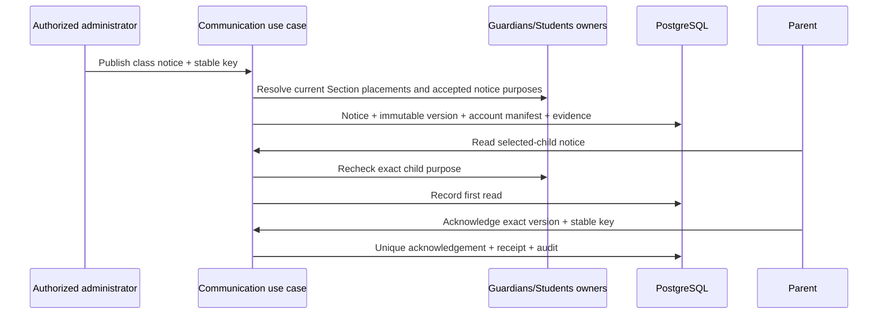

# Communication notice foundation

The first live Communication slice implements the approved Administrator school-notice composition and Parent PAR-14 read/acknowledge outcome. It is intentionally narrower than the full approved Communication pack: scheduling, email delivery, drafts, corrections, withdrawal, teacher authoring, preferences and private conversations remain later slices.

## Invariants and ownership

Communication owns the stable Notice, immutable NoticeVersion, frozen account Recipient manifest, child-purpose provenance, first-read evidence and exact-version Acknowledgement. Guardians owns child access and the independently selected `communication.notice.read` purpose. Students/Academics own current enrollment and Section placement. Access owns accounts and memberships. Communication never writes those foreign owners.

An operator provisions a branch `CommunicationPublisherGrant` for a current School Administrator. Publication also requires the live `communication.publish` role capability, Communication release, and active Communication, Family, Student and Academics module configuration. Parent reads require an active account/token, an accepted non-revoked child link, the exact notice purpose, the selected child binding and the frozen recipient manifest. Navigation visibility is only presentation.

## Commands, reads and failure contract

- `publishNotice`: strict 32 KiB JSON envelope; title 1–120, body 1–5,000, exact active Section and acknowledgement flag. The server derives tenant, publisher and audience. Same actor/key/payload replays; changed payload conflicts.
- `listAdminNotices`: branch-scoped current versions with frozen recipient, first-read and acknowledgement counts.
- `listMyNotices` / `getMyNotice`: starts at the authenticated account's Recipient row and exact selected-child binding; revoked or foreign child access returns unavailable.
- `markNoticeRead`: idempotently records `first_read_at`; it never creates an acknowledgement.
- `acknowledgeNotice`: requires the current published version, a requested acknowledgement and current recipient authority. Same key/payload replays and the unique version/account constraint prevents duplicates.

Failures are the existing `UNAUTHENTICATED`, `FORBIDDEN`, `NOT_FOUND`, `VALIDATION`, `CONFLICT`, `STALE_VERSION`, `IDEMPOTENCY_CONFLICT`, `RELEASE_UNAVAILABLE`, `MODULE_NOT_LICENSED`, `MODULE_DISABLED` and `UNAVAILABLE` responses. Protected Parent failures do not reveal whether another account received a notice.

## Persistence and query design

| Model / physical table | Fields | Constraints and indexes |
|---|---|---|
| `vs_communication_publisher_grant` (CommunicationPublisherGrant) | id uuid PK; organization_id/school_id/membership_id/account_id uuid; granted_by_operator_id uuid; granted_at/revoked_at timestamptz; version int | Scoped membership/account FK; unique scope/account; positive version; active lookup index |
| `vs_communication_notice` (CommunicationNotice) | id/org/school uuid; status; current_version_id; revision; creator and timestamps | Scoped school/creator/current-version FKs; status/revision checks; branch list index |
| `vs_communication_notice_version` (CommunicationNoticeVersion) | id/org/school/notice uuid; version_no; title/body; requires_acknowledgement; audience section/label/digest; published_at | Scoped Notice and Section FKs; unique notice/version; published list index |
| `vs_communication_recipient` (CommunicationRecipient) | id/org/school/version/account uuid; first_read_at; created_at | Scoped version and account FKs; unique version/account; account inbox index |
| `vs_communication_recipient_binding` (CommunicationRecipientBinding) | id/org/school/recipient/access/student uuid | Scoped recipient and Guardian access+Student FKs; unique recipient/access; Student lookup index |
| `vs_communication_acknowledgement` (CommunicationAcknowledgement) | id/org/school/version/recipient_account/actor_account uuid; acknowledged_at | Scoped version and account FKs; actor equals recipient; unique version/recipient; account history index |

Migration `20261015120000_communication_notice_foundation` adds the branch-scoped publisher grant, notice, version, recipient, recipient binding and acknowledgement tables. `20261015121000_communication_notice_foundation_recovery` is an additive compatibility migration for a local PostgreSQL run that retained the first two DDL statements from a failed migration; it is a no-op on fresh databases after ensuring every missing object exists. `20261015122000_guardian_notice_purpose` extends the Guardians purpose constraint forward-only.

Publication locks account → organization SHARE → school UPDATE, rechecks authority/configuration, resolves current school-local enrollment/placement and accepted notice-purpose links, deduplicates by AccountId, then commits Notice, immutable Version, Recipient/Binding manifest, audit, outbox and command receipt in one Serializable transaction. A publication with zero eligible accounts returns `CONFLICT`. Read/ack queries start from account + selected Student binding; no school-wide result is filtered in the browser. Acknowledgement is Serializable and unique on organization/school/version/account.

Indexes support branch notice order, account inbox lookup, Student binding lookup and acknowledgement history. All new tables are TEN-ADR-006 Path A branch tables: application authorization is active; TEN-03 RLS enforcement remains the production gate.

## UI and verification

Administrator composition follows Message → Recipients → Review and publishes only on final confirmation. Parent Messages lists only notices for the current child context; the detail separates read evidence from the deliberate acknowledgement. Desktop 1440×1000 and mobile 390×844 use the approved shared shell, cards, stepper and theme tokens. The documented application-font exception remains.

Focused verification covers input rejection, publisher denial, exact purpose/audience resolution, replay, persisted read/ack, revocation denial and the complete browser journey. Cross-tenant keys are constrained and all queries carry organization/school scope. Native accessibility and TEN-03 remain independent gates.
