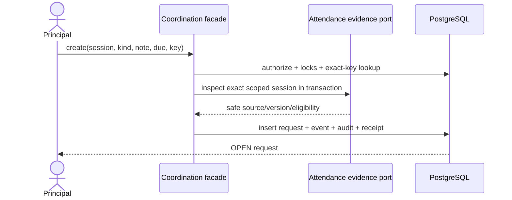
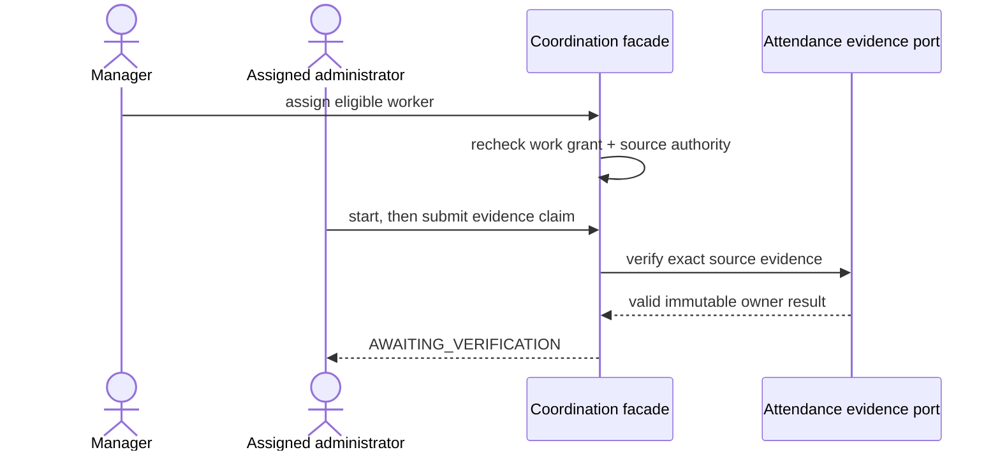
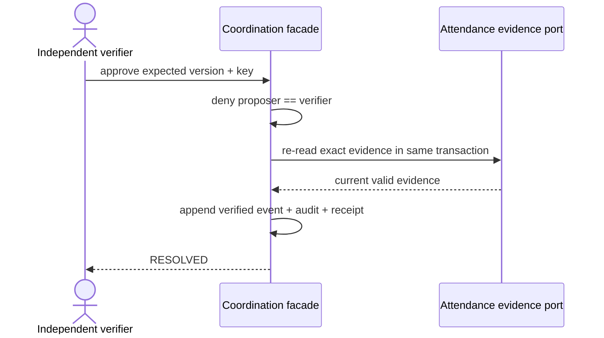

# Coordination — low-level design

Status: approved Attendance-scoped first delivery plus LEA-10 bulk follow-up · 17 October 2026.

## Scope and ownership

Coordination owns operational follow-up requests, current assignment, lifecycle, notes, evidence references and immutable history for LEA-09, LEA-10, LEA-11 and LEA-15. Attendance remains the owner of sessions, registers, correction revisions and cancellation. A Coordination command never changes Attendance data. The first release accepts only `ATTENDANCE_SESSION` sources and request kinds `MISSING_REGISTER` and `SESSION_SETUP_REVIEW`; it is not a generic workflow, messaging, safeguarding, disciplinary, assessment or approval engine.

The runtime defaults to disabled. `VSCHOOL_COORDINATION_MODE=synthetic` enables this slice only for fictional local/test data because no approved retention and backup-deletion policy currently covers the operational note bodies. Production and real-client data remain blocked independently of application verification.

## Aggregate, values and invariants

`CoordinationRequest` is the aggregate root. It is scoped by `organizationId` and `schoolId` and references one exact Attendance session UUID. It stores the source version observed at creation, kind, bounded concern, optional current assignee, optional due instant, bounded creator note, lifecycle version and current resolution claim. Source display facts are never copied into Coordination storage.

Lifecycle: `OPEN → IN_PROGRESS → AWAITING_VERIFICATION → RESOLVED`. An authorized verifier may return `AWAITING_VERIFICATION → IN_PROGRESS`. An authorized manager may withdraw `OPEN`, `IN_PROGRESS`, or `AWAITING_VERIFICATION` to terminal `WITHDRAWN`; an authorized manager may reopen `RESOLVED → OPEN` only after fresh source eligibility and active-request uniqueness checks. Reassignment is limited to `OPEN` or `IN_PROGRESS`. The resolution proposer cannot verify the same claim.

At most one active request exists for `(organization_id, school_id, source_type, source_id, kind)`, where active means a state other than `RESOLVED` or `WITHDRAWN`. PostgreSQL enforces this with a partial unique index. Every mutation supplies a positive expected version and an idempotency key. Exact actor/command/key and identical normalized input returns the prior semantic result after current authorization; a changed payload returns `IDEMPOTENCY_CONFLICT`. A stale version returns `STALE_VERSION` without losing browser input.

Request notes, transition reasons and explanation-only resolution reasons are NFC-normalized plain text of at most 1,000 characters with control characters rejected. Files, markup and arbitrary evidence URLs are not accepted. Due input is optional branch-local `YYYY-MM-DDTHH:mm`; it is resolved through the branch timezone and rejected if nonexistent or ambiguous. Overdue is derived from the stored instant and current server time and never changes lifecycle state automatically.

## Authority

Capabilities are independent operator-designated branch grants:

| Capability | Permitted operation |
|---|---|
| `coordination.create` | Create an eligible Attendance request and read managed requests |
| `coordination.assign` | Assign/reassign an eligible worker and change the optional due time |
| `coordination.work` | Read currently assigned work, start it and submit a resolution claim |
| `coordination.verify` | Verify or return another account's proposed resolution |
| `coordination.manage` | Withdraw/reopen and read managed requests |

No fixed role receives these capabilities automatically. The existing verified operator boundary provisions/revokes the grants. Every protected operation rechecks current account/token, active Organization/School/membership, exact grant, Attendance release/entitlement/activation/dependencies and source scope. Managers also need an existing Attendance read capability appropriate to their role. Assignment requires an active branch membership, `coordination.work`, and current source-module authority: a missing-register assignee needs school Attendance read; a setup-review assignee needs the existing Attendance lifecycle capability applicable to the current session state. Assignment grants no Attendance access. Revocation or reassignment immediately removes assignment-derived Coordination visibility.

Currently authorized request managers may read all requests in their branch; an eligible current assignee may read only their assigned requests. Parent and Student projections do not exist. Direct IDs, cursor values, evidence references and branch identifiers are candidates only and are always re-scoped on the server.

## Attendance evidence port

Coordination depends on a narrow `AttendanceCoordinationEvidencePort`, implemented inside Attendance infrastructure. It inspects an exact scoped session and verifies evidence inside the caller's database transaction; Coordination never imports an Attendance repository or writes Attendance tables.

- `ATTENDANCE_CORRECTION` must identify an immutable `CORRECTION` revision number belonging to the exact session.
- `ATTENDANCE_CANCELLATION` must identify an immutable `CANCEL` revision number for the exact session and current cancelled result.
- A `SESSION_SETUP_REVIEW` already assigned and started while the source was eligible remains workable after an authorized Attendance cancellation so the assignee can submit that exact `CANCEL` revision. Creating a new review for an already-cancelled source remains blocked. `MISSING_REGISTER` work never remains eligible after cancellation.
- `NO_CHANGE_NEEDED` carries no external receipt and requires a bounded operational reason plus independent verifier acceptance.

Failed or foreign evidence throws before the Coordination transition, so no partial status/history/receipt is committed. `RESOLVED` means the follow-up was independently verified; it does not assert an Attendance change unless the checked owner evidence proves one.

## Persistence

All physical names use the Coordination owner prefix and snake_case columns.

| Physical table (Prisma model) | Physical columns | Responsibility | Constraints and indexes |
|---|---|---|---|
| `vs_coordination_capability_grant` (CoordinationCapabilityGrant) | id/org/school/membership/account uuid; capability; operator/grant/revoke timestamps; version | Operator-designated branch capability for the Attendance-scoped Coordination owner. | Scoped membership FK; capability/version checks; unique account/capability; active lookup index |
| `vs_coordination_request` (CoordinationRequest) | id/org/school/source/actor/assignee uuid; kind/concern/status; due/note/resolution; timestamps/version | Attendance-scoped operational follow-up aggregate with current assignment and verified outcome. | Scoped School/Attendance FKs; state/text/evidence/version checks; partial unique active source/kind; queue/assignee indexes |
| `vs_coordination_request_event` (CoordinationRequestEvent) | id/org/school/request/actor/assignee uuid; number/event/states/reason/evidence/timestamp | Immutable authorized request assignment and lifecycle history. | Scoped request FK; unique request/number; text/evidence checks; immutable update/delete trigger |
| `vs_coordination_command_receipt` (CoordinationCommandReceipt) | id/org/school/actor/request uuid; command/key/hash/result/timestamp | Exact-key replay and unknown-outcome recovery for Coordination mutations. | Scoped request FK; unique actor/command/key; request lookup index; safe bounded result contract |

### `vs_coordination_capability_grant`

`id`, `organization_id`, `school_id`, `membership_id`, `account_id`, `capability`, `granted_by_operator_id`, `granted_at`, nullable `revoked_at`, `version`. Unique scope/account/capability; active lookup index. Capability CHECK limits the five values above. Scoped membership/account foreign keys prevent cross-branch grants.

### `vs_coordination_request`

`id`, scope, `kind`, `source_type`, `source_id`, `source_version`, `concern`, `status`, creator/current-assignee IDs, optional `due_at`, optional `note`, optional resolution proposer/kind/revision/reason, lifecycle timestamps, `version`. Scoped unique ID; partial active-source-kind unique index; branch/status/update and assignee/status/update indexes. CHECK constraints enforce known kinds/states/evidence types, positive versions, text bounds, required/paired resolution fields and terminal timestamps.

### `vs_coordination_request_event`

Immutable event rows: `id`, scope, request, sequential `number`, `event_type`, optional from/to states, actor, optional previous/new assignee, optional reason, optional evidence kind/revision, `occurred_at`. Unique request/number and chronological list index. A trigger rejects update/delete. Notes and reasons live only in this authorized domain history, never in the general audit payload.

### `vs_coordination_command_receipt`

`id`, scope, actor, `command`, `idempotency_key`, `input_hash`, request, bounded JSON `result`, `occurred_at`. Unique scope/actor/command/key and request lookup index. Result contains identifiers, version/status/timestamps and replay marker only; it contains no notes or protected Attendance content.

All four tables are `BRANCH` classified with `organization_id, school_id`. Application authorization remains mandatory. Their migration records the TEN-ADR-006 Path A exception; TEN-03 remains the RLS closure gate and blocks production release.

## LEA-10 bounded bulk follow-up

LEA-10 composes the proven single-request command. A Principal explicitly selects 1–50 currently visible Attendance sources. The reviewed payload contains ordered unique source IDs, request kind, concern, optional common assignee and due time, optional operational note, and an assignment reason when assigned. Filter or branch changes clear browser selection with an explanation; there is no implicit all-results operation. The server validates the whole selection again.

The batch lifecycle is `PROCESSING → COMPLETED|PARTIAL`. Items start `PENDING` and finish once as `CREATED`, `ALREADY_EXISTS`, or `FAILED`. `CREATED` points to the request created by the existing command. `ALREADY_EXISTS` points to the unchanged active request only when current manager authority permits reading it. `FAILED` stores only an allowlisted code and safe explanation. Unauthorized or foreign sources use `SOURCE_UNAVAILABLE`; no source label, Student information, or foreign-scope metadata is retained in the result.

The same actor, branch and batch key with the same normalized payload resumes the original batch. A changed payload returns `IDEMPOTENCY_CONFLICT`. Each item receives a stable derived single-command key based on the batch ID and ordinal. Processing is bounded and sequential. Each existing create command commits independently; a separate short transaction then records the item outcome. If the process stops after request commit but before item recording, recovery replays the same derived key and records the original result without a second request. Terminal failed items do not run again and require a new explicitly reviewed batch. Current authority is checked before every item and again before results are disclosed.

| Physical table (Prisma model) | Physical columns | Responsibility | Constraints and indexes |
|---|---|---|---|
| `vs_coordination_batch` (CoordinationBatch) | id/org/school/actor uuid; key/hash; normalized payload; state/count/timestamps/version | Durable reviewed batch intent and recovery root. | Scoped School/actor FKs; unique actor/key; item-count/state/version checks; scoped status index |
| `vs_coordination_batch_item` (CoordinationBatchItem) | id/org/school/batch/source/request uuid; ordinal/status/error/timestamps | Explicit selected source candidate and terminal per-item result. | Scoped batch/request FKs; source is an untrusted candidate reauthorized per item; unique batch ordinal/source; status/error pairing; batch/status index |

Both tables are `BRANCH` classified under TEN-ADR-006 Path A. Application authorization remains mandatory and TEN-03 is their production closure gate. The normalized payload may contain restricted operational text, so the existing synthetic-only retention restriction applies.

### Interfaces, transactions and privacy

`previewBatch(actor, scope, {sourceIds, kind})` returns only reauthorized Attendance summaries, their safe eligibility disposition and currently eligible assignees. `submitBatch(actor, scope, input)` creates or resumes the durable batch and returns totals plus authorized per-item outcomes. `getBatch(actor, scope, batchId)` reauthorizes the actor before returning its reviewed input and results. Hosting uses thin routes under `/api/v1/coordination/batches`; body/header batch-key equality is required.

Batch initialization is one short serializable transaction. Every item calls the existing serializable create command and records its item outcome in another short transaction. No transaction spans the full batch. An invalid common assignee fails that item and never creates an unassigned request. Existing active requests remain unchanged.

General audit contains batch/request/source identifiers, counts, statuses and safe codes only. It never receives note or reason bodies. Batch reads, retries and replay recheck live account, branch, module and Coordination capability. Revocation denies the whole protected receipt rather than returning results committed before revocation.

### Submission and interrupted recovery

```mermaid
sequenceDiagram
  actor P as Principal
  participant B as Coordination batch
  participant S as Existing single create command
  participant DB as PostgreSQL
  P->>B: reviewed payload + batch key
  B->>DB: authorize; create/load batch and PENDING items
  loop bounded sequential items
    B->>S: source payload + stable derived key
    S->>DB: authorize, recheck source/assignee, commit request+receipt
    B->>DB: record CREATED/ALREADY_EXISTS/FAILED
  end
  B->>DB: reauthorize and summarize
  B-->>P: honest partial or completed receipt
```

```mermaid
sequenceDiagram
  actor P as Principal
  participant B as Coordination batch
  participant S as Existing single create command
  P->>B: same normalized payload + same batch key
  B->>B: reject changed hash; load original PENDING items
  B->>S: replay stable item key
  S-->>B: original committed result or current guarded outcome
  B-->>P: recovered receipt; successful items are not recreated
```

## Transactions, locking and audit

Writes run `SERIALIZABLE` with the established account UPDATE → Organization SHARE → School UPDATE lock order, then lock the Coordination request where applicable. Create rechecks the Attendance source inside that transaction; the partial unique index resolves concurrent creation. Assignment locks the request and rechecks the target membership, grant and current source state. Evidence submission and verification lock the request; verification calls the Attendance port before changing state. Each successful mutation atomically updates the root, appends one immutable event, appends a minimal Platform audit entry and stores one command receipt. Audit `before`/`after` contain identifiers, versions, states, capability/evidence kind and source ID only—never note or reason bodies. No delivery outbox event is emitted because this slice has no approved notification/provider behavior.

## Queries and API contracts

The browser-safe contract exposes request ID/version/kind/status, safe Attendance summary, creator/assignee display names, due/overdue state, note and authorized lifecycle history. Lists are ordered by `(updated_at DESC, id DESC)`, default 25/max 50, with a query-bound opaque cursor and filters for state/kind/assignment. Eligible assignees return only active branch members satisfying work and source-authority checks; no general person/account search is exposed. The single-request composition may create and initially assign in one guarded transaction when the actor holds both `coordination.create` and `coordination.assign`; it appends distinct CREATED and ASSIGNED events and returns version 2. A failed eligibility recheck creates neither event nor request.

Hosting routes are thin same-origin wrappers under `/api/v1/coordination`. Bodies are limited to 16 KiB, require exact allowed properties and require header/body idempotency-key equality for mutations. Error mapping preserves `FORBIDDEN`, `NOT_FOUND`, `CONFLICT`, `STALE_VERSION`, `IDEMPOTENCY_CONFLICT`, `VALIDATION`, module availability and safe retryable `UNAVAILABLE` states.

## Sequences







## Failure and verification contract

Required real-PostgreSQL evidence covers foreign scope/forged IDs, every capability denial, assignment without Attendance authority, reassignment visibility removal, revocation, concurrent active uniqueness, stale versions, exact replay, evidence from another session/branch, self-verification denial, withdrawn immutability, audit redaction and evidence-validation rollback. Browser evidence covers empty/populated queues, no eligible assignee, validation, stale/duplicate/revoked/source-unavailable states and the complete create → assign → start → submit → return/verify → reopen journey at 1440×1000 and 390×844. Font portability, native accessibility, human acceptance, TEN-03 and production retention remain separate gates.
