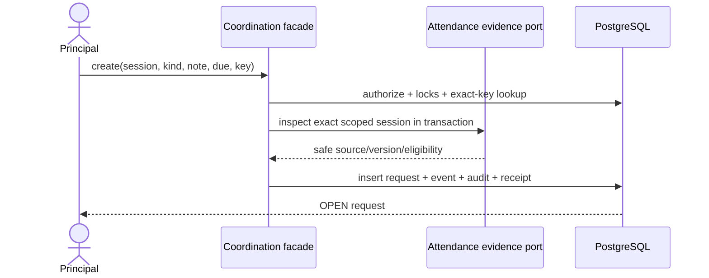
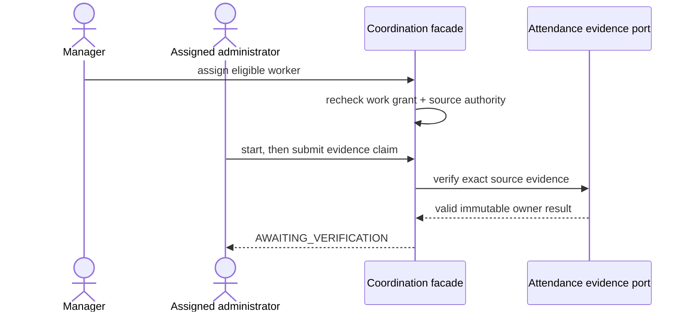
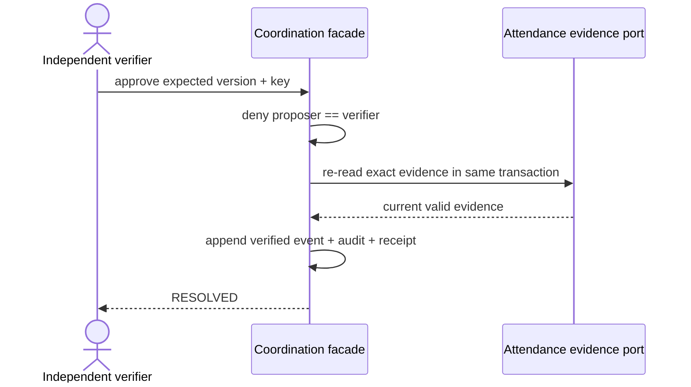

# Coordination — low-level design

Status: approved typed Attendance/Learning delivery, LEA-10 bulk follow-up, F03 typed decision adapter, F04 typed-source extension and F08-B Learning follow-up · 17 October 2026.

## F04 typed source and assignee-policy registry

Approved synthetic-only D04 extends Coordination only through explicitly registered owner adapters. `CoordinationSourceAdapter` is a narrow owner contract: a literal `sourceType`, an allowlist of supported Coordination request kinds, scoped source inspection, owner evidence verification and a current-assignee eligibility predicate. The registry rejects duplicate registrations, unknown source types and unsupported source/kind pairs before an owner query. It never accepts a browser-provided module name or arbitrary repository handle.

The active registrations are Attendance `ATTENDANCE_SESSION` with `MISSING_REGISTER`/`SESSION_SETUP_REVIEW`, Attendance `ATTENDANCE_PUPIL_PATTERN` with `PUPIL_ATTENDANCE_SUPPORT`, synthetic-only Learning `LEARNING_RECIPIENT` with `LEARNING_SUPPORT_REVIEW`, and Learning `LEARNING_FEEDBACK_SUBMISSION` with `LEARNING_FEEDBACK_FOLLOW_UP`. Each owner adapter performs its module, source-read, evidence and source-specific assignee checks. Coordination separately requires active branch membership and current `coordination.work` before invoking the owner predicate. Coordination therefore contains no Attendance- or Learning-table authorization policy.

Every new source requires its owner contract, application registration, shared DTO change, forward CHECK/FK/index migration and focused owner tests; registration alone cannot make a source valid. `ATTENDANCE_PUPIL_PATTERN` uses the immutable scoped Attendance snapshot ID as source identity and copies no pupil facts into Coordination storage. Creation and every protected replay reauthorize the actor's named-pupil grant; an assignee must independently hold the same current grant plus `coordination.work`. Only `NO_CHANGE_NEEDED` is a valid resolution claim because Coordination receives no Attendance mark/correction authority.

## F08-B — typed Learning evidence and academic follow-up

Approved D10/D04 adds exactly one second registered source: `LEARNING_RECIPIENT` with request kind `LEARNING_SUPPORT_REVIEW`. Its source key is the scoped immutable `vs_learning_assignment_recipient.id`; source version is the published `LearningAssignmentVersion.version_no`. The owner projection contains assignment title, class, subject, learner display name, effective deadline, effective status and current policy event number. It never contains response text, feedback, policy reason, diagnosis, inferred risk or family contact data. A caller must hold a live exact `RECIPIENT_STATUS_READ` grant for the source section/subject. Aggregate `learning.read_leadership` alone cannot open the named source.

Creation uses the existing Coordination aggregate with concern `LEARNING_PROGRESS`. A factual bounded note, explicit branch-local review time, eligible assignee and assignment reason are required. Eligibility requires active branch membership, `coordination.work`, and both exact current Learning grants `RECIPIENT_STATUS_READ` and `RECIPIENT_POLICY_MANAGE` for the source class/subject. Assignment grants no Learning access. Work follows the existing `OPEN -> IN_PROGRESS -> AWAITING_VERIFICATION -> RESOLVED` lifecycle; the proposer cannot independently verify.

The only Learning owner evidence is `LEARNING_POLICY_EVENT`, carrying the immutable positive `event_no` for the exact recipient. The adapter verifies it is still the latest policy event before submission and again before independent closure. `NO_CHANGE_NEEDED` remains permitted with no revision and a bounded factual resolution reason. A later policy event makes the earlier proposed evidence stale and closure fails without changing Coordination. Learning remains the only writer of recipient policy.

The existing Attendance-only source foreign key cannot represent this typed union. Forward migration `20261017170000_coordination_learning_source` replaces it with a fail-closed deferred trigger that checks the scoped source against `vs_attendance_session` or `vs_learning_assignment_recipient` according to `source_type`, and extends the exact value allowlists. Follow-up migration `20261017171000_coordination_source_pair_checks` adds fail-closed source/kind, kind/concern and source/evidence pairing constraints without editing the applied migration. The existing scoped active-source unique index continues to prevent duplicate active requests. No new table is introduced. Application authorization remains mandatory and TEN-03 remains the production gate.

The production entry is contextual from `/leadership/learning/evidence`; `/leadership/learning/concerns/new` stages details, review and receipt. Generic Coordination manager/worker detail pages render the discriminated source and link back to the authorized Learning evidence. Verification requires real PostgreSQL source integrity, exact grants, cross-scope and revoked access, assignee eligibility, event staleness, replay and independent closure, plus one-worker desktop/mobile source-to-outcome coverage. Synthetic mode remains required pending retained-note production policy.

## F08-C — typed feedback-publication follow-up

Approved LEA-18 uses the exact immutable Learning submission as the second Learning source. `LEARNING_FEEDBACK_SUBMISSION` supports only `LEARNING_FEEDBACK_FOLLOW_UP` with concern `FEEDBACK_AWAITING`. It exposes assignment/class/subject, accepted time and `AWAITING`/`PUBLISHED` state without learner, Teacher, response, draft or feedback content. New requests require the source still be awaiting its first publication.

The eligible worker must hold active branch membership, `coordination.work` and the exact class/subject Learning `FEEDBACK_FOLLOW_UP` designation. Principal inspection and independent verification use current `learning.read_leadership`; neither authority grants feedback authoring. Closure accepts the earliest immutable `LEARNING_FEEDBACK_PUBLICATION` version for the exact submission, or independently verified `NO_CHANGE_NEEDED`. Private drafts never satisfy evidence, and later publication versions never reset it. The existing Coordination transaction, version, idempotency, replay, separation and history rules remain unchanged.

Forward migration `20261017172000_coordination_learning_feedback_source` extends exact capability/source/kind/concern/evidence checks and the deferred source-integrity trigger. It does not add a table or edit prior migrations. The existing partial active-source unique index prevents duplicate open follow-ups for the same submission. Synthetic-only and retained-note/TEN-03 production gates remain.

## F04 bounded Coordination handover

The F04 owner slice transfers only Coordination requests already visible in one authorized branch. It does not grant or revoke Access authority and therefore does not complete LEA-26, whose Access counterpart remains F02. Input is an explicit ordered selection of 1–50 unique `{requestId, expectedVersion}` items, the exact outgoing assignee, one currently eligible successor, a required normalized reason (1–1,000 characters) and a 16–100 character command key. Transfer takes effect at the server commit time; scheduled delegation, confidential source access and source-owner decisions are outside this command.

The application first creates one durable handover intent keyed by organization, school, actor and key. The canonical hash binds the full ordered payload. Reuse with the same payload resumes or returns the same safe result after fresh `coordination.assign` authorization; changed payload conflicts. Every item then runs independently under the established Coordination lock order and a serializable request-row lock. It must still be OPEN or IN_PROGRESS, have the supplied version, be assigned to the exact outgoing account, and accept the successor through the registered source adapter plus active membership and `coordination.work` designation. A successful item increments the request version and appends a normal `REASSIGNED` event with previous/current assignee and the reviewed reason. Failed items retain a safe terminal code; unrelated successes are never rolled back or recreated on retry. A committed request whose item outcome was not stored is recovered from its stable item command receipt.

`vs_coordination_handover` is the durable intent/receipt root: branch scope, actor, outgoing/successor account, key/hash, normalized payload, PROCESSING/COMPLETED/PARTIAL state, 1–50 count, timestamps and positive version. `vs_coordination_handover_item` owns ordinal, request candidate, expected version, PENDING/TRANSFERRED/FAILED status, result version, safe error and completion time. Both are BRANCH-class, Path-A tables pending TEN-03; all reads and writes continue to perform live application authorization. Scoped foreign keys retain school, request and handover ownership. No note, source content, token or protected receipt is stored in the batch outcome.

| Physical table (Prisma model) | Physical columns | Responsibility | Constraints and indexes |
|---|---|---|---|
| `vs_coordination_handover` (CoordinationHandover) | id/org/school/actor/from/to uuid; key/hash/payload; state/count/timestamps/version | Durable reviewed handover intent and recoverable receipt root. | Scoped School and account FKs; distinct outgoing/successor; unique actor/key; item-count/state/version checks; scoped state index |
| `vs_coordination_handover_item` (CoordinationHandoverItem) | id/org/school/handover/request uuid; ordinal/expected_version/status/result_version/error/timestamps | Explicit request candidate and independent terminal transfer outcome. | Scoped handover/request FKs; positive version and ordinal; unique handover ordinal/request; status/result pairing; batch/status index |

The Principal route `/leadership/handover` lists only open assigned requests the current actor can manage, allows one outgoing owner and eligible successor, reviews explicit items and consequences, and confirms once. The receipt reports transferred and failed items independently and links only to Coordination requests still authorized at render time. Unknown outcome keeps the exact key/payload for status recovery. Revocation blocks both resume and receipt disclosure. In-flow edits are memory-only; no durable draft exists.

## F04 safe Coordination history projection

`coordination.history` is a separate trusted-operator designation. It grants only the safe Coordination event projection and is not included in request-manager capabilities. It does not permit request content, notes, evidence narrative, source contents, commands or mutation. Every query rechecks the active account/token, Organization, School, branch membership and exact current grant. Revocation denies the next query. Opening a linked request or owner source uses that route's own current authorization; a safe historical reference never becomes source authority.

The query accepts one allowlisted attribute: exact Coordination request UUID, exact eligible organization account UUID, or date. Every query also requires inclusive branch-local `fromDate` and `toDate`, each `YYYY-MM-DD`, with a valid non-reversed span of at most 90 calendar days. Actor search first resolves the account through a retained organization Person binding, School membership or institution grant; an unknown or foreign candidate returns a safe empty result. This permits attribution searches after access is revoked without granting the historical actor any current access. Date conversion uses the branch timezone and an exclusive next-day upper bound. Results order by `occurred_at DESC, number DESC, id DESC`, use an opaque cursor containing only that safe position, and allow 1–50 rows.

Each row contains request ID, immutable event number/type, safe from/to states, historical actor display reference, optional previous/current assignee display references and occurrence timestamp. It explicitly omits reason, note, evidence kind/revision, command key/hash/result, Attendance session identity and all source content. Historical attribution remains when an account is inactive because names resolve from the retained verified organization binding. No new persistence is required; the read uses `vs_coordination_request_event` with the existing scope/request/time index. A forward migration extends only the capability CHECK to `coordination.history`; migration history is otherwise unchanged.

## WF-42 separate review finding

D04's optional write is a Coordination-owned immutable record, never another request event and never a source-owner mutation. The trusted operator separately designates `coordination.history.finding`; recording requires both that capability and `coordination.history` on the current branch. Input binds one exact visible request and existing event number, `FINDING` or `ESCALATION`, normalized 1–1,000-character synthetic operational text and a stable key. The server locks and rechecks the scoped request/event at commit. Retry uses the same actor/command/key and exact payload hash; changed input conflicts. Revocation denies protected replay. The general safe-history projection never discloses finding text to an actor without the separate finding designation.

`vs_coordination_history_finding` is append-only: scoped request/event and actor foreign keys, positive event number, allowlisted kind, bounded text and request/time index. An update/delete trigger preserves the record. The existing command receipt stores only its safe result; Platform audit stores IDs/kind/event number and excludes finding text. The write does not change request version, status, assignment, evidence, owner source or earlier events. Path-A application authorization remains active and TEN-03 is the enforcement gate. Real-data use remains blocked by D04 operational-note retention/backup-deletion and designation policy.

| Physical table (Prisma model) | Physical columns | Responsibility | Constraints and indexes |
|---|---|---|---|
| `vs_coordination_history_finding` (CoordinationHistoryFinding) | id/org/school/request/actor uuid; event_number; kind/text; occurred_at | Immutable synthetic-only finding or escalation about one exact safe event. | Scoped request and exact request-event FKs; actor FK; positive event; kind/text checks; immutable update/delete trigger; scoped request/time index |

## F03 typed decision-owner adapter

Approved decision D03 does not create a universal approval aggregate. Leadership owns only a transport-neutral inbox facade and an explicit registry of typed owner adapters. The first registered adapter is `COORDINATION_VERIFICATION`; it projects Coordination requests in `AWAITING_VERIFICATION` only when the current actor has `coordination.verify`, is not the resolution proposer and still passes the registered source evidence guard. Its owner-defined actions are `VERIFY`, `RETURN` and the WF-28 information request described below. Unsupported owner actions, including recusal, remain absent rather than rendered as disabled generic controls.

The adapter maps `list`, `detail`, `decide` and protected replay onto the existing Coordination facade. `VERIFY` calls the existing atomic `CoordinationResolutionVerified` command; `RETURN` calls `CoordinationResolutionReturned` and requires a bounded reason. The owner transaction retains its lock order, expected version, independent-proposer check, Attendance evidence verification, immutable event, redacted audit and actor/command/key receipt. Leadership never writes a Coordination or Attendance table. Exact-payload retry reuses the owner receipt only after current account, branch, capability and source authorization; revoked authority denies the prior result.

`decisionStatus` is the Coordination-owned LEA-31 recovery read. It accepts the same normalized action, request, expected version, reason and key as the original command. Inside a primary-database transaction it rechecks the live Coordination verification grant, proposer separation and registered source access, reconstructs the owner command name and exact input hash, and then reads `vs_coordination_command_receipt`. A matching receipt returns `FOUND`; no receipt with the unchanged awaiting version returns `UNKNOWN`; no receipt after owner version/state change returns `CHANGED`. It writes nothing, never treats absence as failure and never exposes a receipt after revocation. Leadership receives only this owner result through its typed adapter.

The browser-safe projection exposes the typed owner code, opaque owner item ID, version, due/submitted timestamps, safe Attendance source summary, permitted resolution claim and owner-defined actions. Lists order by owner `updated_at DESC, id DESC` and preserve the existing query-bound cursor and 25/default, 50/max bounds. The initial route `/leadership/decisions` is a production recipe-L inbox and `/leadership/decisions/COORDINATION_VERIFICATION/:id` is recipe D/W. The existing `/leadership/coordination` management and worker routes remain authoritative for create, assignment and work; the decision inbox grants none of those actions.

No schema or migration is required for F03. It reuses `vs_coordination_request`, `vs_coordination_request_event`, `vs_coordination_command_receipt` and the existing scoped indexes. These tables remain branch-classified under TEN-ADR-006 Path A; application authorization is mandatory and TEN-03 remains the production gate. Focused verification must cover typed-owner rejection, proposer exclusion, independent verify/return, stale expected version, exact retry after a lost response, changed-payload conflict, and protected receipt denial after capability revocation.

## WF-28 / LEA-28 owner information request

Coordination owns the first concrete D03/D08 information-request implementation. An authorized independent reviewer may ask one NFC-normalized actionable question of at most 1,000 characters while a request is `AWAITING_VERIFICATION`. The optional response expectation is an instant strictly after the server clock; it is guidance rather than a statutory deadline. The recipient is resolved on the server as the current resolution proposer and must still be an eligible `coordination.work` assignee for the exact registered source. The browser cannot select another contact, broaden source access or turn the question into a decision.

`requestInformation` rechecks `coordination.verify`, proposer separation, source-read authority, current owner version and recipient eligibility inside the existing serialized Coordination lock order. It creates one `OPEN` child, increments the parent request version, appends a safe `INFORMATION_REQUESTED` event and writes the owner receipt/audit atomically. While the child is open, the typed decision projection exposes no verify/return action. `respondInformation` rechecks the current recipient identity, `coordination.work`, owner state/version, source eligibility and child version; it stores one bounded answer, marks the child `ANSWERED`, increments both child and parent versions and appends `INFORMATION_RESPONDED`. That evidence-version change requires the reviewer to load and confirm a fresh decision.

Resolving, returning, withdrawing or otherwise leaving the active verification transition cancels any unanswered child in the same owner transaction. A stale response cannot overwrite an answered, cancelled or decided item. Revocation or lost eligibility denies the counterpart action. Both request and response use the existing owner command receipts: exact actor/command/key plus identical normalized input returns the original safe result only after current authorization; a changed payload conflicts. The browser retains the original key after an unknown response and offers exact retry rather than assuming failure. General audit and safe history contain IDs/state only and exclude question and answer text.

### LEA-30 decision recusal

Coordination owns recusal for its verification decision. `verification_reviewer_account_id` is nullable on the request: null means any non-recused, independently eligible verifier may review; a value makes that already-authorized account the exclusive current reviewer. `vs_coordination_decision_recusal` is immutable owner evidence keyed by branch/request/recused account and records the routed reviewer, allowlisted category, protected optional note, resulting request version and time. It does not grant capability. Owner list/detail, verify, return, information request and status recovery all deny a recused account and enforce the current routed reviewer before source disclosure.

`recuseDecision` locks in the existing account → organization → school → request order, rechecks the actor and selected reviewer's account, branch membership, explicit `coordination.verify`, source access and proposer separation, then writes recusal, request version/reviewer, safe event, audit and owner receipt atomically. The optional note remains only in the recusal row and is excluded from general history/audit/receipts. With no eligible reviewer, the request remains `AWAITING_VERIFICATION` with a null reviewer and the recused actor loses access. Only a current active `INSTITUTION_ADMIN` may route that unassigned decision, and routing rechecks recipient eligibility and expected version without disclosing the protected body. Concurrent recusal/decision/routing has one row-lock winner; stale attempts reload.

| Physical table (Prisma model) | Physical columns | Responsibility | Constraints and indexes |
|---|---|---|---|
| `vs_coordination_information_request` (CoordinationInformationRequest) | id/org/school/request/requester/recipient uuid; question/response; response_due_at/status/timestamps/version | One owner-scoped question to the current authorized proposer and its versioned response. | Scoped request FK; account FKs; state/text/version checks; one OPEN child per request; request/status/time and recipient/status/due indexes |
| `vs_coordination_decision_recusal` (CoordinationDecisionRecusal) | id/org/school/request/recused/routed uuid; category/note/request_version/occurred_at | Immutable owner-specific conflict and independent route evidence; note is protected. | Scoped request/account FKs; category/note/version checks; one recusal per request/account; route and actor indexes; immutable trigger |

This branch-classified table is introduced by forward migration `20261018103000_coordination_information_requests`. Application authorization remains active under TEN-ADR-006 Path A; TEN-03 is the RLS closure gate. The production route remains synthetic-only with the rest of Coordination until its retention/backup-deletion policy is approved.

## Scope and ownership

Coordination owns operational follow-up requests, current assignment, lifecycle, notes, evidence references and immutable history for LEA-09, LEA-10, LEA-11, LEA-15 and LEA-19. Attendance remains the owner of sessions, registers, correction revisions and cancellation; Learning remains the owner of assignment recipients and policy events. A Coordination command never changes either owner table. Only explicitly registered Attendance and Learning pairs are accepted; Coordination is not a generic workflow, messaging, safeguarding, disciplinary, assessment or approval engine.

The runtime defaults to disabled. `VSCHOOL_COORDINATION_MODE=synthetic` enables this slice only for fictional local/test data because no approved retention and backup-deletion policy currently covers the operational note bodies. Production and real-client data remain blocked independently of application verification.

## Aggregate, values and invariants

`CoordinationRequest` is the aggregate root. It is scoped by `organizationId` and `schoolId` and references one exact registered owner-source UUID plus its literal source type. It stores the source version observed at creation, kind, bounded concern, optional current assignee, optional due instant, bounded creator note, lifecycle version and current resolution claim. Source display facts are never copied into Coordination storage.

Lifecycle: `OPEN → IN_PROGRESS → AWAITING_VERIFICATION → RESOLVED`. An authorized verifier may return `AWAITING_VERIFICATION → IN_PROGRESS`. An authorized manager may withdraw `OPEN`, `IN_PROGRESS`, or `AWAITING_VERIFICATION` to terminal `WITHDRAWN`; an authorized manager may reopen `RESOLVED → OPEN` only after fresh source eligibility and active-request uniqueness checks. Reassignment is limited to `OPEN` or `IN_PROGRESS`. The resolution proposer cannot verify the same claim.

At most one active request exists for `(organization_id, school_id, source_type, source_id, kind)`, where active means a state other than `RESOLVED` or `WITHDRAWN`. PostgreSQL enforces this with a partial unique index. Every mutation supplies a positive expected version and an idempotency key. Exact actor/command/key and identical normalized input returns the prior semantic result after current authorization; a changed payload returns `IDEMPOTENCY_CONFLICT`. A stale version returns `STALE_VERSION` without losing browser input.

Request notes, transition reasons and explanation-only resolution reasons are NFC-normalized plain text of at most 1,000 characters with control characters rejected. Files, markup and arbitrary evidence URLs are not accepted. Due input is optional branch-local `YYYY-MM-DDTHH:mm`; it is resolved through the branch timezone and rejected if nonexistent or ambiguous. Overdue is derived from the stored instant and current server time and never changes lifecycle state automatically.

## Authority

Capabilities are independent operator-designated branch grants:

| Capability | Permitted operation |
|---|---|
| `coordination.create` | Create an eligible registered-source request and read managed requests |
| `coordination.assign` | Assign/reassign an eligible worker and change the optional due time |
| `coordination.work` | Read currently assigned work, start it and submit a resolution claim |
| `coordination.verify` | Verify or return another account's proposed resolution |
| `coordination.manage` | Withdraw/reopen and read managed requests |
| `coordination.history` | Search the bounded safe event projection only |

No fixed role receives these capabilities automatically. The existing verified operator boundary provisions/revokes the grants. Every protected operation rechecks current account/token, active Organization/School/membership, exact grant, registered owner release/entitlement/activation/dependencies and source scope. Managers also need the owner-specific read authority defined by the adapter. Assignment requires active branch membership, `coordination.work`, and current source-module authority: Attendance keeps its session predicates; Learning requires both exact recipient status-read and policy-manager grants for the source section/subject. Assignment grants no owner-module access. Revocation or reassignment immediately removes assignment-derived Coordination visibility.

Currently authorized request managers may read all requests in their branch; an eligible current assignee may read only their assigned requests. `coordination.history` is not a request-manager grant. Parent and Student projections do not exist. Direct IDs, cursor values, evidence references and branch identifiers are candidates only and are always re-scoped on the server.

## Owner evidence adapters

Coordination depends on the narrow registered `CoordinationSourceAdapter`, implemented inside each owner infrastructure. An adapter inspects one exact scoped source, verifies evidence and evaluates assignee eligibility inside the caller's database transaction. Coordination never imports an owner repository or writes an Attendance or Learning table.

- `ATTENDANCE_CORRECTION` must identify an immutable `CORRECTION` revision number belonging to the exact session.
- `ATTENDANCE_CANCELLATION` must identify an immutable `CANCEL` revision number for the exact session and current cancelled result.
- A `SESSION_SETUP_REVIEW` already assigned and started while the source was eligible remains workable after an authorized Attendance cancellation so the assignee can submit that exact `CANCEL` revision. Creating a new review for an already-cancelled source remains blocked. `MISSING_REGISTER` work never remains eligible after cancellation.
- `NO_CHANGE_NEEDED` carries no external receipt and requires a bounded operational reason plus independent verifier acceptance.
- `LEARNING_POLICY_EVENT` must be the latest immutable positive recipient policy event for the exact Learning source; a later event makes the claim stale.

Failed or foreign evidence throws before the Coordination transition, so no partial status/history/receipt is committed. `RESOLVED` means the follow-up was independently verified; it does not assert an Attendance change unless the checked owner evidence proves one.

## Persistence

All physical names use the Coordination owner prefix and snake_case columns.

| Physical table (Prisma model) | Physical columns | Responsibility | Constraints and indexes |
|---|---|---|---|
| `vs_coordination_capability_grant` (CoordinationCapabilityGrant) | id/org/school/membership/account uuid; capability; operator/grant/revoke timestamps; version | Operator-designated branch capability for the typed-source Coordination owner. | Scoped membership FK; capability/version checks; unique account/capability; active lookup index |
| `vs_coordination_request` (CoordinationRequest) | id/org/school/source/actor/assignee/verification_reviewer uuid; kind/concern/status; due/note/resolution; timestamps/version | Typed Attendance or Learning operational follow-up aggregate with current assignment and verified owner outcome. | Scoped School and optional verification-reviewer FKs plus deferred typed source-integrity trigger; exact source/kind/concern/evidence pairing; state/text/version checks; partial unique active source/kind; queue/assignee/reviewer indexes |
| `vs_coordination_information_request` (CoordinationInformationRequest) | id/org/school/request/requester/recipient uuid; question/response; due/status/timestamps/version | One owner-scoped question to the current eligible resolution proposer and its bounded answer. | Scoped request/account FKs; state/text/version checks; one OPEN child per request; scoped request and recipient indexes |
| `vs_coordination_request_event` (CoordinationRequestEvent) | id/org/school/request/actor/assignee uuid; number/event/states/reason/evidence/timestamp | Immutable authorized request assignment and lifecycle history. | Scoped request FK; unique request/number; text/evidence checks; immutable update/delete trigger |
| `vs_coordination_command_receipt` (CoordinationCommandReceipt) | id/org/school/actor/request uuid; command/key/hash/result/timestamp | Exact-key replay and unknown-outcome recovery for Coordination mutations. | Scoped request FK; unique actor/command/key; request lookup index; safe bounded result contract |

### `vs_coordination_capability_grant`

`id`, `organization_id`, `school_id`, `membership_id`, `account_id`, `capability`, `granted_by_operator_id`, `granted_at`, nullable `revoked_at`, `version`. Unique scope/account/capability; active lookup index. Capability CHECK limits the six values above. Scoped membership/account foreign keys prevent cross-branch grants.

### `vs_coordination_request`

`id`, scope, `kind`, `source_type`, `source_id`, `source_version`, `concern`, `status`, creator/current-assignee IDs, optional `due_at`, optional `note`, optional resolution proposer/kind/revision/reason, lifecycle timestamps, `version`. Scoped unique ID; partial active-source-kind unique index; branch/status/update and assignee/status/update indexes. CHECK constraints enforce known kinds/states/evidence types, positive versions, text bounds, required/paired resolution fields and terminal timestamps.

### `vs_coordination_request_event`

Immutable event rows: `id`, scope, request, sequential `number`, `event_type`, optional from/to states, actor, optional previous/new assignee, optional reason, optional evidence kind/revision, `occurred_at`. Unique request/number and chronological list index. A trigger rejects update/delete. Notes and reasons live only in this authorized domain history, never in the general audit payload.

### `vs_coordination_command_receipt`

`id`, scope, actor, `command`, `idempotency_key`, `input_hash`, request, bounded JSON `result`, `occurred_at`. Unique scope/actor/command/key and request lookup index. Result contains identifiers, version/status/timestamps and replay marker only; it contains no notes or protected Attendance content.

All four tables are `BRANCH` classified with `organization_id, school_id`. Application authorization remains mandatory. Their migration records the TEN-ADR-006 Path A exception; TEN-03 remains the RLS closure gate and blocks production release.

## LEA-10 bounded bulk follow-up

LEA-10 composes the proven single-request command. A Principal explicitly selects 1–50 currently visible Attendance sources. The reviewed payload contains ordered unique source IDs, request kind, concern, optional common assignee and due time, optional operational note, and an assignment reason when assigned. Filter or branch changes clear browser selection with an explanation; there is no implicit all-results operation. The server validates the whole selection again.

The batch lifecycle is `PROCESSING → COMPLETED|PARTIAL`. Items start `PENDING` and finish once as `CREATED`, `ALREADY_EXISTS`, or `FAILED`. `CREATED` points to the request created by the existing command. `ALREADY_EXISTS` points to the unchanged active request only when current manager authority permits reading it. `FAILED` stores only an allowlisted code and safe explanation. Unauthorized or foreign sources use `SOURCE_UNAVAILABLE`; no source label, Student information, or foreign-scope metadata is retained in the result.

The same actor, branch and batch key with the same normalized payload resumes the original batch. A changed payload returns `IDEMPOTENCY_CONFLICT`. Each item receives a stable derived single-command key based on the batch ID and ordinal. Processing is bounded and sequential. Each existing create command commits independently; a separate short transaction then records the item outcome. If the process stops after request commit but before item recording, recovery replays the same derived key and records the original result without a second request. Terminal failed items do not run again and require a new explicitly reviewed batch. Current authority is checked before every item and again before results are disclosed.

| Physical table (Prisma model) | Physical columns | Responsibility | Constraints and indexes |
|---|---|---|---|
| `vs_coordination_batch` (CoordinationBatch) | id/org/school/actor uuid; key/hash; normalized payload; state/count/timestamps/version | Durable reviewed batch intent and recovery root. | Scoped School/actor FKs; unique actor/key; item-count/state/version checks; scoped status index |
| `vs_coordination_batch_item` (CoordinationBatchItem) | id/org/school/batch/source/request uuid; ordinal/status/error/timestamps | Explicit selected source candidate and terminal per-item result. | Scoped batch/request FKs; source is an untrusted candidate reauthorized per item; unique batch ordinal/source; status/error pairing; batch/status index |

Both tables are `BRANCH` classified under TEN-ADR-006 Path A. Application authorization remains mandatory and TEN-03 is their production closure gate. The normalized payload may contain restricted operational text, so the existing synthetic-only retention restriction applies.

### Interfaces, transactions and privacy

`previewBatch(actor, scope, {sourceIds, kind})` returns only reauthorized Attendance summaries, their safe eligibility disposition and currently eligible assignees. `submitBatch(actor, scope, input)` creates or resumes the durable batch and returns totals plus authorized per-item outcomes. `getBatch(actor, scope, batchId)` reauthorizes the actor before returning its reviewed input and results. Hosting uses thin routes under `/api/v1/coordination/batches`; body/header batch-key equality is required.

Batch initialization is one short serializable transaction. Every item calls the existing serializable create command and records its item outcome in another short transaction. No transaction spans the full batch. An invalid common assignee fails that item and never creates an unassigned request. Existing active requests remain unchanged.

General audit contains batch/request/source identifiers, counts, statuses and safe codes only. It never receives note or reason bodies. Batch reads, retries and replay recheck live account, branch, module and Coordination capability. Revocation denies the whole protected receipt rather than returning results committed before revocation.

### Submission and interrupted recovery

```mermaid
sequenceDiagram
  actor P as Principal
  participant B as Coordination batch
  participant S as Existing single create command
  participant DB as PostgreSQL
  P->>B: reviewed payload + batch key
  B->>DB: authorize; create/load batch and PENDING items
  loop bounded sequential items
    B->>S: source payload + stable derived key
    S->>DB: authorize, recheck source/assignee, commit request+receipt
    B->>DB: record CREATED/ALREADY_EXISTS/FAILED
  end
  B->>DB: reauthorize and summarize
  B-->>P: honest partial or completed receipt
```

```mermaid
sequenceDiagram
  actor P as Principal
  participant B as Coordination batch
  participant S as Existing single create command
  P->>B: same normalized payload + same batch key
  B->>B: reject changed hash; load original PENDING items
  B->>S: replay stable item key
  S-->>B: original committed result or current guarded outcome
  B-->>P: recovered receipt; successful items are not recreated
```

## Transactions, locking and audit

Writes run `SERIALIZABLE` with the established account UPDATE → Organization SHARE → School UPDATE lock order, then lock the Coordination request where applicable. Create rechecks the Attendance source inside that transaction; the partial unique index resolves concurrent creation. Assignment locks the request and rechecks the target membership, grant and current source state. Evidence submission and verification lock the request; verification calls the Attendance port before changing state. Each successful mutation atomically updates the root, appends one immutable event, appends a minimal Platform audit entry and stores one command receipt. Audit `before`/`after` contain identifiers, versions, states, capability/evidence kind and source ID only—never note or reason bodies. No delivery outbox event is emitted because this slice has no approved notification/provider behavior.

## Queries and API contracts

The browser-safe contract exposes request ID/version/kind/status, safe Attendance summary, creator/assignee display names, due/overdue state, note and authorized lifecycle history. Lists are ordered by `(updated_at DESC, id DESC)`, default 25/max 50, with a query-bound opaque cursor and filters for state/kind/assignment. Eligible assignees return only active branch members satisfying work and source-authority checks; no general person/account search is exposed. The single-request composition may create and initially assign in one guarded transaction when the actor holds both `coordination.create` and `coordination.assign`; it appends distinct CREATED and ASSIGNED events and returns version 2. A failed eligibility recheck creates neither event nor request.

Hosting routes are thin same-origin wrappers under `/api/v1/coordination`. Bodies are limited to 16 KiB, require exact allowed properties and require header/body idempotency-key equality for mutations. Error mapping preserves `FORBIDDEN`, `NOT_FOUND`, `CONFLICT`, `STALE_VERSION`, `IDEMPOTENCY_CONFLICT`, `VALIDATION`, module availability and safe retryable `UNAVAILABLE` states.

## Sequences







## Failure and verification contract

Required real-PostgreSQL evidence covers foreign scope/forged IDs, every capability denial, assignment without Attendance authority, reassignment visibility removal, revocation, concurrent active uniqueness, stale versions, exact replay, evidence from another session/branch, self-verification denial, withdrawn immutability, audit redaction and evidence-validation rollback. Browser evidence covers empty/populated queues, no eligible assignee, validation, stale/duplicate/revoked/source-unavailable states and the complete create → assign → start → submit → return/verify → reopen journey at 1440×1000 and 390×844. Font portability, native accessibility, human acceptance, TEN-03 and production retention remain separate gates.
