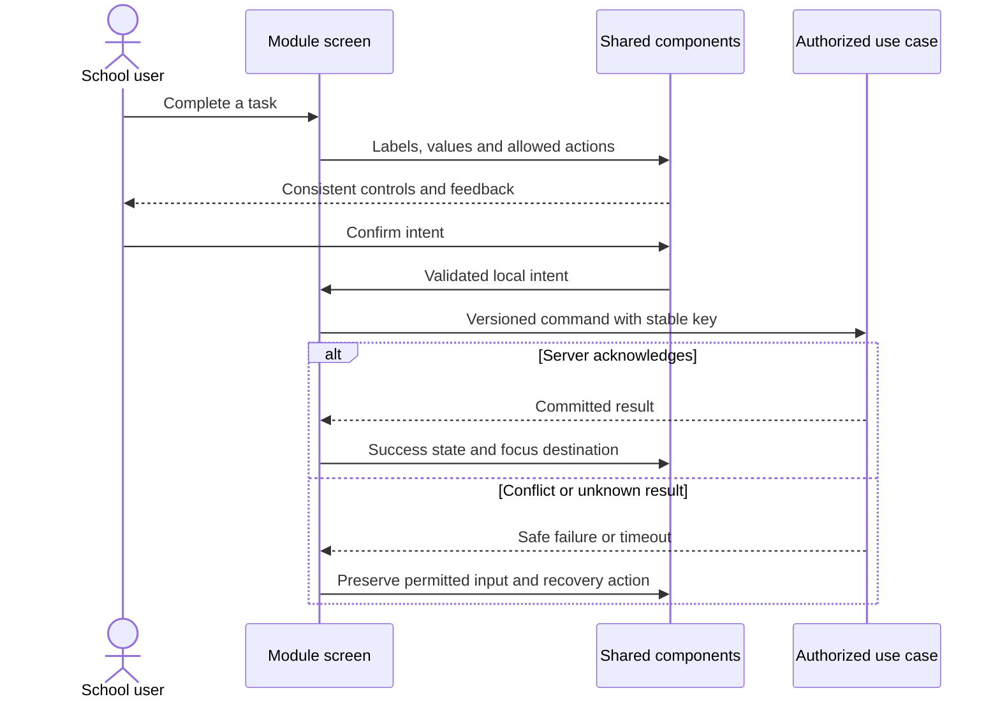

# Shared VSchool experience system — design

Phase 1 · Revision 1 · 3 October 2026. Runtime implementation limits are explicit in CURRENT_STATE.md.

## UXR-00/01A/01 approved UX contract (20 October 2026)

The canonical [UX Constitution](../../ux/UX_CONSTITUTION.md) and [control sizing contract](../../ux/CONTROL_SIZING_CONTRACT.md) govern shared presentation. Existing security, route and module-availability contracts remain unchanged.

**Shared controls.** Production primitives own standard (40px desktop), narrow/coarse (44px), consequential (44px), compact-row (36px desktop), icon-only (44px), and short/long textarea geometry. Purpose widths are semantic and capped by available space. Labels, hints, errors, action rows and section gaps use the canonical spacing contract. Themes change tokens, never geometry. Loading retains the action width; validation can expand without clipping.

**Administrator navigation.** The existing authorized destination catalogue remains the source of truth. Presentation changes from nested operational accordions to direct links under static `Daily work`, `Teaching & communication`, `School operations`, and `School settings` labels. Staff remains one combined entry with Profiles/Access/Availability local navigation. Admissions and Imports remain discoverable from Students, while academic setup, modules, branding and activity remain discoverable from the setup/settings hub. Optional services remain server-filtered. Deep links and per-route authorization are unchanged.

The UXR-01 destination reconciliation preserves every prior entry. `getAdminNavigation` retains its capability and module checks; optional entries retain the live gateway checks in `app/admin/layout.tsx`; every destination continues to enforce its own server authorization.

| Previous presentation | UXR-01 presentation | Route(s) and retained reachability |
|---|---|---|
| Direct Today | Direct Today | `/admin` |
| People → Students | Daily work → Students | `/admin/students`; registration, enrollment, transfer and record actions remain local links |
| People → Staff profiles / Staff access / Staff availability | Daily work → Staff | Preferred authorized staff route; Profiles, Access and Availability remain in local Staff tabs and active-route matching |
| People → Admissions | School operations → Admissions | `/admin/admissions` |
| Teaching → Academic setup | Teaching & communication → Classes & subjects | `/admin/academics` |
| Teaching → Teacher assignments | Teaching & communication → Teacher assignments | `/admin/classes` |
| Teaching → Timetable | Daily work → Timetable | `/admin/timetable` |
| Teaching → Assessments | Teaching & communication → Assessments | `/admin/assessments` |
| Teaching → Cover coordination | Teaching & communication → Cover coordination | `/admin/timetable/cover` |
| Attendance → Registers | Daily work → Attendance | `/admin/attendance/sessions`; Corrections and Explanations remain in the Attendance local tabs |
| Communication → Notices | Teaching & communication → Notices | `/admin/communication` |
| Communication → Calendar & events | Teaching & communication → Calendar & events | `/admin/events` |
| My work → Requests / Assigned follow-ups | School operations → Requests / Assigned follow-ups | `/admin/requests`, `/admin/coordination`; live queue/availability gates retained |
| Reports → Attendance report | School operations → Attendance report | `/admin/reports/attendance` |
| School administration → School setup / School details / Modules / Branding | School settings → School settings / School details / Modules / Branding & appearance | `/admin/setup`, `/admin/school`, `/admin/modules`, `/admin/branding` |
| School administration → Imports / Activity | School operations → Imports / Activity | `/admin/imports`, `/admin/activity` |
| Additional services → Support / Facilities / Finance | School operations → Support procedure / Facilities incidents / Financial exceptions | `/admin/support`, `/admin/services/incidents`, `/admin/finance/exceptions`; each remains conditional on its existing live owner projection |

Groups are static labels rather than disclosure buttons. Empty groups are omitted. Bookmarked deep links remain unchanged and do not depend on the sidebar entry being visible.

**Failures and acceptance.** Mobile navigation retains focus containment, Escape and opener focus restoration. An empty or unavailable group is omitted without granting another destination. Active-route matching stays exact enough that one leaf is current. Verification covers broad and limited Administrator personas, disabled modules, desktop/mobile navigation, five-workspace shared-control consumers, long/error/loading states and all four themes. Human visual and native assistive-technology acceptance remain separate.

## Purpose and boundaries

The design system owns shared presentation primitives, tokens and interaction contracts. It owns no pupil, institution permission or database business state. Module screens import components/ui and compose them; they cannot introduce a competing button/table/form system. BrandSurface receives a validated public theme identifier; no ad hoc CSS injection. Inter 4.1 is bundled locally under the SIL Open Font License and loaded through `next/font/local`; no browser request is made to a font CDN.

DS-ADR-001: native HTML semantics first, small typed React wrappers, no unnecessary UI library dependency. Native dialog provides modal/inert behavior and Escape; shared boundary Tab/Shift+Tab wrapping keeps keyboard focus on visible enabled dialog controls. Native input/select/date/file controls retain browser behavior. Tests and manual assistive-tech review remain required. Advanced async combobox/grid/chart widgets will use a evaluated accessible implementation when their first concrete module requires them, with a design-system task before feature use.

DS-ADR-002: one calm semantic surface system with four constrained presentation presets: Refined Forest (default), Amethyst & Pearl, Porcelain & Ink, and Linen & Bronze. Semantic feedback and keyboard focus remain consistent. Persisted `indigo` and `clay` values are temporary read-only compatibility aliases until UX-03 migrates the existing Branding owner. Dark mode is a future contrast-reviewed token variant, not a global invert filter.

## Component ownership and inventory

See components/ui/primitives.tsx (Button, ButtonLink, Badge, Card, PageHeader, Alert, EmptyState, Skeleton, StatCard, Avatar, Breadcrumbs, Progress, Timeline, Stepper, BrandSurface); forms.tsx (TextField, SelectField, TextArea, Checkbox, Switch, RadioGroup, DateRange, FileUpload); interactive.tsx (Dialog/Drawer, Tabs, Toast, Disclosure, Tooltip, DataTable with pagination). `components/portal/portal-shell.tsx` owns the shared protected shell, responsive drawer focus lifecycle, identity/footer composition and branch-context placement; thin administrator/teacher wrappers supply only already-authorized route groups. SiteHeader, SchoolArt and branded login/configurator compose the public primitives. Native datalist demonstrates basic local autocomplete; it is not an async directory lookup.

`/design-system` is a live showcase of these production components and tokens. Its palette selector is explicitly a local preview. Protected shells receive only the effective published palette for the verified current member and branch; all screen compositions inherit that semantic token scope. See [the rendered route coverage record](ROUTE_COVERAGE.md) for route groups, observed issues and remaining visual evidence.

| Pattern | Implemented contract | Extension boundary |
|---|---|---|
| Button | 4 variants; default type=button; loading disables; aria-busy; visible focus | Server action pending/error supplied by module |
| Field | Label/id, required input, error/hint association, aria-invalid and live field error | Business validation remains application-owned; server errors map to fields |
| Table | Caption, headers, aria-sort, keyboard sort, local sample pagination, bounded scroll | Production list must use authorized server filtering/cursor; no fetch-all |
| Dialog/Drawer | Native modal, boundary Tab/Shift+Tab wrapping, Escape, close button and focus restoration | Form dirty-state confirmation and mutation result remain owning screen |
| Tabs | Tablist/tab/tabpanel IDs; arrow/Home/End; roving tabIndex | Use links instead for navigation between routes |
| Alerts/Toast | Text status and persistent dismissible notice | No auto-hiding important errors; only acknowledged writes show success |
| Tooltip | Hover/focus; Escape dismiss; description relationship | Essential instructions stay visible, not tooltip-only |
| Theme | Approved primary/on-primary/soft/accent tokens | No role/permission behavior controlled by theme |
| Protected portal shell | 248px theme-aware dark desktop sidebar; grouped server-filtered routes; account/sign-out footer; mobile focus containment/return | Page/API authorization remains owner-owned; identity labels cannot infer a person from contact data |

## Tokens and recipes

Bible §17 is the shared product rule. CSS variables in `app/globals.css` and the browser-safe theme catalogue in `shared/contracts/branding.ts` are the implementation tokens. Spacing uses the approved 4–64px scale; cards use 12px radii; controls use 8px radii and 40px desktop/44px mobile targets; focus uses a visible two-pixel ring. Operational typography is local Inter with the documented system fallback. Validate each text/control pair in each theme. High-contrast/forced-colors must preserve input edges and selected states; preserve browser zoom. Motion respects `prefers-reduced-motion`.

The finite production composition catalogue is maintained in [PAGE_RECIPES.md](../../execution/UX_REVAMP/PAGE_RECIPES.md). It covers dashboards, searchable directories, record details, staged forms, review/confirmation, receipts/history, settings, queues, timetable, Attendance/assessment entry and public sign-in. These recipes compose the primitives in this document; they do not introduce a second component library or alter owner behavior.

All module screens use PageHeader → context/actions → filter/form/content → feedback. List state matrix: initial/loading/empty/no matches/partial error/permission denied/ready. Form: pristine/dirty/validating/submitting/unknown result/conflict/success. Unknown result is never a green success toast. Define keyboard order and focus target on every overlay/error. Table compact preference changes padding, never removes access labels.

## Specialized upfront contracts

Before first consuming module, implement these as separate tested additions: (a) asynchronous Combobox with cancellable/debounced authorized query, loading/no-results and ARIA keyboard model; (b) CommandPalette scoped to current allowed routes/actions, with no pupil data cached across context; (c) timetable/calendar with keyboard-operable list alternative and explicit timezone/DST; (d) charts with equivalent numeric table and non-color series encoding; (e) rich editor with sanitized content and attachment policy; (f) advanced bulk-selection table binding selection to scope/filter snapshot; (g) reusable file upload manager with resumable private storage and scan states. They are specified now but not claimed implemented. Do not block Attendance on speculative rich-text or chart infrastructure.

## File selection preview contract

FileUpload accepts a local file with a .csv extension (case-insensitive) and size at most 2 MiB. Browser accept filtering is advisory: unsupported extensions or larger files display an associated field error, clear the rejected native selection, and notify the consumer with null so a previous selection cannot remain active. A valid replacement clears the error. This is a local selection check only; it reads/uploads no file contents. Imports owns future server-side content/schema validation and persistence.

## Test strategy

Unit tests verify palette contrast and primitive policy where nontrivial. Playwright exercises sorting/filter/pagination, labels, invalid state semantics, tabs by keyboard, modal Escape and returned focus, toast dismissal, palette switching, 360px/390px overflow, local file rejection/recovery, focus wrapping, reduced-motion/forced-color emulation and login/configuration scenarios. Record manual 200% zoom, 360px view, VoiceOver/NVDA and high-contrast review before production. Test reports do not prove all WCAG criteria. There are no module database writes; UI fixtures are synthetic and scoped to local component state.

## DS-01 — Review and adopt the shared UI foundation

Use the included component gallery. Review all controls and four approved themes, data table sort/search/pagination, dialog/drawer keyboard behavior, tabs/errors/loading, branding and responsive composition. Improve components centrally, not by module-specific duplication. Record visual owner acceptance separately from automated checks; update UI inventory and token contracts.

**Manual demo:** Visit /design-system; change palettes; search/sort/page sample table; open modal, Escape, verify focus; use arrow-key tabs; inspect mobile form and error state.

## DS-02 — Validate production screen recipes and accessibility

Integrate shared components into real protected teacher/admin screens. `ServerTable` is the semantic presentation shell for rows already queried and authorized by the server: it owns caption, row/column headers, and a keyboard-focusable overflow region; filters, cursor and authorization remain in the owning page/use case. Compose the current-context branch switcher on protected operational screens, list only server-returned selectable branches, and use the shared modal interaction for the discard/reload confirmation. The browser-provided branch is only a candidate; switch and subsequent reads/writes reauthorize on the server.

Verify async unknown/conflict/success states and authorized routes, keyboard order and modal focus return, 200% layout scale/360px/high-contrast emulation, and reduced motion. Record VoiceOver and NVDA sessions separately from automated accessibility-tree evidence; do not imply full WCAG conformance. Specialized future widgets remain gated before their consuming module, no claim all are already implemented.

**Manual demo:** Complete login → branch switch → attendance submission using keyboard and mobile; demonstrate conflict recovery, labels and same component styles across setup/roster/reports.

## Portable backend integration

Follow [the backend extraction contract](../../BACKEND_EXTRACTION.md). Server module code belongs in backend/modules; UI consumes shared/contracts and a module gateway. Next delivery adapters resolve transport/session and invoke portable use cases. Future Nest controllers and provider factories reuse those use cases. Framework-specific context/ORM results never enter domain or browser DTOs.

## Approved experience adoption overlay — revision 2

The Wave A experience overlay is defined by [the execution pack](../../execution/VSchool_Execution_Pack/START_HERE.md), [the live contract reconciliation](../../execution/CONTRACT_DIFF.md), and [the pinned route/reference map](../../execution/ROUTE_REFERENCE_MAP.md). It adopts the approved page bodies and enhanced left navigation for existing school-administrator and teacher routes. The six reference HTML files are immutable visual inputs; their fictional stores, role switches, counts and success states are excluded from production behavior.

EX-ADR-001 through EX-ADR-010 apply as a presentation overlay to existing owner modules. Shared UI owns the shell, controlled list toolbar, drawers and command feedback. Module screens map current browser-safe DTOs. Portable application/domain code and guarded repositories retain authorization, transaction, receipt, version and failure contracts. No initial presentation task adds a table. A missing owner operation is shown as unavailable or omitted and recorded in the contract diff rather than replaced by a dead control.

This overlay does not close DS-02. Native 200% zoom, VoiceOver, NVDA and owner visual review remain outstanding even when Wave A browser checks pass.
## UX-04 ThemePicker recipe — 18 October 2026

`ThemePicker` is one controlled browser-safe fieldset shared by tenant creation/settings surfaces. It renders accessible radio inputs and cards for the four named presets, plus an optional first “Use institution theme” choice whose preview uses the resolved inherited theme. Each card contains a non-interactive 96px miniature made from the theme's semantic sidebar, surface, border and primary variables; selection also uses a visible check, border and radio state. Institution creation marks Forest as Default. The choice grid is two columns on desktop, one below 768px, with 16px gaps/padding, 12px radius and at least a 44px hit area.

The component owns no persistence and accepts no arbitrary colors. Host forms own preview/cancel/save state, announce the persistent unsaved-preview notice, and retain unrelated form values. Preview surfaces use nested `data-vs-theme`; no cookie, localStorage or browser-supplied tenant authority is introduced. Focus remains native and visible. Save/cancel controls follow the shared 40px desktop/44px coarse-pointer button contract.

## UX-05 server-rendered theme inheritance — 18 October 2026

`BrandSurface` sets `data-vs-theme` only when its caller supplies an authorized or published theme. A nested surface with no explicit palette inherits the nearest server-rendered theme instead of resetting to Forest. The root document remains Forest, so generic public and unresolved-context pages retain the approved default without a component-level fallback. Explicit preview and public-brand surfaces continue to create a bounded nested theme scope. No component performs a client theme lookup or stores tenant appearance.

## UX-06 protected shell and Administrator compositions — 18 October 2026

The shared `PortalShell` renders one 240px desktop sidebar and a modal navigation drawer below 1024 CSS pixels. Navigation remains supplied by each server-filtered workspace configuration; presentation never grants a route. Sidebar, active, hover, text and focus colors consume the effective theme variables. The independently scrolling navigation region keeps tenant identity and the account/sign-out footer reachable. When the drawer is open it exposes dialog semantics, traps focus through the existing shell behavior, closes with Escape or backdrop activation, restores focus to the trigger and locks background scrolling.

Administrator Today, Students and manual registration use the shared 64px topbar, 1440px content boundary, responsive 32/24/16px page padding, shared typography, controls, tables, drawers and semantic theme values. Today retains only authoritative metrics and permitted actions. Students retains server search/filter/sort, cursor pagination and branch authorization; its mobile table becomes labelled cards. Registration retains the existing exact Person-ID/admission-number selection contract and performs no write before final confirmation. Unsupported durable draft controls are omitted rather than presented as disabled functionality.

## UX-07 cross-workspace compositions — 18 October 2026

Teacher pages use a 1120px maximum task workspace. Principal, Parent/Guardian and Student pages use the shared 1440px boundary and semantic canvas, surface, border, text and action values. Their actual owner-specific page bodies remain responsible for presenting authorized data; the presentation layer neither adds destinations nor treats prototype sample counts as records.

Parent and Student retain their permission-filtered desktop sidebar and fixed mobile quick navigation. More opens the same protected navigation as the top menu, with dialog semantics, background scroll lock, focus containment, Escape/backdrop dismissal and focus restoration to the specific opening control. Context ribbons remain above page content and identify the currently authorized child or Student scope. Native selectors stay readable at 390px rather than collapsing their selected label. Safe-area padding and focus scroll margins keep bottom-navigation controls from obscuring focused content.

## UX-08 verification fixture and coverage — 18 October 2026

The demo seed owns one bounded appearance scenario using the existing Access institution/branch creation and appearance commands. Repeated runs resolve the same fictional institution and branch codes, retain existing records and credentials, and exercise inheritance plus one explicit branch override. It does not add seed tables, delete data, mutate arbitrary schools or bypass appearance authorization. The private credential/context description is ignored by Git and reports its location without printing secrets.

Integrated visual coverage requires all four approved themes in the component gallery at 1440×1000 and 390×844, plus the authorized appearance editor and representative protected shells. Gallery coverage proves shared token and component behavior; workspace journeys prove server-resolved themes, scope switching and owner-specific composition. Device-scale/viewport emulation is labelled as such and does not satisfy the separate native 200% browser-zoom gate.
