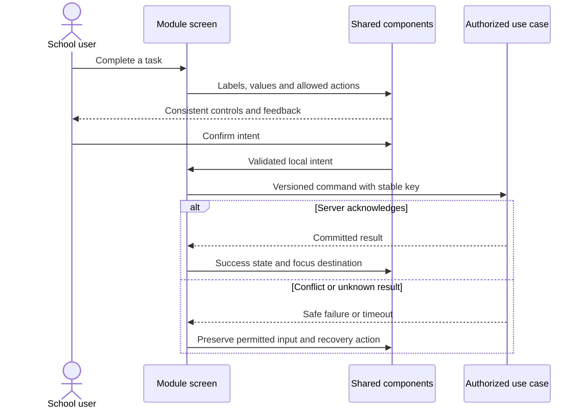

# Shared VSchool experience system — design

Phase 1 · Revision 1 · 3 October 2026. Runtime implementation limits are explicit in CURRENT_STATE.md.

## Purpose and boundaries

The design system owns shared presentation primitives, tokens and interaction contracts. It owns no pupil, institution permission or database business state. Module screens import components/ui and compose them; they cannot introduce a competing button/table/form system. BrandSurface receives a validated public palette; no ad hoc CSS injection. System fonts avoid remote font tracking and render without an extra network dependency.

DS-ADR-001: native HTML semantics first, small typed React wrappers, no unnecessary UI library dependency. Native dialog provides modal/inert behavior and Escape; shared boundary Tab/Shift+Tab wrapping keeps keyboard focus on visible enabled dialog controls. Native input/select/date/file controls retain browser behavior. Tests and manual assistive-tech review remain required. Advanced async combobox/grid/chart widgets will use a evaluated accessible implementation when their first concrete module requires them, with a design-system task before feature use.

DS-ADR-002: one calm neutral surface system with constrained brand tokens. Default Forest, alternate Indigo/Clay. Semantic feedback and keyboard focus remain consistent. Dark mode is a future contrast-reviewed token variant, not a global invert filter.

## Component ownership and inventory

See components/ui/primitives.tsx (Button, ButtonLink, Badge, Card, PageHeader, Alert, EmptyState, Skeleton, StatCard, Avatar, Breadcrumbs, Progress, Timeline, Stepper, BrandSurface); forms.tsx (TextField, SelectField, TextArea, Checkbox, Switch, RadioGroup, DateRange, FileUpload); interactive.tsx (Dialog/Drawer, Tabs, Toast, Disclosure, Tooltip, DataTable with pagination). `components/portal/portal-shell.tsx` owns the shared protected shell, responsive drawer focus lifecycle, identity/footer composition and branch-context placement; thin administrator/teacher wrappers supply only already-authorized route groups. SiteHeader, SchoolArt and branded login/configurator compose the public primitives. Native datalist demonstrates basic local autocomplete; it is not an async directory lookup.

`/design-system` is a live showcase of these production components and tokens. Its palette selector is explicitly a local preview. Protected shells receive only the effective published palette for the verified current member and branch; all screen compositions inherit that semantic token scope. See [the rendered route coverage record](ROUTE_COVERAGE.md) for route groups, observed issues and remaining visual evidence.

| Pattern | Implemented contract | Extension boundary |
|---|---|---|
| Button | 4 variants; default type=button; loading disables; aria-busy; visible focus | Server action pending/error supplied by module |
| Field | Label/id, required input, error/hint association, aria-invalid and live field error | Business validation remains application-owned; server errors map to fields |
| Table | Caption, headers, aria-sort, keyboard sort, local sample pagination, bounded scroll | Production list must use authorized server filtering/cursor; no fetch-all |
| Dialog/Drawer | Native modal, boundary Tab/Shift+Tab wrapping, Escape, close button and focus restoration | Form dirty-state confirmation and mutation result remain owning screen |
| Tabs | Tablist/tab/tabpanel IDs; arrow/Home/End; roving tabIndex | Use links instead for navigation between routes |
| Alerts/Toast | Text status and persistent dismissible notice | No auto-hiding important errors; only acknowledged writes show success |
| Tooltip | Hover/focus; Escape dismiss; description relationship | Essential instructions stay visible, not tooltip-only |
| Theme | Approved primary/on-primary/soft/accent tokens | No role/permission behavior controlled by theme |
| Protected portal shell | 248px theme-aware dark desktop sidebar; grouped server-filtered routes; account/sign-out footer; mobile focus containment/return | Page/API authorization remains owner-owned; identity labels cannot infer a person from contact data |

## Tokens and recipes

Bible §17 is the shared product rule. CSS variables in app/globals.css and palettes in branding/domain/theme.ts are implementation tokens. spacing 4/8 multiples; cards 12px; controls 7px; primary actions 44px; visible ring. Operational typography target 14–16 body, 12–14 labels/metadata. Welcome pages may use serif display headings; school workflows use system sans. Validate each text/control pair in each palette. High-contrast/forced-colors must preserve input edges and selected states; preserve browser zoom. Motion respects prefers-reduced-motion.

All module screens use PageHeader → context/actions → filter/form/content → feedback. List state matrix: initial/loading/empty/no matches/partial error/permission denied/ready. Form: pristine/dirty/validating/submitting/unknown result/conflict/success. Unknown result is never a green success toast. Define keyboard order and focus target on every overlay/error. Table compact preference changes padding, never removes access labels.

## Specialized upfront contracts

Before first consuming module, implement these as separate tested additions: (a) asynchronous Combobox with cancellable/debounced authorized query, loading/no-results and ARIA keyboard model; (b) CommandPalette scoped to current allowed routes/actions, with no pupil data cached across context; (c) timetable/calendar with keyboard-operable list alternative and explicit timezone/DST; (d) charts with equivalent numeric table and non-color series encoding; (e) rich editor with sanitized content and attachment policy; (f) advanced bulk-selection table binding selection to scope/filter snapshot; (g) reusable file upload manager with resumable private storage and scan states. They are specified now but not claimed implemented. Do not block Attendance on speculative rich-text or chart infrastructure.

## File selection preview contract

FileUpload accepts a local file with a .csv extension (case-insensitive) and size at most 2 MiB. Browser accept filtering is advisory: unsupported extensions or larger files display an associated field error, clear the rejected native selection, and notify the consumer with null so a previous selection cannot remain active. A valid replacement clears the error. This is a local selection check only; it reads/uploads no file contents. Imports owns future server-side content/schema validation and persistence.

## Test strategy

Unit tests verify palette contrast and primitive policy where nontrivial. Playwright exercises sorting/filter/pagination, labels, invalid state semantics, tabs by keyboard, modal Escape and returned focus, toast dismissal, palette switching, 360px/390px overflow, local file rejection/recovery, focus wrapping, reduced-motion/forced-color emulation and login/configuration scenarios. Record manual 200% zoom, 360px view, VoiceOver/NVDA and high-contrast review before production. Test reports do not prove all WCAG criteria. There are no module database writes; UI fixtures are synthetic and scoped to local component state.

## DS-01 — Review and adopt the shared UI foundation

Use the included component gallery. Review all controls and three palettes, data table sort/search/pagination, dialog/drawer keyboard behavior, tabs/errors/loading, branding and responsive composition. Improve components centrally, not by module-specific duplication. Record visual owner acceptance separately from automated checks; update UI inventory and token contracts.

**Manual demo:** Visit /design-system; change palettes; search/sort/page sample table; open modal, Escape, verify focus; use arrow-key tabs; inspect mobile form and error state.

## DS-02 — Validate production screen recipes and accessibility

Integrate shared components into real protected teacher/admin screens. `ServerTable` is the semantic presentation shell for rows already queried and authorized by the server: it owns caption, row/column headers, and a keyboard-focusable overflow region; filters, cursor and authorization remain in the owning page/use case. Compose the current-context branch switcher on protected operational screens, list only server-returned selectable branches, and use the shared modal interaction for the discard/reload confirmation. The browser-provided branch is only a candidate; switch and subsequent reads/writes reauthorize on the server.

Verify async unknown/conflict/success states and authorized routes, keyboard order and modal focus return, 200% layout scale/360px/high-contrast emulation, and reduced motion. Record VoiceOver and NVDA sessions separately from automated accessibility-tree evidence; do not imply full WCAG conformance. Specialized future widgets remain gated before their consuming module, no claim all are already implemented.

**Manual demo:** Complete login → branch switch → attendance submission using keyboard and mobile; demonstrate conflict recovery, labels and same component styles across setup/roster/reports.

## Portable backend integration

Follow [the backend extraction contract](../../BACKEND_EXTRACTION.md). Server module code belongs in backend/modules; UI consumes shared/contracts and a module gateway. Next delivery adapters resolve transport/session and invoke portable use cases. Future Nest controllers and provider factories reuse those use cases. Framework-specific context/ORM results never enter domain or browser DTOs.

## Approved experience adoption overlay — revision 2

The Wave A experience overlay is defined by [the execution pack](../../execution/VSchool_Execution_Pack/START_HERE.md), [the live contract reconciliation](../../execution/CONTRACT_DIFF.md), and [the pinned route/reference map](../../execution/ROUTE_REFERENCE_MAP.md). It adopts the approved page bodies and enhanced left navigation for existing school-administrator and teacher routes. The six reference HTML files are immutable visual inputs; their fictional stores, role switches, counts and success states are excluded from production behavior.

EX-ADR-001 through EX-ADR-010 apply as a presentation overlay to existing owner modules. Shared UI owns the shell, controlled list toolbar, drawers and command feedback. Module screens map current browser-safe DTOs. Portable application/domain code and guarded repositories retain authorization, transaction, receipt, version and failure contracts. No initial presentation task adds a table. A missing owner operation is shown as unavailable or omitted and recorded in the contract diff rather than replaced by a dead control.

This overlay does not close DS-02. Native 200% zoom, VoiceOver, NVDA and owner visual review remain outstanding even when Wave A browser checks pass.
