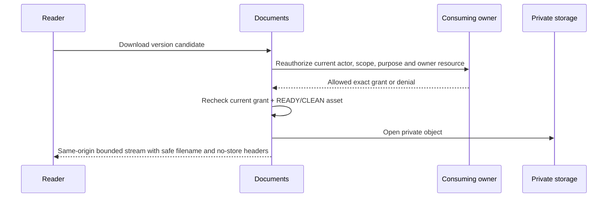

# Documents / shared file-safety owner design

Status: **D15 SYNTHETIC BASELINE APPROVED / DOC-01 IMPLEMENTED / REAL SCANNER CONFIGURATION PENDING**.

The user's 17 October 2026 session approval adopts D15 for synthetic-only implementation. The initial PDF/JPEG/PNG allowlist, 10 MiB per file, five attachments per owner action, configurable 100 MiB synthetic branch quota, private local development storage, fail-closed real scanning, and same-origin authenticated streaming are therefore settled for this programme. Production provider, region, encryption/KMS, scanner service, retention, deletion and production quota remain deliberately unselected. No real-client file or production enablement is authorized.

The current programme calls this the “Files owner”. The approved SA-44 contract names the authoritative owner **Documents** and states that Documents owns `FileAsset`, `ScanResult`, `DocumentVersion` and its grant while a consuming owner references the immutable approved version. This package therefore uses the canonical module name `documents`; creating a competing generic `files` owner would contradict the approved source.

## Workflows unlocked

| Shared capability | Direct workflows | Required consuming-owner counterpart | Current boundary |
|---|---|---|---|
| Safe learning-resource publication and download | TEA-26, TEA-27 resource portion; STW-09, STW-11, STW-12 | Learning publishes an immutable resource link for an exact Offering/Assignment version and reauthorizes the Student recipient | Learning text publication exists; resource link and file safety do not |
| Private Student draft attachment and immutable submission snapshot | STW-13 attachment portion, STW-14, STW-15 file portion | Learning owns draft version, due policy, attempt and exact Student authority | Text draft/submission exists; file attachment contract does not |
| Notice attachments | SA-35 attachment portion, PAR-14 attachment portion, STW-27 | Communication freezes the attachment version with the immutable NoticeVersion and rechecks the exact recipient purpose | Text notice/read/acknowledgement exists |
| Collect and review a document | SA-44; Admissions document portion of SA-39/PAR-38 | Admissions/Students supplies the exact application or Student context and reviewer authority | Product decisions for document classification, review visibility and Admissions grants remain |
| Issue or download an official artifact | SA-45, PAR-24, PAR-35, STW-34 | Results/Documents owner supplies immutable published source, signatory/generation authority and exact Parent/Student purpose | Assessment/result and school-document lifecycles are absent |

Files alone do not complete any workflow whose business owner is absent. In particular, storage cannot invent Assessment publication, Admissions decision authority, certificate signatories, consent rules, result visibility, Learning late/resubmission policy or Notice delivery semantics.

## Approved rules

The following rules come directly from the approved SA-44 and Student/Parent references and are implementation constraints:

- Documents owns the physical asset, safety result, immutable document version and access grant. The consuming owner references the immutable approved version.
- Storage objects are private. No public object URL is permitted.
- An upload is not a submission, publication, approval or issued document.
- A scan failure or unavailable scan never becomes a successful/clean upload.
- Only a clean asset belonging to the same authorized draft/resource may enter an immutable submission or publication.
- Every open/download reauthorizes the current owner context. Expired delivery retries through authorization; an old URL is not authority.
- The UI distinguishes upload, checking, ready, blocked, unsupported, oversized, offline/technical failure and expired states.
- File title/type/size are shown before download. Arbitrary URL fetching is prohibited.
- Student resources default to no new download after current enrollment ends unless a separately approved historical-access rule applies.
- Audit excludes file contents. Cross-child, cross-branch and revoked access must fail without revealing object existence.

## Approved synthetic baseline and production decisions still required

The recommended first-slice values in the first, second, fourth and sixth rows are accepted for synthetic-only implementation by D15. Provider and production-policy choices remain pending:

| Decision | Recommended first slice | Alternatives / consequence |
|---|---|---|
| Initial media allowlist | PDF, JPEG and PNG after signature-based content detection; reject archives, SVG, HTML, executables, macros and mismatched content | Adding office formats requires archive expansion limits, macro handling and document sanitization |
| Limits | 10 MiB per asset, five assets per owner resource, and a configurable branch quota enforced before upload initiation and again at finalize | Larger limits increase scan latency, storage cost and denial-of-service exposure; exact quotas require product approval |
| Production storage | Private S3-compatible object storage behind `ObjectStoragePort`, with opaque generated keys, checksum validation, encryption at rest and blocked public ACL/policy | A named provider/region, residency, replication, versioning and key-management policy still require procurement/security approval |
| Development storage | A guarded local adapter outside `public/`, mode `0700`, available only for `vyapti_vschool`; it may store quarantined bytes but cannot label them clean without a real configured scanner | An object-store emulator tests protocol compatibility but still does not prove production storage/security |
| Scanner | An external malware-scanning adapter (for example a reviewed ClamAV/ICAP service) returning engine/version/signature time and verdict | Provider, update SLA, retry window and incident response remain approval items; test fakes prove state transitions only |
| Download delivery | Same-origin server-authorized streaming for sensitive Student/family/official documents in the first slice | A 60-second signed object URL reduces server load but cannot be revoked after issue until expiry; it is unsuitable where immediate revocation is required |
| Quarantine/orphan expiry | Upload sessions expire after 24 hours; unlinked quarantined assets become cleanup candidates after seven days | These periods are retention decisions and must be approved before a deletion worker exists |
| Retention and deletion | Policy by document purpose/classification, with legal hold and immutable evidence separated from deletable bytes | A single global duration is unsafe; backup expiry and provider deletion guarantees must be approved |

Until a real scanner is configured and exercised, no user-facing upload can be called secure or complete.

## 18 October 2026 closure design delta — DOC-02A

The remaining work is not one external-provider blocker. D15 already authorizes a provider-independent lifecycle that can be implemented against the canonical ports before a scanner is installed:

- `promoteReadyUpload(actor, uploadId, owner, classification, key)` reauthorizes the exact consuming owner, locks the account/scope/upload/asset/document in the documented order, requires the current asset to be `READY` with current `CLEAN` scan evidence for the same hash, creates or advances one immutable DocumentVersion, and creates one ACTIVE owner-purpose grant. Exact replay returns the original version; changed payload conflicts.
- `openAuthorizedVersion(actor, versionId, ownerCandidate)` treats every browser value as a candidate. Documents resolves the active grant, calls the registered owner adapter for current permission, rechecks the Document/version relationship and current asset scan pointer, then opens the private object. Any revoked purpose, withdrawn owner publication, non-CLEAN current scan, missing object or owner denial fails closed without disclosing existence.
- The hosting adapter streams the bytes with the stored normalized media type, a sanitized `Content-Disposition`, `X-Content-Type-Options: nosniff`, `Cache-Control: private, no-store` and no storage key or reusable public URL. A route handler performs only bounded multipart/body parsing and maps typed errors.
- Link/replay evidence needs a Documents-owned exact-command receipt because upload-session idempotency does not cover later promotion. Add it only through a forward BRANCH migration with Path A registration; do not overload Communication receipts or expose the content hash.
- The first owner adapter is Communication. It accepts only an exact current proposal revision controlled by an AUTHOR grant for upload/link and an exact current frozen NoticeVersion recipient for download. Ordered DocumentVersion IDs enter `attachment_digest`; changing the set or order creates a new proposal revision and invalidates prior approval.

Unit and PostgreSQL tests may use a clearly named deterministic scanner double to prove transitions and transactions. Development remains `SCAN_UNAVAILABLE` until a real configured scanner produces evidence, so the runtime cannot use the double to make an asset downloadable.

## Installed physical schema (DOC-01)

| Physical table (logical model) | Exact physical columns | Purpose | Constraints / indexes |
|---|---|---|---|
| `vs_documents_upload_session` (DocumentsUploadSession) | id uuid PK; organization_id/school_id/actor_account_id/owner_resource_id/asset_id uuid; owner_module/resource_type/purpose/filename/media/state/key/hash text; expected_size/version int; expires/created/updated timestamptz | Actor and owner-bound quarantine intent with exact replay metadata. | Scoped School/actor/asset FKs; media/size/hash/state/version CHECKs; scoped id, actor/key and storage uniqueness; owner and expiry indexes |
| `vs_documents_file_asset` (DocumentsFileAsset) | id uuid PK; organization_id/school_id/current_scan_result_id uuid; storage_key/media/state/hash text; byte_size/safety_version int; created_at timestamptz | Immutable private-object metadata and current fail-closed safety pointer. | Scoped School/current-scan FKs; media/size/hash/state/version CHECKs; scoped id and storage uniqueness; hash and safety indexes |
| `vs_documents_scan_result` (DocumentsScanResult) | id uuid PK; organization_id/school_id/asset_id uuid; attempt_no int; hash/verdict/engine/version/definitions/error text; scanned_at timestamptz | Append-only evidence for an exact asset hash and scanner definition. | Scoped Asset FK; verdict/attempt CHECKs; scoped id and asset/attempt uniqueness; asset/time index; append-only trigger |
| `vs_documents_document` (DocumentsDocument) | id uuid PK; organization_id/school_id/owner_resource_id/current_version_id uuid; owner_module/resource_type/status text; revision int; created_at timestamptz | Logical consuming-owner resource and immutable-version pointer. | Scoped School/current-version FKs; status/revision CHECKs; scoped id and owner-resource uniqueness; status/time index |
| `vs_documents_document_version` (DocumentsDocumentVersion) | id uuid PK; organization_id/school_id/document_id/asset_id uuid; version_no int; filename/classification text; created_at timestamptz | Immutable clean asset plus display/classification metadata. | Scoped Document/Asset FKs; positive version CHECK; scoped id and document/version uniqueness; classification index; append-only trigger |
| `vs_documents_document_grant` (DocumentsDocumentGrant) | id uuid PK; organization_id/school_id/document_version_id/owner_resource_id uuid; owner_module/resource_type/purpose/status text; version int; created_at/revoked_at timestamptz | Revocable purpose link; current consuming-owner authorization is still required. | Scoped Version FK; status/version/revocation CHECKs; scoped id and version-owner-purpose uniqueness; active owner index |

## Domain model and invariants

`UploadSession` is one actor- and owner-resource-bound upload intent. Its lifecycle is `INITIATED -> UPLOADING -> UPLOADED -> CHECKING -> READY`, with terminal alternatives `INVALID`, `BLOCKED`, `SCAN_UNAVAILABLE`, `EXPIRED` and `ABORTED`. Only the scanner adapter can supply a clean verdict. Retrying transport may reuse the same upload intent and object key; a changed checksum/size/MIME under the same key conflicts.

`FileAsset` represents immutable stored bytes. Its opaque storage key is server-generated. Size and SHA-256 are verified from stored bytes; browser declarations are hints only. A clean asset never changes bytes. Replacement creates a new asset and scan evidence.

`ScanResult` is append-only evidence for an exact asset hash and scanner definition. `CLEAN`, `BLOCKED`, `ERROR` and `UNAVAILABLE` are distinct. Error/unavailable never implies clean. A later rescan appends evidence and updates the current safety pointer with optimistic versioning.

`DocumentVersion` is immutable metadata plus one clean asset reference. Promotion requires current owner authority and a matching clean asset. Withdrawal/revocation changes a root/grant pointer; it does not mutate the version or erase prior evidence.

`DocumentGrant` binds an immutable version to one consuming-owner resource and purpose. It is not a universal ACL or sufficient authority by itself. Every download calls the registered consuming-owner authorization port with the current actor and exact grant; Documents then rechecks branch/module state and asset safety. The browser cannot assert owner module, resource, audience or a trusted scan result.

## Planned persistence contract

No migration is authorized yet. When the decisions above are accepted, the narrow foundation uses the following `BRANCH` tables with `(organization_id, school_id)` on every row and scoped composite foreign keys:

| Planned physical table | Purpose | Required constraints / indexes |
|---|---|---|
| `vs_documents_upload_session` | Actor/resource-bound upload intent, expected metadata/checksum, state, expiry, idempotency hash and provider upload reference | positive bounded size; state check; unique `(org,school,actor,command,key)`; scoped owner/state/expiry indexes |
| `vs_documents_file_asset` | Immutable opaque object reference, verified size/hash/detected media type and current safety state/version | unique storage key and `(org,school,sha256,id)`; size/state checks; scoped hash and safety indexes; object key never returned to browser |
| `vs_documents_scan_result` | Append-only scanner verdict/evidence for one asset hash | scoped asset FK; verdict check; unique scan attempt; asset/time index; append-only trigger |
| `vs_documents_document` | Logical owner resource and current immutable-version pointer | owner module/type/id allowlist; status/revision checks; scoped owner-resource uniqueness and list index |
| `vs_documents_document_version` | Immutable safe display name, classification, asset reference and version | scoped Document/FileAsset FKs; unique document/version; append-only trigger; classification index |
| `vs_documents_document_grant` | Version-to-consuming-owner purpose link, status/version and owner policy reference | scoped version FK; allowlisted owner/purpose; unique version/owner-resource/purpose; active lookup index |

All six tables must be registered in `docs/database/TABLE_REGISTRY.json`. Their forward migration must record the temporary TEN-ADR-006 Path A classification/comment and TEN-03 closure gate. After TEN-03 enforcement, the same new-table migration must ENABLE/FORCE RLS and create the policies. Application authorization remains mandatory in either case.

No raw content, object key, signed URL, scanner payload or original unsafe filename belongs in audit/outbox/command receipts. Safe metadata is limited to asset/version reference, purpose, normalized media type, size, actor, scope, result code and timestamps. The content hash stays in Documents-owned storage metadata and is not exposed as a bearer reference.

## Ports and adapters

Portable application ports:

```ts
interface ObjectStoragePort {
  beginQuarantinedUpload(input: QuarantinedUpload): Promise<UploadTarget>;
  inspect(objectRef: string): Promise<{size: number; sha256: string; detectedMediaType: string}>;
  openPrivate(objectRef: string): Promise<ReadableByteSource>;
  deletePrivate(objectRef: string): Promise<void>;
}

interface MalwareScanPort {
  scan(input: {objectRef: string; sha256: string}): Promise<ScanEvidence>;
}

interface DocumentOwnerAuthorizationPort {
  authorizeLink(actor: Identity, owner: OwnerReference, purpose: string): Promise<AuthorizedOwnerContext>;
  authorizeDownload(actor: Identity, grant: DocumentGrantReference): Promise<AuthorizedDownloadContext>;
}
```

The Documents repository owns state transitions and PostgreSQL transactions. Consumer-specific authorization adapters live behind Documents contracts and call Learning, Communication, Admissions, Results or Requests facades; Documents never queries their tables directly. `backend/composition/documents.ts` receives storage/scanner/owner-policy adapters and limits explicitly. `lib/server/documents.ts` supplies environment/provider configuration. Browser DTOs live in `shared/contracts/documents.ts`. Next route handlers only parse bounded multipart/finalize/download requests and invoke the facade.

Development local storage must refuse non-local guarded databases, store outside web roots and return `SCAN_UNAVAILABLE` when no real scanner is configured. Test adapters may return deterministic verdicts to prove domain/transaction behavior, but evidence must label them as test doubles rather than malware protection.

## Upload, scan, link and download sequences

```mermaid
sequenceDiagram
  participant U as Authorized user
  participant O as Consuming owner
  participant D as Documents
  participant S as Private storage
  participant V as Scanner
  U->>O: Start attachment for exact resource
  O->>D: Authorize upload intent and owner reference
  D->>S: Allocate opaque quarantine object
  D-->>U: Bounded single-use upload target
  U->>S: Upload bytes
  U->>D: Finalize same intent/key/checksum
  D->>S: Inspect stored bytes and content signature
  D->>V: Scan exact object/hash
  V-->>D: CLEAN / BLOCKED / ERROR / UNAVAILABLE
  D-->>U: Ready only after CLEAN; otherwise explicit unavailable/blocked state
```



Uploads use actor/scope/owner/command/key receipts. Same key plus the same normalized metadata/checksum returns the existing semantic result; changed input conflicts. Promotion/linking locks actor account → Organization share → School update → UploadSession/FileAsset/Document update in stable ID order. Reads take no write locks. A preview or client-side completed upload never authorizes publication. Unknown finalize/link outcomes reconcile with the same key; a new key must not create duplicate asset/version links.

## Validation, delivery and recovery

- Normalize a display filename by Unicode normalization, removal of paths/control characters and a bounded length. Preserve it only as presentation metadata. Storage keys and download URLs never contain it.
- Validate declared media type, extension and detected content signature. Any mismatch is `INVALID`; do not “fix” a mismatched file by renaming it.
- Enforce byte limits during allocation, at storage/provider policy, and after stored-byte inspection. Decompression/archive limits are required before any archive or office format is allowed.
- Responses use `Content-Disposition` with a sanitized contextual name that never contains another Student/child identity, `X-Content-Type-Options: nosniff`, a narrow `Content-Type`, private/no-store caching and CSP/sandbox where inline viewing is later approved.
- A blocked asset remains unavailable; replacement is a new upload intent. Scanner technical failure may retry the same immutable hash through a background job but remains unavailable until a clean evidence row exists.
- Revoking a grant immediately blocks the next server-authorized download. A previously issued signed object URL remains usable until its short expiry; this is why the recommended first sensitive-document slice uses server streaming.

## Retention, deletion and backup implications

Retention is purpose-specific and currently unresolved. The database must separate logical withdrawal, access-grant revocation, retention expiry, legal hold and physical object deletion. A cleanup worker may delete only an unlinked/expired asset after the accepted policy and a locked recheck proves no active version/grant/hold. Delete failure remains retryable and visible; the database cannot claim bytes deleted until the provider confirms.

Backups must cover both PostgreSQL metadata and private objects with compatible point-in-time evidence. Restore verification reconciles every available DocumentVersion with its object hash and scan evidence; a missing/corrupt object becomes unavailable and never a successful empty download. Provider lifecycle/versioning, backup retention, residency and cryptographic-key recovery are production decisions. TEN-03, restore/load proof and provider security review remain release gates.

## Verification criteria

- Unit: state transitions, media/size/filename validation, idempotency hash, clean-only promotion and signed-link expiry semantics.
- Real PostgreSQL: scoped FKs, append-only evidence, replay/conflict, concurrent finalize/promotion, foreign branch denial, revoked owner authority, orphan cleanup locking and rollback.
- Adapter contract: local guarded private storage; production-compatible object adapter checksum/ACL tests; real scanner integration in an isolated non-production environment before claiming safe uploads.
- Browser: upload/check/ready/blocked/unavailable/expired flows, lost-response recovery, reload, keyboard/focus, mobile layout and no public storage URL exposure.
- Security: malicious content corpus under the approved scanner, MIME mismatch/polyglot/oversize tests, header/caching checks, expired/foreign/revoked download denial and logs/audit free of content/object URLs.
- Release: provider threat review, malware-signature update monitoring, retention/legal approval, backup/restore, capacity/load, TEN-03 and native accessibility.

## Smallest demo-able sequence

1. Accept the initial allowlist/limits, retention for quarantine/orphans, scanner/provider behavior and download-delivery decision.
2. Implement provider-independent domain, ports and BRANCH schema with no UI and prove state/authorization transitions using test adapters.
3. Wire guarded local private storage plus a real configured scanner. Demo upload → checking → clean/blocked without exposing bytes.
4. Add reauthorized same-origin download for one Learning resource (`TEA-26 -> STW-12`), keeping Student attachment submission out of this slice.
5. Add Student draft attachments and immutable attempt snapshots (`STW-14/15`) through Learning's existing draft/submit transactions.
6. Add immutable NoticeVersion attachments (`PAR-14/STW-27`) through Communication's frozen recipients.
7. Design the separate Documents request/review/issue lifecycle before SA-44/45, PAR-24/35/38 or STW-34.

No step is implementation-complete until a real scanner and private storage path are exercised. Human review remains separate.
