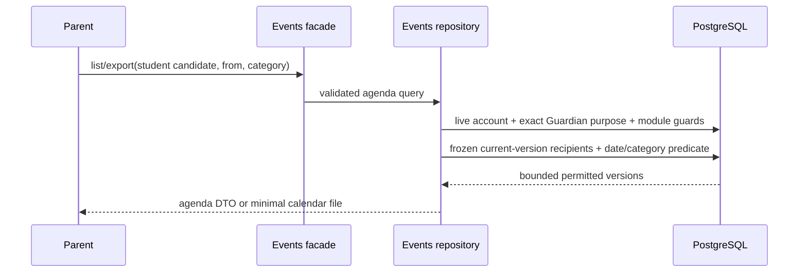
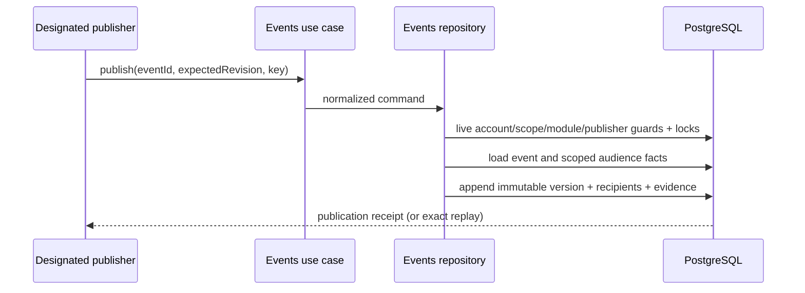

# Events module design

## EV-01 — bounded school calendar

Events owns one-off school calendar publication. It uses the existing `communication` product release because the first release is an in-app publication capability, but it owns its domain, persistence and publisher designation. Academics supplies scoped sections and Students supplies dated enrollment/placement facts; Events never writes either owner's tables.

### First-release decisions (15 October 2026)

- A branch publisher is explicitly designated in `vs_events_publisher_grant`; an administrator role or hidden navigation item alone is insufficient.
- An event targets either the whole branch or one active scoped Section. Publication freezes the exact active Student audience using the branch-local publication date and half-open Enrollment/SectionPlacement intervals. A later grant, enrollment or transfer is not retroactive. Each new published version re-evaluates the audience.
- Parent and Student reads require independent `calendar.event.read_child` and `calendar.event.read_self` purpose grants. They are never added to the base invitation bundle or backfilled. Every read rechecks the live account, accepted non-revoked access, exact purpose, original school, module availability and active Student context.
- One-off events are either an inclusive all-day school-local date range (stored as `starts_on` and exclusive `ends_on_exclusive`) or an offset-qualified timed interval displayed in the branch timezone. Title is 1–120 characters and non-sensitive description is 1–500 characters.
- Lifecycle is `DRAFT -> PUBLISHED -> CANCELED`. Draft saves and every published revision use an expected revision. A published change appends an immutable version and new frozen audience; earlier versions and recipients remain evidence. Cancellation retains the latest version and recipients and remains visible with a canceled state.
- Commands use actor/scope/command/key receipts. Same key and same normalized payload replays the result; changed payload conflicts. Mutation lock order is account `UPDATE`, Organization `SHARE`, School `UPDATE`, then Event row `UPDATE`. Reads do not acquire mutation locks.
- Recurrence, RSVP/interest, consent, capacity, attachments, external delivery, assessment dates and payments are outside EV-01. Therefore PAR-18 and STW-31 remain partial where their approved references include mixed/advanced calendar content.

## EV-02 — typed Parent agenda and authorized export

PAR-18's approved current-release contract adds a school-local **From date**, the filters **All permitted events / Holidays / Meetings / Class events**, and a minimal calendar export. Events remains the owner. This slice does not create RSVP, consent, payment, attendance or transport meaning, and it does not make an event category proof that the academic calendar is closed.

New writes require `HOLIDAY`, `MEETING` or `CLASS_EVENT`. Existing EV-01 records are forward-migrated to `GENERAL` so they remain truthful rather than being silently relabelled; `GENERAL` appears in **All permitted events** only. Category and audience are independent: a category never grants scope, and the frozen recipient/version contract remains authoritative. Publication copies category into the immutable version. Revision may change category only by publishing a new version.

Parent agenda reads accept an optional ISO civil `from` day and one supported category. The default is the current branch-local day. The repository rechecks the live account, exact accepted Guardian binding, independent calendar purpose, original branch, module state and frozen current-version recipient before applying the date/category predicate. Results are bounded to 100 and ordered by effective start then stable event ID. Canceled events stay visible and clearly labelled.

Calendar export is a query, not stored state. It invokes the same guarded projection for every included current version and returns a bounded RFC 5545-compatible `text/calendar` representation containing only title, non-sensitive description, permitted schedule, current version and canceled status. It contains no child identity, other recipient, staff-private schedule or token. A stale downloaded file never overrides the live page; users must regenerate it to receive revisions or cancellations.

The forward migration adds `category` to `vs_events_event` and `vs_events_event_version`, category checks and scoped agenda indexes. Both tables retain their `BRANCH` classification and TEN-03 closure gate. No new table or authorization grant is introduced.

Verification requires domain validation/export escaping, real PostgreSQL legacy-category preservation, category filtering, date overlap, purpose revocation and cross-child denial, plus an Administrator publish → Parent filter/detail/export browser journey at desktop/mobile sizes. Mixed timetable, academic-calendar closures, recurrence and event response remain separately owned gaps; EV-02 does not claim them complete.

## EV-03 — typed Student upcoming agenda

STW-31's approved owner-aligned event slice uses the same immutable publication and exact frozen Student audience as EV-01/EV-02. The Student calendar requests the branch-local current civil date and returns only permitted current versions whose all-day or timed interval has not ended. It displays the immutable category, effective school-local schedule, audience label and canceled state. There is no browser-supplied authority and no new purpose, table or write path.

This slice deliberately does not add assessment schedules, venue/participation fields that Events does not own, or interest actions. Published assessment dates require their Assessment owner and draft/publication boundary; STW-32 interest remains an explicit scope extension with unsettled capacity, consent and allocation rules. An upcoming Events agenda can therefore be verified without implying those capabilities.

Verification adds a real PostgreSQL Student date/category query under exact access and a desktop/mobile Administrator publication → Student upcoming agenda/detail journey. The Student reference Calendar page is the direct visual authority; its fictional assessment/event samples are not production data or authorization.

## EV-04 — PAR-18 combined teaching and event calendar

PAR-18 composes two already-approved read models on the Parent School calendar route: the effective published child Timetable for the week containing the selected **From date**, and the bounded Events agenda beginning on that date. It introduces no cross-owner persistence or merged authority. Events continues to authorize each event through the exact frozen Guardian binding and `calendar.event.read_child`; Academics independently authorizes the timetable through the current accepted Guardian access, `timetable.read_child`, selected Student, original branch and released/enabled Timetable module. The teaching section is omitted when that independent purpose is unavailable.

The page presents a compact teaching-week summary with a guarded link to the full timetable, followed by the existing typed event agenda. Changing the event From date also selects the containing school week, preserving one useful planning context without changing either owner query. A child switch causes the server to resolve and authorize both projections again; no prior-child response is cached in the browser.

This is read-only presentation composition. There is no transaction, idempotency key, lock or schema change. Academic closures are not inferred from an Events `HOLIDAY` category: only the effective published Timetable projection determines visible teaching days. Event response, recurrence, consent, capacity and merged chronological sorting remain separate contracts.

Verification reuses the existing PostgreSQL owner evidence and adds a focused browser journey with both purposes and a six-day published pattern. It must show the effective teaching week and permitted event together, retain From/category URL state, reach the separately guarded timetable/detail routes, and remain usable at desktop/mobile widths with keyboard focus. The generic PAR-18 review prototype remains the visual authority for shell, hierarchy, controls and spacing; the operational combined read view is an explicit supported composition extension.

### Persistence

| Table | Physical fields | Responsibility | Constraints and indexes |
| --- | --- | --- | --- |
| `vs_events_publisher_grant` (EventPublisherGrant) | id/org/school/membership/account/operator uuid; granted/revoked timestamps; version | Explicit branch publisher designation for one-off school events. | Scoped active membership FK; unique scope/account; active publisher index |
| `vs_events_event` (SchoolEvent) | id/org/school uuid; status/revision/current_version; title/description/category; one-off schedule; audience; created/updated/canceled metadata | Versioned one-off event root and current draft/published state. | Scoped school/section/current-version FKs; status/category/audience/schedule checks; scoped ID and current-version uniqueness; list and typed agenda indexes |
| `vs_events_event_version` (SchoolEventVersion) | id/org/school/event uuid; version; title/description/category; schedule; audience label/digest; publisher/time | Immutable published event snapshot and audience evidence. | Scoped event FK; unique event/version and scoped ID; category/schedule/audience checks; append-only trigger |
| `vs_events_recipient` (SchoolEventRecipient) | id/org/school/version/student uuid; created_at | Frozen Student audience membership for an exact published event version. | Scoped version/Student FKs; unique version/Student; Student inbox index; append-only trigger |
| `vs_events_guardian_binding` (SchoolEventGuardianBinding) | id/org/school/recipient/access/student uuid | Frozen exact Guardian access provenance for one event recipient. | Scoped recipient and Guardian access+Student FKs; unique recipient/access; Student/access lookup index; append-only |
| `vs_events_student_binding` (SchoolEventStudentBinding) | id/org/school/recipient/access/student uuid | Frozen exact Student portal access provenance for one event recipient. | Scoped recipient and Student access+Student FKs; unique recipient/access; Student/access lookup index; append-only |

All are `BRANCH` tables with `(organization_id, school_id)`. Application authorization remains active on every read/write. RLS enforcement is registered for the TEN-03 closure gate under the accepted Path A development exception; no real-client production release is permitted before that gate.

### Ports and transactions

`EventsRepository` exposes publisher grant, draft create/update, publish/revise, cancel, administrator list/detail and Parent/Student list/detail. `backend/composition/events.ts` supplies Prisma and release configuration; `lib/server/events.ts` is the Next hosting gateway; `/api/v1/events` routes are thin adapters. Browser DTOs live in `shared/contracts/events.ts`.

Publication and revision run in one serializable transaction: current authority/module checks, scoped section validation, local publication date derivation, eligible Student selection, audience digest, immutable version/recipient append, root pointer/revision update, audit/outbox and command receipt. An empty audience is a conflict. The browser cannot submit recipients or a trusted scope.

Parent and Student projections start from a current accepted access row with the exact independent purpose, then join the frozen recipient by Student and current event version. Direct foreign links return not found. Cancellation masks no event facts but is clearly labeled and exposes no response action.

### UI and failure states

The administrator workspace uses a three-stage composition: Details and audience, Review, Confirm publication. Draft save is a real versioned operation. Published details allow a staged version change or cancellation. Parent and Student calendar pages present an agenda and detail view using their existing context switchers. Empty, loading, unavailable, stale version, unknown command outcome and canceled states use shared components. New conflict states absent from the static reference are narrow extensions.

### Verification

- Unit: input/timing/audience validation and inclusive-to-exclusive date conversion.
- Real PostgreSQL: explicit publisher, exact purpose, branch/class frozen audience, later grant non-retroactivity, published revision, cancellation visibility, replay/conflict, cross-scope denial and revocation.
- Browser: administrator draft/save/reload/publish; Parent and Student agenda/detail; canceled state; context isolation; desktop/mobile and keyboard focus.
- Required gates: database design, backend/boundaries, focused lint/type, build and demo seed. Native VoiceOver/NVDA, font portability and TEN-03 remain separate release gates.
