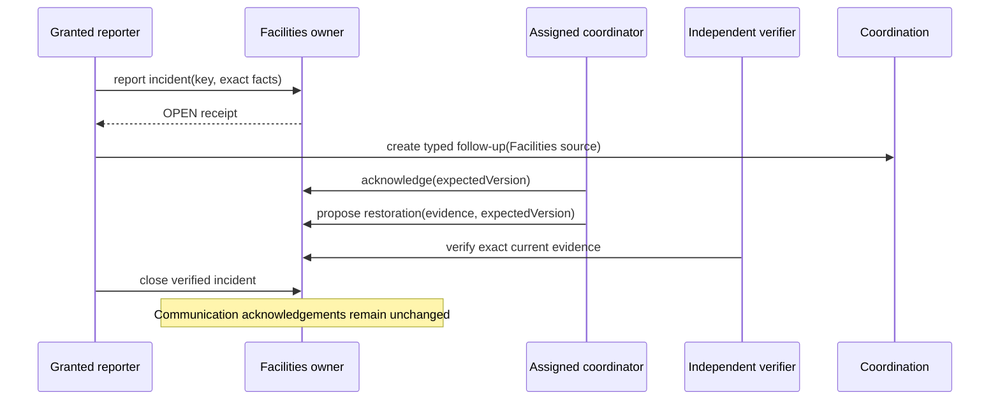

# Facilities service incident owner design

Status: **F16 DESIGN READY / D18 APPROVED FOR SYNTHETIC IMPLEMENTATION / PRODUCTION ROSTER AND PUBLICATION POLICY PENDING**.

This LLD implements the first concrete service owner, Facilities, for LEA-44. The existing `inventory` product release gates the slice because it is the live catalogue capability that owns branch physical resources. This does not enable transport, library, telemetry, passenger, location or emergency workflows. A Principal role grants nothing by itself.

## Invariants and ownership

- Facilities owns the factual affected facility, affected interval, impact, assigned coordinator, lifecycle and immutable restoration evidence. Coordination owns follow-up requests. Communication owns notice review, publication, delivery, read and acknowledgement.
- Explicit branch grants are `INCIDENT_REPORT`, `INCIDENT_COORDINATE`, `RESTORATION_VERIFY` and `INCIDENT_CLOSE`. The assigned coordinator must also hold `INCIDENT_COORDINATE`. The restoration verifier must hold `RESTORATION_VERIFY` and be distinct from the coordinator who proposed restoration.
- Lifecycle is `OPEN -> INVESTIGATING -> RESTORATION_PROPOSED -> VERIFIED_RESTORED -> CLOSED`. Reporting is the only create operation. A coordinator acknowledges, then proposes factual restoration evidence. An independent verifier verifies that exact version. A closer may close only a verified incident.
- No state claims all recipients were informed. A Facilities transition never writes Communication tables or acknowledgement rows. A separately authorized Communication workflow remains necessary for any notice.
- The affected interval is branch-local source data represented by server instants plus the branch timezone. End must be after start and no speculative restoration estimate is stored.

## Schema and queries

All tables are BRANCH classified under TEN-ADR-006 Path A and remain gated by TEN-03.

| Table | Fields | Constraints and read indexes |
|---|---|---|
| `vs_facilities_capability_grant` (FacilitiesCapabilityGrant) | id/org/school/membership/account/operator uuid; capability; grant/revoke/version | Explicit branch Facilities purpose grant. | Scoped membership/account FKs; partial active capability uniqueness; active actor lookup. |
| `vs_facilities_incident` (FacilitiesIncident) | id/org/school uuid; facility/period/impact; reporter/coordinator/proposer/verifier; state/version/timestamps | Facilities-owned factual service incident and restoration state. | Scoped School/account FKs; interval/state/restoration/version checks; state and coordinator queues. |
| `vs_facilities_incident_event` (FacilitiesIncidentEvent) | id/org/school/incident/actor uuid; sequence/transition/evidence/version/time | Append-only Facilities incident lifecycle evidence. | Scoped Incident/account FKs; unique sequence; append-only trigger; history index. |

List and detail always begin with `(organization_id, school_id)` and then require a current branch grant or exact assigned-coordinator relationship. Coordination receives a typed, minimized `FACILITIES_INCIDENT` projection; it never reads Facilities tables directly outside the registered adapter.

## Transactions, replay and authorization

Every request checks live account token, institution, branch, `inventory` release/entitlement/activation and exact current purpose. Mutations lock Account `UPDATE -> Organization SHARE -> School UPDATE -> incident UPDATE`, then recheck purpose and expected version. The owner write, append-only event, privacy-minimized audit and command receipt commit atomically. Same actor/key/exact payload returns one original result; changed payload conflicts. Status lookup reauthorizes the referenced incident before receipt disclosure; revoked actors cannot recover protected results and unknown remains unknown.

The Coordination adapter supports `FACILITIES_FOLLOW_UP` for an eligible non-closed incident and allows only its exact current coordinator as assignee. `FACILITIES_RESTORATION` evidence is valid only at the current verified incident revision. Communication remains a separate authorized workflow; restoring or closing an incident cannot acknowledge a notice.

## API, UI and failures

- Principal: `/leadership/services/incidents` and `/leadership/services/incidents/:id`.
- Facilities counterpart: `/admin/services/incidents` and `/admin/services/incidents/:id`.
- JSON host: `/api/v1/facilities/incidents`, item action, candidates and command status.

The incident composer uses Details -> Coordinator -> Review and performs the first write only on final confirmation. Detail presents current facts, immutable history and only currently authorized actions. A follow-up handoff opens the existing Coordination composer with a typed Facilities source. A communication handoff links to the separately protected Communication workspace and does not claim a notice exists.

Failures distinguish validation, authentication, forbidden, unavailable, not found, stale version, idempotency conflict and unknown outcome. Stale actions require a reload and fresh confirmation. Scope loss clears protected data through the existing portal boundary.

## Verification

Unit tests cover interval/text validation and lifecycle transitions. Real PostgreSQL covers grant scope, lifecycle, independent verification, stale/replay, revocation, Coordination source eligibility, cross-branch denial and unchanged Communication acknowledgement data. Browser checks cover report -> coordinator -> verifier -> close, typed follow-up, lost-response recovery, desktop/mobile and keyboard focus. Synthetic-only fixtures are idempotent. Human review, production service roster/publication policy, TEN-03, font portability and native accessibility remain pending.
