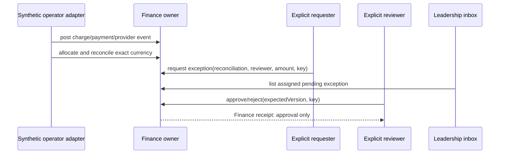

# Finance exact-money and financial exception design

Status: **F15 DESIGN READY / D17 APPROVED FOR SYNTHETIC IMPLEMENTATION / LIVE PAYMENT AND PRODUCTION LIMIT POLICY BLOCKED**.

This LLD implements the Finance-owned synthetic checkpoint required for LEA-43. The existing `fees` release, institution entitlement and branch activation gate every operation. Principal, Administrator and Finance labels grant no authority. Production remains disabled until real policy limits, provider authentication, retention, reconciliation operations and independent review are approved and verified.

## Ownership and invariants

- Finance owns charge, payment, allocation, reconciliation and exception facts. Leadership consumes a minimized projection and never writes Finance tables directly.
- Money is ISO 4217 currency plus integer minor units. Every aggregate, allocation, exception and decision contains one currency; unlike currencies are never combined.
- Ledger entries are immutable positive `CHARGE` or `PAYMENT` facts. This slice accepts only operator-authenticated synthetic facts. A provider event identifier is unique in branch scope; an exact duplicate returns the original entry and changed input conflicts.
- An allocation binds one Payment entry to one Charge entry of the same currency. The transaction locks both entries and existing allocations; cumulative allocation cannot exceed either entry.
- A reconciliation snapshot is immutable and records the exact cutoff, currency, charge/payment/allocation totals, unmatched totals, exception count, source digest and `RECONCILED` or `UNRECONCILED`. Leadership totals come only from this snapshot.
- A financial exception is `CONCESSION` or `REFUND_REQUEST`, assigned to one explicit reviewer and begins `PENDING`. Its amount and currency are pinned to the source reconciliation. Approval records bounded Finance approval only; it does not adjust a charge, initiate a refund, settle funds or prove provider delivery.
- The requester and reviewer must differ. The reviewer needs current `EXCEPTION_REVIEW` purpose with a non-null limit in the same currency and amount not above that limit. Null means no approval authority. Reject requires a reason. All outcomes are immutable events.

## Physical schema and queries

All tables are BRANCH classified under TEN-ADR-006 Path A and retain TEN-03 as a production gate.

| Physical table (classification) | Columns | Responsibility | Constraints and indexes |
|---|---|---|---|
| `vs_finance_capability_grant` (BRANCH) | id/org/school/membership/account/operator uuid; capability/currency/limit/grant/revoke/version | Explicit current Finance purpose; only review grants carry a currency and configured limit. | Scoped membership/account FKs; reviewer limit check; partial active uniqueness; active lookup index. |
| `vs_finance_ledger_entry` (BRANCH) | id/org/school uuid; kind/currency/minor units/source/provider event/times | Immutable synthetic charge and payment facts with provider deduplication. | Scoped School FK; positive amount; unique source and provider event; currency/cutoff index; append-only trigger. |
| `vs_finance_allocation` (BRANCH) | id/org/school/payment/charge uuid; currency/minor units/time | Exact one-currency allocation between immutable payment and charge facts. | Scoped ledger FKs; positive amount; unique pair; application cumulative bounds; append-only trigger. |
| `vs_finance_reconciliation` (BRANCH) | id/org/school uuid; currency/cutoff/state/exact totals/definition/digest/time | Immutable cutoff snapshot used by leadership-safe financial projections. | Scoped School FK; arithmetic/state checks; latest currency/cutoff index; append-only trigger. |
| `vs_finance_exception` (BRANCH) | id/org/school/reconciliation/requester/reviewer uuid; currency/kind/amount/reason/state/version/times | Assigned bounded concession/refund review whose outcome never initiates money movement. | Scoped Reconciliation/account FKs; separation/state/version checks; requester/reviewer queues. |
| `vs_finance_exception_event` (BRANCH) | id/org/school/exception/actor uuid; sequence/transition/reason/version/time | Append-only exception request and decision evidence. | Scoped Exception/account FKs; unique sequence; history index; append-only trigger. |

Summary query selects the latest reconciliation per requested currency under `(organization_id, school_id, currency)` and exposes no pupil identity, debtor list, hardship narrative, payroll or account details. Exception list is restricted to the requester or assigned reviewer and detail repeats that live authorization. The registered Leadership adapter returns only pending items for the exact assigned reviewer.

## Ports, transactions and recovery

`FinanceFacade` exposes operator-only grant and synthetic ledger/reconciliation helpers, plus transport-neutral summary, request, list, get, decide and status operations. The Next host resolves the current scope and injects configuration. Pages and routes contain no Finance rules or writes.

Synthetic fact ingestion uses serializable transactions and durable branch-scoped source/provider keys. Exception request and decision lock Account `UPDATE -> Organization SHARE -> School UPDATE -> exception UPDATE`, recheck `fees` availability and current purpose, compare expected version, and atomically commit owner state, append-only event, minimized audit and generic command receipt. Same actor/key/exact payload returns the original semantic result after live reauthorization; changed payload conflicts. Status lookup never treats missing receipt as failure and denies disclosure after grant or assignment revocation.

The Finance decision adapter registers `FINANCE_EXCEPTION` with the existing Decision inbox. It delegates reads and decisions back to Finance. Inbox presence supplies no approval authority. Request-information is unsupported in this slice; conflict routing is available only to another currently authorized reviewer whose configured currency limit covers the amount.

## API and UX

- Principal: `/leadership/finance/exceptions` and `/leadership/finance/exceptions/:id`.
- Finance requester: `/admin/finance/exceptions`, `/admin/finance/exceptions/new`, and detail.
- JSON host: `/api/v1/finance/summary`, `/exceptions`, `/exceptions/:id`, candidates and command status.
- The shared Leadership decision inbox deep-links the same owner evidence when a pending exception is assigned.

The summary always shows branch, currency, cutoff, definition, reconciliation state and exact totals. Unreconciled means unavailable for collection claims rather than zero. The request flow uses Details -> Reviewer -> Review and writes only on final confirmation. The review flow uses Evidence -> Decision -> Receipt. Approved, initiated and settled remain visibly distinct; this slice can show only `Approval recorded — no payment initiated`.

Failures distinguish validation, unauthenticated, forbidden, unavailable module/configuration, not found, stale evidence, separation conflict, limit exceeded, idempotency conflict and unknown outcome. Protected data clears on scope or authority loss.

## Verification

Unit checks cover exact-money parsing, lifecycle and bounds. Real PostgreSQL proves provider dedup, allocation bounds, reconciliation arithmetic, separation, configured limits, assigned review, stale/replay, revocation and cross-branch denial. Browser checks cover summary -> request -> assigned Principal review -> owner-confirmed approval, lost-response recovery, desktop/mobile and focus. Synthetic seed is idempotent and explicitly labelled. Human review, live provider, actual settlement, production limits, retention, TEN-03, font portability and native accessibility remain pending.
