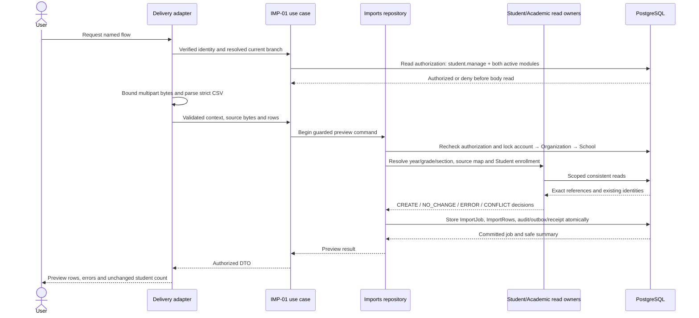
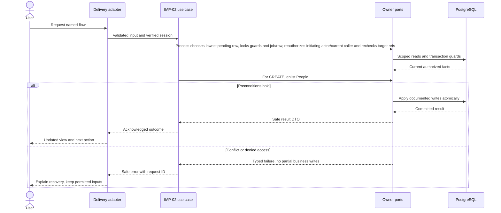
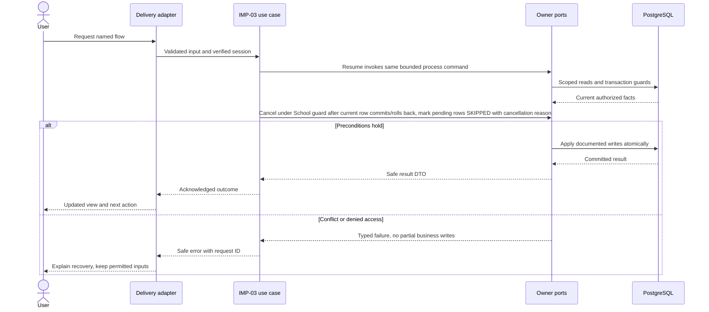

# Previewed, resumable student roster import — design

Phase 1 · Design revision 1 · 3 October 2026. Status: specified for implementation; only the platform readiness path is implemented in this starter. Review unresolved deployment choices in FND-02 before real-data use.

## Database naming and physical mapping

All physical objects follow [the VS database contract](../../DATABASE_DESIGN.md). Table names and columns below are physical SQL names; workflow prose uses logical domain names. `organizationId` maps to `organization_id`, `schoolId` to `school_id`, and `scope` expands to both columns. Models retain PascalCase through Prisma `@@map`; camelCase fields use `@map`. Planned schemas are implemented only through their named tasks and reviewed migrations.

## Ownership, aggregates and values

ImportJob is an orchestration aggregate with immutable source/preview revision and explicit confirmation. ImportRow owns its final outcome and receipt; SourceStudentMap gives stable external identity across jobs. Job states UPLOADED→REVIEW→CONFIRMED→RUNNING→COMPLETED/COMPLETED_WITH_ERRORS; FAILED for unrecoverable source errors; CANCELLED stops unstarted work only. No rows create school data before confirmation. Values: CSVSchemaVersion, SourceNamespace(1–40), ExternalStudentId(1–100), SHA256, PreviewRevision. Events: ImportConfirmed.v1, ImportRowApplied.v1, ImportFinished.v1.

## Module decisions

IMP-ADR-001: bounded bytea source storage for the small pilot. Alternative unrestricted local upload directory rejected. Later storage adapter migration may move private blobs without changing domain import contracts.

IMP-ADR-002: explicit browser-triggered bounded processing (up to 25 rows per request, max 5 seconds between rows) rather than an assumed resident worker. Each row has its own transaction and status under School guard. Repeated process calls skip terminal receipts; concurrent calls serialize row decisions. No lease is needed while the row executes entirely within the DB transaction; if processing later gains external I/O/long work, add a durable claim/lease design first.

IMP-ADR-003: create-only + exact NO_CHANGE reimport in v1. Updates, guardians and transfers are excluded from CSV. This keeps preview approval precise; expansion requires a new schema contract and task.

## Physical data contract

IMP-01 installs ImportJob, ImportRow and SourceStudentMap so preview can resolve existing source identity; only IMP-02 writes SourceStudentMap. `scope` below means `(organizationId,schoolId)`. All business roots have version >=1. All scoped references require composite FK targets with matching unique keys, even when abbreviated in the table. Creation times use server clock; IDs server generated. Required unless nullable is stated. Enum labels are constrained enums/CHECKs, not unchecked strings. Do not silently implement a weaker constraint because Prisma syntax cannot express it; use reviewed migration SQL.

| Table | Fields and data stored | Meaning | Keys / constraints / query support |
|---|---|---|---|
| `vs_imports_import_job` (ImportJob) | id uuid PK; organization_id uuid; school_id uuid; actor_account_id uuid; year_id uuid; campus_id uuid nullable; namespace varchar(40); schema_version varchar(40); state varchar(40); file_hash char(64); source_bytes bytea nullable; source_expires_at timestamptz(3); preview_revision int; context jsonb; confirmed_at timestamptz(3) nullable; version int; created_at timestamptz(3) | Imports-owned job stores immutable source and SHA-256; context contains sanitized display name and selected reference versions. Audit excludes source hash/content and row data. CSV max 2 MiB; source expires after 7 days; row outcomes retain minimal identifiers for 30 days. | Scoped School/year/nullable Campus FKs; global actor FK; UNIQUE(scope,id); index(scope,state,created_at,id); CHECK state/schema/hash/revision/version and octet_length(source_bytes)<=2097152 when nonnull |
| `vs_imports_import_row` (ImportRow) | id uuid PK; organization_id uuid; school_id uuid; job_id uuid; preview_revision int; row_number int; input_hash char(64); normalized jsonb; decision CREATE/NO_CHANGE/ERROR/CONFLICT; status PENDING/SUCCEEDED/FAILED/SKIPPED; expected_references jsonb; result jsonb nullable; error_code varchar(80) nullable; errors jsonb | Normalized bounded row, explicit preview outcome and column-safe row errors. Contains pupil data only in owned ImportRow storage. No credentials. | FK(scope,job_id)→ImportJob; UNIQUE(scope,job_id,preview_revision,row_number); CHECK row 2–1001, decision/status values and JSON shapes; index(scope,job_id,status,row_number) |
| `vs_imports_source_student_map` (SourceStudentMap) | id uuid PK; organization_id uuid; school_id uuid; namespace varchar(40); external_student_id varchar(100); student_id uuid; created_at timestamptz(3) | Stable cross-job source key; no name/email matching. | UNIQUE(scope,namespace,external_student_id); scoped Student FK; UNIQUE(scope,namespace,student_id) to refuse accidental second source identity |

## Read workflows and joins

Preview list reads ImportJob scope/actor + ImportRow by rowNumber, paged 50, with counts grouped by decision/status. Resolve CSV grade/section through Year/Grade/Section using exact codes and selected campus; never create a misspelled section. Match SourceStudentMap→Student→Person→Enrollment/Placement. Admission-number collision resolution queries Student by `(organization_id,school_id,admission_number)`; another branch's matching string is not a collision. If mapping is absent but a branch-scoped Student admission number already exists, preview CONFLICT_REQUIRES_MAPPING; no automatic bind. First release does not offer a mapping repair UI: authorized operator must establish a reviewed source mapping separately or correct the file before repreview.

Progress derives from durable rows, not an in-memory counter. Refresh/restart shows committed successes. No job-level success counter is trusted without reconciliation. Status reads are school-admin authorized; actor ownership alone does not bypass current membership. Downloads reauthorize and escape formula prefixes.

## Screen contract

/admin/imports upload→preview→confirm→progress/results. Display file name (sanitized, not path), schema, school/year/campus, source namespace, selected effective date and counts. Preview includes source row number and column error. Confirm disabled while ERROR/CONFLICT rows remain unless user explicitly chooses "Import valid rows only" with skipped count; invalid rows become SKIPPED, never silently omitted. Show Cancel stops remaining work and cannot undo successes. Page reload supports Resume processing. No file sends invitations.

All screens additionally follow Bible §8: loading, empty, validation, permission, stale/conflict, temporary failure and acknowledged success; semantic labels, focus and mobile layout. No future-module navigation.

## Application ports and transaction boundary

Each named flow below is an application use case. Inputs/outputs are plain DTOs; adapters implement owned repositories and public cross-module facades. Use SchoolCommand, ActorResolver, Clock, IdGenerator and transactional envelope writers from the shared contract. Do not pass Prisma.TransactionClient into application/domain code. Generic `save(any)` is not a replacement for named commands. Domain factories create new roots/events; rehydration restores without events.

Mutations use the account → Organization → School guard protocol in Bible §7. Every protected read and write reauthorizes current scope and resource permission. Read-only flows do not acquire write locks. Bootstrap/auth-only commands use their documented account/provisioning transaction. Scoped school uniqueness/range checks run after locks. Reauthorize before mutation receipt replay and commit; only a successful transaction stores a receipt. Aggregate version, audit, outbox and response commit together. Exact flow-specific reads and writes below refine this shared behavior.

## IMP-01 — Upload and preview a roster without changing students

**Success response contract:** `{jobId,version,previewRevision,fileHash,state:"REVIEW",counts:{create,noChange,error,conflict},nextCursor}`; row DTO `{rowNumber,decision,fields,errors:[{column,code,message}]}`.

**Transport:** POST /api/v1/imports/preview; GET /api/v1/imports/:id/rows

**Input:** Multipart file + schemaVersion=STUDENT_ROSTER_V1,yearId,campusId?,namespace,validFrom. Strict template in Bible; hash calculated server-side. CSV file limit is 2 MiB. Non-file metadata/envelope is separately limited to 8 KiB; multipart framing is limited to 16 KiB, making the maximum request body 2 MiB + 24 KiB. Neither bound applies the metadata limit to file bytes.

The `Idempotency-Key` header is required (16–100 URL-safe characters), counted as request metadata. Metadata accounting includes multipart text field names and UTF-8 values; framing is the remaining multipart delimiter/header/CRLF bytes after file and metadata bytes. Reject a declared or streamed total over the maximum before parsing; after parsing, enforce each separate limit. Unknown/duplicate multipart fields are invalid.

**Workflow:**

1. Resolve the verified actor and active branch, then require current `student.manage`, released/entitled/activated `student_core` and `academic_core` before consuming the body. Keep this existing capability; do not introduce `import.upload`. Apply a bounded account upload rate limit.
2. Read at most 2 MiB + 24 KiB, validate the three independent size budgets and multipart field contract, then parse strict UTF-8 CSV (optional BOM, valid quoted fields, CRLF/LF). Require exact known headers (required columns may be in any order; optional columns may be absent); reject unknown, missing, duplicate headers, malformed quoting/UTF-8, more than 1,000 data rows or a cell over 4 KiB UTF-8. Duplicate external IDs or admission numbers in one file receive row-level errors.
3. In a consistent read snapshot, resolve the selected year (must be OPEN and validFrom within `[startsOn,endsOn)`), exact active grade/section codes for that year and selected campus, source mapping and Student/Person facts. A missing section/grade yields a row ERROR. Resolve admission collision only in this branch. No name/email matching.
4. Classify an unmapped, noncolliding row as CREATE. A branch admission collision without a source mapping is CONFLICT_REQUIRES_MAPPING. For a mapped student, NO_CHANGE is allowed only when normalized first/last name and admission number match exactly and the target-year enrollment/placement exactly match the selected section, `[validFrom,year.endsOn)`, and optional roll; any mismatch is CONFLICT and never an update. Persist reference IDs/versions used for each decision.
5. Under the shared account → Organization → School mutation guard, create one immutable ImportJob and its ImportRows; compute `file_hash` from source bytes server-side and retain source bytes in ImportJob. Require an idempotency key: same key/context/source returns the original job; a changed context or source under that key conflicts. A receipt stores only the opaque job ID and summary; on replay compare submitted bytes with the hash in the scoped ImportJob row. Create no Person/Student/Enrollment and emit no student-created event.
6. Return safe preview summary and paginated row decisions. Every later job/row read reauthorizes current membership, `student.manage`, both module states and branch scope; reads do not acquire write locks.

**Database writes / atomicity:** ImportJob, ImportRow, Platform-owned audit/outbox and an idempotency receipt share one PostgreSQL transaction; SourceStudentMap is read-only in IMP-01. There are no writes to People, Students or Academics. Audit/outbox records actor, scope, opaque job ID, schema/state transition, aggregate decision counts and request ID only. Exclude file name/path, source bytes/hash, raw/normalized row values, student/admission identifiers, contact data and row-level errors. `file_hash` remains in its owned ImportJob storage and authorized job DTO; it is not copied into audit, outbox, logs, analytics or the receipt's stored response/input fingerprint.

**Errors and recovery:** Unauthenticated→401; missing permission→403; missing/foreign job→404; unavailable release→503; inactive entitlement/branch or closed/out-of-scope year→409; missing/invalid multipart fields, malformed UTF-8/CSV/header or invalid idempotency key→422; same key with changed context/source→409; file/metadata/framing bound exceeded→413 with only the exceeded category/limit; rate limit→429 with Retry-After; unknown grade/section→row ERROR; existing branch-scoped unmapped admission or mapped-row mismatch→row CONFLICT. Errors never echo source contents or identifiers.

**Verification:** Unit — Strict UTF-8/CSV quoting, headers, BOM, blank optional fields, limits, duplicate keys, canonical normalized hash and exact NO_CHANGE projection. Functional PostgreSQL — Preview leaves Person/Student/Enrollment counts unchanged; scoped references/source map; module/permission revocation; same-key replay/change conflict; audit/outbox/source-hash exclusions; concurrent duplicate keys. E2E — Upload matching and invalid samples, inspect paged decisions/errors, test body limits/replay and verify student counts remain unchanged before confirm.

**Design-readiness note (4 October 2026):** Imports owns ImportJob/ImportRow/SourceStudentMap; Students/People own all pupil identity and enrollment writes. Require current `student.manage` and active release, entitlement and activation for both student_core and academic_core. A required idempotency key binds immutable context; receipt data stores only opaque job ID/summary and replay compares source bytes with the owned ImportJob hash. The NO_CHANGE projection and mismatch conflict behavior are explicit. The 2 MiB limit applies only to CSV bytes; text metadata (including field names and idempotency key) is separately capped at 8 KiB and multipart framing at 16 KiB. Preview authorizes before body consumption and on every protected read; it writes import-only rows, reads without write locks, and never creates Persons, Students or Enrollments. Hash remains in ImportJob storage; sensitive upload/row data is excluded from audit. Admission collision uses branch-scoped Student ownership; normal student-list search remains. BRANCH scope, indexes, constraints and policy intent are registered under Path A; TEN-03 owns enforcement. No product blocker remains for preview-only IMP-01; distributed production rate limiting remains an FND-02 deployment gate.

## IMP-02 — Confirm and process complete student rows

**Success response contract:** Confirm `{jobId,version,state,approvedCount,skippedCount}`; process `{jobId,state,counts:{pending,succeeded,failed,skipped},hasMore}`; row success `{studentId,enrollmentId,outcome}`.

**Transport:** POST /api/v1/imports/:id/confirm; POST /api/v1/imports/:id/process

**Input:** Confirm expectedVersion,previewRevision,fileHash,skipInvalid boolean,key; Process command key and jobId; requests handle <=25 rows.

**Workflow:**

1. Confirm under account/School guards: current student.manage, file/context/revision hash and referenced versions; pin approved row set.
2. Process chooses lowest pending row, locks guards and job/row, reauthorizes initiating actor/current caller and rechecks target refs.
3. For CREATE, enlist People.Register + Students.Register/Enroll in one transaction; for exact NO_CHANGE validate current approved fields and return original IDs.
4. Commit SourceStudentMap, ImportRow result/status, row audit/outbox and receipt with business writes. No half-created person on failure.
5. On validation conflict rollback row business work, record FAILED in a separate authorized transaction; advance safely and derive final state from durable outcomes.

**Database writes / atomicity:** Per row: Person + Student + Enrollment + Placement + SourceStudentMap + row SUCCEEDED result + envelopes, or no business writes for NO_CHANGE. Job state transitions separately, never claim all-file rollback.

**Errors and recovery:** Stale confirmation→409; changed references during process→row CONFLICT; current permission lost→403 and stop; crash leaves current row pending; exact retry returns committed result.

**Verification:** Unit — Preview binding and permitted row transitions. Functional PostgreSQL — Failure after Person creation rolls full row back; concurrent jobs same external/admission yield one identity; two process calls never apply a row twice. E2E — Confirm, process, refresh result; retry process without duplicates.

## IMP-03 — Resume, cancel and explain partial imports

**Success response contract:** Same progress DTO; cancel includes committedCount and skippedCount with `state:"CANCELLED"`. Error CSV includes rowNumber,column,errorCode,message and safe reviewed identifiers only.

**Transport:** POST /api/v1/imports/:id/cancel; GET /api/v1/imports/:id; GET /api/v1/imports/:id/errors.csv; operator purge-import-sources

**Input:** Cancel expectedVersion,reason,key; reads limited current-school scope; purge only expired payloads under operator retention policy.

**Workflow:**

1. Read durable row counts; distinguish failed, skipped, pending and succeeded.
2. Resume invokes same bounded process command; no client-local progress authority.
3. Cancel under School guard after current row commits/rolls back, mark pending rows SKIPPED with cancellation reason.
4. Authorize error CSV; quote/escape dangerous spreadsheet prefixes, stream no private unrestricted file URL.
5. Retention command purges expired sourceBytes and later row PII while preserving minimal job/result/key evidence per policy; refuse resume if unprocessed source is expired.

**Database writes / atomicity:** Job CANCELLED and pending rows SKIPPED; previously committed student rows remain; expiry purge writes audited technical retention outcome.

**Errors and recovery:** Cancel terminal→safe existing response; expired unprocessed source→409 SOURCE_EXPIRED; permission lost→403 with no sensitive download.

**Verification:** Unit — Terminal state totals and formula-safe cells. Functional PostgreSQL — Crash/resume idempotency; revoke actor mid-job; cancellation preserves successes; retention does not erase source mappings. E2E — Reload while work pending; resume; cancel remaining; download errors.

## Migration, retention and handoff

Implement tables only in the task that first uses them; migrate from empty database and the previous task checkpoint. Add scoped unique indexes before composite FKs; detect existing duplicates before adding constraints. SQL append-only/null-campus/range safeguards must appear in reviewed migrations and real-DB tests. No seed may erase prior data. Use synthetic fixtures and clean only owned test records. Preserve schema-compatible app rollback; use a reviewed forward migration when incompatible. Retention changes must preserve required immutable evidence and legal holds under the school-approved policy, not an ad hoc DELETE.

Malformed quotes/BOM/UTF-8, duplicate/unknown headers, leading zeros, Unicode, embedded commas/newlines, size/row/cell limits, duplicate external keys, stale confirmation, source/admission collision, injected failure after Person creation, concurrent process/reimport, lost response, revocation, cancellation and formula-safe errors. Test with real owner facades and PostgreSQL.

See [tasks](TASKS.md), [current state](CURRENT_STATE.md), [Bible](../../VSchool_Bible.md) and [agent runbook](../../AGENT_RUNBOOK.md).

## v4.1 integration requirements

School means operational Branch and Organization means client Institution. Every protected flow checks current release availability, institution entitlement, branch activation and user/resource permission; foundational commands remain available only through their required capability projection. Apply the revised account → Organization shared guard → School guard protocol from Tenancy DESIGN. Use the shared components/tokens and current branch context; never invent a second visual system. No operational access is implied by institution administrator role.

## Portable backend integration

Follow [the backend extraction contract](../../BACKEND_EXTRACTION.md). Server module code belongs in backend/modules; UI consumes shared/contracts and a module gateway. Next delivery adapters resolve transport/session and invoke portable use cases. Future Nest controllers and provider factories reuse those use cases. Framework-specific context/ORM results never enter domain or browser DTOs.
