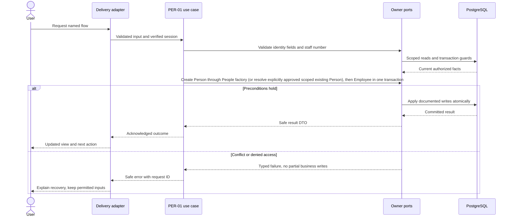
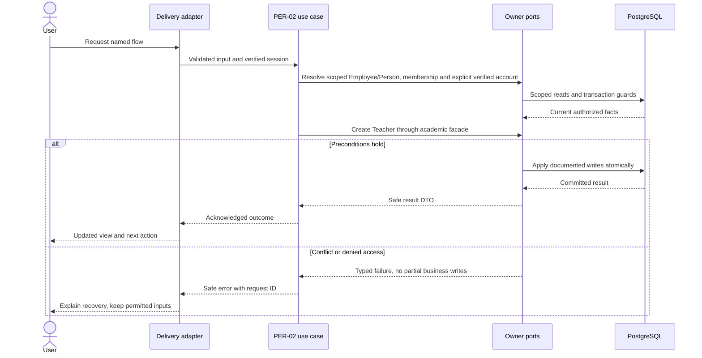

# People and staff identity — design

Phase 1 · Design revision 2 · 5 October 2026. PER-01 and PER-02 are implementation-verified; PER-02 human review remains pending for source `e72125d4545e48c4b5c69c4ba3c9a646f7eea5d1`. IAM-03 acceptance was recorded for the prerequisite source `e0f262a78d7e020919cd36be80d508c9032d1e07`. Teacher schema is installed. Review unresolved deployment choices in FND-02 before real-data use.

## Database naming and physical mapping

All physical objects follow [the VS database contract](../../DATABASE_DESIGN.md). Table names and columns below are physical SQL names; workflow prose uses logical domain names. `organizationId` maps to `organization_id`, `schoolId` to `school_id`, and `scope` expands to both columns. Models retain PascalCase through Prisma `@@map`; camelCase fields use `@map`. Planned schemas are implemented only through their named tasks and reviewed migrations.

## Ownership, aggregates and values

Person aggregate owns organization-local display identity. Employee is a school root with staff number, employment interval and status. Academics owns Teacher, not People. A Person can become both staff and guardian later without duplicating names. Values: HumanName (firstName 1–100, lastName 0–100), StaffNumber (1–40), EmailAddress, DateRange. Events: PersonRegistered.v1, PersonNameChanged.v1, EmployeeCreated/Ended.v1. Do not merge on name/contact similarity.

## Module decisions

PER-ADR-001: stable person identity and separate school profiles. Creating similarly named people is permitted, while suggested matches need explicit human resolution. Alternative uniqueness on contact email rejected because families share addresses.

PER-ADR-002: organization-wide or shared-profile Person corrections are restricted identity-steward maintenance in Phase 1. SA-COMP-04 permits a narrower school-administrator correction only when the selected Person is referenced by exactly one Student in the institution and by no Employee. The Students owner proves the exact current-branch Student selection and institution-wide Student exclusivity under the Person lock; People proves no Employee reference and owns the name transition/history. Shared identities fail closed with `PERSON_SHARED`. This exception cannot rename another branch's pupil or a staff/account-bound identity.

### STF-04A — Staff command recovery

People exposes an owner-specific status query only for `EmployeeCreated`, `TeacherEligibilityEnabled`, `PersonAccountBound`, `EmployeeEnded` and `EmployeeCategoryChanged`. The browser retains one immutable command key and payload while an outcome is unknown. Status returns only `UNKNOWN` or the exact `FOUND` People result; it never interprets absence as failure. The repository establishes verified database context, rechecks the current administrator membership and `class.manage` (plus `user.manage` for account binding), reads only the applicable People/Platform receipt, verifies that its Employee still belongs to the exact branch, then reauthorizes before disclosure. Revoked authority denies even a committed receipt.

Confirmed mutation and failed refresh is a distinct presentation state. Its recovery issues only the protected GET and never repeats the mutation. A genuinely unknown mutation disables further People saves until status or exact-payload replay resolves it. This contract does not authorize PD-STF-02 Person/Employee corrections or durable browser drafts.

## Physical data contract

PER-01 installs Person, Employee and the Access-owned AccountPersonBinding table; binding rows remain empty until PER-02. PER-02 installs the Academics-owned Teacher eligibility table. Later People tables remain planned. `scope` below means `(organizationId,schoolId)`. All business roots have version >=1. All scoped references require composite FK targets with matching unique keys, even when abbreviated in the table. Creation times use server clock; IDs server generated. Required unless nullable is stated. Enum labels are constrained enums/CHECKs, not unchecked strings. Do not silently implement a weaker constraint because Prisma syntax cannot express it; use reviewed migration SQL.

| Table | Fields and data stored | Meaning | Keys / constraints / query support |
|---|---|---|---|
| `vs_people_person` (Person) | id uuid PK; organization_id uuid; first_name varchar(100); last_name varchar(100) default empty; contact_email varchar(254) nullable; version int; created_at timestamptz(3) | Canonical name/contact; email contact is not verified login ownership. Minimal pilot PII, no health/document fields. | FK organization; UNIQUE(organization_id,id); index(organization_id,last_name,id); no email/name uniqueness |
| `vs_people_person_name_revision` (PersonNameRevision) | id uuid PK; organization_id uuid; person_id uuid; version int; previous_first_name varchar(100); previous_last_name varchar(100); corrected_first_name varchar(100); corrected_last_name varchar(100); reason varchar(500); actor_account_id uuid; school_id uuid; occurred_at timestamptz(3) | Append-only People-owned identity correction history. Names and reason stay in this owned storage and are excluded from receipts/outbox/audit diffs. | FK(organization_id,person_id)→Person; FK actor account; scoped School context FK; UNIQUE(organization_id,person_id,version); index(organization_id,person_id,version desc); CHECK version>=2, bounded names/reason; append-only trigger |
| `vs_people_employee` (Employee) | id uuid PK; organization_id uuid; school_id uuid; person_id uuid; staff_number varchar(40); category TEACHING/ADMINISTRATION/SUPPORT/UNCLASSIFIED default UNCLASSIFIED; employed_from date; employed_to date nullable; status ACTIVE/ENDED; version int | School institutional profile; links rather than duplicates identity. Category is descriptive only. | Scoped School FK; FK(organization_id,person_id); UNIQUE(scope,staff_number); UNIQUE(scope,person_id); UNIQUE(scope,id); CHECK category vocabulary; CHECK end null or from<end |
| `vs_people_availability_recorder_grant` (PeopleAvailabilityRecorderGrant) | id uuid PK; organization_id uuid; school_id uuid; membership_id uuid; account_id uuid; designated_by_operator_id uuid; designated_at timestamptz(3); revoked_at timestamptz(3) nullable; version int | Separately designated operational availability recorder; independent of role. | Scoped membership FK; UNIQUE(scope,id); UNIQUE(scope,account_id); positive version; runtime index |
| `vs_people_availability_interval` (PeopleAvailabilityInterval) | id uuid PK; organization_id uuid; school_id uuid; employee_id uuid; state AVAILABLE/UNAVAILABLE; starts_at/ends_at timestamptz(3); timezone varchar(64); source_kind; source_reference; recorded_by_account_id; recorded_at; version | Authoritative non-sensitive operational availability interval; no private leave narrative. | Scoped Employee FK; actor FK; closed vocabularies; half-open maximum 31-day window; positive version; scope/window indexes |
| `vs_people_availability_revision` (PeopleAvailabilityRevision) | id uuid PK; organization_id uuid; school_id uuid; interval_id uuid; version; state; starts_at/ends_at; timezone; source_kind/reference; actor_account_id; occurred_at | Append-only availability revision history and attribution. | Scoped interval FK; actor FK; closed vocabularies/window checks; UNIQUE(scope,interval_id,version); history index |
| `vs_academics_teacher` (Teacher) | id uuid PK; organization_id uuid; school_id uuid; employee_id uuid; active boolean; version int | Academics-owned teacher eligibility, not an account or login. | Scoped FK(scope,employee_id)→Employee(scope,id); UNIQUE(scope,employee_id); UNIQUE(scope,id); index(scope,active,employee_id); Path A RLS metadata; TEN-03 enforcement gate |

## Read workflows and joins

Staff list: Employee filtered by selected school → Person on organization/id → optional Teacher on scope/employeeId → AccountPersonBinding on organization/personId → current SchoolMembership for that account. Return staff name/number/status and portal-access badge, never password/token. A Person is viewable only through an authorized same-school profile. Organization-wide contact/name edits must lock every school in which that Person has a profile in sorted order and require explicit organization identity-steward operator authority; the school-admin exception below cannot change a shared identity.

### STF-01A People-native Staff directory query

The Staff directory accepts a normalized name or Employee-code search, one People-owned category filter, one People-owned employment-state filter, and deterministic name, Employee-code or employment ordering. Search and all People predicates apply to the complete authorized branch result before pagination. Name search matches the normalized displayed first/last-name composition; Employee-code search never becomes a Person identity-resolution operation. Teaching and Access filters/sorts remain absent until those owners publish the versioned directory projections specified by STF-01B.

Ordering uses a case-folded primary value followed by case-folded Staff number and Employee ID. The primary direction may be ascending or descending; tie-breakers remain ascending in display order. Opaque HMAC cursors bind the organization, branch, actor, token version, School configuration version, complete normalized query, page direction and boundary tuple. A changed query, authority version or branch revision invalidates the cursor. Reads retain the current live account, membership, `class.manage`, release and scope guard and execute at repeatable read. The response includes current page rows, total matching People records and safe next/previous cursors. Browser URL state contains only validated query fields and the opaque cursor; Back/Forward therefore reissues the protected owner query rather than reusing another scope's rows.

### STF-03A authorized Staff Profile composition

`GET /api/v1/employees/{employeeId}` and `/admin/teachers/{employeeId}` resolve an exact same-branch Employee only after the current People account/token, institution, branch, active membership and `class.manage` guard. People returns Person display/contact facts, Employee code/category/employment/version and bounded People-owned history. Contact email remains descriptive and is never treated as sign-in identity.

The People facade composes two typed read ports. Academics independently rechecks the live actor, branch, `class.manage`, release, institution entitlement and branch activation before returning Teacher eligibility plus bounded dated assignments. Access independently rechecks live `user.manage` authority before returning binding, membership roles and the latest safe invitation lifecycle without email, token, hash or verification evidence. A missing foreign capability or module yields an explicit unavailable panel without inferred owner facts; an invalid account/token or missing scoped Employee produces a not-found-shaped destination denial. People rechecks its guard after composing the projections so a concurrent revocation cannot leave a protected Profile result available. No foreign private table is read by People and this read creates no persistence or migration.

SA-COMP-04's deliberately narrow read is Student detail → exact scoped Student → organization Person → PersonNameRevision ordered by version descending, bounded to 20. It runs only after `student.manage` authorization. The administrator path is absent when any other institution Student or any Employee references the Person. AccountPersonBinding is currently created only for an Employee Person, so the Employee exclusion also blocks bound login identities. Future Person consumers must join the exclusivity contract before this command can remain enabled.

## Screen contract

/admin/teachers: search/paginate staff; PER-01 captures first/last name, optional contact email, staff number and employment start date, then shows employment and portal-access status. It always creates a new Person and never links an account or enables teaching. PER-02 adds only the separately reviewed verified-account and teacher-eligibility actions. Pending portal access and no assignments remain distinct states; ending employment shows affected assignments/sessions first.

All screens additionally follow Bible §8: loading, empty, validation, permission, stale/conflict, temporary failure and acknowledged success; semantic labels, focus and mobile layout. No future-module navigation.

## Application ports and transaction boundary

Each named flow below is an application use case. Inputs/outputs are plain DTOs; adapters implement owned repositories and public cross-module facades. Use SchoolCommand, ActorResolver, Clock, IdGenerator and transactional envelope writers from the shared contract. Do not pass Prisma.TransactionClient into application/domain code. Generic `save(any)` is not a replacement for named commands. Domain factories create new roots/events; rehydration restores without events.

Mutations use the account → Organization → School guard protocol in Bible §7. Every protected read and write reauthorizes current scope and resource permission. Read-only flows do not acquire write locks. Bootstrap/auth-only commands use their documented account/provisioning transaction. Scoped school uniqueness/range checks run after locks. Reauthorize before mutation receipt replay and commit; only a successful transaction stores a receipt. Aggregate version, audit, outbox and response commit together. Exact flow-specific reads and writes below refine this shared behavior.

## PER-01 — Create and inspect staff profiles

**Success response contract:** `{employeeId,version,staffNumber,person:{id,displayName},employment:{from,to,status},portalAccess:"UNLINKED"}`. List adds current permitted portal badge.

**Transport:** POST /api/v1/employees; GET /api/v1/employees

**Input:** firstName,lastName?,contactEmail?,staffNumber,employedFrom; key. class.manage required. PER-01 always creates a new Person; it has no existing-person resolution path because this task has no operator-verification port. Names and contact data never merge identities. A later verified resolution command must be explicit and reviewed.

**Workflow:**

1. Authorize school staff management through class.manage; acquire guards.
2. Validate identity fields and staff number; do not infer Person equality from contact.
3. Create a new Person through the People factory, then Employee in one transaction. Never search or merge by name/contact.
4. Persist event/audit/receipt; add AccountPersonBinding table now Person exists, but do not bind automatically.
5. Read staff list via scoped Employee/Person join; display profile and portal status separately.

**Database writes / atomicity:** Person, Employee, the Access-owned AccountPersonBinding table (empty until the verified PER-02 binding use case), and shared envelopes; one forward migration with the scoped Person FK.

**Errors and recovery:** Staff number duplicate→409; foreign Person→404; invalid dates/contact→422.



**Verification:** Unit — Human name and employment interval validation. Functional PostgreSQL — Atomic Person/Employee rollback; scoped FK; duplicate staff race and same-name nonmerge. E2E — Create teacher staff record without login and refresh list.

## PER-02 — Enable teaching eligibility and verified account binding

**Success response contract:** `{employeeId,version,teacherId?,bindingId?,portalAccess,employmentStatus}`; impacted sessions in a conflict are bounded authorized IDs/dates, not foreign-school names.

**Transport:** POST /api/v1/employees/:id/teacher-profile; POST /api/v1/employees/:id/account-binding; PATCH /api/v1/employees/:id/end

**Input:** Teacher enable expectedVersion; binding accountId + verificationReference + reason, `user.manage` required; end effectiveDate (last employed day, inclusive) + reason/version; key. Offboarding currently accepts only the current school-local date; future-dated termination is unsupported. The stored `employed_to` remains the exclusive next day so the half-open employment range stays valid.

**Workflow:**

1. Acquire the initiating account, Organization and School guards in order; reauthorize the current resource capability before receipt replay and commit. Binding target account rows are guarded by Access inside the same transaction.
2. Resolve the scoped Employee/Person; account email equality, activation, or login possession is not proof. Only a user.manage administrator may bind after recording an out-of-band identity-check reference.
3. Create Teacher through the Academics facade; bind through the Access facade, each in the same owner-enlisted transaction. Each command has its own idempotency receipt.
4. End only for the current school-local date; mark Employee ENDED with the next-day exclusive `employed_to` and Teacher inactive atomically. The employment end revokes eligibility immediately. Assignment/session tables are not installed yet; ACA-03 and ATT-01 must add owner-side assignment/submission guards before those workflows are released. Do not claim an impact query in PER-02.
5. Persist audit/outbox/receipt and school configuration revision with the owning-module changes; present eligibility and account badges.

**Database writes / atomicity:** Teacher (Academics facade), AccountPersonBinding (Access facade), Employee end/status; audit/outbox/receipt and school revision in one serializable transaction. Binding records an Access security event containing only the safe verification reference, never the account email or raw evidence. Reads remain reauthorized and do not lock; mutations use account→Organization→School row locks.

**Errors and recovery:** Account/person already differently bound, inactive/unverified account, or missing active same-branch TEACHER membership→409; employee outside branch→404; stale version or competing write→409; past/future end date→422; invalid capability→403. Failure in any owner facade rolls back all owner rows and envelopes. When assignments/sessions ship, their owning mutation guards must reject incompatible offboarding with a safe conflict.



**Verification:** Unit — Input validation and safe errors. Functional PostgreSQL — Scoped Teacher FK/uniqueness, verified same-school binding, wrong-account/foreign-membership rejection, binding uniqueness race, atomic cross-owner rollback and same-day offboarding CAS. E2E — Enable eligibility, bind the intended synthetic active teacher account, refresh, reject a second binding; end employment and confirm eligibility becomes disabled. Assignment/session impact race evidence belongs to ACA-03/ATT-01 when those tables exist.

**Design-readiness note (4 October 2026):** Schema ownership is settled: People owns Employee lifecycle; Academics owns Teacher eligibility; Access owns the existing organization-local AccountPersonBinding keyed uniquely by `(organization_id,account_id)` and `(organization_id,person_id)`. A `user.manage` school administrator may bind only after an explicit out-of-band identity check and records a non-sensitive verification reference/reason; email equality, activation, or possession of a login alone never proves person identity. The operation enlists Access and Academics in one account→Organization→School guarded transaction; binding races roll back all owners. Dated dependency snapshot on 4 October: PER-01 VERIFIED/PENDING, IAM-03 VERIFIED/PENDING, ACA-01 VERIFIED/PENDING. PER-01 and ACA-01 pending reviews do not block PER-02; IAM-03 has the explicit owner-acceptance gate recorded in Access CURRENT_STATE and must be PASSED before PER-02 begins. CURRENT_STATE tables remain authoritative. No new binding schema is required. Path A defers database enforcement to TEN-03 while application authorization remains active.

## SA-COMP-04 — Correct an exclusive student Person name

**Owner contract:** Students owns exact branch Student selection and current `student.manage` authorization. People owns Person name validation, the version transition and immutable correction history. Students invokes the People `correctName` port with the same opaque transaction; neither application layer imports Prisma or the other owner's repository. The protected detail query composes the People history port after the scoped Student read.

**Input / output:** `studentId`, `expectedPersonVersion`, `firstName`, optional `lastName`, `reason` (5–500), stable key. Success returns only `{studentId,personVersion,revisionId,replayed}`; names are omitted from receipt, audit and outbox payloads. Detail adds current `personVersion`, `nameCorrectionAllowed` and at most 20 authorized People history entries. Transport is `POST /api/v1/students/:id/name-correction` through the Students gateway because the exact selected Student is the resource authority.

**Transaction and concurrency:** acquire the existing account→Organization SHARE→School UPDATE guards, then lock Person `FOR UPDATE` before the exclusivity query and CAS. Existing-Person Student registration also locks the selected Person, so a correction cannot race another branch attaching that identity. Under the lock, Students requires exactly one institution Student reference and that it is the selected scoped record; People requires no Employee reference. People inserts revision `expectedPersonVersion+1` and updates Person by `(organization_id,id,version)`. School revision, PII-free command receipt, platform audit/outbox and owner rows commit atomically at SERIALIZABLE isolation. Same key/same input reauthorizes and returns the original IDs/version; changed input conflicts.

**Failures and recovery:** foreign/missing Student→404; shared Student/Employee identity→409 `PERSON_SHARED` with identity-steward guidance; same normalized name→409; stale Person version→409 and the browser refetches the authorized detail to compare attempted and current names; malformed names/reason→422; permission/session/module failures retain existing safe mappings; evidence/database failure→503 with same-key retry. No route exposes contact email, other branches, foreign usage counts, tokens, or raw database errors.

```mermaid
sequenceDiagram
  actor A as School administrator
  participant H as Students HTTP/gateway
  participant S as Students use case/repository
  participant P as People name port
  participant D as PostgreSQL
  A->>H: Correct selected student's name, version, reason, key
  H->>S: Verified session and current branch
  S->>D: Lock account, organization, school, then Person
  S->>D: Re-read exact scoped Student and institution Student references
  S->>P: correctName in the same opaque transaction
  P->>D: Reject Employee use; CAS Person; append PersonNameRevision
  alt permitted and current
    S->>D: Commit school revision and PII-free evidence/receipt
    S-->>H: studentId, personVersion, revisionId
    H-->>A: Refresh current name and history
  else shared or stale
    P-->>S: Typed conflict; no partial write
    H-->>A: Guidance or current-versus-attempted comparison
  end
```

**Verification:** unit validation and unchanged-name rejection; populated migration from existing Person rows; real PostgreSQL success/history/replay/CAS, evidence rollback, cross-branch/shared Employee denial and correction-versus-existing-Person registration serialization; desktop/mobile browser success, reload persistence, reason validation and stale comparison. Path A class is INSTITUTION with `organization_id`; application resource authorization remains mandatory and TEN-03 is the enforcement gate.

**Design-readiness note (10 October 2026):** The approved SA-20 workflow and the former blanket PER-ADR-002 wording are reconciled through the exclusive-identity rule above. This resolves owner boundaries, exact Student selection, physical schema, authorized joins, lock order, idempotency, stale recovery, privacy exclusions and verification. No unresolved product decision remains for the narrow Phase 1 slice. Shared identities remain blocked rather than widened.

## Migration, retention and handoff

Implement tables only in the task that first uses them; migrate from empty database and the previous task checkpoint. Add scoped unique indexes before composite FKs; detect existing duplicates before adding constraints. SQL append-only/null-campus/range safeguards must appear in reviewed migrations and real-DB tests. No seed may erase prior data. Use synthetic fixtures and clean only owned test records. Preserve schema-compatible app rollback; use a reviewed forward migration when incompatible. Retention changes must preserve required immutable evidence and legal holds under the school-approved policy, not an ad hoc DELETE.

Duplicate staff-number race; same name allowed; no auto binding by email; wrong-organization Person denied; teacher profile creation rollback; ending employment immediately prevents submission through eligibility checks while retaining history.

See [tasks](TASKS.md), [current state](CURRENT_STATE.md), [Bible](../../VSchool_Bible.md) and [agent runbook](../../AGENT_RUNBOOK.md).

## Change log

2026-10-04 / PER-01 clarification: creation always makes a new Person because no operator-verified Person-resolution port exists in this task. This preserves the no-similarity-merge rule and reserves existing-person linking for an explicit reviewed workflow.

## v4.1 integration requirements

School means operational Branch and Organization means client Institution. Every protected flow checks current release availability, institution entitlement, branch activation and user/resource permission; foundational commands remain available only through their required capability projection. Apply the revised account → Organization shared guard → School guard protocol from Tenancy DESIGN. Use the shared components/tokens and current branch context; never invent a second visual system. No operational access is implied by institution administrator role.

## F07-A / LEA-23 — safe operational availability — 17 October 2026

Decision D09 is approved for synthetic-only implementation. People owns authoritative operational availability; it does not own leave, payroll, medical, timetable, or attendance facts. A separately designated availability recorder may create or revise a bounded `AVAILABLE` or `UNAVAILABLE` interval for an active same-branch Employee. The command contains `employeeId`, optional `intervalId`, `expectedVersion` (`0` for create), ISO instants `startsAt`/`endsAt`, the branch timezone, a bounded non-sensitive `sourceKind` and `sourceReference`, and an idempotency key. The interval is half-open, at most 31 days, and its timezone must equal the current Branch timezone. The source reference is provenance, never a private leave reason.

The persisted contract is `vs_people_availability_recorder_grant`, `vs_people_availability_interval`, and append-only `vs_people_availability_revision`. All are branch-scoped with composite scope FKs, positive versions, closed state/source vocabularies, interval checks, and scope-leading overlap/history indexes. Recorder designation is independent of role capability. A live account, token, membership, designation, Staff release/entitlement/activation, active Employee, expected version and exact replay input are rechecked in the serializable transaction. The transaction locks account → Organization → School → interval, updates School configuration revision, and appends platform audit/outbox/receipt plus the People revision. Same key and canonical input replays the owner result; changed input conflicts. Failed evidence rolls back the interval.

The Principal query requires current `leadership.read` (direct or Access-owned D02 delegation), current branch membership and Staff availability. It uses repeatable read and no write lock. For each active teaching Employee on the selected school-local date it returns name, staff number, `AVAILABLE`, `UNAVAILABLE`, or `UNKNOWN`, safe interval times, timezone, version and observed time. It never returns provenance, request text, leave reason, payroll, health or foreign-branch details. No matching interval is explicitly `UNKNOWN`, never free. The People cross-branch conflict port accepts a Person and exact instant interval and returns only `BUSY`, `FREE`, or `UNKNOWN`: any overlapping authoritative unavailable interval is busy; a covering available interval is free; otherwise unknown. It discloses no branch, class, reason, source or staff record.

Routes are `/admin/teachers/availability` for the designated recorder and `/leadership/staff/availability` for the safe Principal projection. JSON delivery is `/api/v1/people/availability`; browser scope is derived from the authenticated server context. The Principal page follows production recipe L and supports date refresh, populated/unknown/unavailable/forbidden states. The recorder uses one staged review dialog, retains safe input after validation, and only writes on final confirmation. Durable drafts are not introduced.

Verification covers interval validation and state precedence; real PostgreSQL scope, designation, module gates, create/revise/replay/stale behavior, immutable revisions, rollback, foreign-branch denial and minimal cross-branch collision; browser Principal and recorder journeys at 1440×1000 and 390×844 with keyboard focus. Path A policy metadata is recorded now; TEN-03 remains the production enforcement gate.

## Portable backend integration

Follow [the backend extraction contract](../../BACKEND_EXTRACTION.md). Server module code belongs in backend/modules; UI consumes shared/contracts and a module gateway. Next delivery adapters resolve transport/session and invoke portable use cases. Future Nest controllers and provider factories reuse those use cases. Framework-specific context/ORM results never enter domain or browser DTOs.

## SA-13 — Descriptive staff category

`Employee.category` is required descriptive metadata for new profiles. Accepted create/correction values are `TEACHING`, `ADMINISTRATION` and `SUPPORT`; `UNCLASSIFIED` is reserved for legacy rows whose category has not been explicitly verified. Category never changes account status, SchoolMembership, RoleGrant, Teacher eligibility, setup responsibility or any permission. Teaching eligibility remains the separate Academics-owned Teacher operation.

Migration `20261010013000_employee_staff_category` adds `vs_people_employee.category varchar(20) NOT NULL DEFAULT 'UNCLASSIFIED'` with a closed CHECK. The default performs the explicit non-destructive legacy backfill and supports old compatible writers during rollout. No index is added because the Phase 1 reads list scoped staff in existing staff-number order and do not filter by category. The list joins and scope predicates are unchanged; Employee DTOs add the stored category.

`createEmployee(actor,organizationId,schoolId,{...,category,key})` requires one of the three approved values and retains the existing serializable Person+Employee+evidence transaction. `updateCategory(actor,organizationId,schoolId,employeeId,{expectedVersion,category,reason,key})` requires current `class.manage`, the trusted session branch, reason 5–500, aggregate CAS and the existing account→Organization→School lock order. It writes Employee version/category plus command receipt, Platform audit with category before/after and safe outbox metadata atomically. Same key/same input reauthorizes and replays; changed input conflicts. A stale version conflicts without write. `UNCLASSIFIED` can only be replaced by an explicit authorized value and is never accepted from create/edit input.

The staff form requires category, the directory displays it, and a reasoned correction dialog retains current server state on conflict. Invalid category/date/name/contact returns validation; duplicate staff number or unchanged category conflicts; foreign Employee is unavailable in scope. Application authorization remains mandatory on every read/write, Path A RLS metadata is unchanged, and TEN-03 remains the database enforcement gate.

```mermaid
sequenceDiagram
  actor A as School administrator
  participant W as Staff workspace/gateway
  participant U as People use case
  participant R as People PostgreSQL adapter
  A->>W: Create profile with category or correct category/version/reason/key
  W->>U: Current identity and trusted branch
  U->>R: Validated closed category command
  R->>R: Lock account, Organization, School; reauthorize class.manage
  R->>R: Resolve scoped Employee and receipt; CAS category/version
  R->>R: Commit Employee, receipt, audit and outbox atomically
  R-->>W: Employee profile with category and unchanged access/Teacher state
```

Verification covers closed vocabulary and `UNCLASSIFIED` denial in unit tests; real PostgreSQL default/backfill contract, CHECK, scope, replay, stale correction, audit and unchanged Teacher/access state; and desktop/mobile create, display, correction, refresh and safe failure journeys. No human acceptance is inferred.
