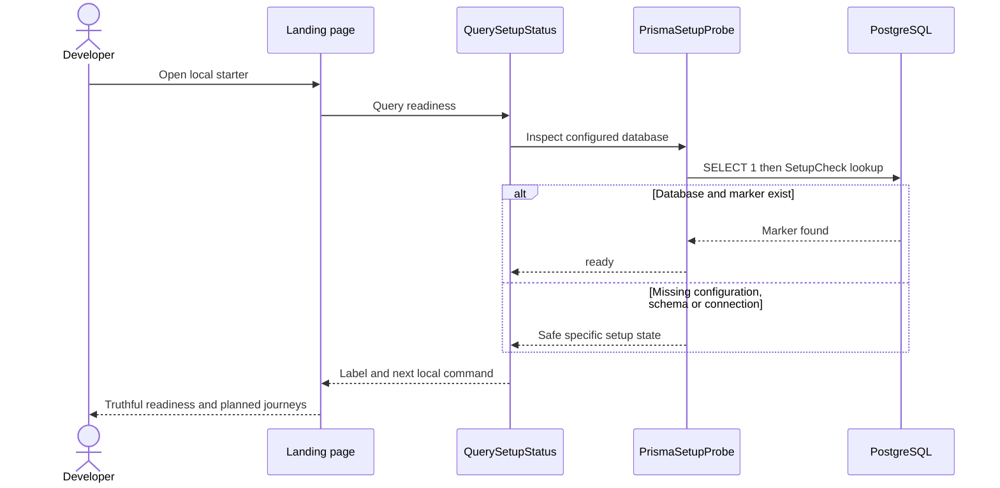
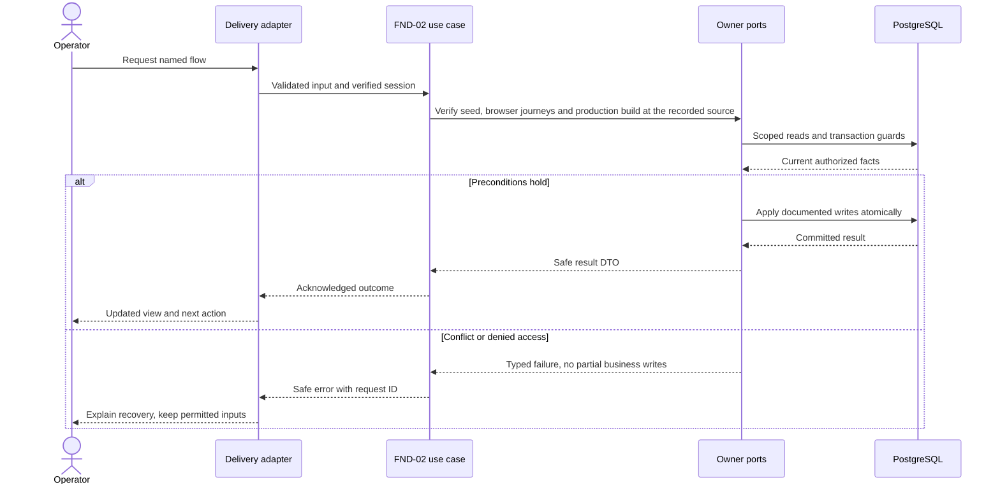
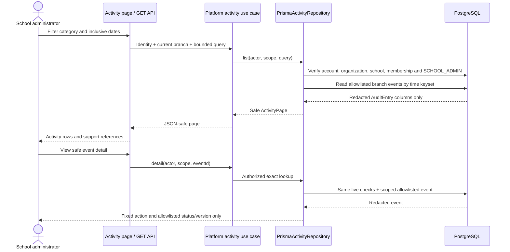

# Development foundation and delivery — design

Phase 1 · Design revision 1 · 3 October 2026. Status: foundation is implemented and accepted; IAM-01 installs shared evidence envelopes. Pilot release work remains planned. Review unresolved deployment choices in FND-02 before real-data use.

## Database naming and physical mapping

All physical objects follow [the VS database contract](../../DATABASE_DESIGN.md). Table names and columns below are physical SQL names; workflow prose uses logical domain names. `organizationId` maps to `organization_id`, `schoolId` to `school_id`, and `scope` expands to both columns. Models retain PascalCase through Prisma `@@map`; camelCase fields use `@map`. Planned schemas are implemented only through their named tasks and reviewed migrations.

## Ownership, aggregates and values

Readiness is a pure value (`not_configured`, `unavailable`, `schema_missing`, `seed_missing`, `ready`). QuerySetupStatus uses a SetupProbe port; PrismaSetupProbe is the concrete adapter. This path is implemented. The future SchoolCommand unit of work, Clock, IdGenerator, AuditWriter, OutboxWriter and ReceiptStore are application ports, never domain dependencies on Prisma. Shared envelopes are infrastructure records, not a giant business aggregate.

## Module decisions

PLT-ADR-001: a truthful, minimal starter rather than simulated feature screens. Rationale: avoid treating mock flows as implementation. Alternative: seeded fake dashboard; rejected. Verification: E2E labels every journey Planned and checks a real DB marker.

PLT-ADR-002: shared physical receipt/audit/outbox envelopes with module-owned event schemas. Alternative: unrestricted generic CRUD; rejected. IAM-01 builds this envelope with the first secure school transaction, so there is no infrastructure-only placeholder task.

## Physical data contract

SetupCheck and the IAM-01 audit/outbox/receipt envelopes are installed; other platform work remains planned. `scope` below means `(organizationId,schoolId)`. All business roots have version >=1. All scoped references require composite FK targets with matching unique keys, even when abbreviated in the table. Creation times use server clock; IDs server generated. Required unless nullable is stated. Enum labels are constrained enums/CHECKs, not unchecked strings. Do not silently implement a weaker constraint because Prisma syntax cannot express it; use reviewed migration SQL.

| Table | Fields and data stored | Meaning | Keys / constraints / query support |
|---|---|---|---|
| `vs_platform_setup_check` (SetupCheck — implemented) | id text PK; created_at timestamptz(3) default now | id=starter is the idempotently seeded readiness marker. No school data. | PK(id) |
| `vs_platform_audit_entry` (AuditEntry — installed IAM-01) | id uuid PK; organization_id uuid; school_id uuid; actor_account_id uuid; module varchar(40); command varchar(80); resource_type varchar(80); resource_id uuid; before jsonb; after jsonb; reason varchar(500) nullable; request_id uuid; occurred_at timestamptz(3) | Redacted business changes only; immutable. before/after are small allowlisted diffs, never password/token/CSV bodies. | FK school scope; actor account FK; index(scope,module,resource_id,occurred_at,id); index(scope,occurred_at DESC,id DESC); DB trigger denies UPDATE/DELETE to app role |
| `vs_platform_outbox_event` (OutboxEvent — installed IAM-01) | id uuid PK; organization_id uuid; school_id uuid; module varchar(40); type varchar(100); schema_version int; aggregate_id uuid; aggregate_version int; occurred_at timestamptz(3); payload jsonb; state varchar(20) default PENDING; attempts int default 0; available_at timestamptz(3); delivered_at timestamptz(3) nullable | Internal domain fact. Phase 1 only persists; no external delivery is claimed. Future dispatcher uses an explicit lease and receipt migration. | FK school scope; CHECK schema_version>0, aggregate_version>0, attempts>=0, state in PENDING/DELIVERED/EXHAUSTED; index(state,available_at,id) |
| `vs_platform_command_receipt` (CommandReceipt — installed IAM-01) | id uuid PK; organization_id uuid; school_id uuid; actor_account_id uuid; command varchar(80); key varchar(100); input_hash char(64); response jsonb; created_at timestamptz(3) | Only committed safe success response; all fields immutable. Unsuccessful transaction writes no receipt. | UNIQUE(scope,actor_account_id,command,key); FK school and account; hash/key format checks; immutable trigger |
| `vs_platform_operator_audit` (OperatorAuditEntry — IMP-03 retention) | id uuid PK; operator_id uuid; command varchar(80); resource_type varchar(80); resource_id uuid; occurred_at timestamptz(3); details jsonb | Append-only global platform-operator audit; aggregate technical outcomes only, no tenant/student/source identifiers. | CHECK bounded command and details object; index(operator_id,occurred_at,id); UPDATE/DELETE rejected by trigger |

## Read workflows and joins

GET /api/health/live returns a fixed starter release identifier and liveness only. GET /api/health runs SELECT 1 then SetupCheck lookup and returns only service/ready/state (503 when not ready). Landing page uses the same application query, never displays a connection string. Query timeout is 2.5s; missing configuration and unavailable DB are distinct. Starter is local-only; deployment must restrict detailed readiness to an operational endpoint while public liveness stays minimal.

## Screen contract

Route / is an intentionally public local developer landing page, not an administrator dashboard. It shows readiness and planned journeys; no personal data. Keyboard-operable plan link and refresh; mobile cards stack. The UI must still render with DB down. Synthetic sign-in preview links are allowed when they clearly state that no authentication occurs; real login remains access-module work.

All screens additionally follow Bible §8: loading, empty, validation, permission, stale/conflict, temporary failure and acknowledged success; semantic labels, focus and mobile layout. No future-module navigation.

## Application ports and transaction boundary

Each named flow below is an application use case. Inputs/outputs are plain DTOs; adapters implement owned repositories and public cross-module facades. Use SchoolCommand, ActorResolver, Clock, IdGenerator and transactional envelope writers from the shared contract. Do not pass Prisma.TransactionClient into application/domain code. Generic `save(any)` is not a replacement for named commands. Domain factories create new roots/events; rehydration restores without events.

Mutations use the account → Organization → School guard protocol in Bible §7. Read-only flows do not take write locks. Bootstrap/auth-only commands use their documented account/provisioning transaction. Scoped school uniqueness/range checks run after locks. Reauthorize before replay and commit; only a successful transaction stores a receipt. Aggregate version, audit, outbox and response commit together. Exact flow-specific reads and writes below refine this shared behavior.

## FND-01 — Run and checkpoint the fresh local foundation

**Success response contract:** GET health `{service:"vschool",ready:boolean,state}`; live `{service:"vschool",release:"fresh-0.3.0",alive:true}`. No DB URL. Setup scripts return exit codes and sanitized guidance.

**Transport:** GET /; GET /api/health; GET /api/health/live

**Input:** No request body. Configure new local .env using setup script, never a copied production URL.

**Workflow:**

1. Inspect independent folder, Git status, package lock and environment target.
2. Install frozen dependencies; run setup:local and db:setup.
3. Query readiness through application port and Prisma adapter.
4. Run check, real PostgreSQL functional tests, browser tests and build.
5. Start local server; record source checkpoint and request manual review.

**Database writes / atomicity:** Only SetupCheck migration/seed; no account or school data.

**Errors and recovery:** Missing configuration → helpful setup state; unavailable database → 503; wrong database name → setup/test guard abort.



**Verification:** Unit — Readiness labels; provider exception hides secret. Functional PostgreSQL — Real persistence replay and failed transaction rollback. E2E — Desktop/mobile page; health and no secret response.

## FND-02 — Prepare and verify the complete Phase 1 demo

**Success response contract:** Local demo evidence records source commit, migration/schema state, guarded idempotent seed results, verified administrator/teacher journeys, demo URL and limitations. This reaches PHASE 1 DEMO READY only. Production release and real-client data remain BLOCKED by TEN-03 enforcement, outstanding accessibility evidence, provider/security review, backup/restore targets and other release gates.

**Transport:** Full local UI journey plus demo runbook; release evidence remains a separate operational gate.

**Input:** Synthetic school fixtures only. No deployment target, client data, external mail or production operation is part of this task.

**Workflow:**

1. Preserve and checkpoint partial TEN-03 implementation without enabling RLS or changing applied migrations.
2. Run the guarded `pnpm demo:seed` command twice; confirm fictional data is added without replacing records/credentials or sending real messages.
3. Run relevant unit, real-PostgreSQL functional, browser and production-build checks for the exact demo source.
4. Exercise the administrator and assigned-teacher school-day journey, including denial/failure recovery, import partial results, attendance correction and reporting/export.
5. Verify theme draft preview/cancel, publish/rollback, isolation/inheritance, and the published school-branded sign-in route.
6. Start one stable local production-mode demo and record source commit, enabled modules, credential-file locations, URL and limitations. Set owner review to PENDING.

**Database writes / atomicity:** Only existing module-owned guarded synthetic seed writes. No reset/delete/restore into existing databases and no new FND-02 business schema. Preserve applied migration history and existing records.

**Errors and recovery:** Seed conflict, denied authorization, partial import, stale form, failed attendance submission, or export/storage error must show the owning module's truthful recovery path. Failed technical checks leave the demo checkpoint incomplete. Missing release evidence leaves production blocked; never route real data into an unverified candidate.



**Verification:** Unit — only risk-specific regressions for integration defects. Real PostgreSQL — full functional suite at this coherent checkpoint, including auth, scope, transactions, migrations and seed idempotency. Playwright desktop/mobile — admin setup → brand preview/publish → staff/teacher assignment → student import/enrolment → teacher attendance → admin correction/report/export, plus denied/unknown-result recovery. Production build from the exact source commit. Release-only evidence remains explicitly open.

## SA-COMP-05 / SA-62 — Review safe branch activity

**Design readiness (10 October 2026):** resolved. Phase 1 implements only the activity-review subset of SA-62. Privacy requests, support impersonation, unrestricted export and audit deletion require separate authority and remain blocked. The live fixed-role model has no `school.audit.read` grant; for this release the exact authorized actor is a current `SCHOOL_ADMIN`, enforced through its existing `school.manage` capability. This does not create an audit wildcard for teachers or institution-only administrators.

### Workflow and ownership

Platform owns the append-only `AuditEntry` projection and this safe read model. The administrator enters at `/admin/activity`, chooses one of `SCHOOL_SETTINGS`, `STAFF_ACCESS`, `STUDENT_CHANGE` or `ATTENDANCE_CORRECTION`, and supplies an inclusive school-local date range of at most 93 days. Default UI dates cover the prior 30 days through today. Each request rechecks live account token, active Organization, active School, active branch membership and `school.manage`. It returns only allowlisted commands in the selected branch. Unknown/restricted commands never enter the DTO.

List rows expose event ID, category, a fixed human-readable action, resource type, occurrence time and request ID as the support reference. Detail repeats those fields and may expose only allowlisted `status` and numeric `version` values from the redacted audit diff. It never returns `before`/`after` JSON, arbitrary reason text, actor account ID, names, email, admission number, imported row content, token, credentials or another branch's event. The UI labels the actor generically as `School administrator`. No mutation exists; retry is a fresh safe read and reads acquire no write locks.

`shared/contracts/activity.ts` owns browser DTOs. `backend/modules/platform/application/activity.ts` owns `ActivityRepository.list/detail` and the transport-neutral facade. `backend/modules/platform/domain/activity.ts` owns filter/date/cursor bounds and the allowlisted command/category/action mapping. `backend/modules/platform/infrastructure/activity.ts` implements live authorization plus PostgreSQL reads. `backend/composition/activity.ts` supplies database URL, cursor secret and clock. `lib/server/activity.ts` reads host configuration and current branch context; `/api/v1/activity` and `/api/v1/activity/:id` are thin GET adapters.

```ts
type ActivityCategory = "SCHOOL_SETTINGS" | "STAFF_ACCESS" | "STUDENT_CHANGE" | "ATTENDANCE_CORRECTION";
type ActivityQuery = Readonly<{category:ActivityCategory;from:string;to:string;cursor:string|null;limit:number}>;
type ActivityItem = Readonly<{eventId:string;category:ActivityCategory;action:string;resourceType:string;supportReference:string;occurredAt:string}>;
type ActivityPage = Readonly<{items:readonly ActivityItem[];nextCursor:string|null}>;
type ActivityDetail = ActivityItem & Readonly<{actorLabel:"School administrator";changes:readonly {label:"Status"|"Version";before:string|null;after:string|null}[]}>;
interface ActivityRepository {
 list(actor:Identity,organizationId:string,schoolId:string,query:ActivityQuery):Promise<ActivityPage>;
 detail(actor:Identity,organizationId:string,schoolId:string,eventId:string):Promise<ActivityDetail>;
}
```

Validation failures return `VALIDATION`; malformed or scope-mismatched cursors return `INVALID_CURSOR`; an absent, restricted or foreign event returns `NOT_FOUND`; revoked identity returns `UNAUTHENTICATED`; missing current administrator authority returns `FORBIDDEN`; database/configuration failures return `UNAVAILABLE`. There is no idempotency key or transaction receipt because the workflow is read-only.

### Query, index and UI contract

`vs_platform_audit_entry` drives both reads. List predicate is exact `organization_id`, `school_id`, allowlisted `command IN (...)`, `occurred_at >= from` and `< to + 1 day`, plus keyset `(occurred_at,id) < cursor`; ordering is `occurred_at DESC,id DESC`, bounded to 101 rows. Detail adds exact `id`. The existing `(scope,module,resource_id,occurred_at,id)` index cannot support branch-wide time ordering across modules/resources, so forward migration `20261010010000_platform_activity_index` adds `(organization_id,school_id,occurred_at DESC,id DESC)`. No row or table contract changes.

The production page uses the shared portal shell, PageHeader, compact filter toolbar, Card, Badge, table and Alert states. Filter submission uses validated URL fields; changing category/date clears the cursor. Each row has a keyboard-operable `View safe detail` disclosure and a `Copy support reference` button whose acknowledged state is local presentation only. Empty, denied and unavailable states state what can be done next. A visible authority note explains that privacy requests and support access must go to the designated authorized team and that this screen cannot delete history, impersonate an account or export unrestricted data.



Verification requires unit validation/allowlist/cursor tests; real PostgreSQL list/detail, branch isolation, revoked permission, unknown-command suppression, bounded pagination and index-plan evidence; desktop/mobile Playwright for populated, empty, validation, detail, copy acknowledgement, permission denial, keyboard reachability and overflow. Existing synthetic audit events from `pnpm demo:seed` are reused; no new fixture table or destructive seed is required.

## Migration, retention and handoff

Implement tables only in the task that first uses them; migrate from empty database and the previous task checkpoint. Add scoped unique indexes before composite FKs; detect existing duplicates before adding constraints. SQL append-only/null-campus/range safeguards must appear in reviewed migrations and real-DB tests. No seed may erase prior data. Use synthetic fixtures and clean only owned test records. Preserve schema-compatible app rollback; use a reviewed forward migration when incompatible. Retention changes must preserve required immutable evidence and legal holds under the school-approved policy, not an ad hoc DELETE.

Starter unit checks provider error sanitization and truthful readiness. Functional checks exercise migration, idempotent marker creation and rollback in real PostgreSQL. Browser tests check desktop/mobile readiness, plan labels, safe health response and horizontal overflow. FND-02 demo verification exercises existing implemented module journeys end to end; clean-install/restore, provider, TEN-03 RLS and native accessibility evidence remain release-only checks.

See [tasks](TASKS.md), [current state](CURRENT_STATE.md), [Bible](../../VSchool_Bible.md) and [agent runbook](../../AGENT_RUNBOOK.md).

## v4.1 integration requirements

School means operational Branch and Organization means client Institution. Every protected flow checks current release availability, institution entitlement, branch activation and user/resource permission; foundational commands remain available only through their required capability projection. Apply the revised account → Organization shared guard → School guard protocol from Tenancy DESIGN. Use the shared components/tokens and current branch context; never invent a second visual system. No operational access is implied by institution administrator role.

## VS migration compatibility

SetupCheck now maps to vs_platform_setup_check and createdAt to created_at. Preserve the original foundation migration checksum and deploy the forward 20261003000300_vs_prefix migration with the old local server stopped. Rows and timestamps survive; regenerate the mapped client before restart. Database catalog and functional naming checks are part of FND-01. Business tables remain planned.

## Portable backend integration

Follow [the backend extraction contract](../../BACKEND_EXTRACTION.md). Server module code belongs in backend/modules; UI consumes shared/contracts and a module gateway. Next delivery adapters resolve transport/session and invoke portable use cases. Future Nest controllers and provider factories reuse those use cases. Framework-specific context/ORM results never enter domain or browser DTOs.
