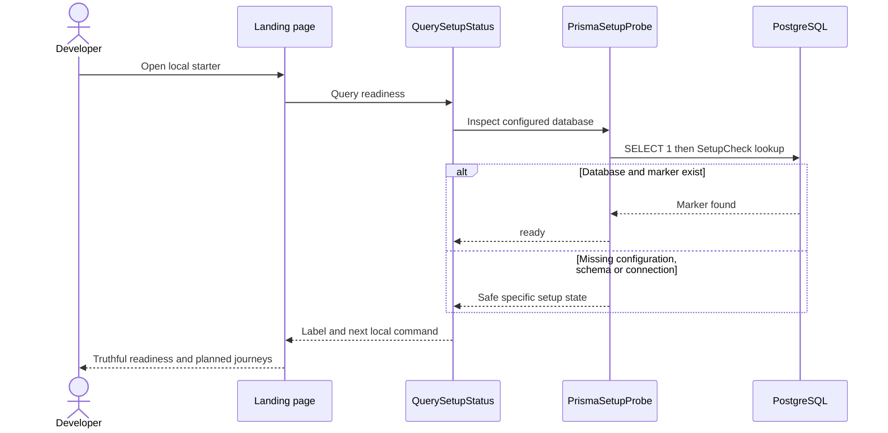
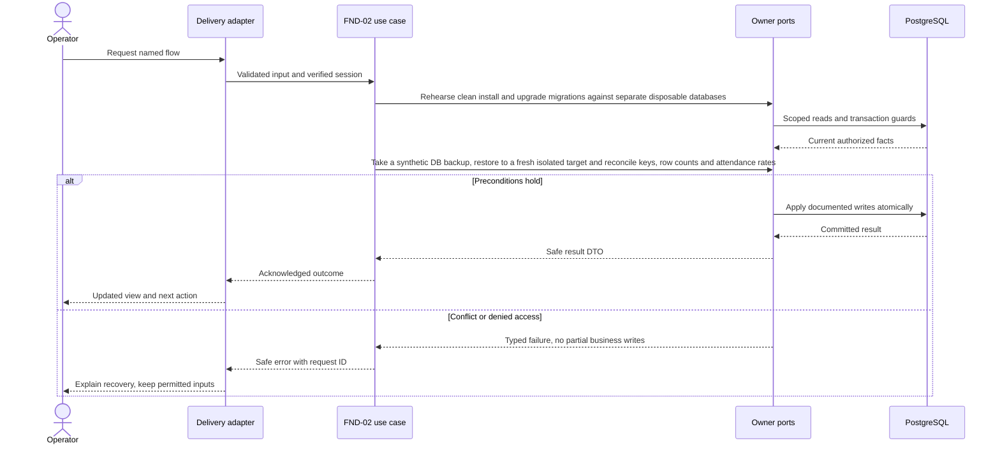

# Development foundation and delivery — design

Phase 1 · Design revision 1 · 3 October 2026. Status: specified for implementation; only the platform readiness path is implemented in this starter. Review unresolved deployment choices in FND-02 before real-data use.

## Database naming and physical mapping

All physical objects follow [the VS database contract](../../DATABASE_DESIGN.md). Table names and columns below are physical SQL names; workflow prose uses logical domain names. `organizationId` maps to `organization_id`, `schoolId` to `school_id`, and `scope` expands to both columns. Models retain PascalCase through Prisma `@@map`; camelCase fields use `@map`. Planned schemas are implemented only through their named tasks and reviewed migrations.

## Ownership, aggregates and values

Readiness is a pure value (`not_configured`, `unavailable`, `schema_missing`, `seed_missing`, `ready`). QuerySetupStatus uses a SetupProbe port; PrismaSetupProbe is the concrete adapter. This path is implemented. The future SchoolCommand unit of work, Clock, IdGenerator, AuditWriter, OutboxWriter and ReceiptStore are application ports, never domain dependencies on Prisma. Shared envelopes are infrastructure records, not a giant business aggregate.

## Module decisions

PLT-ADR-001: a truthful, minimal starter rather than simulated feature screens. Rationale: avoid treating mock flows as implementation. Alternative: seeded fake dashboard; rejected. Verification: E2E labels every journey Planned and checks a real DB marker.

PLT-ADR-002: shared physical receipt/audit/outbox envelopes with module-owned event schemas. Alternative: unrestricted generic CRUD; rejected. IAM-01 builds this envelope with the first secure school transaction, so there is no infrastructure-only placeholder task.

## Physical data contract

All tables are planned except SetupCheck. `scope` below means `(organizationId,schoolId)`. All business roots have version >=1. All scoped references require composite FK targets with matching unique keys, even when abbreviated in the table. Creation times use server clock; IDs server generated. Required unless nullable is stated. Enum labels are constrained enums/CHECKs, not unchecked strings. Do not silently implement a weaker constraint because Prisma syntax cannot express it; use reviewed migration SQL.

| Table | Fields and data stored | Meaning | Keys / constraints / query support |
|---|---|---|---|
| `vs_platform_setup_check` (SetupCheck — implemented) | id text PK; created_at timestamptz(3) default now | id=starter is the idempotently seeded readiness marker. No school data. | PK(id) |
| `vs_platform_audit_entry` (AuditEntry — planned IAM-01) | id uuid PK; organization_id uuid; school_id uuid; actor_account_id uuid; module varchar(40); command varchar(80); resource_type varchar(80); resource_id uuid; before jsonb; after jsonb; reason varchar(500) nullable; request_id uuid; occurred_at timestamptz(3) | Redacted business changes only; immutable. before/after are small allowlisted diffs, never password/token/CSV bodies. | FK school scope; actor account FK; index(scope,module,resource_id,occurred_at,id); DB trigger denies UPDATE/DELETE to app role |
| `vs_platform_outbox_event` (OutboxEvent — planned IAM-01) | id uuid PK; organization_id uuid; school_id uuid; module varchar(40); type varchar(100); schema_version int; aggregate_id uuid; aggregate_version int; occurred_at timestamptz(3); payload jsonb; state varchar(20) default PENDING; attempts int default 0; available_at timestamptz(3); delivered_at timestamptz(3) nullable | Internal domain fact. Phase 1 only persists; no external delivery is claimed. Future dispatcher uses an explicit lease and receipt migration. | FK school scope; CHECK schema_version>0, aggregate_version>0, attempts>=0, state in PENDING/DELIVERED/EXHAUSTED; index(state,available_at,id) |
| `vs_platform_command_receipt` (CommandReceipt — planned IAM-01) | id uuid PK; organization_id uuid; school_id uuid; actor_account_id uuid; command varchar(80); key varchar(100); input_hash char(64); response jsonb; created_at timestamptz(3) | Only committed safe success response; all fields immutable. Unsuccessful transaction writes no receipt. | UNIQUE(scope,actor_account_id,command,key); FK school and account; hash/key format checks; immutable trigger |

## Read workflows and joins

GET /api/health/live returns a fixed starter release identifier and liveness only. GET /api/health runs SELECT 1 then SetupCheck lookup and returns only service/ready/state (503 when not ready). Landing page uses the same application query, never displays a connection string. Query timeout is 2.5s; missing configuration and unavailable DB are distinct. Starter is local-only; deployment must restrict detailed readiness to an operational endpoint while public liveness stays minimal.

## Screen contract

Route / is an intentionally public local developer landing page, not an administrator dashboard. It shows readiness and planned journeys; no personal data. Keyboard-operable plan link and refresh; mobile cards stack. The UI must still render with DB down. No login link until access is implemented.

All screens additionally follow Bible §8: loading, empty, validation, permission, stale/conflict, temporary failure and acknowledged success; semantic labels, focus and mobile layout. No future-module navigation.

## Application ports and transaction boundary

Each named flow below is an application use case. Inputs/outputs are plain DTOs; adapters implement owned repositories and public cross-module facades. Use SchoolCommand, ActorResolver, Clock, IdGenerator and transactional envelope writers from the shared contract. Do not pass Prisma.TransactionClient into application/domain code. Generic `save(any)` is not a replacement for named commands. Domain factories create new roots/events; rehydration restores without events.

Mutations use the account → Organization → School guard protocol in Bible §7. Read-only flows do not take write locks. Bootstrap/auth-only commands use their documented account/provisioning transaction. Scoped school uniqueness/range checks run after locks. Reauthorize before replay and commit; only a successful transaction stores a receipt. Aggregate version, audit, outbox and response commit together. Exact flow-specific reads and writes below refine this shared behavior.

## FND-01 — Run and checkpoint the fresh local foundation

**Success response contract:** GET health `{service:"vschool",ready:boolean,state}`; live `{service:"vschool",release:"fresh-0.2.2",alive:true}`. No DB URL. Setup scripts return exit codes and sanitized guidance.

**Transport:** GET /; GET /api/health; GET /api/health/live

**Input:** No request body. Configure new local .env using setup script, never a copied production URL.

**Workflow:**

1. Inspect independent folder, Git status, package lock and environment target.
2. Install frozen dependencies; run setup:local and db:setup.
3. Query readiness through application port and Prisma adapter.
4. Run check, real PostgreSQL functional tests, browser tests and build.
5. Start local server; record source checkpoint and request manual review.

**Database writes / atomicity:** Only SetupCheck migration/seed; no account or school data.

**Errors and recovery:** Missing configuration → helpful setup state; unavailable database → 503; wrong database name → setup/test guard abort.

**Verification:** Unit — Readiness labels; provider exception hides secret. Functional PostgreSQL — Real persistence replay and failed transaction rollback. E2E — Desktop/mobile page; health and no secret response.

## FND-02 — Demonstrate and release the complete pilot

**Success response contract:** Release evidence with source commit, verified deployment/restore target labels, acceptance outcomes and remaining limitations; release stays BLOCKED if any gate fails.

**Transport:** Full UI journey plus operator release runbook

**Input:** Synthetic school fixtures first; deployment target and approved real-data policy explicitly selected before production.

**Workflow:**

1. Run all module acceptance suites and production build from a recorded source commit.
2. Rehearse clean install and upgrade migrations against separate disposable databases.
3. Take a synthetic DB backup, restore to a fresh isolated target and reconcile keys, row counts and attendance rates.
4. Verify identity recovery, TLS/secrets, rate controls, redacted logging and operator permissions.
5. Start final release candidate and request owner acceptance of the complete school day.

**Database writes / atomicity:** No new feature schema unless a reviewed release defect requires a forward migration; evidence includes restore verification.

**Errors and recovery:** Restore mismatch or failed security gate → BLOCKED release; never route real data into an unverified candidate.

**Verification:** Unit — Only new risk-specific regression tests needed. Functional PostgreSQL — Backup/restore, migration upgrade and full scope/transaction regression. E2E — Admin setup → import → assignment → teacher submit → admin correction/export.

## Migration, retention and handoff

Implement tables only in the task that first uses them; migrate from empty database and the previous task checkpoint. Add scoped unique indexes before composite FKs; detect existing duplicates before adding constraints. SQL append-only/null-campus/range safeguards must appear in reviewed migrations and real-DB tests. No seed may erase prior data. Use synthetic fixtures and clean only owned test records. Preserve schema-compatible app rollback; use a reviewed forward migration when incompatible. Retention changes must preserve required immutable evidence and legal holds under the school-approved policy, not an ad hoc DELETE.

Starter unit checks provider error sanitization and truthful readiness. Functional checks exercise migration, idempotent marker creation and rollback in real PostgreSQL. Browser tests check desktop/mobile readiness, plan labels, safe health response and horizontal overflow. FND-02 adds the complete release/recovery suite, not artificial tests of documentation text alone.

See [tasks](TASKS.md), [current state](CURRENT_STATE.md), [Bible](../../VSchool_Bible.md) and [agent runbook](../../AGENT_RUNBOOK.md).

## v4.1 integration requirements

School means operational Branch and Organization means client Institution. Every protected flow checks current release availability, institution entitlement, branch activation and user/resource permission; foundational commands remain available only through their required capability projection. Apply the revised account → Organization shared guard → School guard protocol from Tenancy DESIGN. Use the shared components/tokens and current branch context; never invent a second visual system. No operational access is implied by institution administrator role.

## VS migration compatibility

SetupCheck now maps to vs_platform_setup_check and createdAt to created_at. Preserve the original foundation migration checksum and deploy the forward 20261003000300_vs_prefix migration with the old local server stopped. Rows and timestamps survive; regenerate the mapped client before restart. Database catalog and functional naming checks are part of FND-01. Business tables remain planned.

## Portable backend integration

Follow [the backend extraction contract](../../BACKEND_EXTRACTION.md). Server module code belongs in backend/modules; UI consumes shared/contracts and a module gateway. Next delivery adapters resolve transport/session and invoke portable use cases. Future Nest controllers and provider factories reuse those use cases. Framework-specific context/ORM results never enter domain or browser DTOs.
