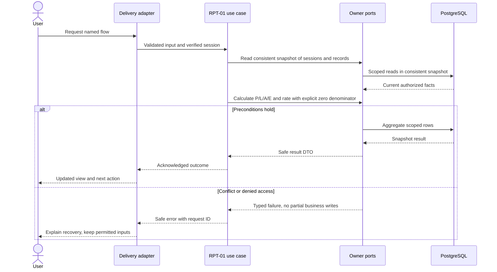
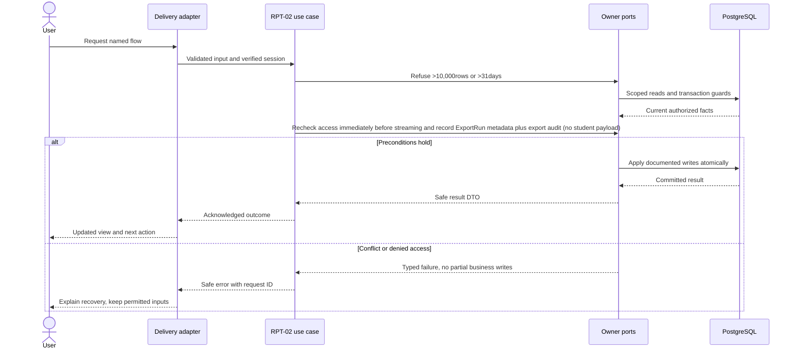

# Attendance review, completeness and exports — design

Phase 1 · Design revision 1 · 3 October 2026. Status: specified for implementation; only the platform readiness path is implemented in this starter. Review unresolved deployment choices in FND-02 before real-data use.

## Database naming and physical mapping

All physical objects follow [the VS database contract](../../DATABASE_DESIGN.md). Table names and columns below are physical SQL names; workflow prose uses logical domain names. `organizationId` maps to `organization_id`, `schoolId` to `school_id`, and `scope` expands to both columns. Models retain PascalCase through Prisma `@@map`; camelCase fields use `@map`. Planned schemas are implemented only through their named tasks and reviewed migrations.

## Ownership, aggregates and values

Read models compose authorized facts; they do not own editable attendance aggregates. AttendanceRate and Completeness are deterministic values. ExportRun is a scoped operational record, not a public file permission. All filters are server-validated. Pending is not absent; cancelled is excluded; excused is excluded from attendance-rate denominator. Distinct student counts and student-session counts are separately labeled.

## Module decisions

RPT-ADR-001: derived queries rather than mutable daily summary tables for the pilot. Alternative materialized counters deferred until measurements justify invalidation complexity.

RPT-ADR-002: bounded direct CSV response, not public file hosting. Authorize before generation and immediately before response; headers no-store and attachment. Formula-safe encoding handles leading whitespace/control characters followed by =,+,-,@ and correct quote escaping. Export metadata logs filters/count/hash only.

## Physical data contract

All tables are planned except SetupCheck. `scope` below means `(organizationId,schoolId)`. All business roots have version >=1. All scoped references require composite FK targets with matching unique keys, even when abbreviated in the table. Creation times use server clock; IDs server generated. Required unless nullable is stated. Enum labels are constrained enums/CHECKs, not unchecked strings. Do not silently implement a weaker constraint because Prisma syntax cannot express it; use reviewed migration SQL.

| Table | Fields and data stored | Meaning | Keys / constraints / query support |
|---|---|---|---|
| `vs_reporting_export_run` (ExportRun) | id uuid PK; organization_id uuid; school_id uuid; actor_account_id uuid; filters jsonb; requested_at timestamptz(3); state GENERATED/FAILED; row_count int; content_hash char(64) nullable; request_id uuid | Synchronous bounded export metadata, no public stored CSV. GENERATED means the bytes were prepared, not that browser received them. | Scoped school/account FKs; index(scope,requested_at,id); no raw exported CSV or credentials |

## Read workflows and joins

Overview query starts with scoped AttendanceSession in [fromDate,toDate) and optional year/section/subject; applies authorization before counts. Expected sessions are noncancelled sessions with startsAt <= now; submitted completeness counts SUBMITTED among expected, pending counts SCHEDULED/OPEN among expected. Future scheduled sessions displayed separately, not overdue. Cancelled displayed in a separate count.

Attendance totals join submitted noncancelled Session → AttendanceRecord and count by status, constrained same scope. Percent=(P+L)/(P+L+A), unavailable when denominator=0; E shown separately. Student detail joins SessionRosterEntry to record and session; pending has no record, so remains pending. Daily badge is derived: no eligible sessions→No sessions; any overdue unresolved→Incomplete; otherwise mixed statuses shown as counts, never a false all-day absence. Offering→Section→Grade/Subject gives readable labels; roster snapshot supplies historical pupil name, current permissions govern visibility.

GetSchoolOverview uses REPEATABLE READ for multiple aggregate queries, returning asOf timestamp; otherwise counts can disagree during correction. Drilldown carries the exact filters, not an unrelated default date. Export uses same read contract and snapshot with max 31 days/10,000 rows; exceed limit→422 narrow filters, not silent truncation. CSV includes schoolDate,sessionId,sectionCode,subjectCode,studentAdmissionNumber,studentName,status,lateMinutes,sessionState,revision. Pending/cancelled separate rows only if explicitly selected; no misleading ABSENT coercion.

## Screen contract

/admin/attendance overview date/year/section/subject filters; metric cards label "sessions submitted / expected", "pending sessions", "student-session absences", "attendance rate" and asOf time. Drilldown lists only permitted matching sessions. Empty and zero denominator use explanatory text, not 0%. Detail links go to attendance correction screen. Export action shows date/row bound; errors retain chosen filters. No student risk rankings or automated alerts in Phase 1.

All screens additionally follow Bible §8: loading, empty, validation, permission, stale/conflict, temporary failure and acknowledged success; semantic labels, focus and mobile layout. No future-module navigation.

## Application ports and transaction boundary

Each named flow below is an application use case. Inputs/outputs are plain DTOs; adapters implement owned repositories and public cross-module facades. Use SchoolCommand, ActorResolver, Clock, IdGenerator and transactional envelope writers from the shared contract. Do not pass Prisma.TransactionClient into application/domain code. Generic `save(any)` is not a replacement for named commands. Domain factories create new roots/events; rehydration restores without events.

Mutations use the account → Organization → School guard protocol in Bible §7. Read-only flows do not take write locks. Bootstrap/auth-only commands use their documented account/provisioning transaction. Scoped school uniqueness/range checks run after locks. Reauthorize before replay and commit; only a successful transaction stores a receipt. Aggregate version, audit, outbox and response commit together. Exact flow-specific reads and writes below refine this shared behavior.

## RPT-01 — Review school attendance with explainable totals

**Success response contract:** `{asOf,filters,counts:{expectedSessions,submittedSessions,pendingSessions,futureSessions,cancelledSessions,present,late,absent,excused},rate:{numerator,denominator,value:null|number},sessions:{items,nextCursor}}`. Round display to one decimal only; retain exact integer numerator/denominator.

**Transport:** GET /api/v1/reports/attendance; GET /api/v1/reports/attendance/sessions

**Input:** fromDate,toDate (exclusive),yearId?,sectionId?,subjectId?,cursor?,limit<=100. Max31 days. Requires attendance.read_school.

**Workflow:**

1. Resolve current actor and scoped filter references; reject invalid/foreign filters before aggregation.
2. Read consistent snapshot of sessions and records; calculate expected/submitted/pending/future/cancelled counts separately.
3. Calculate P/L/A/E and rate with explicit zero denominator; no inferred absent from missing records.
4. Join readable class/subject labels and bounded drilldown list; return asOf and calculation explanation.
5. Render filters/cards/list and links to existing session history.

**Database writes / atomicity:** Read-only; no derived total writes. Operational metrics may be non-sensitive, no product analytics dependency.

**Errors and recovery:** Foreign filter→404; too broad/reversed range→422; forbidden teacher school report→403; DB failure distinct from empty.

**Verification:** Unit — 2 present +1 late+1 absent+1 excused yields75%; all excused→unavailable; pending distinct. Functional PostgreSQL — Cross-school join denial; REPEATABLE READ consistency while correction commits. E2E — Filter, inspect metrics, drill down with same range; compare to hand-counted fixture.

## RPT-02 — Export a scoped report and review audit history

**Success response contract:** CSV attachment bytes plus safe Content-Disposition filename; history `{items:[{id,occurredAt,actor,command,reason,before,after}],nextCursor}`. Staff-only fields omitted from every teacher-facing DTO.

**Transport:** GET /api/v1/reports/attendance.csv; GET /api/v1/audit?module=attendance&resourceId=

**Input:** Same bounded filters as RPT-01; export requires attendance.export; history attendance.read_school. No stored-file URL.

**Workflow:**

1. Authorize current actor/filter scope and take consistent report snapshot.
2. Refuse >10,000rows or >31days; generate UTF-8 CSV with quoted cells and formula-safe text.
3. Recheck access immediately before streaming and record ExportRun metadata plus export audit (no student payload).
4. Return no-store attachment; history query filters scope/module/resource and paginates occurredAt/id.
5. Present export result and immutable correction/cancellation timeline; label generated/downloaded distinction accurately.

**Database writes / atomicity:** ExportRun and scoped export audit; attendance/history are read-only. Export audit resource references the ExportRun UUID.

**Errors and recovery:** Too broad→422; access revoked before stream→403; failure→FAILED metadata; replay export is a new authorized read, not a stale download permission.

**Verification:** Unit — CSV quoting/BOM policy and dangerous prefix neutralization; no raw staff notes. Functional PostgreSQL — Scope denial; snapshot consistency; event audit module filter; safe metadata and failure path. E2E — Export matches visible selected range; spreadsheet-safe synthetic names; history shows reason/old/new.

## Migration, retention and handoff

Implement tables only in the task that first uses them; migrate from empty database and the previous task checkpoint. Add scoped unique indexes before composite FKs; detect existing duplicates before adding constraints. SQL append-only/null-campus/range safeguards must appear in reviewed migrations and real-DB tests. No seed may erase prior data. Use synthetic fixtures and clean only owned test records. Preserve schema-compatible app rollback; use a reviewed forward migration when incompatible. Retention changes must preserve required immutable evidence and legal holds under the school-approved policy, not an ad hoc DELETE.

P/L/A/E arithmetic, zero denominator, cancelled and future exclusion, pending not absent, date boundaries, consistent snapshot under correction, filter-preserving drilldown, cross-school joins/exports, formula injection and row-limit refusal. UI must show completeness alongside rate.

See [tasks](TASKS.md), [current state](CURRENT_STATE.md), [Bible](../../VSchool_Bible.md) and [agent runbook](../../AGENT_RUNBOOK.md).

## v4.1 integration requirements

School means operational Branch and Organization means client Institution. Every protected flow checks current release availability, institution entitlement, branch activation and user/resource permission; foundational commands remain available only through their required capability projection. Apply the revised account → Organization shared guard → School guard protocol from Tenancy DESIGN. Use the shared components/tokens and current branch context; never invent a second visual system. No operational access is implied by institution administrator role.

## Portable backend integration

Follow [the backend extraction contract](../../BACKEND_EXTRACTION.md). Server module code belongs in backend/modules; UI consumes shared/contracts and a module gateway. Next delivery adapters resolve transport/session and invoke portable use cases. Future Nest controllers and provider factories reuse those use cases. Framework-specific context/ORM results never enter domain or browser DTOs.
