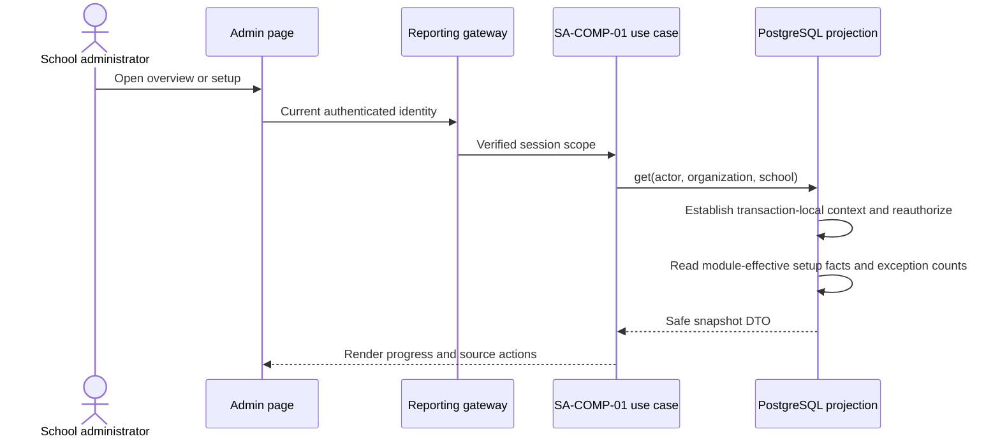
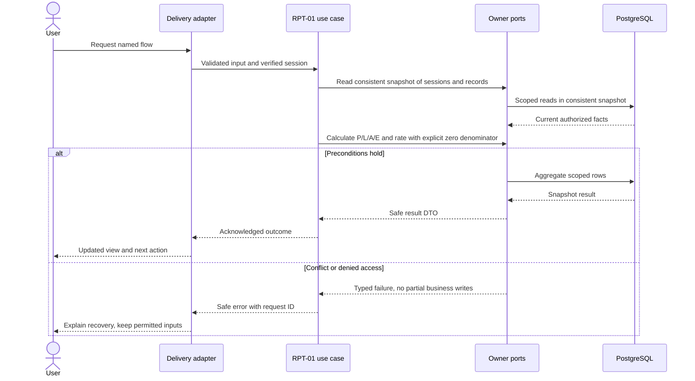
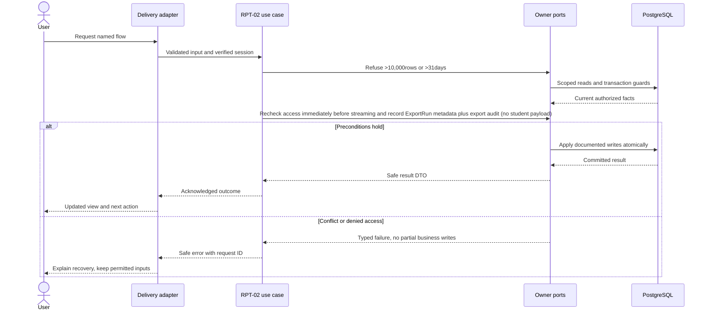

# Attendance review, completeness and exports — design

Phase 1 · Design revision 1 · 5 October 2026. RPT-01 is implemented; RPT-02 remains specified for its gated task. Review unresolved deployment choices in FND-02 before real-data use.

## SA-COMP-01 — School setup readiness and daily exceptions

This read-only Reporting projection completes SA-04 and SA-05 without moving ownership of source facts. A current School Administrator with live `school.manage` authority requests the current session's institution/branch; client scope is never accepted. The query establishes transaction-local verified database context, rechecks active account/token, organization, school, membership and role grants, then reads one `REPEATABLE READ` snapshot. Disabled or unreleased product modules are omitted rather than shown as missing setup. Failures are `UNAUTHENTICATED`, `FORBIDDEN`, `NOT_FOUND` or `UNAVAILABLE`; a successful empty result is distinct from failure.

The transport-neutral signature is `schoolAdminOverview(actor, organizationId, schoolId): Promise<SchoolAdminOverview>`. `SchoolAdminOverviewRepository.get` is implemented in `backend/modules/reporting/infrastructure/school-admin-overview.ts`, composed in `backend/composition/reporting.ts`, and exposed to server-rendered pages by `lib/server/reporting.ts`. The browser-safe DTO is in `shared/contracts/reporting.ts`. No mutation, idempotency key, lock or write receipt applies.

Readiness facts and stable links are: active School plus Campus → `/admin/school`; open/draft AcademicYear with a published CalendarRevision plus active GradeLevel, Subject and Section → `/admin/academics`; active SchoolMembership plus active Employee/TeacherAssignment → `/admin/users`; active Student with a current Enrollment/SectionPlacement → `/admin/students`; any AttendanceSession → `/admin/attendance/sessions`. Module-effective predicates use current `vs_tenancy_organization_entitlement` dates/state, `vs_tenancy_branch_activation` state and the injected release manifest. Staff is included only for effective `staff_core`, academics only for `academic_core`, students only for `student_core`, and attendance only for `attendance`.

Actionable exceptions are counts, never paginated-list totals: started SCHEDULED/OPEN attendance sessions for the current school-local date; ImportJob in `REVIEW`, `CONFIRMED`, `RUNNING`, `COMPLETED_WITH_ERRORS` or `FAILED`; and current PENDING SchoolMembership or unaccepted non-revoked, non-expired AccessInvite with pending/failed delivery. Each count uses `(organization_id, school_id)` and links to its owning workspace. Existing scope-leading indexes support the reads; no migration is required. `asOf` is the injected clock and current enrollment/assignment dates use the school's timezone-derived date. No Person details, import source bytes/hash, tokens or audit narratives are returned.



Verification: unit validation and repository delegation; real PostgreSQL populated/empty projections, cross-branch denial, revoked membership, disabled-module omission and current-date exception predicates; Playwright administrator overview/setup populated and empty states at desktop/mobile, keyboard links and no horizontal overflow. Human visual review remains separate.

## Database naming and physical mapping

All physical objects follow [the VS database contract](../../DATABASE_DESIGN.md). Table names and columns below are physical SQL names; workflow prose uses logical domain names. `organizationId` maps to `organization_id`, `schoolId` to `school_id`, and `scope` expands to both columns. Models retain PascalCase through Prisma `@@map`; camelCase fields use `@map`. Planned schemas are implemented only through their named tasks and reviewed migrations.

## Ownership, aggregates and values

Read models compose authorized facts; they do not own editable attendance aggregates. AttendanceRate and Completeness are deterministic values. ExportRun is a scoped operational record, not a public file permission. All filters are server-validated. Pending is not absent; cancelled is excluded; excused is excluded from attendance-rate denominator. Distinct student counts and student-session counts are separately labeled.

## Module decisions

RPT-ADR-001: derived queries rather than mutable daily summary tables for the pilot. Alternative materialized counters deferred until measurements justify invalidation complexity.

RPT-ADR-002: bounded direct CSV response, not public file hosting. Authorize before generation and immediately before response; headers no-store and attachment. Formula-safe encoding handles leading whitespace/control characters followed by =,+,-,@ and correct quote escaping. Export metadata logs filters/count/hash only.

RPT-ADR-003: retained Principal aggregates are immutable Reporting-owned snapshots, separately designated from report read/export. First release is synthetic-only until retention and backup-deletion policy is approved for real school data. Removal clears the snapshot payload and denies stale URLs while preserving minimal deletion audit metadata; it never mutates owner source records.

## Physical data contract

Reporting tables are planned except the implemented RPT-02 ExportRun, LEA-39 ReportingExportGrant and LEA-06 retained-snapshot tables; `scope` below means `(organizationId,schoolId)`. All business roots have version >=1. All scoped references require composite FK targets with matching unique keys, even when abbreviated in the table. Creation times use server clock; IDs server generated. Required unless nullable is stated. Enum labels are constrained enums/CHECKs, not unchecked strings. Do not silently implement a weaker constraint because Prisma syntax cannot express it; use reviewed migration SQL.

| Table | Fields and data stored | Meaning | Keys / constraints / query support |
|---|---|---|---|
| `vs_reporting_export_run` (ExportRun) | id uuid PK; organization_id uuid; school_id uuid; actor_account_id uuid; filters jsonb; requested_at timestamptz(3); state GENERATED/FAILED; row_count int; content_hash char(64) nullable; request_id uuid | Synchronous bounded export metadata, no public stored CSV. GENERATED means the bytes were prepared, not that browser received them. | Composite FK(scope)->School and FK(actor_account_id)->UserAccount; CHECK state in GENERATED/FAILED, row_count>=0, object filters and null-or-lowercase-SHA256 content_hash; index(scope,requested_at,id); no raw exported CSV, pupil data, or credentials |
| `vs_reporting_export_grant` (ReportingExportGrant) | id uuid PK; organization_id uuid; school_id uuid; membership_id uuid; account_id uuid; granted_by_operator_id uuid; granted_at timestamptz(3); revoked_at timestamptz(3) nullable; version int | Operator-designated branch authority for Principal aggregate export; Principal role or report-read authority never creates this grant automatically. | Composite FK(scope,membership_id,account_id)->SchoolMembership; UNIQUE(scope,account_id); CHECK version>0; active lookup index(scope,account_id,revoked_at) |
| `vs_reporting_snapshot_manager_grant` (ReportingSnapshotManagerGrant) | id uuid PK; organization_id uuid; school_id uuid; membership_id uuid; account_id uuid; granted_by_operator_id uuid; granted_at timestamptz(3); revoked_at timestamptz(3) nullable; version int | Operator-designated branch authority for Principal aggregate snapshot capture/removal; report-read alone never creates this grant. | Composite FK(scope,membership_id,account_id)->SchoolMembership; UNIQUE(scope,account_id); CHECK version>0; active lookup index(scope,account_id,revoked_at) |
| `vs_reporting_snapshot` (ReportingSnapshot) | id/scope/actor uuid; report_type/definition_version; query jsonb; school_date; source_as_of/captured_at; payload jsonb nullable; payload_hash; row_count; capture/removal intent metadata; version | Immutable bounded aggregate Principal report snapshot; explicit removal clears only the protected payload and retains minimal deletion metadata. | Scoped School and actor/remover Account FKs; UNIQUE(scope,id) and capture intent; CHECK version, row bound and active/removed payload state; list and actor indexes |

## Read workflows and joins

Overview query starts with scoped AttendanceSession in [fromDate,toDate) and optional year/section/subject; applies authorization before counts. Expected sessions are noncancelled sessions with startsAt <= now; submitted completeness counts SUBMITTED among expected, pending counts SCHEDULED/OPEN among expected. Future scheduled sessions displayed separately, not overdue. Cancelled displayed in a separate count.

Attendance totals join submitted noncancelled Session → AttendanceRecord and count by status, constrained same scope. Percent=(P+L)/(P+L+A), unavailable when denominator=0; E shown separately. Student detail joins SessionRosterEntry to record and session; pending has no record, so remains pending. Daily badge is derived: no eligible sessions→No sessions; any overdue unresolved→Incomplete; otherwise mixed statuses shown as counts, never a false all-day absence. Offering→Section→Grade/Subject gives readable labels; roster snapshot supplies historical pupil name, current permissions govern visibility.

GetSchoolOverview uses REPEATABLE READ for multiple aggregate queries, returning asOf timestamp; otherwise counts can disagree during correction. Drilldown carries the exact filters, not an unrelated default date. Export uses same read contract and snapshot with max 31 days/10,000 rows; exceed limit→422 narrow filters, not silent truncation. CSV includes schoolDate,sessionId,sectionCode,subjectCode,studentAdmissionNumber,studentName,status,lateMinutes,sessionState,revision. Pending/cancelled separate rows only if explicitly selected; no misleading ABSENT coercion.

## Screen contract

/admin/attendance overview date/year/section/subject filters; metric cards label "sessions submitted / expected", "pending sessions", "student-session absences", "attendance rate" and asOf time. Drilldown lists only permitted matching sessions. Empty and zero denominator use explanatory text, not 0%. Detail links go to attendance correction screen. Export action shows date/row bound; errors retain chosen filters. No student risk rankings or automated alerts in Phase 1.

All screens additionally follow Bible §8: loading, empty, validation, permission, stale/conflict, temporary failure and acknowledged success; semantic labels, focus and mobile layout. No future-module navigation.

## Application ports and transaction boundary

Each named flow below is an application use case. Inputs/outputs are plain DTOs; adapters implement owned repositories and public cross-module facades. Use SchoolCommand, ActorResolver, Clock, IdGenerator and transactional envelope writers from the shared contract. Do not pass Prisma.TransactionClient into application/domain code. Generic `save(any)` is not a replacement for named commands. Domain factories create new roots/events; rehydration restores without events.

Mutations use the account → Organization → School guard protocol in Bible §7. Read-only flows do not take write locks. Bootstrap/auth-only commands use their documented account/provisioning transaction. Scoped school uniqueness/range checks run after locks. Reauthorize before replay and commit; only a successful transaction stores a receipt. Aggregate version, audit, outbox and response commit together. Exact flow-specific reads and writes below refine this shared behavior.

## RPT-01 — Review school attendance with explainable totals

**Success response contract:** `{asOf,filters,counts:{expectedSessions,submittedSessions,pendingSessions,futureSessions,cancelledSessions,present,late,absent,excused},rate:{numerator,denominator,value:null|number},sessions:{items,nextCursor}}`. Round display to one decimal only; retain exact integer numerator/denominator.

**Transport:** GET /api/v1/reports/attendance; GET /api/v1/reports/attendance/sessions

**Input:** fromDate,toDate (exclusive),yearId?,sectionId?,subjectId?,cursor?,limit<=100. Max31 days. Requires attendance.read_school.

**Workflow:**

1. Resolve current actor and scoped filter references; reject invalid/foreign filters before aggregation.
2. Read consistent snapshot of sessions and records; calculate expected/submitted/pending/future/cancelled counts separately.
3. Calculate P/L/A/E and rate with explicit zero denominator; no inferred absent from missing records.
4. Join readable class/subject labels and bounded drilldown list; return asOf and calculation explanation.
5. Render filters/cards/list and links to existing session history.

**Database writes / atomicity:** Read-only; no derived total writes. Operational metrics may be non-sensitive, no product analytics dependency.

**Errors and recovery:** Foreign filter→404; too broad/reversed range→422; forbidden teacher school report→403; DB failure distinct from empty.



**Verification:** Unit — 2 present +1 late+1 absent+1 excused yields75%; all excused→unavailable; pending distinct. Functional PostgreSQL — Cross-school join denial; REPEATABLE READ consistency while correction commits. E2E — Filter, inspect metrics, drill down with same range; compare to hand-counted fixture.

**RPT-01 design-readiness and implementation contract (5 October 2026):** Reporting owns only derived read models. It adds no table, migration, index or write; existing session, offering, section, subject and attendance-record contracts remain owned by their modules. The aggregate predicate is `session.organization_id = scope.organization_id AND session.school_id = scope.school_id AND session.school_date >= fromDate AND session.school_date < toDate`, plus exact offering `year_id`, `section_id` and `subject_id` predicates when selected. Joins retain both scope columns: session→offering→section/subject and session→attendance_record by `(organization_id,school_id,session_id)`. Attendance records contribute only for SUBMITTED, noncancelled sessions. This uses existing `vs_attendance_session_school_day_idx (organization_id,school_id,school_date,status,starts_at,id)` and `vs_attendance_record_session_student_key`; page order/cursor is `(school_date,starts_at,id)`. The scoped date query and offering/date filter will be captured with `EXPLAIN (ANALYZE, BUFFERS)`; small fixture timings are plan evidence, not the Bible pilot benchmark or TEN-03 scale gate.

Every report request rechecks active account/token version, current active membership and `attendance.read_school`, active Organization/Branch, release manifest, attendance entitlement/activation and all declared attendance dependencies. Only the current school administrator capability projection includes school-wide read; teachers receive 403. Filter IDs are first resolved in the authorized scope, so foreign/absent IDs return 404 before aggregates. Reads run in one PostgreSQL REPEATABLE READ transaction; they do not acquire write locks. No RLS is enforced yet: attendance tables retain their Path A BRANCH classification/scope metadata and TEN-03 owns restricted-role enforcement and cross-tenant proof. Application authorization remains in force on every read.

The expected/pending/future/cancelled counts are session counts. Expected is a started, noncancelled SUBMITTED/SCHEDULED/OPEN session; submitted and pending split that set. Future is a not-yet-started SCHEDULED session; cancellation is separate. P/L/A/E are submitted student-session counts; missing records do not become ABSENT. Rate is `(present + late)/(present + late + absent)`, with exact numerator/denominator retained and `value:null` for zero denominator. Excused and pending are excluded. Session DTOs expose only the session UUID/date/state/class labels and aggregate counts, never pupil identity. Errors: unauthenticated 401, teacher/permission denial 403, foreign filter 404, invalid/reversed/>31-day range or cursor 422, inactive module/release denied safely, database failure 503. No results are shown as a truthful empty state, not as a service failure.

## RPT-02 — Export a scoped report and review audit history

**Design-readiness note (5 October 2026):** RPT-01 and ATT-04 are implementation-VERIFIED; their human reviews are PENDING and are not implementation gates under the current Phase 1 policy. Attendance owns the immutable `vs_attendance_revision` timeline and exposes scoped `AttendanceFacade.history`; reuse it for correction/cancellation details rather than duplicating attendance history in Platform audit. Platform owns `vs_platform_audit_entry`, which is already installed, but currently exposes no audit append/query contract. Add a narrow `PlatformAuditWriter` port/factory for the safe `AttendanceExportGenerated` event, implemented by Platform infrastructure and enlisted by Reporting composition on the same Prisma transaction as `ExportRun`; Reporting must not directly issue platform-table writes. The existing AuditEntry index `(organization_id,school_id,module,resource_id,occurred_at,id)` supports scoped export-event lookup. Add `ExportRun` as Reporting-owned with a forward migration, scoped School and Account FKs, index `(organization_id,school_id,requested_at,id)`, and Path A BRANCH metadata/TEN-03 closure. Export rows come from scoped session→frozen roster→current attendance record, plus Student admission number and offering/section/subject labels, only for SUBMITTED sessions; pending and canceled rows are represented only in the session-level report, not synthesized as pupil attendance. Preserve the date-range, filter and 10,000-row bounds. The CSV generation is in-memory and no-store; first obtain a repeatable-read snapshot after current export/read permissions and entitlements, then in a short account→Organization→School guarded transaction reauthorize and atomically append ExportRun plus safe Platform audit before returning bytes. No CSV body, pupil name/admission number, credential, raw reason or source data enters ExportRun/audit. Audit history uses `AttendanceFacade.history` and requires current `attendance.read_school`, active dependencies/branch scope and a submitted/cancelled session; teacher DTOs never include it. No per-export command idempotency is introduced: each authorized export is a new read and audit event. On a generation/write failure after valid scope is established, store a FAILED ExportRun only if the metadata transaction can be committed safely; authorization and validation failures create no record. Reauthorize immediately before bytes are returned; no persistent file or reusable download permission is created.

**Success response contract:** CSV attachment bytes with safe Content-Disposition filename, `X-Export-Run-Id`, `X-Export-Row-Count` and generated-time headers; `/api/v1/audit?module=attendance&resourceId=<sessionId>&cursor=&limit=50` returns `{sessionId,status,version,items:[{number,kind,occurredAt,reason,actorDisplayName,changes}],nextCursor}`. This endpoint is the Attendance-owned immutable revision timeline (not a generic Platform-audit projection); correction/cancellation reason and changes are available only to current `attendance.read_school` callers. Staff-only fields are omitted from teacher-facing DTOs.

**Transport:** GET /api/v1/reports/attendance.csv; GET /api/v1/audit?module=attendance&resourceId=<sessionId>&cursor=<opaque>&limit=50

**Input:** Same bounded filters as RPT-01; export requires attendance.export; history attendance.read_school. No stored-file URL.

**Workflow:**

1. Authorize current actor/filter scope and take consistent report snapshot.
2. Refuse >10,000rows or >31days; generate UTF-8 CSV with quoted cells and formula-safe text.
3. Recheck current membership, `attendance.export`, release/entitlements and branch activation in an account→Organization→School guarded transaction immediately before returning bytes; append ExportRun metadata and the safe Platform audit event atomically (no CSV or pupil payload).
4. Return no-store attachment. History resolves a scoped submitted/cancelled session via Attendance, paginates its immutable revision number descending with a 50-row default (max 100), and returns each page chronologically with an opaque cursor.
5. Present export result and immutable correction/cancellation timeline; label generated/downloaded distinction accurately.

**Database writes / atomicity:** ExportRun and scoped export audit; attendance/history are read-only. Export audit resource references the ExportRun UUID.

**Errors and recovery:** Too broad (>31 days or >10,000 submitted pupil rows)→422; missing permission/revoked before response→403; unknown/foreign filters/session→404; operational query failure after current export authorization attempts safe FAILED metadata and returns 503; metadata/audit failure rolls back both and returns 503. Replay export is a new authorized read with a new ExportRun/audit event, not a stale download permission.



**Verification:** Unit — CSV quoting/BOM policy and dangerous prefix neutralization; no raw staff notes. Functional PostgreSQL — scoped session/roster/record joins; export/read permission and entitlement denial; foreign filters/scope; row bound; current authorization recheck before metadata commit; ExportRun+Platform audit atomic commit/rollback; FAILED metadata after an authorized query failure; safe metadata; revision cursor pages. E2E — browser download matches selected range and submitted records; formula-safe synthetic text; admin sees correction/cancellation reason and changes; teacher is denied audit history; unknown/revoked access fails safely. `EXPLAIN (ANALYZE, BUFFERS)` captures the submitted session→roster→record/student join using scope/date/status and optional offering filters; small test data is query/index evidence only, not pilot or TEN-03 scale proof.

## LEA-39 — Principal aggregate CSV export

**Design-readiness note (16 October 2026):** The approved first slice exports only Attendance-owned `register-coverage.v1`, because it is the supported Principal aggregate with a bounded evidence list and settled disclosure rules. It does not reuse Administrator `attendance.export`, grant pupil-level attendance, or imply exports for later metrics. The approved workflow reference is LEA-39 in the Principal pack; the production composition carries the exact selected Attendance filters into an export preview and direct private download.

Reporting owns export designation, CSV encoding, ExportRun metadata and safe audit. Attendance continues to own and authorize the aggregate. `LeadershipAggregateSourcePort.attendanceCoverage` calls the existing `LeadershipCoverageFacade.get`; Reporting does not query Attendance tables. The first export contains one aggregate row followed by at most 50 already-visible awaiting-register rows. Its allowlisted columns are row kind, definition/version, as-of, branch date/timezone/due policy, aggregate counts and the visible session/class/subject/Teacher/status/schedule facts. It contains no pupil identity, roster, mark, explanation, correction history, private Learning content or hidden operational note. If more than 50 evidence rows match, generation fails with `VALIDATION` and tells the leader to narrow the class/status/Teacher filters; no truncation occurs.

The capability is an independent operator-designated branch grant represented by `vs_reporting_export_grant`. A live `PRINCIPAL` membership and `attendance.read_leadership` remain required, but neither grants `reporting.export` automatically. Only a verified operator may grant or revoke the designation for an active Principal membership. The grant has `(organization_id, school_id, account_id)` uniqueness, a composite membership/account FK, positive version, nullable revocation time and an active lookup index. It is a TEN-ADR-006 Path A BRANCH table registered for TEN-03 closure; application authorization remains mandatory.

`exportLeadershipAttendance(actor, organizationId, schoolId, query)` validates the same date/class/status/Teacher/sort contract as Attendance, reads the owner snapshot with a 50-row bound, verifies that no matching evidence was omitted, encodes formula-safe UTF-8 CSV, then enters a short account → Organization → School guarded transaction. That transaction re-establishes verified tenant context and rechecks account/token, active Principal membership, `attendance.read_leadership`, the non-revoked export designation and current Attendance module release/entitlement/activation. It atomically records an existing `ExportRun` plus a Platform-owned audit event containing only report type, safe filters, source as-of, row count and content hash. CSV bytes and source records never enter the audit. Each generation is a fresh read/action rather than a durable download permission; the response is a direct attachment with `private, no-store`, no public URL and no persisted file.

```mermaid
sequenceDiagram
  actor P as Principal
  participant W as Reports page / route
  participant R as Reporting export use case
  participant A as Attendance coverage port
  participant D as Reporting persistence
  P->>W: Review exact filters, fields and scope
  W->>R: Generate attendance coverage CSV
  R->>A: Read authorized register-coverage.v1 (limit 50)
  A-->>R: Snapshot, counts and visible evidence
  alt Evidence exceeds bound
    R-->>W: Narrow filters; no file or silent truncation
  else Within bound
    R->>D: Reauthorize export + report read; record metadata/audit
    D-->>R: ExportRun id/hash/generatedAt
    R-->>W: Private no-store CSV attachment
  end
```

Verification requires pure CSV formula/quote tests; real PostgreSQL grant/no-auto-grant, revocation, foreign-scope, module denial, owner-total consistency, bound refusal and safe ExportRun/audit metadata; and a one-worker desktop/mobile journey that carries filter state, previews columns/scope, downloads the CSV and compares aggregate totals. Human review, native accessibility, font portability and TEN-03 remain separate gates. Other Principal aggregate exports keep LEA-39 partial until implemented through their owner ports.

**Assignment-completion export extension (16 October 2026):** Reporting now consumes Learning's existing `leadershipLearningOverview` application port as `LeadershipAggregateSourcePort.assignmentCompletion`; it does not read Learning persistence. The query carries the same paired branch-local interval, exact class and subject filters, owner definition and server as-of into a 50-assignment owner page. A matching total above the returned 50 rows fails before metadata is written, so no assignment is silently omitted. The allowlist contains one aggregate summary and stable assignment/version references, title, class, subject, due instant and per-assignment expected/submitted/awaiting counts. Student identities, drafts, response text, feedback, extension/excusal data and follow-up notes remain excluded.

Generation calls the Learning owner projection first, then Reporting enters its short guarded transaction and rechecks the live account/token, exact Principal membership, `learning.read_leadership`, export designation and Homework dependency chain before writing the existing `ExportRun` and minimal audit metadata. Availability is report-specific: a Principal may see an authorized Learning export while Attendance is unavailable, or the reverse. `/leadership/reports/learning` previews the same scope and fields; `/api/v1/leadership/reports/learning.csv` performs a fresh direct private/no-store generation. No schema or migration is required because the existing export grant/run contracts are report-type neutral.

**Feedback-turnaround export extension (16 October 2026):** Reporting consumes the existing Learning `leadershipFeedbackTurnaround` port with the exact paired interval, class/subject filters, cohort/clock definitions and owner as-of. The CSV is deliberately one aggregate row: accepted, first-published and awaiting counts plus median elapsed seconds. It contains no Student/Teacher identity, assignment row, draft, response, feedback text, target, ranking or overdue label. The preview and direct route repeat the same report-specific Learning/read/export checks and private/no-store response policy. No schema or migration is added.

**Timetable-exceptions export extension (16 October 2026):** Reporting consumes Academics' existing bounded Principal timetable projection as `timetable-exceptions.v1`; it never reads Timetable or Attendance tables. The owner port returns the current immutable publication/reconciliation definition, server as-of, aggregate outcome counts and at most 50 already-visible unresolved occurrences. Export fails before metadata is written when the owner total exceeds that page. The allowlist contains publication/reconciliation facts plus occurrence time, class, subject, current Teacher, outcome/error code and an already-authorized existing-session reference. Student identities, rosters, marks, absence explanations, private staff data, drafts and mutation authority are excluded. Preview and download independently recheck the exact Principal Timetable read, the Timetable dependency chain and the separate branch export designation. The existing ExportRun/audit transaction is reused; no schema or migration is added.

**Notice-coverage export extension (16 October 2026):** Reporting consumes Communication's `notice-coverage.v1` page with `limit:50` and refuses when its exact current-publication total exceeds the returned rows. One summary plus the safe notice/version, title, frozen audience label, lifecycle and eligible/read/acknowledged counts are formula-safe. Recipient/account/Student identity, notice body, contact/family detail, delivery inference and reminder/resend authority are excluded. Current Principal Communication read, the complete Communication module chain and the independent export designation are rechecked before the existing safe metadata/audit commit. No schema or migration is added.

## LEA-06 — Retained aggregate snapshots and stale-evidence recognition

**Design-readiness note (16 October 2026):** The approved Principal LEA-06 workflow requires source cutoff, completeness and unavailable states to remain distinct; the explicit retained-snapshot policy authorizes a narrow last-known evidence store. The first slice captures Attendance-owned `register-coverage.v1` only. Reporting owns the snapshot and its separate manager designation; Attendance continues to own the live repeatable-read projection and all source records. No pupil identity, roster, mark, explanation, private response/feedback, raw owner row or new decision authority enters the snapshot.

`captureAttendanceSnapshot(actor, scope, {query,key})` calls `LeadershipSnapshotSourcePort.attendanceCoverage` with the same bounded filters and limit 50. Attendance returns its own repeatable-read report plus server `asOf`; the Reporting transaction then records that exact projection, definition version, safe filters, school date, source as-of, capture time, actor, row count and payload hash. Because the owner read and Reporting write are separate owner transactions, the snapshot claims the explicit source `asOf` boundary rather than a cross-owner atomic instant. Capture uses `(scope,actor,key)` uniqueness and a canonical request hash: exact retries return the original immutable snapshot after current reauthorization; a changed request with the same key conflicts. More than 50 evidence rows is refused without truncation.

Current Principal `attendance.read_leadership`, exact branch scope, active identity/token and Attendance release/entitlement/activation are required for every list/detail read. Capture/removal additionally require the independent operator-designated `reporting.snapshot.manage` grant. Snapshot export is not offered by this slice; any future export must also pass the separate `reporting.export` check. A removed snapshot returns not found from its former URL. Removal is versioned/idempotent, locks account → Organization → School → snapshot, sets payload/hash to SQL NULL and appends a safe Platform audit event. Source Attendance records and prior audit entries never change.

Runtime composition defaults snapshots to disabled. Only the explicit `synthetic` mode enables persistence for fictional local/test data. Real school-data availability remains blocked until retention and backup-deletion policy is approved; no statutory period or legal hold is implied. Tables are Path A BRANCH-classified and retain application authorization while TEN-03 RLS is pending.

```mermaid
sequenceDiagram
  actor P as Principal
  participant W as Snapshot page / route
  participant R as Reporting snapshot use case
  participant A as Attendance coverage port
  participant D as Reporting persistence
  P->>W: Capture current bounded aggregate with intent key
  W->>R: Verified session, scope candidate, filters and key
  R->>A: Current authorized register-coverage.v1 (limit 50)
  A-->>R: Repeatable-read projection + source asOf
  R->>D: Reauthorize manager; lock scope; replay or insert snapshot
  D-->>R: Immutable snapshot receipt
  R-->>W: Snapshot detail with last-known warning
  P->>W: Confirm payload removal
  W->>R: id + expected version + retained key
  R->>D: Reauthorize manager; clear payload; append safe audit
  D-->>W: Removal receipt; stale detail URL denied
```

Verification: pure use-case bound and exact-retry tests; real PostgreSQL proves no automatic manager grant, synthetic-mode gate, current read/manage authority, immutable payload after source change, cross-branch and revoked denial, duplicate-click replay/conflict, safe audit, explicit removal/replay and stale-link denial. One-worker desktop/mobile browser evidence covers capture, reload, source change without recalculation, current-vs-retained labels, keyboard focus, confirmation/removal and the approved LEA-06 reference state. Font portability, native accessibility, TEN-03, retention/backup deletion, production data and human review remain pending.

## Migration, retention and handoff

Implement tables only in the task that first uses them; migrate from empty database and the previous task checkpoint. Add scoped unique indexes before composite FKs; detect existing duplicates before adding constraints. SQL append-only/null-campus/range safeguards must appear in reviewed migrations and real-DB tests. No seed may erase prior data. Use synthetic fixtures and clean only owned test records. Preserve schema-compatible app rollback; use a reviewed forward migration when incompatible. Retention changes must preserve required immutable evidence and legal holds under the school-approved policy, not an ad hoc DELETE.

P/L/A/E arithmetic, zero denominator, cancelled and future exclusion, pending not absent, date boundaries, consistent snapshot under correction, filter-preserving drilldown, cross-school joins/exports, formula injection and row-limit refusal. UI must show completeness alongside rate.

See [tasks](TASKS.md), [current state](CURRENT_STATE.md), [Bible](../../VSchool_Bible.md) and [agent runbook](../../AGENT_RUNBOOK.md).

## v4.1 integration requirements

School means operational Branch and Organization means client Institution. Every protected flow checks current release availability, institution entitlement, branch activation and user/resource permission; foundational commands remain available only through their required capability projection. Apply the revised account → Organization shared guard → School guard protocol from Tenancy DESIGN. Use the shared components/tokens and current branch context; never invent a second visual system. No operational access is implied by institution administrator role.

## Portable backend integration

Follow [the backend extraction contract](../../BACKEND_EXTRACTION.md). Server module code belongs in backend/modules; UI consumes shared/contracts and a module gateway. Next delivery adapters resolve transport/session and invoke portable use cases. Future Nest controllers and provider factories reuse those use cases. Framework-specific context/ORM results never enter domain or browser DTOs.

## SA-04 Phase 1 responsibility amendment

Responsibility is derived, display-only explanatory metadata. It names the role authorized to perform an operation and never a person, assignment, permission source or proof that a current user holds authority. The explicit Phase 1 map is: School settings → School administrator; Academic year/calendar and classes/subjects → School administrator; Staff/assignments → School administrator; Students/enrollment → School administrator; Attendance-session setup → School administrator. These values follow the existing owner capability contracts used by this projection. Unknown future operations return `responsibleRole:null` and render “No responsible role defined”; they are not guessed from labels, email or the signed-in actor.

`SchoolReadinessItem.responsibleRole` is browser-safe and read-only. `schoolAdminOverview` continues to reauthorize independently, omit unavailable modules and provide the owning route. There is no assignment control, write port, table, version, idempotency record or audit event. This is an explicit Phase 1 amendment to the approved role-selection interaction; named assignment remains outside this workflow.
