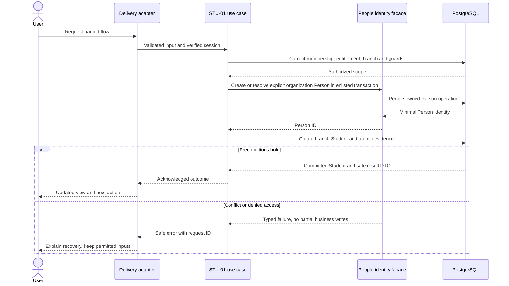
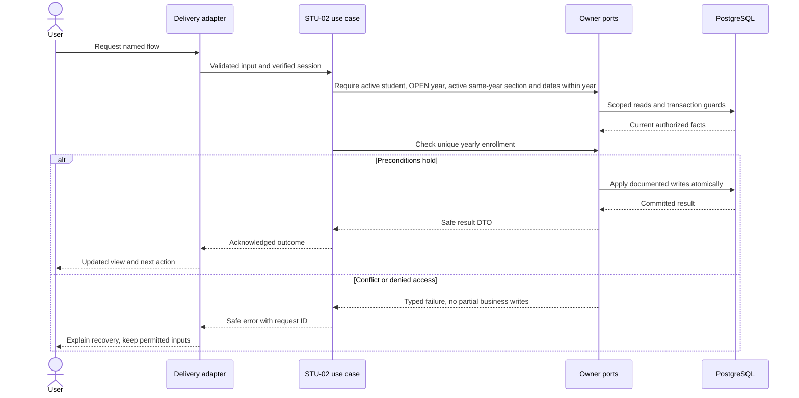
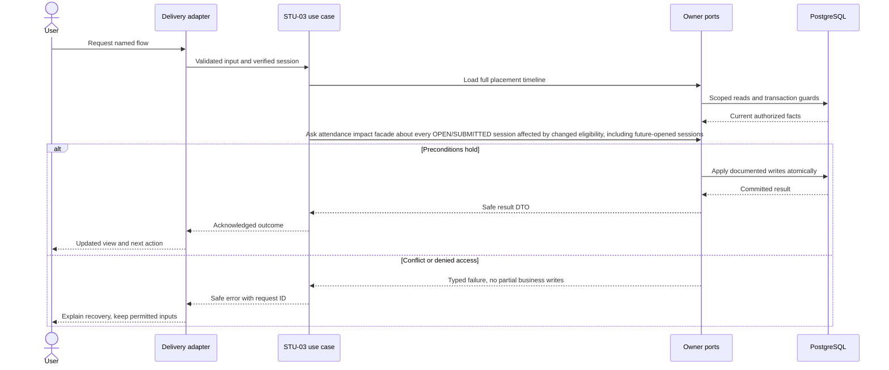

# Students, enrollment and placement history — design

Phase 1 · Design revision 1 · 3 October 2026. Status: STU-01 and STU-02 are locally implemented; STU-03 is in progress; later student workflows remain planned. Review unresolved deployment choices in FND-02 before real-data use.

## Database naming and physical mapping

All physical objects follow [the VS database contract](../../DATABASE_DESIGN.md). Table names and columns below are physical SQL names; workflow prose uses logical domain names. `organizationId` maps to `organization_id`, `schoolId` to `school_id`, and `scope` expands to both columns. Models retain PascalCase through Prisma `@@map`; camelCase fields use `@map`. Planned schemas are implemented only through their named tasks and reviewed migrations.

## Ownership, aggregates and values

Student is a school-local aggregate referencing Person, owning admission number and ACTIVE/ARCHIVED status. Enrollment is one root per student/year; its SectionPlacement entities own nonoverlapping effective intervals. A student may have different yearly enrollments, but never two active placements for the same day within the year. Values: AdmissionNumber(1–40), RollNumber(0–30 string), DateRange, AcademicYearId. Events: StudentRegistered.v1, StudentEnrolled.v1, PlacementChanged.v1, StudentArchived.v1. Admission applications and guardian access are later modules.

## Module decisions

STU-ADR-001: separate Student/Enrollment/Placement; daily applicability uses half-open dates. Alternative overwriting student's section rejected because it changes history.

STU-ADR-002: pilot transfer is today-or-future only and rejects any change affecting an existing OPEN/SUBMITTED roster. A scheduled unopened session may calculate its new roster later. Phase 1 does not offer an admin backdate override. Archive requires no current/future eligible enrollment or session impact; historical records remain.

## Physical data contract

Student is installed by STU-01; Enrollment and SectionPlacement are installed by STU-02. `scope` below means `(organizationId,schoolId)`. All business roots have version >=1. All scoped references require composite FK targets with matching unique keys, even when abbreviated in the table. Creation times use server clock; IDs server generated. Required unless nullable is stated. Enum labels are constrained enums/CHECKs, not unchecked strings. Do not silently implement a weaker constraint because Prisma syntax cannot express it; use reviewed migration SQL.

| Table | Fields and data stored | Meaning | Keys / constraints / query support |
|---|---|---|---|
| `vs_students_student` (Student) | id uuid PK; organization_id uuid; school_id uuid; person_id uuid; admission_number varchar(40); status ACTIVE/ARCHIVED; version int; created_at timestamptz(3) | Institutional student identity; admission number never recycled after archive. | FK(scope)→School; FK(organization_id,person_id)→Person; UNIQUE(scope,id); UNIQUE(scope,admission_number); UNIQUE(scope,person_id); CHECK status/version/admission_number; index(scope,status,id) |
| `vs_students_enrollment` (Enrollment) | id uuid PK; organization_id uuid; school_id uuid; student_id uuid; year_id uuid; valid_from date; valid_to date; version int | One yearly root per Student and AcademicYear; retains the enrolled date range. | UNIQUE(scope,student_id,year_id); UNIQUE(scope,id,year_id); scoped Student/Year FKs; CHECK from<to and version>=1; index(scope,student_id,year_id) via unique key |
| `vs_students_section_placement` (SectionPlacement) | id uuid PK; organization_id uuid; school_id uuid; enrollment_id uuid; year_id uuid; section_id uuid; valid_from date; valid_to date; roll_number varchar(30) nullable | Section membership intervals; no duplicated year/student roots per transfer. Roll is optional display text (including leading zeroes), not a globally unique identity. | Scoped FK(enrollment_id,year_id) and FK(section_id,year_id); CHECK from<to; index(scope,section_id,valid_from,valid_to,enrollment_id) for roster; index(scope,enrollment_id,valid_from) for timeline; interval nonoverlap guarded by School serialization and verified PostgreSQL concurrency tests |

## Read workflows and joins

Student list filters current School scope/status and joins Student → Person on `organization_id,person_id`; after STU-02 it also joins the latest scoped Enrollment summary. Detail joins Student → Person → Enrollment → SectionPlacement → Academics-owned AcademicYear/Section using both scope columns and the year-qualified IDs. Roster reads filter Placement by `organization_id=? AND school_id=? AND section_id=? AND valid_from<=? AND valid_to>?`; student history orders placements by `valid_from` within each AcademicYear. Normal list search matches branch-owned admission numbers and Person first/last names with signed bounded pagination. Existing-Person selection is a separate exact-reference query: immutable Person ID is organization-scoped and admission number is resolved through the current branch Student owner. It requires `student.manage`, returns one minimal identity, and never accepts name/email or infers a match. Student ownership and admission-number uniqueness resolve against `vs_students_student` by `(organization_id,school_id,person_id)` and `(organization_id,school_id,admission_number)`; the same admission string in another branch is not a collision. No organization-wide Person discovery or contact fields are returned.

## Screen contract

/admin/students list and detail; create form name/admission number, optional reviewed existing identity. An active Student detail may enroll once per OPEN AcademicYear from `/api/v1/enrollments/options` and `POST /api/v1/enrollments`; options are limited to the current institution/branch and active sections in OPEN years. The form presents inclusive last day and converts it by one civil day to the stored exclusive `validTo`. Detail shows each year and placement interval; currently applicable placement uses the half-open predicate. Transfer shows from/to/date and impact errors. Unenrolled is distinct from empty school. Teacher profile DTO is name/admission or roll only, never contact or unrelated enrollment history.

All screens additionally follow Bible §8: loading, empty, validation, permission, stale/conflict, temporary failure and acknowledged success; semantic labels, focus and mobile layout. No future-module navigation.

## Application ports and transaction boundary

Each named flow below is an application use case. Inputs/outputs are plain DTOs; adapters implement owned repositories and public cross-module facades. Use SchoolCommand, ActorResolver, Clock, IdGenerator and transactional envelope writers from the shared contract. Do not pass Prisma.TransactionClient into application/domain code. Generic `save(any)` is not a replacement for named commands. Domain factories create new roots/events; rehydration restores without events.

Mutations use the account → Organization → School guard protocol in Bible §7. Every protected read and write reauthorizes current scope and resource permission. Read-only flows do not acquire write locks. Bootstrap/auth-only commands use their documented account/provisioning transaction. Scoped school uniqueness/range checks run after locks. Reauthorize before mutation receipt replay and commit; only a successful transaction stores a receipt. Aggregate version, audit, outbox and response commit together. Exact flow-specific reads and writes below refine this shared behavior.

## STU-01 — Register and inspect students

**Success response contract:** `{studentId,personId,version,admissionNumber,displayName,status:"ACTIVE",enrollment:null,replayed}`. List returns `{items,nextCursor}` and detail returns the same profile with `history:[]` until STU-02. Receipts store only scoped resource ID/version/status; a replay reconstructs the response after current authorization, so names/admission data are not persisted in receipts.

**Transport:** POST /api/v1/students; GET /api/v1/students; GET /api/v1/students/:id; GET /api/v1/people/selection?kind=PERSON_ID|ADMISSION_NUMBER&value= (student.manage, one exact scoped result only)

**Input:** POST accepts `firstName`, optional `lastName`, `admissionNumber`, optional `existingPersonId`, and stable command key. A new organization-local Person is the default; existingPersonId is accepted only after the separate exact authorized choice flow and is rechecked in the write transaction. GET list accepts `search`≤100 chars, optional `status` (`ACTIVE` by default, `ARCHIVED` or `ALL`), `limit` 1–100 and signed cursor. Identity resolution accepts either a UUID Person ID or 1–40-character exact admission number and returns one minimal scoped result. Student-list search remains separate and searches admission number/name without selecting or linking a Person.

**Workflow:**

1. Resolve current identity/membership, institution and active branch; require the `student_core` release, entitlement and activation plus `student.manage` for the school-wide list, detail, writes and Person selection. A teacher's `student.read` grant is assignment-scoped and is consumed only through the Attendance roster port after Attendance verifies the assigned teacher and session; it never authorizes the generic directory or detail endpoints.
2. Mutations lock the actor account, Organization and School in the shared order; reads use a repeatable-read snapshot without write locks. For optional Person reuse, call the separate exact selection query and revalidate the selected organization-local Person inside the write transaction.
3. Resolve admission collisions only against Student in the selected branch. Call the People enlisted identity facade to create a Person when no ID was selected, then create Student.
4. Commit the School revision, Student, audit, minimal outbox event and PII-free idempotency receipt together. Unique constraints settle concurrent admission/person races; a failure rolls back the newly created Person.
5. Read the organization-qualified Person join, return only display identity and show Not enrolled until STU-02 adds Enrollment. When `academic_core` is not currently entitled and activated, omit Academic-owned year/section labels and expose no enrollment history; basic Student identity remains available under `student_core`.

**Database writes / atomicity:** Person via the People identity facade and Student via Students; School configuration revision, `StudentRegistered.v1`, audit and PII-free receipt in one PostgreSQL transaction. Receipt replay reauthorizes, checks the canonical input hash and reconstructs from the current scoped row.

**Errors and recovery:** Duplicate branch admission or already-registered branch Person→409; foreign/nonexistent Person→404; missing current permission→403; missing/stale session→401; inactive module/branch or unavailable release→safe 409/503; malformed name/admission/limit/name-selection→422; malformed/scope-mismatched cursor→422 with refresh guidance; database/evidence failure→503 with the same idempotency key safe to retry.



**Verification:** Unit — Admission identifier preserves zeros; exact existing-Person selection stays separate from normal list search. Real PostgreSQL — scoped FKs/uniqueness, authorized tenant/resource reads, Person rollback on Student/evidence failure, same Person/admission races, branch-isolated admission reuse and PII-free receipt. E2E — Create student, search by admission/name, refresh detail, explicitly reuse an exact Person, reject duplicate admission without orphan Person, and deny foreign profile.

**Design-readiness note (4 October 2026):** Student identity belongs to Students; organization-local Person identity remains People-owned. Create a new Person by default; reuse only an explicitly selected same-organization Person through a separate authorized exact-name selection query, never similarity/email matching. Normal Student list search remains intact. Admission uniqueness/collision checks use the actual branch-scoped Student table. People+Student writes and evidence share one guarded transaction; reads reauthorize but do not acquire write locks; duplicate races are settled by constraints and return 409. Path A records the BRANCH classification, `(organization_id,school_id)` scope, policy/index intent and TEN-03 closure gate; application authorization remains active while database enforcement is deferred. The initial Bible pilot remains the only pilot benchmark; the larger scale profile belongs to TEN-03.

## STU-02 — Enroll students into a dated section

**Success response contract:** `{enrollmentId,version,studentId,yearId,yearCode,yearName,validFrom,validTo,placement:{placementId,sectionId,sectionCode,sectionName,gradeName,validFrom,validTo,rollNumber,activeRosterCount},replayed}`. Protected detail returns the full year/placement history with current active roster count for each section. List summaries expose only the latest enrollment identifiers and display labels while `academic_core` is active.

**Transport:** GET /api/v1/enrollments/options; POST /api/v1/enrollments

**Input:** Options requires current `student.manage`; POST accepts `studentId`, `yearId`, `sectionId`, inclusive `startsOn` and `lastDay` as `YYYY-MM-DD`, optional `rollNumber` (0–30 characters preserved as text), and stable command key. Server converts `lastDay` to exclusive `validTo`; no timezone conversion is applied to civil dates.

**Workflow:**

1. Require the released `student_core` and `academic_core` modules, active institution entitlements, active branch activations and current `student.manage` on options and mutations. Resolve the current account/token/membership on every request. Detail/list may show Academic-owned enrollment/year/section data only while `academic_core` is currently active; when it is not, retain Student detail and hide that data.
2. For mutation, lock account → Organization → School in shared order, then re-read scoped Student, AcademicYear and Section inside the same transaction. Student must be ACTIVE, year must be OPEN, section ACTIVE and belong to that year and scope.
3. Validate `startsOn < validTo`, `startsOn >= year.startsOn` and `validTo <= year.endsOn`; stored ranges are half-open. A second root for the same scoped Student/year returns conflict; no implicit transfer is attempted. Validate optional roll as bounded opaque text.
4. Create one Enrollment and its first SectionPlacement, increment the School revision, and append audit/outbox/PII-safe receipt atomically. Stable identical command replay reauthorizes and reconstructs the scoped committed resource; key reuse with changed input conflicts.
5. Return joined student/year/section labels and interval, refresh detail/list, and show no enrollment before the transaction commits. The School guard serializes competing first enrollments and Academics year/section mutations; PostgreSQL scoped unique/FK/check constraints remain the final integrity boundary.

**Database writes / atomicity:** Students owns Enrollment and SectionPlacement; Academics-owned AcademicYear/Section are read-only references. Enrollment/first placement, School configuration revision, StudentEnrolled event, audit, minimal outbox and PII-safe receipt share one PostgreSQL transaction.

**Errors and recovery:** Foreign Student/year/section→404; archived Student→409; already enrolled for year/key replay mismatch→409; closed or draft year/inactive section→409; Section from another year→422; malformed/reversed/out-of-year dates or roll→422; current permission/session→403/401; either module unavailable/unlicensed/disabled→safe 409/503; serialization/stale School revision→409; storage/evidence failure→503 and retry with the same key.



**Verification:** Unit — Strict civil dates, inclusive UI last-day conversion, half-open membership, date bounds, and roll-number zero/leading-zero preservation. Real PostgreSQL — Concurrent duplicate first enrollment yields one root and one conflict; scoped composite FKs, wrong year/branch rejection, evidence rollback, receipt replay and permission/module revocation; inactive `academic_core` hides joined labels while preserving Student access. E2E — Configure synthetic OPEN year and active section, enroll, refresh list/detail history and roster, reject a section from another year and duplicate year enrollment.

**Design-readiness note (4 October 2026):** Enrollment belongs to Students; Section/year remain Academics-owned and are queried as scoped read-only references. Both student and academic capabilities (release, entitlement, branch activation) plus current `student.manage` are required. The public options read is authorized and minimal. The command repeats all authorization and scoped reference/state/date checks inside one School-guarded PostgreSQL transaction; reads themselves do not take write locks. Stored ranges are half-open and the UI converts its inclusive final date using UTC civil arithmetic. One enrollment per scoped student/year is protected by a composite unique key; the second request conflicts rather than moving a student. Migration adds BRANCH-classified Enrollment and Placement with `(organization_id,school_id)` scope, scoped year/section/student FKs, interval/version checks and history/roster indexes; policy intent/owner/TEN-03 closure are registered under Path A. Restricted runtime-role enforcement remains deferred to TEN-03. No product blocker remains.

## STU-03 — Transfer or archive with historical protection

**Success response contract:** Transfer returns updated enrollment version and full current-year timeline; archive returns `{studentId,version,status:"ARCHIVED"}`.

**Transport:** POST /api/v1/enrollments/:id/transfer; POST /api/v1/students/:id/archive

**Input:** Transfer expectedVersion,toSectionId,effectiveDate,rollNumber?,reason; archive expectedVersion,reason; key.

**Ownership and transaction contract:** Students owns the SectionPlacement interval change, Enrollment.version and Student archive state. Academics owns the destination Section/AcademicYear references; validate both in the same branch and the same OPEN year. Transfer and archive require current `student.manage`, `student_core` and `academic_core` release/entitlement/branch activation; no new capability is introduced. Mutations recheck identity, membership and scope under account→Organization→School guards; read-only timeline reads use no write locks. `expectedVersion` is the Enrollment version for transfer and Student version for archive. One idempotency receipt, audit/outbox evidence and business writes commit together.

**Transfer decision:** Only the currently active placement in an OPEN year may be changed. `effectiveDate` is school-local, today or later, strictly after the old placement's `validFrom`, and before its exclusive `validTo`. The old interval becomes `[old.validFrom,D)` and the destination interval is `[D,old.validTo)`; destination Section must be active and belong to the same year. Reject a same-section no-op, an existing future-dated placement/queued transfer, a stale Enrollment version, or invalid/overlapping timeline. If `rollNumber` is omitted, carry its current value to the new placement; a supplied value changes only the new placement. Transfer reason is required (5–500 characters).

Before changing intervals, enlist the Attendance-owned `PlacementImpact` query inside this same transaction. It checks scoped sessions joined through Offering/Section for both old and destination sections with `school_date >= D AND school_date < old.validTo AND status IN ('OPEN','SUBMITTED')`. Any match returns `ROSTER_IN_USE`; a SCHEDULED unopened session is safe because its roster is calculated after the transfer. Future-dated OPEN/SUBMITTED rows are checked defensively if present, while ATT-ADR-001 continues to prohibit opening a future session. Both transfer and ATT-02 opening take the School write guard, so whichever commits first is visible to the other. ATT-01 has no roster-entry table yet; the check uses migrated session status and section, conservatively blocking a frozen session for either affected section.

**Archive decision:** Archive is a status/version transition only; do not delete Person, Student, Enrollment, Placement or attendance history. Require no Enrollment/SectionPlacement interval with `valid_to > schoolLocalToday`, which rejects current or future enrollment/placement. Since no such interval remains, future session roster impact cannot include the student; historical Attendance rows do not block archive. Use Student.expectedVersion, require a 5–500-character reason and the same School transaction/evidence protocol. Past intervals remain available on the Student detail. Repeating a committed request with the same key replays its scoped result after current authorization; different input under that key conflicts.

**Failure contract:** Foreign Student/Enrollment/Section and foreign-branch IDs return 404. Stale Enrollment/Student version, same-section move, queued transfer, interval conflict, open roster, or active/future enrollment on archive return 409 (`ROSTER_IN_USE` or `STUDENT_IN_USE` as appropriate). Backdated, boundary-empty, out-of-year or malformed dates/reasons return 422. Missing permission returns 403; stale session identity returns 401; missing module release/entitlement/activation returns a safe 409/503. Unexpected database/evidence failure rolls back all writes and returns retryable 503 using the same command key.

**Workflow:**

1. Authorize student.manage and acquire guard protocol; validate date not before school-local today. The transfer uses READ COMMITTED so queries after waiting on the School lock see a just-committed attendance session; School-guarded writers serialize the validations and writes.
2. Load full placement timeline; disallow overlapping queued transfers and no-op same-section move.
3. Ask attendance impact facade about every OPEN/SUBMITTED session affected by changed eligibility, including future-opened sessions.
4. If safe, close prior placement at D and create new [D,oldEnd); archive only when no current/future enrollment/impact remains.
5. Commit versions and envelopes; detail preserves the old interval and audit.

**Database writes / atomicity:** SectionPlacement interval/new row and Enrollment.version; Student.status/version only for permitted archive; envelopes.

**Errors and recovery:** Historical/open-roster impact→409 ROSTER_IN_USE; invalid effective date→422; archive enrolled→409 STUDENT_IN_USE.



**Verification:** Unit — Date boundary D belongs only to new placement; no backdate. Functional PostgreSQL — Transfer vs OpenSession serializes; no duplicate overlapping placement; failure preserves old history. E2E — Today-or-future transfer detail; archive impact explanation; archive unused synthetic profile and filter it from the list.

**Design-readiness note (5 October 2026):** All core ownership, scoped predicates, guard ordering, version/idempotency behavior, date boundaries, roster impact query, permission/module checks and safe failure outcomes are defined above. No new table or migration is required; current Student/Enrollment/Placement constraints and the migrated AttendanceSession status/School lock are sufficient. The one permitted cross-owner read is the Attendance PlacementImpact facade enlisted on the Student transaction; neither module writes the other's rows. Automated acceptance does not require STU-02 or ATT-01 human reviews to pass. No unresolved product decision blocks STU-03.

## SA-COMP-04 / SA-20 — Review and correct a student identity

The detail route retains its established branch-scoped Student read and adds the People-owned name version/history projection defined in [People DESIGN](../people/DESIGN.md#sa-comp-04--correct-an-exclusive-student-person-name). A School administrator needs `student.manage`, active `student_core` release/entitlement/branch activation and an exact Student in the current branch. Viewing this record grants no Fees, Health, staff or other module permission.

The mutation is `POST /api/v1/students/:id/name-correction` with `expectedPersonVersion`, `firstName`, `lastName?`, `reason` and a header/body-equal key. Students rechecks the selected Student and requires its Person to have exactly one Student reference in the institution. It then calls the enlisted People name port, which blocks Employee/shared identity, owns the Person CAS and appends immutable history. Student, enrollment and attendance history never change. Receipt/audit/outbox carry IDs, versions and outcome only; corrected and previous names live solely in Person and PersonNameRevision.

The detail form preserves safe attempted values on validation/stale failure. On `STALE_VERSION`, it refetches the same authorized detail and presents attempted versus current display name and version before allowing another deliberate submit. `PERSON_SHARED` explains that an identity steward must handle the shared record without disclosing where else it is used. Success refreshes the page and shows the new revision, reason and time.

Verification covers authorization, cross-scope selection, exclusive-reference race, shared Employee denial, exact replay, changed-key input, version CAS, rollback and persisted history in real PostgreSQL. Playwright covers correction/reload and an independently introduced stale edit on desktop/mobile. The history migration is People-owned, INSTITUTION-scoped Path A metadata with TEN-03 closure.

## Migration, retention and handoff

Implement tables only in the task that first uses them; migrate from empty database and the previous task checkpoint. Add scoped unique indexes before composite FKs; detect existing duplicates before adding constraints. SQL append-only/null-campus/range safeguards must appear in reviewed migrations and real-DB tests. No seed may erase prior data. Use synthetic fixtures and clean only owned test records. Preserve schema-compatible app rollback; use a reviewed forward migration when incompatible. Retention changes must preserve required immutable evidence and legal holds under the school-approved policy, not an ad hoc DELETE.

Same-name nonmerge; school admission uniqueness; one root per student/year under race; cross-year section FK; adjacent placement boundaries; transfer racing roster opening; no historical attendance mutation; archive in-use refusal.

See [tasks](TASKS.md), [current state](CURRENT_STATE.md), [Bible](../../VSchool_Bible.md) and [agent runbook](../../AGENT_RUNBOOK.md).

## v4.1 integration requirements

School means operational Branch and Organization means client Institution. Every protected flow checks current release availability, institution entitlement, branch activation and user/resource permission; foundational commands remain available only through their required capability projection. Apply the revised account → Organization shared guard → School guard protocol from Tenancy DESIGN. Use the shared components/tokens and current branch context; never invent a second visual system. No operational access is implied by institution administrator role.

## Capability boundary: Fees-only installation

Student registration/person identity and basic detail are student_core capabilities; they do not require academic_core to be active. Year/section enrollment and transfer panels appear only with academic_core and appropriate grants. Fees references Student and billing-party contracts without a Year/Placement dependency. Phase 1 build order may configure academics first, but runtime dependency must not be encoded as Student→Attendance or Fees→Academics.

## Portable backend integration

Follow [the backend extraction contract](../../BACKEND_EXTRACTION.md). Server module code belongs in backend/modules; UI consumes shared/contracts and a module gateway. Next delivery adapters resolve transport/session and invoke portable use cases. Future Nest controllers and provider factories reuse those use cases. Framework-specific context/ORM results never enter domain or browser DTOs.

## SA-18 completion-review delta

The approved existing-Person step uses exact person ID or admission reference; the live selector queries exact display name. Completion replaces that ambiguous contract with `resolveExistingPerson(actor,{kind:'PERSON_ID',personId}|{kind:'ADMISSION_NUMBER',admissionNumber})`. Person-ID resolution is restricted to the current organization and returns only the minimal choice. Admission resolution drives from `vs_students_student` using `(organization_id,school_id,admission_number)` and joins Person on `(organization_id,person_id)`; it cannot be an organization-wide Person-name query. Both require current `student.manage`, student_core availability and verified transaction context. Failures are `VALIDATION | FORBIDDEN | NOT_FOUND | CONFLICT | UNAVAILABLE`; a found Student cannot be registered again as a new school Student. No write or receipt occurs during resolution. UI must label the two exact identifier modes and keep ordinary student-list search separate. PostgreSQL/browser evidence must cover foreign organization/branch, guessed IDs, duplicate admission in another branch, no match and explicit selection.

### SA-18 corrective implementation contract

**Authority and classification.** The Edition 03 SA-18 workflow, its `student.manage` capability and its exact person-ID/admission rule are `EXISTING_ACCEPTED_CONTRACT`. Reusing the current STU-01 route, guard, Person/Student transaction and error vocabulary is a `ROUTINE_ENGINEERING_CHOICE`. This slice adds no new identity authority, fuzzy discovery or cross-branch search. The approved admission-date field has no accepted Student storage/lifecycle contract and remains separately unresolved; it is not silently mapped to `created_at`.

**Interfaces and reads.** `ExistingPersonReference` is `{kind:'PERSON_ID';personId:string}|{kind:'ADMISSION_NUMBER';admissionNumber:string}`. `StudentRepository.resolveExistingPerson(actor,organizationId,schoolId,reference): Promise<ExistingPersonChoice>` returns `{personId,displayName,source,eligibleForRegistration,existingStudentId}`. `PERSON_ID` reads `vs_people_person` by `(organization_id,id)` and checks for an existing `vs_students_student` in the current branch. `ADMISSION_NUMBER` reads Student by `(organization_id,school_id,admission_number)` and joins its organization-qualified Person. The existing unique keys support both reads; no index or migration changes. A foreign or missing reference is the same `NOT_FOUND` response and reveals no other scope.

**Write and recovery.** Resolution is read-only under a repeatable-read transaction and performs the normal current account/membership/capability/module checks without write locks. Registration remains `POST /api/v1/students`; it re-reads an explicitly selected Person inside the existing serializable account → Organization → School transaction, then rechecks branch Person/admission uniqueness before Person/Student/evidence commit. An admission result always identifies an already registered branch Student, so the UI offers the authorized existing detail and never attempts a duplicate link. Person-ID results are selectable only when no current-branch Student owns the Person. Constraint races still return conflict without partial Person rows.

```mermaid
sequenceDiagram
  actor A as School administrator
  participant H as Student HTTP adapter
  participant U as Students use case
  participant D as PostgreSQL
  A->>H: GET selection?kind=PERSON_ID|ADMISSION_NUMBER&value=exact
  H->>U: Verified session plus untrusted exact reference
  U->>D: Reauthorize branch and student.manage
  alt Person ID
    U->>D: Person by organization + id; current-branch Student check
  else Admission number
    U->>D: Student by organization + school + admission; join Person
  end
  D-->>U: Minimal scoped identity or no match
  U-->>A: Selectable Person or existing Student recovery
  opt Explicit selectable Person submitted
    A->>H: POST student with Person ID and stable key
    H->>U: Validated registration command
    U->>D: Lock guards; re-read Person; enforce uniqueness; commit evidence
    D-->>A: New Student or safe conflict with no partial write
  end
```

**Delivery and verification.** The registration dialog separates identity reference type from its value, preserves entered Student fields on lookup failure, never accepts names/emails, and provides an “Open existing student” recovery for admission/current-branch Person matches. Unit tests cover strict reference parsing and leading zeros. Real PostgreSQL tests cover authorized Person ID, branch admission, already-linked Person, foreign organization, missing admission and revoked/cross-scope actor. Playwright covers selectable Person-ID registration plus exact-admission recovery at desktop and mobile widths. Human and native assistive-technology review remain separate gates.
