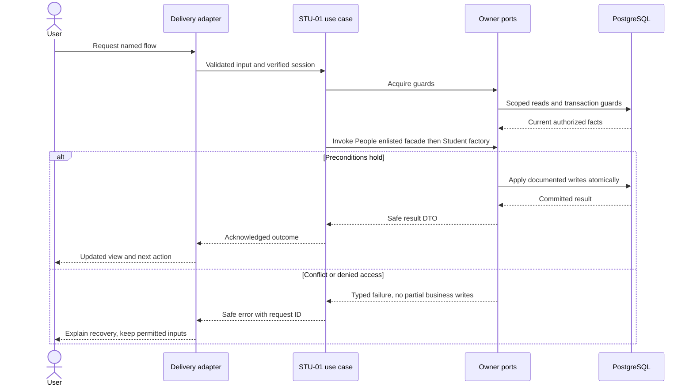
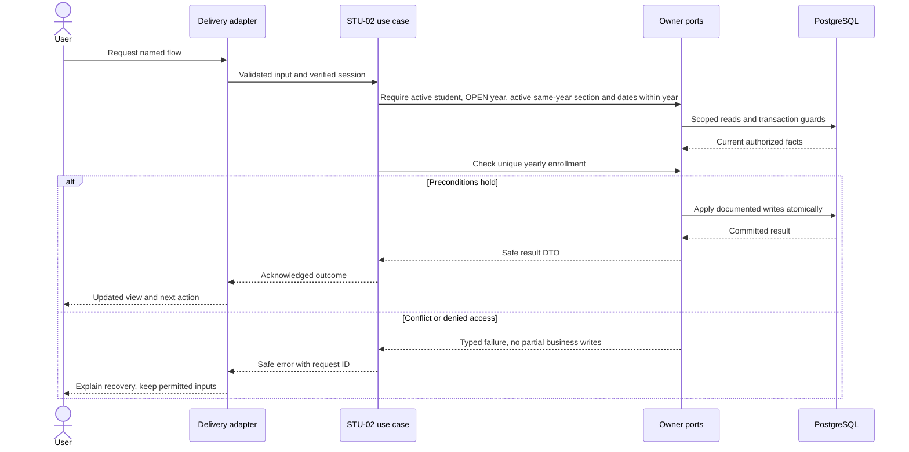
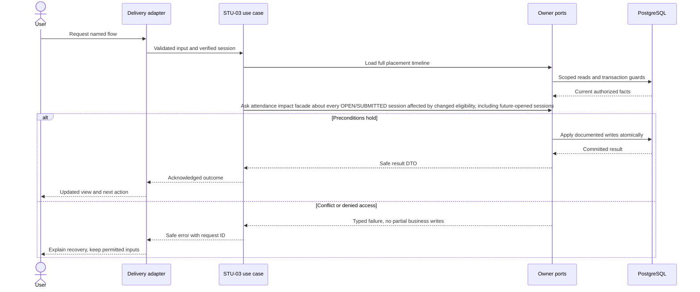

# Students, enrollment and placement history — design

Phase 1 · Design revision 1 · 3 October 2026. Status: specified for implementation; only the platform readiness path is implemented in this starter. Review unresolved deployment choices in FND-02 before real-data use.

## Database naming and physical mapping

All physical objects follow [the VS database contract](../../DATABASE_DESIGN.md). Table names and columns below are physical SQL names; workflow prose uses logical domain names. `organizationId` maps to `organization_id`, `schoolId` to `school_id`, and `scope` expands to both columns. Models retain PascalCase through Prisma `@@map`; camelCase fields use `@map`. Planned schemas are implemented only through their named tasks and reviewed migrations.

## Ownership, aggregates and values

Student is a school-local aggregate referencing Person, owning admission number and ACTIVE/ARCHIVED status. Enrollment is one root per student/year; its SectionPlacement entities own nonoverlapping effective intervals. A student may have different yearly enrollments, but never two active placements for the same day within the year. Values: AdmissionNumber(1–40), RollNumber(0–30 string), DateRange, AcademicYearId. Events: StudentRegistered.v1, StudentEnrolled.v1, PlacementChanged.v1, StudentArchived.v1. Admission applications and guardian access are later modules.

## Module decisions

STU-ADR-001: separate Student/Enrollment/Placement; daily applicability uses half-open dates. Alternative overwriting student's section rejected because it changes history.

STU-ADR-002: pilot transfer is today-or-future only and rejects any change affecting an existing OPEN/SUBMITTED roster. A scheduled unopened session may calculate its new roster later. Phase 1 does not offer an admin backdate override. Archive requires no current/future eligible enrollment or session impact; historical records remain.

## Physical data contract

All tables are planned except SetupCheck. `scope` below means `(organizationId,schoolId)`. All business roots have version >=1. All scoped references require composite FK targets with matching unique keys, even when abbreviated in the table. Creation times use server clock; IDs server generated. Required unless nullable is stated. Enum labels are constrained enums/CHECKs, not unchecked strings. Do not silently implement a weaker constraint because Prisma syntax cannot express it; use reviewed migration SQL.

| Table | Fields and data stored | Meaning | Keys / constraints / query support |
|---|---|---|---|
| `vs_students_student` (Student) | id uuid PK; organization_id uuid; school_id uuid; person_id uuid; admission_number varchar(40); status ACTIVE/ARCHIVED; version int; created_at timestamptz(3) | Institutional student identity; admission number never recycled after archive. | UNIQUE(scope,id); UNIQUE(scope,admission_number); UNIQUE(scope,person_id); scoped school and organization Person FKs |
| `vs_students_enrollment` (Enrollment) | id uuid PK; organization_id uuid; school_id uuid; student_id uuid; year_id uuid; valid_from date; valid_to date; version int | Yearly enrollment root; retained historical ranges. | UNIQUE(scope,student_id,year_id); UNIQUE(scope,id,year_id); scoped Student/Year FKs; CHECK from<to |
| `vs_students_section_placement` (SectionPlacement) | id uuid PK; organization_id uuid; school_id uuid; enrollment_id uuid; year_id uuid; section_id uuid; valid_from date; valid_to date; roll_number varchar(30) nullable | Section membership intervals; no duplicated year/student rows per transfer. Roll is display identifier, not a globally unique identity. | Scoped FK(enrollment_id,year_id) and FK(section_id,year_id); CHECK from<to; index(scope,section_id,valid_from,valid_to,enrollment_id); nonoverlap under School guard, verified concurrency tests |

## Read workflows and joins

Student list filters School scope/status/year and joins Student → Person (organization-qualified), optional Enrollment by year and Placement at selected date → Section/Grade. Left joins retain unenrolled students; multiple historical placements must not duplicate a current list row. Detail shows immutable identity ID and ordered placement history. Roster query: Offering.sectionId + session.schoolDate → Placement where from<=D AND D<to → Enrollment same year and dates → Student ACTIVE at scheduling/opening eligibility → Person display fields. Once session opens, Attendance uses frozen roster, not this live join. Search matches school profile names/admission numbers with bounded pagination; no organization-wide Person search.

## Screen contract

/admin/students list and detail; create form name/admission number, optional reviewed existing identity. Enroll form selects year/section/date with inclusive last-day display converted to exclusive end. Detail shows history, current placement and future scheduled transfer. Transfer shows from/to/date and impact errors. Unenrolled is distinct from empty school. Teacher profile DTO is name/admission or roll only, never contact or unrelated enrollment history.

All screens additionally follow Bible §8: loading, empty, validation, permission, stale/conflict, temporary failure and acknowledged success; semantic labels, focus and mobile layout. No future-module navigation.

## Application ports and transaction boundary

Each named flow below is an application use case. Inputs/outputs are plain DTOs; adapters implement owned repositories and public cross-module facades. Use SchoolCommand, ActorResolver, Clock, IdGenerator and transactional envelope writers from the shared contract. Do not pass Prisma.TransactionClient into application/domain code. Generic `save(any)` is not a replacement for named commands. Domain factories create new roots/events; rehydration restores without events.

Mutations use the account → Organization → School guard protocol in Bible §7. Read-only flows do not take write locks. Bootstrap/auth-only commands use their documented account/provisioning transaction. Scoped school uniqueness/range checks run after locks. Reauthorize before replay and commit; only a successful transaction stores a receipt. Aggregate version, audit, outbox and response commit together. Exact flow-specific reads and writes below refine this shared behavior.

## STU-01 — Register and inspect students

**Success response contract:** `{studentId,version,admissionNumber,displayName,status,enrollment:null}` initially; profile contains only authorized yearly placement history.

**Transport:** POST /api/v1/students; GET /api/v1/students; GET /api/v1/students/:id

**Input:** firstName,lastName?,admissionNumber; new Person by default; existingPersonId only explicit verified mapping; command key. Search q<=100, limit<=100.

**Workflow:**

1. Require student.manage for create, student.read with resource policy for list/detail.
2. Acquire guards; validate admission number and deliberate Person identity.
3. Invoke People enlisted facade then Student factory; no guardian/account invented.
4. Persist Person+Student+envelopes in one transaction.
5. Read joined detail and show Not enrolled until enrollment exists.

**Database writes / atomicity:** Person via People owner and Student; audit/outbox/receipt.

**Errors and recovery:** Duplicate admission→409; foreign Person→404; malformed name→422.

**Verification:** Unit — Admission identifier preserves zeros; names not identifiers. Functional PostgreSQL — Rollback Person on Student failure; concurrent admission number uniqueness. E2E — Create student, search, refresh detail and denied foreign profile.

**Design-readiness note (4 October 2026):** Student identity belongs to Students; organization-local Person identity remains People-owned. Create a new Person by default; reuse only an explicitly selected same-organization Person after authorized lookup, never similarity/email matching. The physical Student contract requires unique `(organization_id,school_id,admission_number)` and `(organization_id,school_id,person_id)`, scoped school/person FKs, and bounded scope/status/admission search; joined reads retain unenrolled profiles without exposing contact data. People+Student writes and evidence share one guarded transaction; duplicate races are settled by constraints and return 409. Future Student table migration includes its TEN-ADR-006 RLS class/policy/grants/index/restricted-role tests; RLS runtime enforcement remains a TEN-03 gate.

## STU-02 — Enroll students into a dated section

**Success response contract:** `{enrollmentId,version,studentId,yearId,placements:[{placementId,sectionId,validFrom,validTo,rollNumber}]}`.

**Transport:** POST /api/v1/enrollments

**Input:** studentId,yearId,sectionId,validFrom,validTo,rollNumber?; key; all dates YYYY-MM-DD.

**Workflow:**

1. Authorize student.manage; lock actor/School then scoped references.
2. Require active student, OPEN year, active same-year section and dates within year.
3. Check unique yearly enrollment; reject overlap or a second root instead of silently moving.
4. Create Enrollment and first Placement with envelope in one transaction.
5. Return joined student/year/section DTO and refresh roster count.

**Database writes / atomicity:** Enrollment, SectionPlacement; audit/outbox/receipt.

**Errors and recovery:** Already enrolled→409 ENROLLMENT_EXISTS; cross-year/dates→422; closed year→409.

**Verification:** Unit — Bounds and half-open membership; roll remains text. Functional PostgreSQL — Two enrollments racing yield one root; scoped FKs and complete rollback. E2E — Enroll, refresh class roster, reject wrong-year section.

**Design-readiness note (4 October 2026):** Enrollment belongs to Students; Section/year remain Academics-owned. One enrollment per scoped student/year, half-open date ranges, and nonoverlapping placements are enforced under the School guard plus scoped composite FKs/unique keys; `(scope,section_id,valid_from,valid_to,enrollment_id)` supports current roster reads. Creating enrollment and first placement is atomic, duplicate requests replay by receipt, and a second yearly root conflicts rather than silently transferring. Transfer/roster impact is reserved for STU-03/ATT-01. New tenant tables follow TEN-ADR-006 migration RLS requirements; database RLS enforcement awaits TEN-03.

## STU-03 — Transfer or archive with historical protection

**Success response contract:** Transfer returns updated enrollment version and full current-year timeline; archive returns `{studentId,version,status:"ARCHIVED"}`.

**Transport:** POST /api/v1/enrollments/:id/transfer; POST /api/v1/students/:id/archive

**Input:** Transfer expectedVersion,toSectionId,effectiveDate,rollNumber?,reason; archive expectedVersion,reason; key.

**Workflow:**

1. Authorize student.manage and acquire guard protocol; validate date not before school-local today.
2. Load full placement timeline; disallow overlapping queued transfers and no-op same-section move.
3. Ask attendance impact facade about every OPEN/SUBMITTED session affected by changed eligibility, including future-opened sessions.
4. If safe, close prior placement at D and create new [D,oldEnd); archive only when no current/future enrollment/impact remains.
5. Commit versions and envelopes; detail preserves the old interval and audit.

**Database writes / atomicity:** SectionPlacement interval/new row and Enrollment.version; Student.status/version only for permitted archive; envelopes.

**Errors and recovery:** Historical/open-roster impact→409 ROSTER_IN_USE; invalid effective date→422; archive enrolled→409 STUDENT_IN_USE.

**Verification:** Unit — Date boundary D belongs only to new placement; no backdate. Functional PostgreSQL — Transfer vs OpenSession serializes; no duplicate overlapping placement; failure preserves old history. E2E — Future transfer detail; impact explanation on unsafe move; archive inactive eligible synthetic profile.

## Migration, retention and handoff

Implement tables only in the task that first uses them; migrate from empty database and the previous task checkpoint. Add scoped unique indexes before composite FKs; detect existing duplicates before adding constraints. SQL append-only/null-campus/range safeguards must appear in reviewed migrations and real-DB tests. No seed may erase prior data. Use synthetic fixtures and clean only owned test records. Preserve schema-compatible app rollback; use a reviewed forward migration when incompatible. Retention changes must preserve required immutable evidence and legal holds under the school-approved policy, not an ad hoc DELETE.

Same-name nonmerge; school admission uniqueness; one root per student/year under race; cross-year section FK; adjacent placement boundaries; transfer racing roster opening; no historical attendance mutation; archive in-use refusal.

See [tasks](TASKS.md), [current state](CURRENT_STATE.md), [Bible](../../VSchool_Bible.md) and [agent runbook](../../AGENT_RUNBOOK.md).

## v4.1 integration requirements

School means operational Branch and Organization means client Institution. Every protected flow checks current release availability, institution entitlement, branch activation and user/resource permission; foundational commands remain available only through their required capability projection. Apply the revised account → Organization shared guard → School guard protocol from Tenancy DESIGN. Use the shared components/tokens and current branch context; never invent a second visual system. No operational access is implied by institution administrator role.

## Capability boundary: Fees-only installation

Student registration/person identity and basic detail are student_core capabilities; they do not require academic_core to be active. Year/section enrollment and transfer panels appear only with academic_core and appropriate grants. Fees references Student and billing-party contracts without a Year/Placement dependency. Phase 1 build order may configure academics first, but runtime dependency must not be encoded as Student→Attendance or Fees→Academics.

## Portable backend integration

Follow [the backend extraction contract](../../BACKEND_EXTRACTION.md). Server module code belongs in backend/modules; UI consumes shared/contracts and a module gateway. Next delivery adapters resolve transport/session and invoke portable use cases. Future Nest controllers and provider factories reuse those use cases. Framework-specific context/ORM results never enter domain or browser DTOs.
