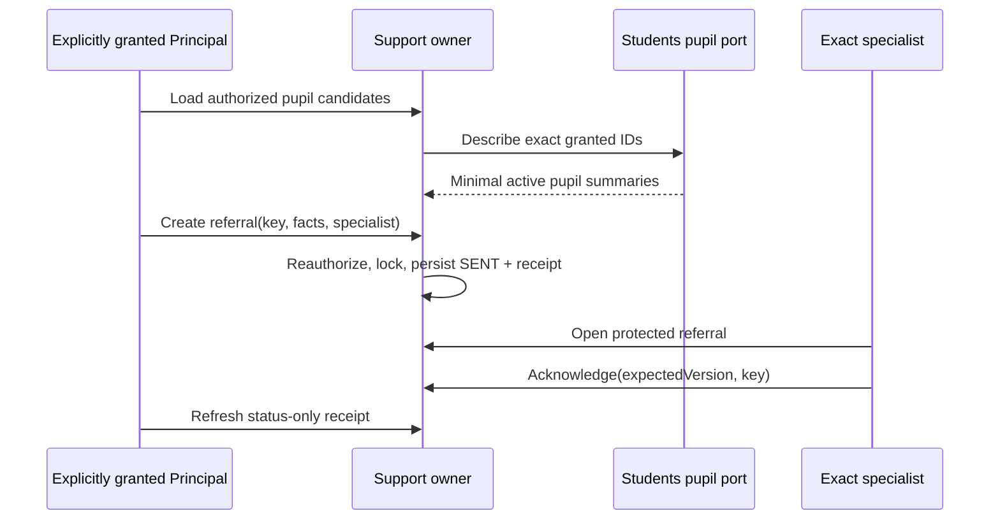

# Restricted support owner design

Status: **F14 DESIGN READY / D16 APPROVED FOR SYNTHETIC IMPLEMENTATION / PRODUCTION POLICY PENDING**.

This LLD implements only LEA-37 and LEA-38 under the recorded D16 synthetic-only approval. The existing `health` product release, institution entitlement and branch activation gate the owner because the live module catalogue already reserves that restricted Student-support capability. A broad Principal, Teacher or Administrator role grants nothing here. Trusted operator-issued purpose grants remain mandatory on every read, write and replay.

## Invariants and ownership

- Support owns referral narrative, safe referral status, reviewed procedure versions and minimal urgent handoff evidence. General Coordination, dashboards, audit and analytics never receive protected narrative.
- Students owns pupil identity. Support receives only an exact active pupil summary through `SupportPupilContextPort`; Support never queries or writes Student tables.
- `REFERRAL_CREATE` is granted for one exact Student. `SPECIALIST`, `POLICY_STEWARD` and `HANDOFF_RECORD` are branch grants. Every grant is tied to a live membership and rechecked with account token, institution, branch, module release, entitlement and activation.
- A referral is created directly as `SENT`; no durable draft is introduced. The sender can later see identity, route, status and timestamps only. Only the exact currently authorized specialist sees the factual concern and may acknowledge, return or close it.
- Receipt means recorded handoff. `ACKNOWLEDGED` means the designated specialist acknowledged receipt. Neither state claims diagnosis, intervention, treatment or emergency assistance.
- A procedure is an immutable published version except for retirement. Publishing retires the previous branch version in the same transaction. It contains only school-authored instructions, a contact label and one currently authorized responsible account.
- An urgent handoff can be recorded only against the currently published procedure by an explicit recorder. Only the procedure's exact responsible account may acknowledge it. No break-glass access, autonomous notification or emergency-response status exists.

## Physical schema

All five tables are BRANCH classified under TEN-ADR-006 Path A; TEN-03 remains their production enforcement gate.

| Physical table (logical model) | Physical fields | Responsibility | Constraints and indexes |
|---|---|---|---|
| `vs_support_capability_grant` (SupportCapabilityGrant) | id/org/school/membership/account/operator/student uuid; capability; grant/revoke/version | Explicit resource or branch Support purpose grant. | Scoped membership/Student FKs; conditional capability/resource check; partial unique grants; active lookup index. |
| `vs_support_handoff` (SupportHandoff) | id/org/school/procedure/recorder/responsible uuid; procedure version/safe reference/status/version/time | Minimal recorded urgent-procedure handoff evidence. | Scoped Procedure FK; status/version checks; recorder and responsible inbox indexes. |
| `vs_support_procedure` (SupportProcedure) | id/org/school/responsible/publisher uuid; version/title/instruction/contact/status/time | Versioned published school urgent-contact procedure. | Scoped School FK; unique version and current published row; status/version checks; current index. |
| `vs_support_referral` (SupportReferral) | id/org/school/student/referrer/specialist uuid; snapshots; protected concern; status/version/time | Restricted specialist referral and safe handoff status. | Scoped Student FK; closed state/version checks; referrer and specialist inbox indexes. |
| `vs_support_referral_event` (SupportReferralEvent) | id/org/school/referral/actor uuid; sequence/type/safe details/time | Append-only privacy-minimized referral lifecycle evidence. | Scoped Referral FK; unique sequence; append-only trigger; history index. |

Scoped foreign keys bind every row to Organization/School and bind grants to their exact membership. Student and account references are scope-inclusive where the owner supplies such keys. Reads use `(organization_id, school_id, ...)` predicates before resource identifiers.

## Ports and transactions

`SupportPupilContextPort.list(transaction, actor, scope, authorizedStudentIds)` is implemented by Students infrastructure and returns only active Student ID, display name and admission number. It performs no Support authorization.

`SupportFacade` exposes operator grant/configuration helpers plus transport-neutral `candidates`, `createReferral`, `listReferrals`, `getReferral`, `transitionReferral`, `currentProcedure`, `publishProcedure`, `recordHandoff`, `listHandoffs`, `acknowledgeHandoff` and `status` operations. The Next host reads environment configuration in `lib/server`; route handlers only parse transport and map errors.

Mutations lock Account → Organization SHARE → School UPDATE, then the exact owner row where applicable. Each final command reauthorizes after locks, checks expected version, hashes the exact semantic input and stores one generic owner-safe command receipt atomically with the owner write and privacy-minimized platform audit. Same actor/key/input returns the original semantic result; changed input conflicts. Status recovery checks current resource authorization before disclosing a protected receipt. `UNKNOWN` remains unknown.

## API and UI

- Principal: `/leadership/support`, `/leadership/support/referrals/new`, `/leadership/support/referrals/:id`, `/leadership/support/urgent`.
- Specialist counterpart: `/teacher/support` and `/teacher/support/referrals/:id` for a separately granted synthetic staff specialist.
- Policy steward configuration: `/admin/support`.
- JSON delivery: `/api/v1/support/*`; strict input parsing remains in domain/application code.

The referral composer uses staged Details → Review → Result composition and retains in-flow values only. Final submission is the first write. Unknown outcomes keep the original key and offer status recovery. The urgent page shows an honest unavailable/contact-gap state when no procedure is published. Recording a handoff uses the published procedure version and renders `Recorded for restricted follow-up`, never `help sent`, `resolved` or equivalent.

## Failure and verification contract

Failures distinguish validation, unauthenticated, forbidden, not found, unavailable module/configuration, stale version, idempotency conflict and unknown outcome. Revoked purpose denies detail and receipt recovery. Wrong-route specialists receive `NOT_FOUND`. Cross-branch identifiers never reveal existence.

Unit checks cover bounds and closed states. Real PostgreSQL proves exact grant scope, typed pupil context, protected narrative separation, lifecycle/CAS/replay, wrong specialist denial, procedure publication/retirement, missing-procedure state, handoff acknowledgement, revocation and cross-branch denial. Browser checks cover Principal referral → specialist acknowledgement → status refresh, missing/published urgent procedure → record → acknowledgement, unknown recovery, desktop/mobile, focus and direct reference comparison. Synthetic data only; human review, retention, native accessibility, font portability, TEN-03 and production configuration remain pending.

